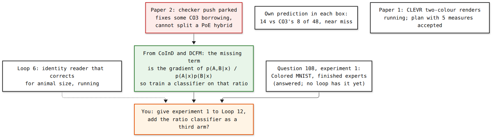
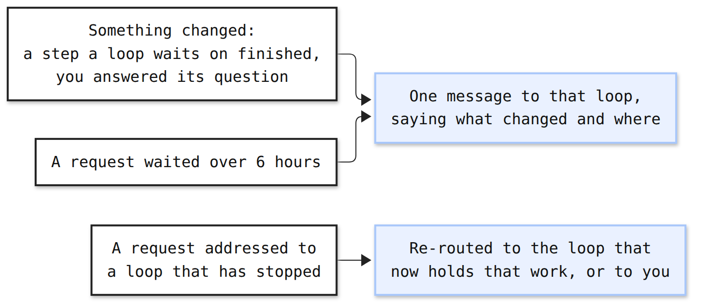

# 🧭 Briefing: where the PhD work stands

The one page to read. Loop 13 rewrites it every 6 hours, and at once when you say "updates", "brief me"
or "where are we". The full detail is on [the status page](status.md).

**Written:** 2026-11-25 08:55 (UTC+2).

## Contents

- [Where we are](#where-we-are)
- [For you to decide](#for-you-to-decide)
- [What the manager does for you](#what-the-manager-does-for-you)

## Where we are

1. **Paper 2's checker push is parked by its own bar.** On known failures it made no plain-PoE picture
   two clear (0 of 12, random push 0) and 2 joint-prompt pictures (random 0, a lead of 4 needed). On
   CO3 it fixed borrowed parts on two cases (8 of 12) but spoiled 4 of 8 draws CO3 already got right,
   and across all 96 tuning pictures it did worse than CO3 alone (7 against 11). It can correct parts
   on two bodies already drawn; it cannot split one body into two ([the review](../leakage/08-first-correction-test/review.md)).
2. **CoInD and DCFM say what the classifier should learn.** Both train the interaction term to zero
   (CoInD's penalty is exactly the size of it). By Bayes' rule that term is the gradient of
   p(A, B | x) / (p(A | x) p(B | x)): how much more likely the two concepts are together than apart.
   A classifier trained on that ratio gives a push that is zero where the concepts do not interact and
   works on any model with classifier-free guidance. It is an idea, untested.
3. **The size-corrected identity reader is running** (Loop 6, your answer to 106), on 96 fresh CO3
   pictures with the extra-animal rule. Its result lands in a few hours.
4. **Paper 1 has its evaluation plan and its closest rival read.** You accepted five measures where
   pasting can fail (105) and added NIH Chest X-ray 14 and DCFM's score (107). DCFM's code is not
   public. You chose its first experiment (108: Colored MNIST, finished experts, with and without a
   push), but no running loop has it yet. Loop 6's two-colour CLEVR renders are at about 3 hours.
5. **Loop 12 is idle**, with no step after Z8, and Loop 14 has finished. mscluster48 joined the
   dead-GPU list.

## For you to decide

Answer with `python3 scripts/progress_board.py answer <number> "<your answer>"`, or in this session.

| # | The question | Default |
|---|---|---|
| none yet | Give question 108's experiment 1 to Loop 12, and add a third arm: a classifier trained on the together-against-apart ratio | Loop 13 asks the reviewer first, then sends it |
| 96 | Should Paper 2's checkers be judged on ranking good pictures above bad ones instead of their yes-or-no call at zero? | keep the yes-or-no gate, report ranking beside it |
| 104 | Which model Paper 2 runs on | **held by you** until Paper 2 works on SDXL |

## What the manager does for you

### Deciding questions

When a loop asks something whose every option is reversible, inside its budget and changes no recorded
bar or verdict, the manager runs the reviewer and decides, marked "Decided by Loop 13 for the owner".
Deletions, secrets, disagreeing records, runs over 3 GPU-hours and stopping a loop stay with you.

### Resources and finish times

Every hour the manager reads the queue, the finished jobs and the node states, compares our jobs with
the caps, flags waits over 2 hours, and tells a loop when the other partition has an idle card.

### Checking designs before they run

A new or changed design is read before its first run, for its data, its controls, whether its input
holds what it asks for, and its cost. A design likely to waste more than 3 GPU-hours reaches you.

### Things that may be wrong

Failed and slow jobs and steps with nothing running go on the status page. Two records that disagree go
to you. Two misses in a row from one loop earn it a method review request: it pauses and writes why.

### The reviewer

Once a day, and before any method review, the reviewer reads each loop against the 84 papers the
project has read and gives one verdict: continue, fix or stop. A stop reaches you as a board question.

### Nudges and re-routing

A loop gets one message when something it waits on changes or a request to it has waited 6 hours. A
request addressed to a stopped loop goes to the loop that now holds that work, or to you.

### Closing sessions

An idle session whose loop is finished or closed, or a second copy of a loop, is closed after its open
requests move on. A busy session never is, and a loop with steps left only with your yes.

### Briefing

This page, every 6 hours or when you ask.
