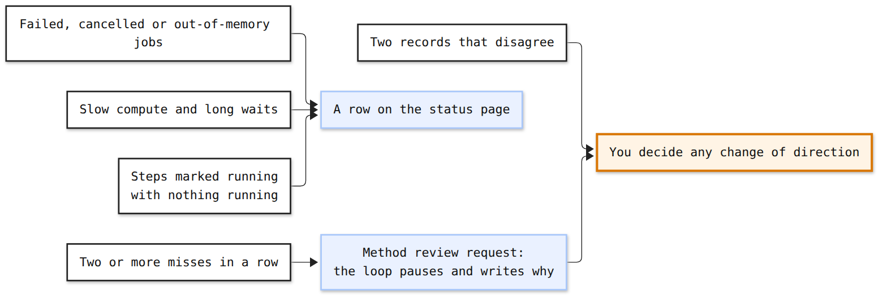

# 🧭 Briefing: where the PhD work stands

The one page to read. Loop 13 rewrites it every 6 hours, and at once when you say "updates", "brief me"
or "where are we". The full detail is on [the status page](status.md).

**Written:** 2026-11-25 23:00 (UTC+2).

## Contents

- [Where we are](#where-we-are)
- [For you to decide](#for-you-to-decide)
- [What the manager does for you](#what-the-manager-does-for-you)

## Where we are

1. **Paper 1's two-colour block test shows the problem plainly.** One model trained only on red CLEVR
   blocks and one only on blue, combined by adding their predictions, drew the right scene in 0 of 288
   pictures checked by eye (two blind reviewers, 864 of 864 agreed), at every count from 1 red + 1 blue
   to 3 + 3: they draw dark blends that are neither colour. A better sampler (Du et al.'s corrector) also
   drew 0, so the blending is not a sampling error. Pasting one model's blocks onto the other's picture
   drew 20.5% right (59% at 1 + 1, 0% at 3 + 3). The block counter disagreed with the eye on 14.7% of
   pictures, because it reads a red sliver under a pasted blue block as two objects, so the result rests
   on the eye calls ([M10's review](../method-search/05-two-experts-by-colour/review.md)).
2. **Paper 1's method row has not run.** The count checker could not read block counts from the experts'
   maps at any noise level (best 0.741 against its 0.75 bar). One checker that reads the noisy picture
   itself is the one remaining attempt (question 116).
3. **Paper 2's box check was too weak to tell.** The gentle box push drew 27 two-clear pictures of 96
   against CO3's 26, but changed each picture by about 2 grey levels of 255. This morning's stronger
   clean-up pass changed pictures about 10 times more, and the same pass without boxes changed them most
   of all, so the open question is whether boxes add anything beyond the pass: 14 against 10 of 48, not
   yet significant ([Z12's review](../leakage/12-aligned-classifier-on-co3/review.md)). Automatic boxes
   (a detector plus CLIP) matched boxes drawn by eye on 46 of 48 pictures.
4. **Also closed today:** the LoRA plus boxes (4 against 2 of 32, hybrids rose), Paper 2's first checker
   route, the attention reader and the ratio classifier. Still standing: on coloured digits, the
   classifier trained so its push points the right way beats every control (88.8% against 73.8%, 63.1%
   and 47.0%).
5. **Nothing is running.** Both RunPod pods are stopped after checked copies; today's RunPod spend is
   about R180. Loops 6 and 12 wait on your answers; Loops 4 and 11 stay paused. Parked for later: the
   DCFM and Bradley benchmark rebuilds, CO3 stage B and the X-ray work.

## For you to decide

Answer with `python3 scripts/progress_board.py answer <number> "<your answer>"`, or in this session.

| # | The question | Recommended |
|---|---|---|
| 114 | The block counter came in short | **report on the eye calls**; retraining cannot fix overlap it never saw |
| 116 | One checker that reads the picture itself, for Paper 1's method row | **yes**, about 1 RunPod GPU-hour, bar unchanged, judged by eye |
| 115 | Paper 2's box idea | **one deciding rerun**: this morning's clean-up pass with boxes against without, fresh seeds, 96 each, about 3 cluster GPU-hours |
| 96 | Judge checkers on ranking instead of their yes-or-no call? | moot for the closed checker route |
| 104 | Which model Paper 2 runs on | **held by you** until Paper 2 works on SDXL |

## What the manager does for you

### Deciding questions

When a loop asks something whose every option is reversible, inside its budget and changes no recorded
bar or verdict, the manager runs the reviewer and decides, marked "Decided by Loop 13 for the owner".
Deletions, secrets, disagreeing records, runs over 3 GPU-hours and stopping a loop stay with you.

### Resources and finish times

Every hour the manager reads the queue, the finished jobs and the node states, compares our jobs with
the caps, flags waits over 2 hours, and tells a loop when the other partition has an idle card.

### Checking designs before they run

A new or changed design is read before its first run, for its data, its controls, whether its input
holds what it asks for, and its cost. A design likely to waste more than 3 GPU-hours reaches you.

### Things that may be wrong

Failed and slow jobs and steps with nothing running go on the status page. Two records that disagree go
to you. Two misses in a row from one loop earn it a method review request: it pauses and writes why.

### The reviewer

Once a day, and before any method review, the reviewer reads each loop against the 84 papers the
project has read and gives one verdict: continue, fix or stop. A stop reaches you as a board question.

### Nudges and re-routing

A loop gets one message when something it waits on changes or a request to it has waited 6 hours. A
request addressed to a stopped loop goes to the loop that now holds that work, or to you.

### Closing sessions

An idle session whose loop is finished or closed, or a second copy of a loop, is closed after its open
requests move on. A busy session never is, and a loop with steps left only with your yes.

### Briefing

This page, every 6 hours or when you ask.
