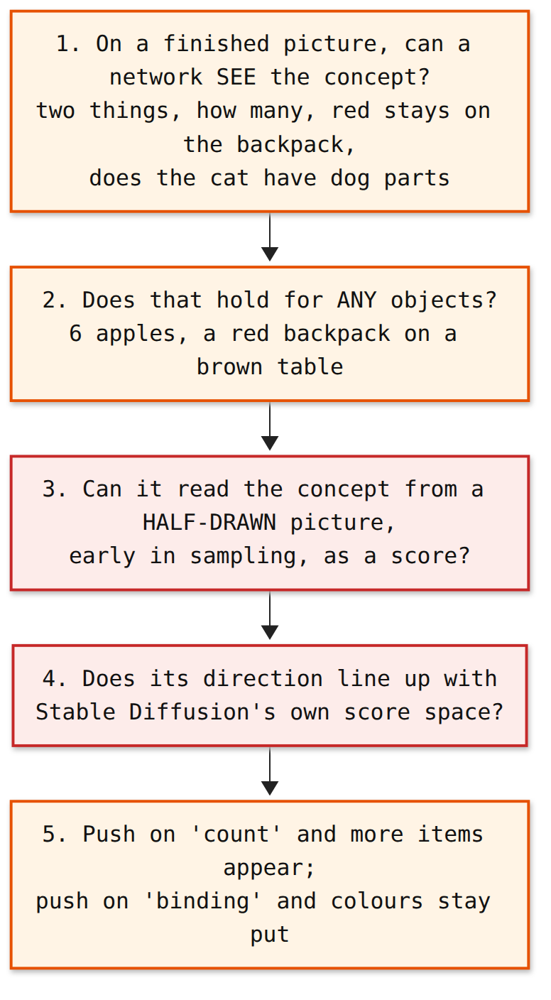
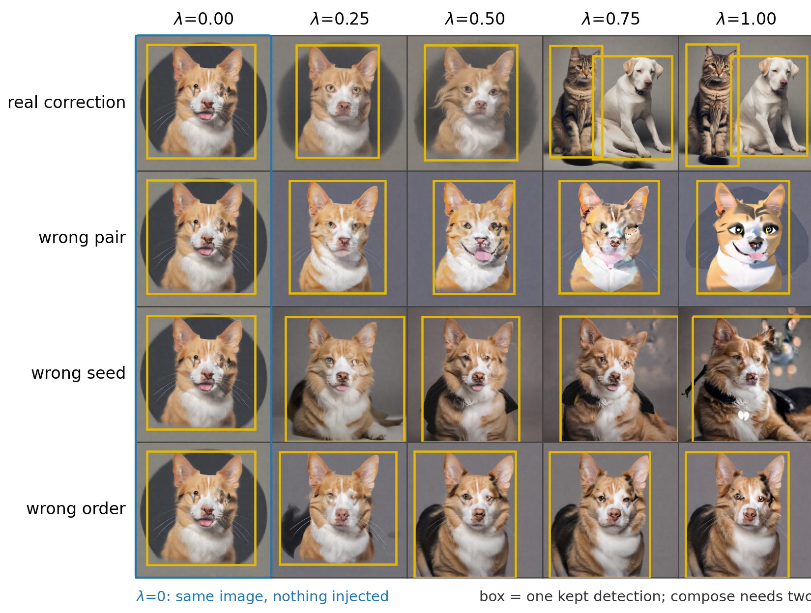

# The concept ladder: seeing an abstract concept, then steering with it

The idea, in one sentence: if a network can see an abstract concept (two separate things, how many,
which colour belongs to which object, whether each animal keeps its own parts), that seeing can be
turned into a push that makes the image model draw it. The ladder below splits that into five
questions that each pass or fail on their own, with the evidence the project already holds.

## Rung 1: can a network see the concept on a finished picture?

**Idea.** A detector or a vision-language model looks at a finished picture and answers: how many
animals, is each one clear, is the colour on the right object.

**Evidence.** A detector draws one box per animal it finds; "two things" means two boxes. In the figure
below, each row adds a correction to cat × dog at a strength from 0 to 1, and the detector's boxes go
from one hybrid to two separate animals only for the real correction.

For "does each animal keep its own parts", a vision-language judge called two-clear pictures right
0.914 of the time against blind human calls on 96 CO3 pictures, where 0.5 is chance
(`method-search/07-a-checker-that-reads-identity/review.md`, the judge's control). The detector counts
animals but cannot tell a cat from a dog, so it is a count reader, not an identity reader.

**How it is verified.** Against blind human labels, with chance and a written bar beside the score.

**Status.** Answered for count and for parts. Cited for binding (T2I-CompBench's question-answering
score; GenEval's colour attribution).

## Rung 2: does it hold for any objects?

**Idea.** The same reader works on six apples or a red backpack on a brown table, not only on animals.

**Status.** Cited: open-vocabulary detectors and the benchmarks above run over hundreds of categories.
Their known weak spots are large counts and colour binding: colour attribution scores 0.43 to 0.60 on
released models (`gaps/01-is-paper-2-still-open.md`).

## Rung 3: can it read the concept from a half-drawn picture?

**Idea.** The push has to act early, while the picture is still mostly noise, so the reader must work
there too.

**Evidence: where the network looks.** The figure below plots, at each sampling step, how much the two
words' attention maps overlap: 1 means "cat" and "dog" look at the same places, 0 means separate places.
The plain product's overlap (orange) climbs toward 0.9: both words look at one body. Among the joint
prompt's 8 seeds, the three that ended with a separate cat and dog average lower overlap at steps 5, 10
and 15 (0.28, 0.25, 0.26) than the other five (0.36, 0.34, 0.35), but seed by seed the two groups mix:
seed 2, which came out apart, reads 0.48 at step 5, and seed 5, which did not, reads 0.01
(`attention/overlap.json` in that result's archive). The separation is a weak group difference, not a
per-picture one.

A classifier trained on clean pictures reads noisy ones near chance (GradCheck: 26.65% on 4 classes).
Readers built from the model's raw predictions scored 0.63 to 0.69, below simply knowing the pair
(0.757). The judge, reading the model's guess of the finished picture, sees identity from step 15
(0.773).

**How it is verified.** A reader's score at each step against the finished picture's label, judged
within each pair so the pair itself cannot give the answer away.

**Status.** Open, and the attention overlap is the most promising reader the project has seen: it names
no subject and separates success early on cat × dog.

## Rung 4: does its direction line up with Stable Diffusion's own?

**Idea.** A reader's push is its gradient. It only helps if that gradient points where the image model
itself would move to draw the concept.

**Evidence.** The project's checker push follows the term the product drops at a cosine of +0.105 on
CO3 at step 0, the right way but weak, against a random direction's 0.003 to 0.005
(`method-search/09-gradient-direction-check/review.md`). Ordinary training leaves a classifier's
gradient unconstrained (Kawar, Ganz and Elad); a penalty can pull it toward the model's own direction
(Ganz, Kawar and Elad), untested for an abstract relation.

**Status.** Open. This is where the project's attempts have broken.

## Rung 5: does pushing work?

**Idea.** Push on "count" and more items appear; push on "together" and two separate animals appear.

**Evidence.** The detector figure under rung 1 is this rung for co-occurrence: a correction turned up
from 0 to 1 gives two boxes, the project's dial on cat × dog. On digits, an abstract "two digits" push
added 43 clean pairs of 320 where a random push of the same size did nothing.

**Status.** Shown on cat × dog and on digits; untested on pairs the correction never trained on.

## The experiments that remain

| Rung | Experiment | Cost | Status |
|---|---|---|---|
| 3 | **A score that names no subject:** the attention overlap and instance count at steps 5 to 15 on the 192 labelled CO3 pictures, judged within each pair, pairs held out | about 0.5 GPU-hours, no training | closed after a double-flipped bar; the owner's call to reopen |
| 4 | **A classifier trained so its gradient points the right way**, on coloured digits first | about 2.3 GPU-hours | reviewed (fix); waits for the owner |
| 5 | **The co-occurrence dial on pairs never trained on:** the correction at strength 0 to 1.25 on 8 held-out pairs, each picture called one, hybrid or two | about 1.5 GPU-hours | approved; waits for the coloured-digit test |

## What it gives each paper

**Paper 2** (one frozen model, two subjects) is this ladder for one concept, co-occurrence, on SDXL:
rungs 1 and 2 are cited, rung 3's attention reader and rung 5's dial are its experiments, and rung 4
is its method question.

**Paper 1** (experts trained apart) uses rungs 1 and 2 as its measures: the detector counts objects, the
judge checks each object keeps its own parts, and its five CLEVR measures (occlusion, shared light, cast
shadow, seams, colour) are rung 1 for interactions that need both objects. Its method question is rung
5 for experts that never met.
