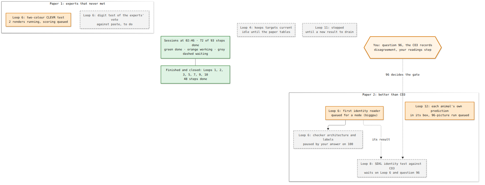

# 🧭 Manager: where the loops stand

Loop 13 rewrites this page every hour. It reads the progress board, the open questions, the requests
between loops, the cluster and the live sessions, decides the questions it is allowed to decide for you,
and leaves the rest here. Paper 1 is experts that never met; Paper 2 is doing better than CO3 inside one
model.

**Last tick:** 2026-11-25 23:59 (UTC+2). The board stands at 57 of 90 steps done and 6 in progress.

## Contents

- [Decided for you, and still for you](#decided-for-you-and-still-for-you)
- [Where each loop is](#where-each-loop-is)
- [Resources](#resources)
- [Things that may be wrong](#things-that-may-be-wrong)
- [Alignment](#alignment)
- [Nudges, requests and decisions sent](#nudges-requests-and-decisions-sent)
- [Requests waiting](#requests-waiting)
- [Last tick](#last-tick)

## Decided for you, and still for you

### Decided for you since you last looked

Each was reversible, inside the asking loop's budget, and changed no recorded bar or verdict. To
overrule one, answer it again: `python3 scripts/progress_board.py answer <number> "<your answer>"`.

| # | The question | Decided | Why |
|---|---|---|---|
| none | Keep the RunPod pod on overnight while questions 114 and 116 wait? | **Decided by Loop 13 for the owner: no.** Once the corrector row's last block is copied back and checked, the pod is stopped (its disk is kept, so it can restart if you pick the raw-picture checker); idle would cost about R16 an hour |
| none | The co-occurrence dial needed 8 held-out animal pairs sharing no animal with the adapter's training pairs, but only 3 exist | **Option A: 8 new animal pairs** sharing no animal with v58's 48 training pairs and in no benchmark or held-out set, drawn by a fixed rule written into the design before any render; the paper's adapter (v58-03-self, step 30,000) | Keeps the frozen held-out set unspent and keeps Loop 12's rule against held-out pairs; no bar written yet |
| none | The digit shared-canvas experiment filled every canvas with ink twice (0 of 320 each time); diagnose it? | **Yes, as a diagnosis**: no corrector and no pushes first, then each piece added back alone, stopping at the first that breaks it; about 6 GPU-minutes, after M10 starts | It is the one comparison asking whether the experts need their own regions; reads no bar until the sampler draws digits |
| none | M14's bar was written with M13's old sign; may it be corrected before the split? | **Yes, mechanically**: every threshold negated and "opposes" read as "follows", nothing else changed, committed alone before any split | M13's sign was reversed (Loop 6's check on 12 saved states: cosine -1.0 between the push and the gradient); no split had been computed |
| none | Should Z9's checker push get the matched-length digit-and-colour-only control Loop 15 asked for? | **Yes**, about 0.2 GPU-hours inside Z9 | Without it, the 46.9% to 76.0% lift cannot be told apart from stronger attributes alone |
| none | Two steps downstream of the closed checker route (tuning the winner, M3; Loop 6's checker against Loop 8's, M8) and the recipes step (M4) still named a Paper 2 checker | **M3 covers Paper 1 only; M8 closes as not run; M4 needs Paper 1's recipe only**, and Paper 2's recipe waits for your choice after Z9 and Loop 15's last step | Follows from your answer to 111; changes no result or bar |
| none | M13, the gradient-direction check, had only CO3 trajectories; should it add plain PoE? | **Yes**: 48 plain-PoE trajectories (12 tuning pairs, seeds 6001 to 6004, Z8's settings), judged by the same bar | The push failed on PoE in Z8, so that is where its direction matters most; about 0.5 GPU-hours more, under 1.5 in all |
| none | Does your yes to card 1 on mscluster107 (question 103) still hold after the other user's job 94785 ended and their new job 94793 took the node? | **Yes**: Loop 12 re-reads card 1 and runs the test there with the same launch check and watchdog; if the watchdog stops it, only the unfinished cases go to the queue | Your instruction named the card being empty, not a host job; the check and watchdog protect the other user either way |
| none | Paper 2's first correction test waited in the queue for a free card (job 94977) while mscluster107's card 1 was empty | **Run the test on card 1**, under the same launch rules and watchdog as the screening | Your instruction was to run it on card 1 (question 103); the 30-minute figure was my estimate, not a limit; it saves the wait for a queue card |
| none | Paper 2's first correction test (Z8): the cases the design named do not exist, so where does the 1.7 GPU-hour run go? | **Option 1:** the screening pass that draws plain PoE and the joint prompt on the tuning pairs (about 35 GPU-minutes) runs on mscluster107 card 1, and the test itself (about 65 GPU-minutes) in `bigbatch` | Keeps card 1 at about the 30 GPU-minutes you approved in question 103; the whole run is under the 3 GPU-hour line; cat × dog is dropped because the checker trained on it |
| none | Loop 8's method review found the removal test feeds nothing since your answer on 86 | **Close the removal test (V7) as not run** after the cheap visibility check; the full retraining from question 95 is skipped | Reversible, saves about 1.5 GPU-hours, no bar changed; it was option B of question 95. |
| 102 | Loop 8's SDXL identity test: cheaper gated version, Loop 6's features, or close it? | wait for Loop 6's identity read; then the cheaper gated version (about 5 to 6 GPU-hours) if its judge reads borrowing at 0.75 or better by step 15, otherwise close it and end Loop 8 with its digit results |
| 101 | Card 1 and your Anthropic key for Loop 6's first identity reader | yes to both. The host job on mscluster107 then ended, so the reader runs through Slurm on our free `biggpu` slot instead; the judge's tokens count against question 15's unspent budget |
| 100 | Pause Loop 6's clean-pair checker search and look for a checker that reads which subjects are drawn? | A: yes. The architecture and label steps (about 31 GPU-hours) are paused; a reviewer pass picks the identity reader to try first before anything is built |
| 99 | May loops use mscluster107's idle card 1 again, inside another user's new job? | yes: one run at a time, Loop 12 then Loop 8 then Loop 6, with the stop rule; it ends when their job ends |
| 98 | What does Paper 2 test next, now that Loop 12 found neither where borrowed parts start nor a working fix? | **Each animal's own prediction inside its drawn box** at steps 5 to 30, on the same 48 pictures, after a free text-only check, run by Loop 12; about 0.8 GPU-hours, its 48-picture bar written first | The test the first fix never ran, named by both reviews; the text-encoder fix stays held behind the free check. |
| 97 | Which of three small reruns from Loop 12's audit of Loops 8, 9 and 10 should run? | **Only the first** (when the digit sampler settles which digits it draws), in Loop 8, about 0.04 GPU-hours; the third read free from Loop 12's own records, reopening nothing | The second is already settled by Loop 8's checks; the third needs Loop 10, which is closed. |
| 95 | Loop 8's identity checker missed twice on the sampler's own states (0.651, then 0.552 with memorised training digits); what next? | **A with three additions**: first check the digits are readable from the sampler's states at all (about 0.1 GPU-hours, and stop if not), hold out seeds of digits 0 to 4 as a control, then train on both data sets and read fresh digits 5 to 9 once; about 1.6 GPU-hours | The [reviewer's second pass](../reviewer/2026-11-24-review.md#loop-8-again-at-2215-two-misses-on-reading-sampler-states) found the second try memorised 2,036 stored states with no fresh noise, and no one has checked the digits are readable there at all. The SDXL test does not wait on this. |
| 94 | Loop 8's digit identity checker reads pasted digits (0.861) but not the sampler's own states (0.651 against 0.75); does its removal test run? | **A: retrain it on sampler states from digits 0 to 4, read digits 5 to 9 again on freshly drawn canvases, and run the removal test only if it passes**, about 1.5 GPU-hours | It answers the reviewer's main point on Loop 8 and tells its SDXL test whether to train on CO3's states. Reversible, inside budget, no bar changed. |
| 93 | Loop 6's checker cannot see CO3's failure; what happens to its search for the best checker? | **A: read the two checkers being trained now the same way first**, about 2.2 GPU-hours, before the next steps spend about 31 | Reversible, inside budget, no bar changed, and the reviewer's first fix. If neither new checker sees the failure, pausing the search for an identity reader comes to you. |
| 91 | Which fix should Loop 12 test on CO3's borrowed parts? | **Not the default as written.** A free check on saved records first, then a place-by-place fix at about steps 15 to 30 with boxes drawn by eye as a positive control, beside a whole-canvas control; about 1.7 GPU-hours | The [reviewer](../reviewer/2026-11-24-review.md#loop-12-where-co3-leaks) found the default read its places at steps 0 to 5, where Loop 12's own picture shows both animals' predictions still drawing both bodies, the failure that closed Loop 6's region test. How the pictures are scored is yours, as question 92. |
| 83 | Should Loop 6 close its test of whether drawing each subject in its own region stops borrowed parts, after three tries missed? | **Close it**, reporting what it found | Loop 6's own [method review](../method-search/04-bind-each-body/method-review.md) and the [reviewer](../reviewer/2026-11-24-review.md#loop-6-find-the-best-method) agree: every try split the picture using a signal that had not yet separated the two subjects, and a fourth would cost about 4.9 GPU-hours without fixing that. Costs nothing. |
| 78 | Who runs Loop 10's small digit test of whether the experts' vote beats simply pasting their samples, for Paper 1? | **Loop 6**, after its current step | About 0.3 GPU-hours inside Loop 6's budget, and it adds the paste comparison the reviewer finds Paper 1's tests lack. |
| 81 | Loop 11's ten format conflicts on the 48 method and finding pages it wrote | **All ten of its defaults** | None changes a recorded number or verdict; where two verdicts exist both stay side by side. The reviewer found Loop 11's work sound. No GPU. |
| 85 | The reviewer's fixes for Loop 6's search for the best checker | **Yes to two of three**: first check whether the checker can tell CO3's clean pictures from its borrowed-part ones at each step (about 1.2 GPU-hours), and give the two-colour CLEVR test a paste comparison (CPU only) | Both are reversible and inside budget. The third fix changes how Loop 6 is judged, so it is yours, as question 87. |
| none | Loop 6's read came out inconclusive by count: 21 of 96 trajectories missed the 3-of-255 match because they were first drawn on an RTX 8000 and reread on an RTX 3090 | **Rerun those 21 on mscluster107 card 1** after Loop 8's checks, before Loop 6's training | About 15 minutes; it meets the read's own written rule on the matching card type and changes no bar. Loop 6 records that the rerun was decided after the 75-trajectory result. |
| none | Eight requests were addressed to Loops 7 and 10, which have stopped | **Re-routed**: four to Loop 8, four to Loop 11 | Each corrects a page that disagreed with what ran; no result changes. A ninth, on numbers in Loop 10's digit-signal review, Loop 10 fixed itself (commit `77cf7bb7`: five copying slips corrected to match its result file, verdict unchanged). |

**Acted on.** Loop 6 carried out 83, 78 and 85 by 16:31 (commits `6f8f65e5` and `58cee28a`): the region test is closed on the board, the digit test is its new step M11, and the check of whether its checker can see CO3's failure is designed with its bar written first and runs as jobs 94593 and 94594 before any comparison renders.

### Answered by you

At 16:55, in chat, recorded on the board and sent to each loop:

| # | The question | Your answer |
|---|---|---|
| 114, 115, 116 | The block counter, the deciding box rerun, the picture-reading checker | **Yes to all** (you, 2026-11-26 00:10): M10 reports on the eye calls; the picture-reading checker trains on the migrated RTX 4090 pod and stops itself below 0.75; Z13 approved at 4.2 cluster GPU-hours with its half-way stop. You also asked whether to stop both papers' method search: after these two runs, no new method routes open, and the papers' shape is your next decision |
| none | Run Paper 1's two-colour CLEVR comparison on RunPod? | **Yes** (you): on red's pod, with blue's model copied there, about 7 GPU-hours (about R90), all rows on one RTX 4090, stop and ask past 8; blue pod stopped at 18:25 after its copy (508 MB) was checked on /datasets |
| none | Run the CO3 check (stage A) on fewer pictures? | **No: keep 96 per row**, since this morning's 48-picture box test landed at p = 0.073, and **add a half-way stop rule**: after 48 box pictures, stop if the box correction is not ahead of CO3 at all |
| none | Start the rival-benchmark rebuilds now? | **Not yet: land what is running first.** Parked for later: DCFM's Colored MNIST benchmark (`manager/fair-dcfm-match.md`) and Bradley et al.'s CLEVR count benchmark (Kmax, their plain model as the calibration row, a ResNet-18 counter); Loop 12 told to hold the DCFM design |
| none | DCFM comparison approach | **Read the rival's paper, rebuild its benchmark, run only our methods, set our numbers beside its printed ones**, with one of its simple baselines rebuilt as a calibration row; the big benchmarks (DCFM's chest X-rays) wait until a result earns them. The same recipe applies to Bradley et al. on CLEVR and to ToMe and Attend-and-Excite on their prompt sets |
| none | How to compare with DCFM? | **Our methods on DCFM's exact Colored MNIST benchmark, beside its printed numbers; DCFM not rerun.** One of DCFM's simple baselines is rebuilt first to calibrate our FID against its printed number (`manager/fair-dcfm-match.md`); waits for Loop 12 after the CO3 check |
| none | Build a fair comparison with DCFM on Colored MNIST? | **Yes** (you): designed in `manager/fair-dcfm-match.md` (five rows in one pipeline, a DCFM-style row from CoInD's public penalty, DCFM's ten-holder splits and the project's two-holder split, all on RunPod 4090s); the reviewer reads it first; Loop 12 asked to stay open to run it and the CO3 test |
| none | Take the gradient-trained classifier to CO3? | **Yes** (you): the reviewer reads the proposal first (`manager/aligned-classifier-on-co3.md`), about 5 GPU-hours if it runs |
| 113 | Test the LoRA's separating plus each animal's own prediction in its box, on the dial test's 8 new pairs (`1-lora-correction/binding-plan.md`, option A)? | **Yes, run it now** (you, in Loop 12's session): the LoRA alone and the plain product reused from the dial test's 3090 pictures; the box rows drawn on bigbatch 3090s, about 0.9 GPU-hours. A pass justifies training the LoRA with a binding loss |
| none | Use the RunPod credit now? | **Yes**: three RTX 4090 pods started 2026-11-25 at about 14:40, each $0.90 an hour. m10-red-4090 and m10-blue-4090 train Loop 6's two CLEVR colour experts (about 2.5 hours, about R80), and z11-4090 runs Loop 12's gradient-trained classifier test end to end (about 1.4 hours, about R25). Cluster jobs 95442 to 95448 are cancelled as the pods start; the dial test stays on cluster 3090s |
| none | Your dial test at 2.83 GPU-hours against 1.5 approved, and the attention reader | **Run the dial as designed**; the attention reader had already finished (missed its bar), so nothing to stop. For speed, Loop 12 may run up to four dial jobs and the gradient-trained classifier in parallel inside the six-job cap, all on RTX 3090 cards |
| none | How is the joint-target test read, now its condition was double-flipped? | **As intended**: met at step 0 by 0.001, inconclusive at steps 5 to 15; the attention-reader test (M15) reopens under question 112's rule |
| none | The gradient-trained classifier, with the reviewer's fixes | **Yes**, as Loop 12's step Z11 after the dial test, about 2.3 GPU-hours |
| 111, again | Reopen the checker route now the sign is corrected? | **No**: kept closed; its corrected finding (right direction, too weak) feeds the dial and attention experiments |
| none | The full ten-holder DCFM match | **Held** until two-colour CLEVR shows whether Paper 1 has its own method |
| none | Z9's fourth arm missed its fit check (0.224 against 0.25) while its pictures passed (89.2% against 78.8%) | **Recorded as not reached; one retrained attempt (about 30,000 steps) with the same 0.25, labelled as a second attempt**, about 0.6 GPU-hours |
| none | Add a classifier trained so its gradient points along the missing term to the coloured-digit test? | **Yes**, as a fifth arm beside the plain checker and the size-matched control; the reviewer reads it first, including whether it extends to abstract concepts and to CO3 |
| none | Two steps still named the closed checker route: the short fine-tune with the push (D5) and Loop 8's checker on SDXL's unseen objects (V4) | **Both closed as not run**; question 102's branch A for Loop 8 is withdrawn, and Loop 8's count checker stays a measure |
| none | When does the full ten-holder DCFM match (question 108, experiment 3) run? | **After** Z9's arms 3 and 4 and Loop 15's step H4 land; Loop 13 then plans it with the best method row, likely on RunPod (about 4 to 14 GPU-hours) |
| none | Add a trained correction to Z9 beside the classifier? | **Yes**: a fourth arm, a small model predicting the dropped term with both experts frozen, trained on the finished experts' own samples (keeps DCFM's no-sharing setting); the reviewer reads it first; Z9 rises to about 3.3 GPU-hours, approved |
| none | Which loop runs question 108's first experiment, and with which arms? | **Loop 12**, as step Z9, with three arms: plain product of finished Colored MNIST experts, the checker push, and a push from a classifier on the together-against-apart ratio; the reviewer reads the ratio idea first |
| 88 | Should Loop 11 stop after its last two steps until a research loop has something new? | yes, the default |
| 87 | Should Loop 6's checker search be judged on two clear subjects, drawing style ignored? | yes; damage reported beside it, two reviewers per picture |
| 80 | Should a checker choose CO3's sharpness setting at each corrected step? | declined: the checker does not see CO3's failure (60% right against a 65% floor); the design stays on file to reopen if a checker that sees it is found |
| 92 | Should Loop 12's fix test count two clear subjects with their own parts, drawing style ignored? | you asked Loop 13 to decide: yes, with broken anatomy as a guard and faithful pairs reported beside it, so every Paper 2 result is counted one way; Loop 4 is bringing the bar's page in line |
| 90 | May loops run queued work on mscluster107's idle card 1, inside another user's allocation? | yes: one run at a time, Loop 8 then Loop 6, with a watchdog that stops ours if their process starts using the card |
| 89 | May Loop 13 add an edit command to the board script and fix the three records that disagreed with your answers? | yes: Loop 8's SDXL test now needs Loop 6's training list and names CO3 alone as its rival; the small CLEVR test is closed without running and the recipe freeze waits on the two-colour CLEVR test; Loop 10's skipped steps are closed. Commit `88b787c9`; the board before the change is kept at `/home/molef/.claude/jobs/3c51301e/tmp/board-before-q89.json` |
| 79 | Which of Loop 9's two recorded verdicts leads its report title? | the default: the test's own verdict on the title, and the fairness test as its own finding beside it (answered at 16:59) |
| 86 | Should Loop 8's SDXL test push identity on CO3's own run and be judged against CO3 alone? | yes; it starts from Loop 6's training list, about 6 GPU-hours. Loop 8 is asked to use the same two-clear-subjects measure as Loop 6 so the two compare |

### Still for you

Newest first. A default happens only if you answer with it; nothing changes while a question waits.

| # | The question, in one line | Why it is yours | Default | Waiting |
|---|---|---|---|---|
| 96 | Paper 2's checkers are gated on their yes-or-no call at zero (75% right), but the push follows only the direction of the checker's gradient, so ranking good pictures above bad ones is what steers it. Loop 6's checker ranks at about 0.70 but calls 0.602 right; Loop 8's ranks at 0.78 but calls 0.651. Keep the recorded gate, or switch to ranking? | changes a recorded bar after seeing which one passes on similar checkers | keep the recorded gate, report ranking beside it, and bring a pass on ranking alone back to you | just filed |

Your own reading step (confirm the draft statements from your readings) is ready on the board.

## Where each loop is

 

The finish range is `session_status.py`'s, from the 63 finished steps: fastest pace seen to slowest.

| Loop | Doing now, and why | Steps left | Estimated finish | Session | Held by |
|---|---|---|---|---|---|
| 4. Rivals and targets | Keeping every target current. It updated Paper 2's bar page to count two clear subjects with their own parts (questions 87 and 92). | 1 | none useful: it ends after the paper tables, which have not started | idle | nothing |
| 6. Best method | By your answer A on question 100, its clean-pair search is paused and its training-list step closed. Its first identity reader (the per-place signal, no training) waits for a node (jobs 94807 and 94808); the judge beside it passed its control, 0.914 against 0.75, on 209,000 of the approved tokens. Paper 1's two-colour CLEVR renders continue. | 8 | not yet estimated | busy | a free node |
| 7. Abstract-checker papers | Finished; its session is closed. | 0 | done | closed | nothing |
| 8. Abstract checkers | Its digit identity checker reads pasted digits (0.861 against 0.75) but not the sampler's own states, and its removal test (V7) is closed as not run. The last check shows why: at steps 27 to 36 the digits are still unsettled (16% settled by step 26, half by step 37), and even the digit judge reads only 0.724 there ([review](../abstract-checkers/10-reading-identity/review.md)). Its one remaining step is the SDXL identity test against CO3. | 1 | not yet estimated | idle | Loop 6's training list and question 96 |
| 11. Drain into the pillars | Stopped by your answer on 88; every finished result is on a report page. | 1 | when restarted | stopped its loop | a new result worth draining |
| 12. Where CO3 leaks | Its six planned steps are done ([verdict](../leakage/06-verdict.md)). On step Z7 (question 98): the free text-only check is null (how far the second-named animal's word moves against how often a pair borrows: rank correlation -0.023), so the text-encoder fix stays held; the smoke run passed both controls; the full run of each animal's own prediction inside its drawn box (about 1.7 GPU-hours) goes to Slurm. | 1 | not yet estimated | busy | its own Slurm job |

## Resources

**RunPod, 2026-11-26 00:15:** the stopped red pod's card was taken, so RunPod moved it to a new RTX 4090 pod, m10-red-4090-migration (47.47.180.32:13911, $0.90/hr), with an empty disk; Loop 6 rebuilds from /datasets for the picture-reading checker (question 116, about 1 GPU-hour). Credit $12.28.

**RunPod, 2026-11-25 21:20:** both pods stopped (blue 18:25, red 21:20), each after a sha256-checked copy to /datasets. The two-colour CLEVR comparison used about 3.7 GPU-hours of the 7 approved. No pod is running.

Read at 02:13 from `squeue`, `sacct` and `sinfo`; down nodes from `sinfo -R` at 16:28.

| What | Now |
|---|---|
| Our jobs against the caps | 4 running on `bigbatch` of 6 allowed (Loop 6's two CLEVR renders and two scoring renders); 0 on `biggpu`; 20 queued, waiting on cluster priority |
| Longest wait | the queue as a whole: nothing of ours finished between 00:13 and 01:13 |
| Nodes out of service | `bigbatch`: 12 down and 5 drained of 48. `biggpu`: 2 down and 2 drained of 7, including mscluster108 and mscluster111, drained at 09:27 and 09:10 today after a failed job kill |
| Idle capacity | none: at 17:43 every working `bigbatch` and `biggpu` node was allocated. mscluster107 is now another user's `biggpu` job (94610, 6-hour limit, started 17:36); its second card sits idle at 170 MiB, but their process holds it, so it is not ours to use. Your interactive job 83423 on that node no longer appears in the queue |
| Shared card | **Not in use.** The other user's job on mscluster107 ended by 02:45, so question 99's approval has lapsed; the node is free in Slurm, and Loop 6's identity reader goes there through our `biggpu` slot. A new shared-card run needs a new yes from you |
| Compute against budget since 2026-11-21 | Loop 6: 53.4 node-hours of 87 (34.8 were CLEVR renders that may have used no GPU). Loop 8: 11.9 of 30. Loop 12: about 0.4, no total set. Slurm here records no GPU count, so these are node-hours, an upper bound |

**RunPod speed test, 2026-11-25.** Plain SDXL at 1024 by 1024, 50 steps, one picture at a time: **5.96 seconds on a Secure-cloud RTX 4090** ($0.89 an hour) against **14.81 seconds on a cluster RTX 3090** (job 94818, mscluster46), so a 4090 does about 2.5 times the work of a cluster card. Community cloud had no capacity on any card at 03:40. A private image of the cluster's `co3` environment (`ghcr.io/mo-rsa24/poe-co3:2.5.1-cu118`, recipe in `scripts/runpod/co3-image/`) matches its library versions exactly and pulls with the RunPod credential, but at 16.8 GB its last layer had not finished downloading after 20 minutes, so the test pod was stopped before running. Both tests together cost about $0.46. **The fast route is tested:** a pod from RunPod's own PyTorch template (Ubuntu 24.04) starts in about 40 seconds, and `scripts/runpod/setup-co3-on-pod.sh` builds the cluster's co3 environment on it in 34 seconds (Python 3.10.22 through uv, PyTorch 2.5.1+cu118, diffusers 0.29.2, transformers 4.44.1, every other package pinned without dependency resolution). SDXL then draws in 6.69 seconds a picture (6.05 at batch 4), 2.2 times a cluster RTX 3090 on the same software (14.81). RunPod's RTX 3090s were out of capacity, so a RunPod experiment runs wholly on 4090s. The classifier pod z11-4090 ran the gradient-trained classifier test end to end and was stopped from inside the pod with `runpodctl` at about 16:45, since the browser connection was down; its outputs are on `/datasets/mmolefe/poe_repair_min/loop-12/z11/pod-run/`.

**What would make the queue move faster:** little within our control. There is no idle `biggpu` card,
and the drained nodes need the administrator. Loop 6's two-colour CLEVR renders hold two `bigbatch`
nodes for up to 10 hours each while running on the CPU; they must stay on `bigbatch`, the only other
partition we may use, so this is a cost to note, not one to fix.

## Things that may be wrong

Newest first.

| Concerns | Finding | Source |
|---|---|---|
| Paper 1's two-colour CLEVR test (Loop 6) | **The block counter cannot judge pastes, so the test is inconclusive on its scorer whatever question 114 decides.** Two blind reviewers agreed on all 864 pictures: exact share plain 0.000, corrector 0.000, mask paste 0.205, where the counter said about 0.5 for the paste. Most pastes lay blue over red and leave a red sliver, which the counter, trained on scenes where objects never overlap, reads as two objects. The eye calls are the faithful measure; question 114's retraining would buy nothing | M10's review, commit 2b8c40b3 |
| Paper 1's two-colour CLEVR test (Loop 6) | **The count checker, Paper 1's method row, missed its training bar**: held-out balanced accuracy 0.645 against 0.75, flat from update 500; 82% on well-separated pastes, 57% touching, 37% one count off. Its push window was carried over from the digit test (σ 10.5 to 3.8), where a digit filled half the canvas; CLEVR blocks are a few pixels at 64 px. A labelled diagnosis at four lower windows is running; moving the window, recorded before the checker's row runs, is yours to call | Loop 6's message, 19:30 |
| Loop 12 | **Z12 ran 0.2 GPU-hours over** (3.3 against 3.1 approved): three jobs died on /datasets races on mscluster79 and 87, now in `environment/hpc/nodes.md`. Stage A missed its bar, 27 against 26 two clear of 96, and its review reads the miss as too weak to tell (median change 2.3 grey levels) | `leakage/12-aligned-classifier-on-co3/review.md` |
| Paper 2's CO3 check (stage A) | **The box push barely changes the pictures, so stage A may be too weak to test the box idea.** At half-way it drew 9 two-clear pictures of 48 against CO3's 8, but it moves each picture by a median of 2.2 grey levels of 255, with a push length of about 1 in noise units against a prediction of about 250. Loop 12 finishes the blind call unchanged and measures this morning's own-prediction row's change from saved pictures; a rerun at another push length is yours to call | `leakage/12-aligned-classifier-on-co3/blind/half/` |
| Paper 1 and the ICLR draft | **The pooled adapter's "58 of 64 on unseen pairs" counted bodies, not correct animals.** It was scored by the count detector, which counts animals but cannot name them. Z10 shows the adapter separates bodies on new pairs (hybrids 29 to 4 of 32, separate bodies 1 to 26 as its weight goes 0 to 1) while two clear, each the right animal, rises only 0 to 2, and even training pair badger x magpie gave none at full weight. Any sentence reading the 58 of 64 as "composes unseen pairs" overstates it; it shows two bodies. | Z10's review; the pooled-adapter finding's own scorer |
| Loop 12 | **Z10 ran 0.11 GPU-hours over** (2.94 against 2.83 approved): the test runs that found the adapter's leaking off switch. | Z10's review |
| All loops | **The laptop restarted at 15:27 on 2026-11-25 and left 14 empty objects in the git store, including the branch's latest commit.** Repaired at 15:55 with the owner's yes: the branch pointers, history logs and index were backed up to `/home/molef/PhD/git-repair-backup-2026-11-25/`, the empty objects moved there rather than deleted, the branch pointed back at the last intact commit (5d5f2521), the zeroed history lines removed and a fresh index built from that commit. `git fsck` is clean. The lost commit's changes are on disk as uncommitted changes, and loops re-commit them. | the repair, this session |
| All λ sweeps | **Switching the adapter off may not switch it all off.** With v58-03-self attached and disabled by `disable_adapters()`, SDXL's picture differs from a plain product with no adapter attached by a mean of 10.8 grey levels (largest 231), against 34.5 with it on: about a third of the adapter remains (Loop 12, job 95428, `leakage/10-co-occurrence-dial/diagnose/diagnose.json`). Any recorded weighted run that took its 'off' term from the same U-Net (the adapter_lambda path in `run_poe_classifier_guided`, and the windowed sampler in `lambda_window_grid.py`) may have an 'off' that is partly on. Which recorded results and paper figures used that path is not yet checked. | Loop 12's diagnosis; an earlier, different toggle bug is in the project memory (the windowed sampler returning with the adapter on) |
| Loop 12 | **Z9 ran 0.4 GPU-hours over its approval**: 3.70 against 3.3, because the trained interaction model's second attempt took 1.39 hours against an estimate of 0.6. Recorded in Z9's review (commit a4df558a). | Z9's review |
| Loop 6, Loop 13 | **M14's verdict may read the wrong way round, from Loop 13's own instruction.** Loop 13 told Loop 6 to negate every threshold when correcting M13's sign; with the cosines already in the push's direction, the joint-wrong-target condition was flipped twice. As intended (the push follows the joint's direction less where the joint fails), step 0's difference of -0.051 (interval -0.129 to -0.002) meets it just barely, and steps 5 to 15 are inconclusive. M15 was closed on the "checker is wrong" verdict. Re-reading is the owner's call. | M14's review, commit 7c89593e; Loop 6's earlier message stating the corrected reading |
| Loop 6 | **M13's sign was reversed, and is now corrected** (Loop 6, commits 1b581f08 and cee397e5). The reviewer reads the push as moving the noise prediction by minus the checker's gradient, so M13's median cosine of -0.105 at step 0 on CO3 would mean the push moves along the joint-minus-product term, not against it. Question 111's closure and Loop 15's "the joint is the wrong target" reading partly rest on the sign. Loop 6 is checking it on one saved state; the owner hears before M14 is read. | reviewer section "The gradient-trained classifier, 2026-11-25", fix 8 |
| All loops | **Broken nodes trap jobs, and three records disagree on which they are.** mscluster48, mscluster71 and mscluster82 have dead GPUs (48 failed Loop 6's job 95077 in one second on 2026-11-25 with the same "Unable to determine the device handle for GPU0" error), and Slurm sends waiting jobs to idle nodes first; two of Loop 13's test jobs failed there in one second (94814, 94815). The environment notes list only mscluster50 and 51; the project memory note lists 44, 45, 50, 51, 65, 68, 74, 75, 76 and 83; Loop 12's brief lists 44, 45, 50, 51, 57, 61, 65, 68, 71 to 76 and 82. Loops are asked to exclude the union. Settling the list in the environment notes, and telling the administrator, are yours. | `environment/hpc/nodes.md`; Loop 12's brief line 82; `manager-speedtest/` logs |
| Loops 6 and 8 | **Two loops chase the same question for Paper 2**: can identity be read from CO3's own states? Loop 6's per-place reader answers it for about 0.3 GPU-hours (its judge's control passed at 0.914); Loop 8's signature checker would spend 5 to 14. Loop 8 is asked to hold until Loop 6's read lands. | questions 100, 101, 102 |
| Loops 6 and 9 | **Two records disagree on what CO3 draws.** Loop 6's first test says CO3 draws two separate bodies in 96 of 96 tuning pictures; Loop 9's part labels call 23 of the 96 "not two" (for example a boar with two pheasants). If Loop 9's labels hold, about a third of CO3's failures are extra subjects, which no borrowed-parts fix can repair. Yours to settle. | `method-search/01-beat-the-baseline/review.md`; `noise-text-critic/02d-binding/part-binding-calls.csv` |
| Loop 12 | **A run of bad results** (two nulls) and **a test that measured something else than its name**: the drawn-box fix never gave each animal its own prediction inside its box, so its draft verdict that regions cannot work overreaches. Method review request sent at 23:35. | `2-classifier-guidance/scripts/leakage/z3_regions.py` lines 66 to 72 |
| Loop 8 | **A run of bad results on reading sampler states**: 0.651, then 0.552 with memorised training digits. Method review request sent at 22:20 after the reviewer's second pass. | `abstract-checkers/10-reading-identity/review.md` |
| Loops 6 and 8 | **The same split in both loops**: their checkers rank good above bad pictures moderately (area under the curve about 0.70 on CO3, 0.78 on digits) but their yes-or-no call at zero misses the bar (0.602 and 0.651). Neither loop may swap the gate after seeing this; both are asked to look at it in review. | both reviews |
| Loop 8 | **The digit checker reads pasted canvases but not real sampler states**: 0.861 on pasted digits against 0.651 on the sampler's own states at steps 27 to 36, under 0.75. A checker that pushes during sampling has to read sampler states, so this is the result that decides whether the removal test is worth running. | Loop 8's message at 18:26 |
| All loops | **The same CO3 run gives different pictures on different card types.** Loop 6's rerun of M1's 96 CO3 trajectories on an RTX 3090 matched all 48 first drawn on a 3090 and none of the 21 checked from an RTX 8000, beyond 3 of 255 in mean pixel value. Any comparison of pictures drawn on mixed card types mixes the card in. No environment page records this, and the environment pillar's keeper has stopped. | Loop 6's message at 18:22 |
| Loop 6 | **Design note, not a problem.** The new check scores whether the checker's score lands on the right side of zero, a fixed cut. If its area under the curve, reported beside, is high while that accuracy is low, the checker separates CO3's clean pictures from its borrowed-part ones and only its cut is off. Read the two numbers together when the check lands. | `method-search/01b-balance-the-checker-data/design.md`, the check section |
| Loop 6 | **The checker training failed twice in 3 minutes** (jobs 94473 and 94474); the reruns (94579 and 94580) finished in 11 and 12 minutes. | `sacct` |
| Loops 6 and 8 | **A run of bad results, now reviewed.** Loop 6's region test missed three times in a row and Loop 8's misses shared a cause. Both answered their reviews within minutes and corrected their records and pictures (Loop 6 commit `f29cf613`, Loop 8 commit `8c310b3a`). | [the review](../reviewer/2026-11-24-review.md) |
| Loop 6 | **Its CLEVR paste review contradicts itself**, Loop 11 found: line 3 says no verdict yet while lines 95 to 97 give one, and the expert check is both still to run and passed. Sent to Loop 6 in `requests.md` at about 17:00. | `requests.md` |
| Loop 4 | **The standing step has run 54 hours**, longer than any finished step (23.5 hours). It ends only after the paper tables, by design. | `session_status.py` |
| Loops 6 and 8 | **Failed jobs in the last 24 hours, each followed by a rerun that finished or a move to card 1**: Loop 6, 11 failed and 5 cancelled (the two newest, 94603 and 94605, on a training-list bug it fixed); Loop 8, 2 failed. No time-outs or out-of-memory ends. | `sacct` |

Nothing found for: jobs running past twice their estimate, steps in progress with nothing running for
them, or new rows on the void list (unchanged since 2026-11-22).

## Alignment

Round 2, 2026-11-24 22:10 (round 1 at 16:10), against the intents in [the alignment check](../score-space/13-alignment-check.md).

| Loop | Still working towards its intent? | Reviewer | The fact that shows it |
|---|---|---|---|
| 4. Rivals and targets | yes | next pass | Paper 2's bar page now counts two clear subjects with their own parts, by questions 87 and 92, so every Paper 2 result is judged one way ([leakage rivals](../targets/leakage-rivals.md), commit `a437cb86`). |
| 6. Best method | partly, re-aimed | **fix** | It now tests whether a checker can see CO3's failure before choosing one: the kept checker cannot (best 0.602 against a 0.65 floor, [review](../method-search/01b-balance-the-checker-data/review.md)), and its two new checkers are read next. |
| 7. Abstract-checker papers | yes, finished | not reviewed | Its three steps are done; the five-checker design is in `abstract-checkers/03-design.md`. |
| 8. Abstract checkers | partly | **fix**, twice | Its digit half holds on pasted digits (0.861 against 0.75), but two tries to read the sampler's own states missed; its [method review](../abstract-checkers/10-reading-identity/method-review.md) found the causes, and its SDXL test against CO3 is the step that serves Paper 2 ([second pass](../reviewer/2026-11-24-review.md#loop-8-again-at-2215-two-misses-on-reading-sampler-states)). |
| 11. Drain into the pillars | yes | **continue** | [Its checks page](../drain/04-checks.md) covers all 48 pages it wrote, with 15 of 28 findings fixed. |
| 12. Where CO3 leaks | partly | **fix**, twice | Two nulls in a row, and its drawn-box test kept the joint prompt's prediction inside each box, so it does not show that regions cannot work; its next test (a text-side swap) has no positive control yet ([second pass](../reviewer/2026-11-24-review.md#loop-12-again-at-2300-two-nulls-in-a-row)). |

**Loop 11's intent, written by Loop 13 from its brief for you to correct.** Loop 11 takes the
diagrams, picture sheets and results the research loops produce, which sit in their own notes folders
where no pillar page shows them, and drains them into `report/` and `context/`: checked against the
pillar formats, explained from the overview down to each part, in organised folders of numbered pages.
It took this over from Loops 2 and 3, which have stopped.

## Nudges, requests and decisions sent

Newest first.

| Time | To | What and why |
|---|---|---|
| 17:02 | Loop 8 | Its rewritten SDXL test passes the design check (stop rule, random and zero controls, comparison prompts fixed in advance, the same two-clear measure as Loop 6; about 7 GPU-hours, inside budget). Its board record goes to you as question 89. |
| 04:22 | Loops 6, 8, 12 | Exclude mscluster50, 51, 71 and 82 from job scripts: 71 and 82 have dead GPUs but show idle, so jobs land there and fail. One line in `requests.md`. |
| 03:15 | Loop 8 | Asked to hold its SDXL test until Loop 6's identity read lands; question 102 is yours. |
| 02:30 | Loop 6 | The reviewer's first identity reader for M12, with its bar and stop conditions. |
| 02:30 | Loop 6 | Your answer A on question 100 sent; the reviewer is choosing the identity reader to try first. |
| 02:25 | Loop 6 | Its checker read is done: none of three checkers sees CO3's failure; it filed question 100 to you. |
| 02:16 | Loop 6 | Card 1 is free after Loop 8; Loop 6's turn. Loop 8 closed its removal test, as decided. |
| 02:11 | Loop 8 | Card 1 is free after Loop 12; Loop 8's turn. |
| 01:58 | Loops 12, 8 and 6 | Card 1 on mscluster107 approved again (question 99): Loop 12 first, then Loop 8, then Loop 6; each told the order and the rules. |
| 00:30 | Loop 12 | Question 98 decided: it runs the own-prediction test as step Z7. Its design passed the check: bar written first, the control re-rendered in the same window so only the box contents differ, about 1.7 GPU-hours. |
| 23:50 | Loop 12 | Its [method review](../leakage/method-review.md) answered: records corrected to say what the drawn-box test did, the two disagreeing records reconciled, question 97's third rerun read free from its own records. Next, in order: a free text-only check, each animal's own prediction inside its box (about 0.8 GPU-hours), and the text-side swap only if the free check supports it, with a positive control. |
| 23:35 | Loops 12 and 8 | **Method review request** to Loop 12 after two nulls, with question 97 decided; Loop 8 runs that question's first rerun beside its free check. One line in `requests.md`. |
| 22:30 | Loops 8 and 6 | Loop 8's method review answered (`method-review.md`): the first checker ranks but its cut drifts, the second memorised. Its removal test closes after the visibility check; the gate question is yours as 96, and both loops keep their recorded gate until then. |
| 22:20 | Loop 8 | **Method review request** after two misses on sampler states, with question 95 decided; one line in `requests.md`. |
| 19:00 | Loop 8 | Question 94 decided: retrain on sampler states and re-read fresh digits 5 to 9 before the removal test. |
| 18:56 | Loop 8 | Idle since 18:25 with its removal test on hold for you but no question filed; asked to file it with its recommendation, and to close its identity-digits step if its proof is met. |
| 18:52 | Loop 6 | Question 93 decided: read the two new checkers first; pausing the search returns to you if both fail. |
| 18:46 | Loops 12 and 4 | Question 92 decided at your request: Loop 12 counts two clear subjects, drawing ignored; Loop 4 asked to update `targets/leakage-rivals.md` lines 23 and 24 and any Paper 2 row naming faithful pairs. |
| 18:40 | Loop 12 | **Reviewer verdict: fix**, and question 91 decided against its default; question 92 left with you, so faithful pairs stand until then. |
| 18:27 | Loop 6 | Card 1 handed over after Loop 8 finished. |
| 17:58 | Loops 8 and 6 | Card 1 on mscluster107 approved (question 90): Loop 8 launches its two checks first, Loop 6's checker training follows; both cancel their queued Slurm copies once the shared run starts. |
| 16:30 | Loop 10 | Its question 78 is decided; its open requests are re-routed. |
| 16:39 | Loop 8 | The four requests re-routed from Loop 7 take the form Loop 8 proposed: the design text stays as written, and one added section lists what ran differently, line by line with commits. Loop 8 also put this to you in its own session; your answer there governs. |
| 16:30 | Loop 8 | Four requests re-routed from Loop 7, which has finished. |
| 16:30 | Loop 11 | Question 81 decided (all ten defaults); four requests re-routed from Loop 10. |
| 16:30 | Loop 6 | Questions 83, 78 and 85 decided; question 87 left with you, so its bar stands until then. |
| 16:25 | Loop 8 | **Reviewer verdict: fix**, with the review and question 86. |
| 16:25 | Loop 6 | **Reviewer verdict: fix**, with the review and question 85. |
| 16:09 | Loop 6 | **Method review request** on the region test after three misses; answered at 16:11 with [its method review](../method-search/04-bind-each-body/method-review.md). |

### Sessions closed

Under the closing rule: idle, and the loop finished, closed, or a second copy of one loop. Open requests were carried over first.

| Time | Session | Loop | Why |
|---|---|---|---|
| 2026-11-25 | 🎯 PhD Loop 4: Read Rivals And Set Targets (both copies) | **paused by the owner** until the go or no-go; its upkeep step K6 stays open; restart with its prompt's start command |
| 2026-11-25 | 🗂️ PhD Loop 11: Drain The Loops Into The Pillars | **paused by the owner** until the go or no-go; its final drain (Y5) waits for the other loops |
| 2026-11-25 | 🔭 PhD Loop 14: Gaps And Reviewer Questions | G1 to G4 done; idle; its requests moved to Loops 4, 12 and 13 |
| 2026-11-25 | 🧭 PhD Loop 15: Directions And Dials | H1 to H4 done; idle; its three experiments routed to Loops 6 and 12 |
| 16:46 | `70624adb` | 10, the score path | closed by you on question 76; its requests went to Loop 11 and question 80 stays with you |
| 16:46 | `38bc00f5` | 4, rivals and targets | the older of two sessions; `f3676c33` keeps running and the board now names it |
| 16:44 | `09f14d5d` | 7, abstract-checker papers | every step done |
| 16:44 | `bed4762f` | 9, concepts into scores | closed by you |
| 16:44 | `b0fc9e51` | 5, reproduce the rivals | closed by you |

Four more entries in the session list (an old Loop 4 copy, Loops 2 and 3, and a Loop 7 copy in the learning folder) have no running process, so there was nothing to close.

## Requests waiting

Read from `requests.md` at 16:15 (277 lines then). Of the 158 lines addressed to a watched loop, 49 had
been acted on, 93 asked nothing, and 15 waited. Nine of those were re-routed or fixed this tick
(above). Still waiting:

| Line | To | From | Added | The request | Why it still waits |
|---|---|---|---|---|---|
| 127 and 269 | Loop 4 | Loop 4 | 11-23 13:54 | Make the scoreboard count a win against the best finished rival rerun (your question 47). | Not due: no score of ours exists yet. |
| 133 | Loop 4 | Loop 6 | 11-23 14:51 | Write your decision that abstract checkers belong in Paper 2 into the problem statements and the two-paper route, once a result exists. | Unclear whether due: digit results exist, the SDXL test has not run. |
| 239 | Loop 11 | Loop 8 | 11-24 14:14 | Pass on to whoever drew `annotated-overviews/loop-8.png` that its push window and push length are wrong. | No later line mentions it. |
| 247 and 273 | Loop 11 | Loop 4 | 11-24 14:14 and 15:58 | Commit the cross-reference links written this morning and afternoon. | The files are still uncommitted. |
| 287 | Loops 5, 9 and 10 (closed) | Loop 11 | 11-24 16:50 | A card in each step folder whose pictures a report finding embeds: `reproductions/`, `noise-text-critic/`, `score-space/05-signal/`. Loops 6 and 8 did theirs. | No live loop owns these folders; they wait for Loop 11's restart. |
| 251 | Loop 6 | Loop 11 | 11-24 14:14 | Backlinks from Loop 6's first-test and region-test designs to the three method-search findings. | No such links yet. |

## Last tick

2026-11-24 21:08. Next tick about 22:08, with the alignment round and briefing. The briefing for you is [the briefing page](briefing.md).
