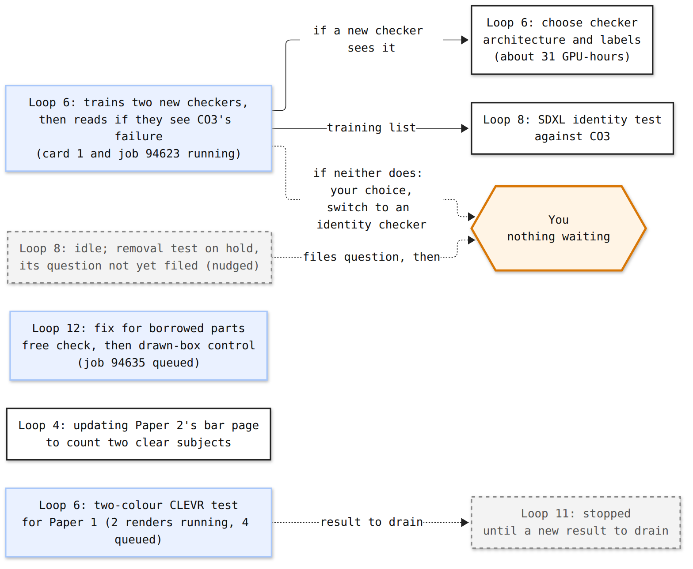

# 🧭 Manager: where the loops stand

Loop 13 rewrites this page every hour. It reads the progress board, the open questions, the requests
between loops, the cluster and the live sessions, decides the questions it is allowed to decide for you,
and leaves the rest here. Paper 1 is experts that never met; Paper 2 is doing better than CO3 inside one
model.

**Last tick:** 2026-11-24 23:51 (UTC+2). The board stands at 57 of 90 steps done and 6 in progress.

## Contents

- [Decided for you, and still for you](#decided-for-you-and-still-for-you)
- [Where each loop is](#where-each-loop-is)
- [Resources](#resources)
- [Things that may be wrong](#things-that-may-be-wrong)
- [Alignment](#alignment)
- [Nudges, requests and decisions sent](#nudges-requests-and-decisions-sent)
- [Requests waiting](#requests-waiting)
- [Last tick](#last-tick)

## Decided for you, and still for you

### Decided for you since you last looked

Each was reversible, inside the asking loop's budget, and changed no recorded bar or verdict. To
overrule one, answer it again: `python3 scripts/progress_board.py answer <number> "<your answer>"`.

| # | The question | Decided | Why |
|---|---|---|---|
| none | Loop 8's method review found the removal test feeds nothing since your answer on 86 | **Close the removal test (V7) as not run** after the cheap visibility check; the full retraining from question 95 is skipped | Reversible, saves about 1.5 GPU-hours, no bar changed; it was option B of question 95. |
| 97 | Which of three small reruns from Loop 12's audit of Loops 8, 9 and 10 should run? | **Only the first** (when the digit sampler settles which digits it draws), in Loop 8, about 0.04 GPU-hours; the third read free from Loop 12's own records, reopening nothing | The second is already settled by Loop 8's checks; the third needs Loop 10, which is closed. |
| 95 | Loop 8's identity checker missed twice on the sampler's own states (0.651, then 0.552 with memorised training digits); what next? | **A with three additions**: first check the digits are readable from the sampler's states at all (about 0.1 GPU-hours, and stop if not), hold out seeds of digits 0 to 4 as a control, then train on both data sets and read fresh digits 5 to 9 once; about 1.6 GPU-hours | The [reviewer's second pass](../reviewer/2026-11-24-review.md#loop-8-again-at-2215-two-misses-on-reading-sampler-states) found the second try memorised 2,036 stored states with no fresh noise, and no one has checked the digits are readable there at all. The SDXL test does not wait on this. |
| 94 | Loop 8's digit identity checker reads pasted digits (0.861) but not the sampler's own states (0.651 against 0.75); does its removal test run? | **A: retrain it on sampler states from digits 0 to 4, read digits 5 to 9 again on freshly drawn canvases, and run the removal test only if it passes**, about 1.5 GPU-hours | It answers the reviewer's main point on Loop 8 and tells its SDXL test whether to train on CO3's states. Reversible, inside budget, no bar changed. |
| 93 | Loop 6's checker cannot see CO3's failure; what happens to its search for the best checker? | **A: read the two checkers being trained now the same way first**, about 2.2 GPU-hours, before the next steps spend about 31 | Reversible, inside budget, no bar changed, and the reviewer's first fix. If neither new checker sees the failure, pausing the search for an identity reader comes to you. |
| 91 | Which fix should Loop 12 test on CO3's borrowed parts? | **Not the default as written.** A free check on saved records first, then a place-by-place fix at about steps 15 to 30 with boxes drawn by eye as a positive control, beside a whole-canvas control; about 1.7 GPU-hours | The [reviewer](../reviewer/2026-11-24-review.md#loop-12-where-co3-leaks) found the default read its places at steps 0 to 5, where Loop 12's own picture shows both animals' predictions still drawing both bodies, the failure that closed Loop 6's region test. How the pictures are scored is yours, as question 92. |
| 83 | Should Loop 6 close its test of whether drawing each subject in its own region stops borrowed parts, after three tries missed? | **Close it**, reporting what it found | Loop 6's own [method review](../method-search/04-bind-each-body/method-review.md) and the [reviewer](../reviewer/2026-11-24-review.md#loop-6-find-the-best-method) agree: every try split the picture using a signal that had not yet separated the two subjects, and a fourth would cost about 4.9 GPU-hours without fixing that. Costs nothing. |
| 78 | Who runs Loop 10's small digit test of whether the experts' vote beats simply pasting their samples, for Paper 1? | **Loop 6**, after its current step | About 0.3 GPU-hours inside Loop 6's budget, and it adds the paste comparison the reviewer finds Paper 1's tests lack. |
| 81 | Loop 11's ten format conflicts on the 48 method and finding pages it wrote | **All ten of its defaults** | None changes a recorded number or verdict; where two verdicts exist both stay side by side. The reviewer found Loop 11's work sound. No GPU. |
| 85 | The reviewer's fixes for Loop 6's search for the best checker | **Yes to two of three**: first check whether the checker can tell CO3's clean pictures from its borrowed-part ones at each step (about 1.2 GPU-hours), and give the two-colour CLEVR test a paste comparison (CPU only) | Both are reversible and inside budget. The third fix changes how Loop 6 is judged, so it is yours, as question 87. |
| none | Loop 6's read came out inconclusive by count: 21 of 96 trajectories missed the 3-of-255 match because they were first drawn on an RTX 8000 and reread on an RTX 3090 | **Rerun those 21 on mscluster107 card 1** after Loop 8's checks, before Loop 6's training | About 15 minutes; it meets the read's own written rule on the matching card type and changes no bar. Loop 6 records that the rerun was decided after the 75-trajectory result. |
| none | Eight requests were addressed to Loops 7 and 10, which have stopped | **Re-routed**: four to Loop 8, four to Loop 11 | Each corrects a page that disagreed with what ran; no result changes. A ninth, on numbers in Loop 10's digit-signal review, Loop 10 fixed itself (commit `77cf7bb7`: five copying slips corrected to match its result file, verdict unchanged). |

**Acted on.** Loop 6 carried out 83, 78 and 85 by 16:31 (commits `6f8f65e5` and `58cee28a`): the region test is closed on the board, the digit test is its new step M11, and the check of whether its checker can see CO3's failure is designed with its bar written first and runs as jobs 94593 and 94594 before any comparison renders.

### Answered by you

At 16:55, in chat, recorded on the board and sent to each loop:

| # | The question | Your answer |
|---|---|---|
| 88 | Should Loop 11 stop after its last two steps until a research loop has something new? | yes, the default |
| 87 | Should Loop 6's checker search be judged on two clear subjects, drawing style ignored? | yes; damage reported beside it, two reviewers per picture |
| 80 | Should a checker choose CO3's sharpness setting at each corrected step? | declined: the checker does not see CO3's failure (60% right against a 65% floor); the design stays on file to reopen if a checker that sees it is found |
| 92 | Should Loop 12's fix test count two clear subjects with their own parts, drawing style ignored? | you asked Loop 13 to decide: yes, with broken anatomy as a guard and faithful pairs reported beside it, so every Paper 2 result is counted one way; Loop 4 is bringing the bar's page in line |
| 90 | May loops run queued work on mscluster107's idle card 1, inside another user's allocation? | yes: one run at a time, Loop 8 then Loop 6, with a watchdog that stops ours if their process starts using the card |
| 89 | May Loop 13 add an edit command to the board script and fix the three records that disagreed with your answers? | yes: Loop 8's SDXL test now needs Loop 6's training list and names CO3 alone as its rival; the small CLEVR test is closed without running and the recipe freeze waits on the two-colour CLEVR test; Loop 10's skipped steps are closed. Commit `88b787c9`; the board before the change is kept at `/home/molef/.claude/jobs/3c51301e/tmp/board-before-q89.json` |
| 79 | Which of Loop 9's two recorded verdicts leads its report title? | the default: the test's own verdict on the title, and the fairness test as its own finding beside it (answered at 16:59) |
| 86 | Should Loop 8's SDXL test push identity on CO3's own run and be judged against CO3 alone? | yes; it starts from Loop 6's training list, about 6 GPU-hours. Loop 8 is asked to use the same two-clear-subjects measure as Loop 6 so the two compare |

### Still for you

Newest first. A default happens only if you answer with it; nothing changes while a question waits.

| # | The question, in one line | Why it is yours | Default | Waiting |
|---|---|---|---|---|
| 96 | Paper 2's checkers are gated on their yes-or-no call at zero (75% right), but the push follows only the direction of the checker's gradient, so ranking good pictures above bad ones is what steers it. Loop 6's checker ranks at about 0.70 but calls 0.602 right; Loop 8's ranks at 0.78 but calls 0.651. Keep the recorded gate, or switch to ranking? | changes a recorded bar after seeing which one passes on similar checkers | keep the recorded gate, report ranking beside it, and bring a pass on ranking alone back to you | just filed |

Your own reading step (confirm the draft statements from your readings) is ready on the board.

## Where each loop is

The finish range is `session_status.py`'s, from the 63 finished steps: fastest pace seen to slowest.

| Loop | Doing now, and why | Steps left | Estimated finish | Session | Held by |
|---|---|---|---|---|---|
| 4. Rivals and targets | Keeping every target current. It updated Paper 2's bar page to count two clear subjects with their own parts (questions 87 and 92). | 1 | none useful: it ends after the paper tables, which have not started | idle | nothing |
| 6. Best method | Choosing the training list for Paper 2's checker (step M5): its kept checker does not see CO3's failure (right 60% of the time, floor 65%), so by question 93 it reads its two new checkers the same way first; one training is done, one runs (job 94662), and the read waits for the `biggpu` slot (94704). Paper 1's two-colour CLEVR test has its first 5,000 pictures per colour rendered and its scoring renders queued. | 9 | 5.1 h to 202.5 h | busy | its own jobs; question 96 decides how its checker reads are judged |
| 7. Abstract-checker papers | Finished; its session is closed. | 0 | done | closed | nothing |
| 8. Abstract checkers | Its digit identity checker reads pasted digits (0.861 against 0.75) but not the sampler's own states. Its method review found the first checker ranks but its cut drifts, and the second memorised. It finishes one cheap check of whether digits are readable there (job 94717), then closes its removal test as not run. Its SDXL test against CO3 is next. | 2 | 1.7 h to 61.7 h | busy | question 96 decides the SDXL test's readability gate; Loop 6's training list |
| 11. Drain into the pillars | Stopped by your answer on 88; every finished result is on a report page. | 1 | when restarted | stopped its loop | a new result worth draining |
| 12. Where CO3 leaks | Its fix test is done and null: boxes drawn by eye, whole-picture correction and CO3 alone each give 5 of 48 two-clear pictures ([fix review](../leakage/03-one-fix/review.md)). It chose a text-side fix to test next and audited Loops 8, 9 and 10's designs ([audit](../leakage/05-design-audit.md)); question 97 asks for three small reruns. The reviewer is reading it again. | 2 | 49 min to 46.6 h | idle | question 97 |

## Resources

Read at 21:07 from `squeue`, `sacct` and `sinfo`; down nodes from `sinfo -R` at 16:28.

| What | Now |
|---|---|
| Our jobs against the caps | 5 running on `bigbatch` of 6 allowed (Loop 6's two checker trainings and two CLEVR renders, Loop 8's retraining); 0 on `biggpu` of 1, since Loop 6's state save there finished, though `biggpu` has no idle node; 6 queued, including Loop 6's scoring read (94700) and Loop 12's next fix run (94678) |
| Longest wait | Loop 6's scoring read (94700) and Loop 12's next fix run (94678), both waiting on `bigbatch` priority |
| Nodes out of service | `bigbatch`: 12 down and 5 drained of 48. `biggpu`: 2 down and 2 drained of 7, including mscluster108 and mscluster111, drained at 09:27 and 09:10 today after a failed job kill |
| Idle capacity | none: at 17:43 every working `bigbatch` and `biggpu` node was allocated. mscluster107 is now another user's `biggpu` job (94610, 6-hour limit, started 17:36); its second card sits idle at 170 MiB, but their process holds it, so it is not ours to use. Your interactive job 83423 on that node no longer appears in the queue |
| Shared card | **Not in use.** The other user's job on mscluster107 ended early, around 20:00, leaving the node idle in Slurm, so question 90's approval for borrowing a card inside their allocation no longer applies. Loop 6 stopped its shared run within 30 seconds, with nothing written, and resubmitted it through Slurm as its one `biggpu` job (94676, pinned to mscluster107 for the RTX 8000 the six CO3 pairs were first drawn on). Loop 8's run there earlier finished cleanly. A new shared-card run needs a new yes from you |
| Compute against budget since 2026-11-21 | Loop 6: 53.4 node-hours of 87 (34.8 were CLEVR renders that may have used no GPU). Loop 8: 11.9 of 30. Loop 12: about 0.4, no total set. Slurm here records no GPU count, so these are node-hours, an upper bound |

**What would make the queue move faster:** little within our control. There is no idle `biggpu` card,
and the drained nodes need the administrator. Loop 6's two-colour CLEVR renders hold two `bigbatch`
nodes for up to 10 hours each while running on the CPU; they must stay on `bigbatch`, the only other
partition we may use, so this is a cost to note, not one to fix.

## Things that may be wrong

Newest first.

| Concerns | Finding | Source |
|---|---|---|
| Loop 12 | **A run of bad results** (two nulls) and **a test that measured something else than its name**: the drawn-box fix never gave each animal its own prediction inside its box, so its draft verdict that regions cannot work overreaches. Method review request sent at 23:35. | `2-classifier-guidance/scripts/leakage/z3_regions.py` lines 66 to 72 |
| Loop 8 | **A run of bad results on reading sampler states**: 0.651, then 0.552 with memorised training digits. Method review request sent at 22:20 after the reviewer's second pass. | `abstract-checkers/10-reading-identity/review.md` |
| Loops 6 and 8 | **The same split in both loops**: their checkers rank good above bad pictures moderately (area under the curve about 0.70 on CO3, 0.78 on digits) but their yes-or-no call at zero misses the bar (0.602 and 0.651). Neither loop may swap the gate after seeing this; both are asked to look at it in review. | both reviews |
| Loop 8 | **The digit checker reads pasted canvases but not real sampler states**: 0.861 on pasted digits against 0.651 on the sampler's own states at steps 27 to 36, under 0.75. A checker that pushes during sampling has to read sampler states, so this is the result that decides whether the removal test is worth running. | Loop 8's message at 18:26 |
| All loops | **The same CO3 run gives different pictures on different card types.** Loop 6's rerun of M1's 96 CO3 trajectories on an RTX 3090 matched all 48 first drawn on a 3090 and none of the 21 checked from an RTX 8000, beyond 3 of 255 in mean pixel value. Any comparison of pictures drawn on mixed card types mixes the card in. No environment page records this, and the environment pillar's keeper has stopped. | Loop 6's message at 18:22 |
| Loop 6 | **Design note, not a problem.** The new check scores whether the checker's score lands on the right side of zero, a fixed cut. If its area under the curve, reported beside, is high while that accuracy is low, the checker separates CO3's clean pictures from its borrowed-part ones and only its cut is off. Read the two numbers together when the check lands. | `method-search/01b-balance-the-checker-data/design.md`, the check section |
| Loop 6 | **The checker training failed twice in 3 minutes** (jobs 94473 and 94474); the reruns (94579 and 94580) finished in 11 and 12 minutes. | `sacct` |
| Loops 6 and 8 | **A run of bad results, now reviewed.** Loop 6's region test missed three times in a row and Loop 8's misses shared a cause. Both answered their reviews within minutes and corrected their records and pictures (Loop 6 commit `f29cf613`, Loop 8 commit `8c310b3a`). | [the review](../reviewer/2026-11-24-review.md) |
| Loop 6 | **Its CLEVR paste review contradicts itself**, Loop 11 found: line 3 says no verdict yet while lines 95 to 97 give one, and the expert check is both still to run and passed. Sent to Loop 6 in `requests.md` at about 17:00. | `requests.md` |
| Loop 4 | **The standing step has run 54 hours**, longer than any finished step (23.5 hours). It ends only after the paper tables, by design. | `session_status.py` |
| Loops 6 and 8 | **Failed jobs in the last 24 hours, each followed by a rerun that finished or a move to card 1**: Loop 6, 11 failed and 5 cancelled (the two newest, 94603 and 94605, on a training-list bug it fixed); Loop 8, 2 failed. No time-outs or out-of-memory ends. | `sacct` |

Nothing found for: jobs running past twice their estimate, steps in progress with nothing running for
them, or new rows on the void list (unchanged since 2026-11-22).

## Alignment

Round 2, 2026-11-24 22:10 (round 1 at 16:10), against the intents in [the alignment check](../score-space/13-alignment-check.md).

| Loop | Still working towards its intent? | Reviewer | The fact that shows it |
|---|---|---|---|
| 4. Rivals and targets | yes | next pass | Paper 2's bar page now counts two clear subjects with their own parts, by questions 87 and 92, so every Paper 2 result is judged one way ([leakage rivals](../targets/leakage-rivals.md), commit `a437cb86`). |
| 6. Best method | partly, re-aimed | **fix** | It now tests whether a checker can see CO3's failure before choosing one: the kept checker cannot (best 0.602 against a 0.65 floor, [review](../method-search/01b-balance-the-checker-data/review.md)), and its two new checkers are read next. |
| 7. Abstract-checker papers | yes, finished | not reviewed | Its three steps are done; the five-checker design is in `abstract-checkers/03-design.md`. |
| 8. Abstract checkers | partly | **fix**, twice | Its digit half holds on pasted digits (0.861 against 0.75), but two tries to read the sampler's own states missed; its [method review](../abstract-checkers/10-reading-identity/method-review.md) found the causes, and its SDXL test against CO3 is the step that serves Paper 2 ([second pass](../reviewer/2026-11-24-review.md#loop-8-again-at-2215-two-misses-on-reading-sampler-states)). |
| 11. Drain into the pillars | yes | **continue** | [Its checks page](../drain/04-checks.md) covers all 48 pages it wrote, with 15 of 28 findings fixed. |
| 12. Where CO3 leaks | partly | **fix**, twice | Two nulls in a row, and its drawn-box test kept the joint prompt's prediction inside each box, so it does not show that regions cannot work; its next test (a text-side swap) has no positive control yet ([second pass](../reviewer/2026-11-24-review.md#loop-12-again-at-2300-two-nulls-in-a-row)). |

**Loop 11's intent, written by Loop 13 from its brief for you to correct.** Loop 11 takes the
diagrams, picture sheets and results the research loops produce, which sit in their own notes folders
where no pillar page shows them, and drains them into `report/` and `context/`: checked against the
pillar formats, explained from the overview down to each part, in organised folders of numbered pages.
It took this over from Loops 2 and 3, which have stopped.

## Nudges, requests and decisions sent

Newest first.

| Time | To | What and why |
|---|---|---|
| 17:02 | Loop 8 | Its rewritten SDXL test passes the design check (stop rule, random and zero controls, comparison prompts fixed in advance, the same two-clear measure as Loop 6; about 7 GPU-hours, inside budget). Its board record goes to you as question 89. |
| 23:50 | Loop 12 | Its [method review](../leakage/method-review.md) answered: records corrected to say what the drawn-box test did, the two disagreeing records reconciled, question 97's third rerun read free from its own records. Next, in order: a free text-only check, each animal's own prediction inside its box (about 0.8 GPU-hours), and the text-side swap only if the free check supports it, with a positive control. |
| 23:35 | Loops 12 and 8 | **Method review request** to Loop 12 after two nulls, with question 97 decided; Loop 8 runs that question's first rerun beside its free check. One line in `requests.md`. |
| 22:30 | Loops 8 and 6 | Loop 8's method review answered (`method-review.md`): the first checker ranks but its cut drifts, the second memorised. Its removal test closes after the visibility check; the gate question is yours as 96, and both loops keep their recorded gate until then. |
| 22:20 | Loop 8 | **Method review request** after two misses on sampler states, with question 95 decided; one line in `requests.md`. |
| 19:00 | Loop 8 | Question 94 decided: retrain on sampler states and re-read fresh digits 5 to 9 before the removal test. |
| 18:56 | Loop 8 | Idle since 18:25 with its removal test on hold for you but no question filed; asked to file it with its recommendation, and to close its identity-digits step if its proof is met. |
| 18:52 | Loop 6 | Question 93 decided: read the two new checkers first; pausing the search returns to you if both fail. |
| 18:46 | Loops 12 and 4 | Question 92 decided at your request: Loop 12 counts two clear subjects, drawing ignored; Loop 4 asked to update `targets/leakage-rivals.md` lines 23 and 24 and any Paper 2 row naming faithful pairs. |
| 18:40 | Loop 12 | **Reviewer verdict: fix**, and question 91 decided against its default; question 92 left with you, so faithful pairs stand until then. |
| 18:27 | Loop 6 | Card 1 handed over after Loop 8 finished. |
| 17:58 | Loops 8 and 6 | Card 1 on mscluster107 approved (question 90): Loop 8 launches its two checks first, Loop 6's checker training follows; both cancel their queued Slurm copies once the shared run starts. |
| 16:30 | Loop 10 | Its question 78 is decided; its open requests are re-routed. |
| 16:39 | Loop 8 | The four requests re-routed from Loop 7 take the form Loop 8 proposed: the design text stays as written, and one added section lists what ran differently, line by line with commits. Loop 8 also put this to you in its own session; your answer there governs. |
| 16:30 | Loop 8 | Four requests re-routed from Loop 7, which has finished. |
| 16:30 | Loop 11 | Question 81 decided (all ten defaults); four requests re-routed from Loop 10. |
| 16:30 | Loop 6 | Questions 83, 78 and 85 decided; question 87 left with you, so its bar stands until then. |
| 16:25 | Loop 8 | **Reviewer verdict: fix**, with the review and question 86. |
| 16:25 | Loop 6 | **Reviewer verdict: fix**, with the review and question 85. |
| 16:09 | Loop 6 | **Method review request** on the region test after three misses; answered at 16:11 with [its method review](../method-search/04-bind-each-body/method-review.md). |

### Sessions closed

Under the closing rule: idle, and the loop finished, closed, or a second copy of one loop. Open requests were carried over first.

| Time | Session | Loop | Why |
|---|---|---|---|
| 16:46 | `70624adb` | 10, the score path | closed by you on question 76; its requests went to Loop 11 and question 80 stays with you |
| 16:46 | `38bc00f5` | 4, rivals and targets | the older of two sessions; `f3676c33` keeps running and the board now names it |
| 16:44 | `09f14d5d` | 7, abstract-checker papers | every step done |
| 16:44 | `bed4762f` | 9, concepts into scores | closed by you |
| 16:44 | `b0fc9e51` | 5, reproduce the rivals | closed by you |

Four more entries in the session list (an old Loop 4 copy, Loops 2 and 3, and a Loop 7 copy in the learning folder) have no running process, so there was nothing to close.

## Requests waiting

Read from `requests.md` at 16:15 (277 lines then). Of the 158 lines addressed to a watched loop, 49 had
been acted on, 93 asked nothing, and 15 waited. Nine of those were re-routed or fixed this tick
(above). Still waiting:

| Line | To | From | Added | The request | Why it still waits |
|---|---|---|---|---|---|
| 127 and 269 | Loop 4 | Loop 4 | 11-23 13:54 | Make the scoreboard count a win against the best finished rival rerun (your question 47). | Not due: no score of ours exists yet. |
| 133 | Loop 4 | Loop 6 | 11-23 14:51 | Write your decision that abstract checkers belong in Paper 2 into the problem statements and the two-paper route, once a result exists. | Unclear whether due: digit results exist, the SDXL test has not run. |
| 239 | Loop 11 | Loop 8 | 11-24 14:14 | Pass on to whoever drew `annotated-overviews/loop-8.png` that its push window and push length are wrong. | No later line mentions it. |
| 247 and 273 | Loop 11 | Loop 4 | 11-24 14:14 and 15:58 | Commit the cross-reference links written this morning and afternoon. | The files are still uncommitted. |
| 287 | Loops 5, 9 and 10 (closed) | Loop 11 | 11-24 16:50 | A card in each step folder whose pictures a report finding embeds: `reproductions/`, `noise-text-critic/`, `score-space/05-signal/`. Loops 6 and 8 did theirs. | No live loop owns these folders; they wait for Loop 11's restart. |
| 251 | Loop 6 | Loop 11 | 11-24 14:14 | Backlinks from Loop 6's first-test and region-test designs to the three method-search findings. | No such links yet. |

## Last tick

2026-11-24 21:08. Next tick about 22:08, with the alignment round and briefing. The briefing for you is [the briefing page](briefing.md).
