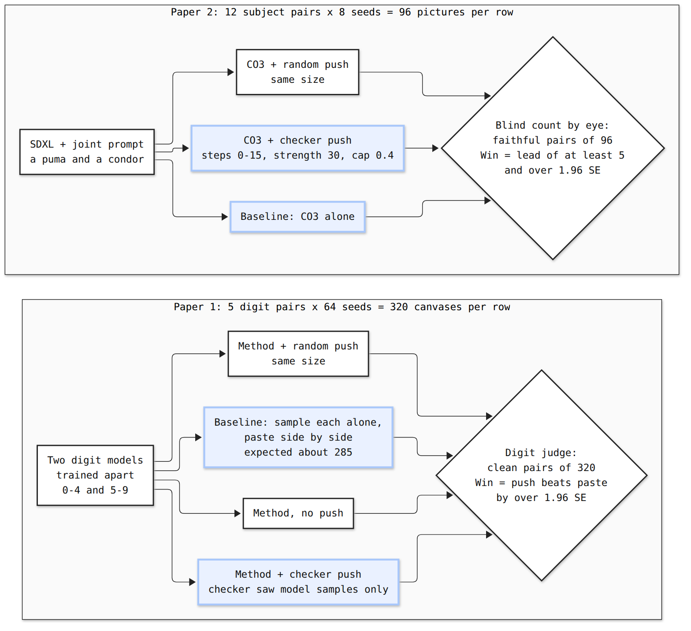
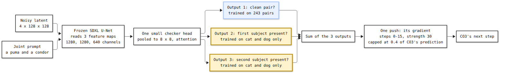
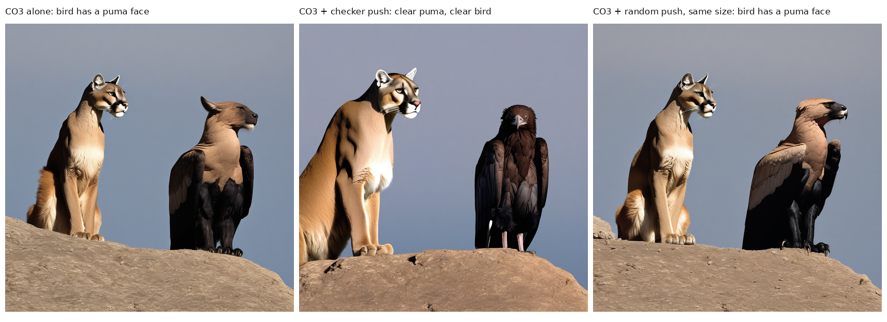
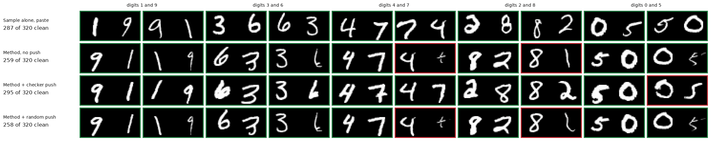
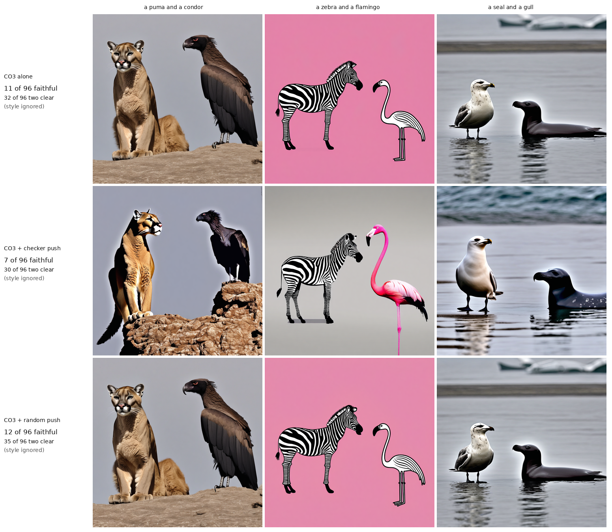

# Does either paper's method beat its rival on tuning data? (step M1)

Step M1 ran each paper's method against its rival on tuning pairs and seeds. Paper 1 composes two digit models trained apart and is compared
with sampling each model alone and pasting the two side by side. Paper 2 pushes CO3 inside SDXL with the kept checker and is compared with CO3
alone. Both are nulls: Paper 1 ties paste, and Paper 2's push makes fewer faithful pairs than CO3 alone. The verdicts and every count are in
[the step's review](review.md), and the bars are in [its design](design.md).

## What is in here

Two diagrams of what ran, three sheets of pictures, and the blind calls, key and scored result behind Paper 2's counts.

## The diagrams

### the-two-comparisons

**What it shows**

The two comparisons side by side. Top, Paper 2: one joint prompt goes to three rows (CO3 with the checker push, CO3 with a random push of the
same size, and CO3 alone), and 96 pictures per row are counted blind by eye. Bottom, Paper 1: two digit models trained apart on digits 0 to 4
and 5 to 9 go to four rows, and 320 canvases per row are scored by a digit judge. The diamond on each side states the win rule.

**How we got this image**

Drawn from the Mermaid source [the-two-comparisons.mmd](the-two-comparisons.mmd) beside it, rendered to PNG and SVG with the drip skill's
Mermaid renderer.

**What it lets you say**

Which rows each paper compared, how many pictures each row holds, and what counted as a win before anything ran.

**What it cannot say**

Any result. The diamond's "faithful pairs" was M1's bar. Steps M5 and D3 are judged on two clear subjects with drawing style ignored, by
the owner's answer to board question 87, so this diagram describes M1 only.

**Where it came from and what judged it**

The rows and bars are [M1's design](design.md). The results are judged in [the review](review.md).

### what-the-push-follows

**What it shows**

The path from a noisy SDXL latent to CO3's next step. The frozen U-Net reads three feature maps under the joint prompt, one small checker head
pools and attends over them, and its three outputs (clean pair, first subject present, second subject present) are summed. The gradient of
that sum is the push, on steps 0 to 15 at strength 30, capped at 0.4 of CO3's prediction. The two presence outputs are marked in yellow
because they were trained on cat and dog only.

**How we got this image**

Drawn from the Mermaid source [what-the-push-follows.mmd](what-the-push-follows.mmd) beside it, rendered to PNG and SVG.

**What it lets you say**

That two of the three outputs the push follows learned only cat and dog, which is one candidate reason the push did not help CO3 on other
pairs.

**What it cannot say**

That the presence outputs caused the null. No run in M1 removes them. Step M5 trains the clean-pair output alone, and step M2 tests the labels.

**Where it came from and what judged it**

The checker is `PairHead` in `2-classifier-guidance/scripts/rung2/train_readout_pair.py`, read from the kept head at
`/home-mscluster/mmolefe/poe_repair_min_scratch/outputs/classifier_guidance_ladder/rung2/readout_pair/readout-multipair/head_step_002000.pt`.
The push settings are in [M1's design](design.md).

## The sheets

### smoke-puma-and-condor-seed-6001

**What it shows**

Three renders of "a puma and a condor" at seed 6001. Left, CO3 alone: the bird has a puma's face. Middle, CO3 with the checker push: a clear
puma beside a clear dark bird. Right, CO3 with a random push of the same size: the bird again has a puma's face.

**How we got this image**

The three renders come from M1's smoke rung on the cluster, under `/datasets/mmolefe/poe_repair_min/loop-6/m1/paper-2/smoke/`. They were
pulled to the laptop, checked at full size, and laid out in one row with a caption per picture.

**What it lets you say**

The code runs and the three rows produce different pictures from the same seed.

**What it cannot say**

Anything about which row is better. It is one pair at one seed, chosen because it was the smoke run, and the full count went the other way.

**Where it came from and what judged it**

The smoke rung of [M1's design](design.md), described in the review's [smoke section](review.md#the-smoke-picture).

### paper-1-four-rows-first-two-seeds

**What it shows**

Digit canvases for the five digit pairs (1 and 9, 3 and 6, 4 and 7, 2 and 8, 0 and 5) at seeds 0 and 1, two canvases per pair. The rows are
sample-and-paste, the method with no push, the method with the checker push, and the method with a random push. A green frame is a canvas the
digit judge calls clean, a red frame one it does not. Each row's label carries its clean count of 320.

**How we got this image**

The canvases come from M1's Paper 1 run on the cluster, under `/datasets/mmolefe/poe_repair_min/loop-6/m1/`. The first two seeds of each pair
were pulled to the laptop, framed by the judge's call, and laid out four rows by ten.

**What it lets you say**

Where the no-push and random-push rows fail (a half-drawn second digit) and that the checker push repairs those canvases. Across all 320
canvases it lifts the method by 36 clean pairs where a random push changes nothing.

**What it cannot say**

That the method beats paste. Paste draws 287 and the pushed method 295, a lead of 8 under the bar of 13.54. Ten canvases per row are not the count.

**Where it came from and what judged it**

The counts and the bar are in the review's [Paper 1 question](review.md#questions). Sixty-four canvases were also called by eye, agreeing with
the judge on 58.

### paper-2-three-rows-seed-6002

**What it shows**

Three tuning pairs at seed 6002 (puma and condor, zebra and flamingo, seal and gull) under three rows: CO3 alone, CO3 with the checker push and
CO3 with a random push of the same size. Each row's label carries its counts of 96: faithful pairs, and two clear subjects with style ignored.
CO3 alone and the random push are nearly identical, and the checker push changes the drawing and the background.

**How we got this image**

The renders come from M1's full Paper 2 run on the cluster, under `/datasets/mmolefe/poe_repair_min/loop-6/m1/paper-2/full/renders/`. The
first three tuning pairs at seed 6002 were pulled to the laptop, checked at full size, and laid out three by three. Giraffe and tortoise is
counted in the 96 and left off the sheet.

**What it lets you say**

All three rows draw two separate bodies, so CO3's failures are identity and style, and the kept push does not fix them: 7 faithful pairs of
96 against 11 for CO3 alone, and 30 two-clear pictures against 32.

**What it cannot say**

Anything per pair. Three pictures per row are an illustration, and the counts come from blind calls on all 96 per row.

**Where it came from and what judged it**

The blind calls are in [paper-2-blind-calls.csv](paper-2-blind-calls.csv), the hidden key mapping each picture to its row, pair and seed is in
[paper-2-blind-key.json](paper-2-blind-key.json), and the scored counts are in [paper-2-blind-result.json](paper-2-blind-result.json). The
verdict is in the review's [Paper 2 question](review.md#questions), W&B run `s7o6404z`.
