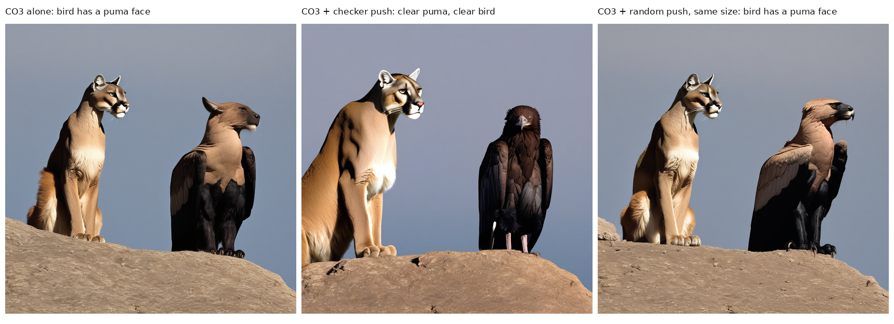

# Review: does each paper's method beat its simple baseline? (step M1)

This file holds what the runs in [the M1 design](design.md) produced. Neither paper has a verdict yet.

## Runs

Outputs are on the cluster under `/datasets/mmolefe/poe_repair_min/loop-6/m1/`, and logs are in
`/datasets/mmolefe/poe_repair_min/loop-6/logs/`. A commit pair is the repository commit, then the replications hub commit.

| Paper | Rung | Slurm job | Commits | Output | State |
|---|---|---|---|---|---|
| 1 | Smoke, overfit, 1% and zero-push check | 93461 | `f0410a14-f2bdb6d` | `paper-1/ladder/` | passed |
| 1 | 1% of the data, 1,000 steps, so the loss is logged | 93583 | `7df3e0b1-f2bdb6d` | `paper-1/ladder/checkers-1pct-1000/` | passed |
| 1 | Comparison: 35,000-sample pool, two checkers, four rows | 93598 | `7df3e0b1-f2bdb6d` | `paper-1/full/` | running |
| 2 | Concept parse and zero-push check | 93468 | `99ac88a8-f2bdb6d` | `paper-2/controls/check.json` | passed |
| 2 | Smoke and 1%: one pair, one seed, three rows | 93481 | `99ac88a8-f2bdb6d` | `paper-2/smoke/` | passed |
| 2 | Comparison, pair shard 0 of 2 | 93523 | `99ac88a8-f2bdb6d` | `paper-2/full/` | running |
| 2 | Comparison, pair shard 1 of 2 | 93524 | `99ac88a8-f2bdb6d` | `paper-2/full/` | queued |

## Paper 1 controls

**Do both checkers memorise 16 canvases?** ✅ Yes. The pair checker and the separate checker each got 16 of 16 right, against a bar of 15.

**Does the loss fall on 1% of the pool?** ✅ Yes. Over 1,000 updates on 300 training samples, the logged loss went from 0.5793 at update
500 to 0.5035 at update 1,000 for the pair checker, and from 0.3453 to 0.3243 for the separate checker.

**Does a zero push reproduce the method without a push?** ✅ Yes. The largest absolute difference was 0.0, against a bar of 1e-5, in one
process on an RTX 3090.

**Do all four rows run?** ✅ Yes, on digits 4 and 7 at 8 seeds. The counts from that smoke run are too small to compare.

## Paper 2 controls

**Does a zero push reproduce CO3's own loop?** ✅ Yes. The largest absolute difference between final latents was 0.0, against a bar of
1e-5, in one process on a Quadro RTX 8000 at float16. Two plain CO3 runs in that process also differed by 0.0.

**Does the real push change the render?** ✅ Yes. The largest absolute difference in the final latent was 3.79. The push acted on all 16
steps from 0 to 15, and the cap fired on 2 of them.

**Does every tuning prompt give CO3 two concepts?** ✅ Yes, on all 12.

**How long does a picture take?** On the RTX 8000, one seed took 43.2 seconds for CO3 alone, 58.3 with the push and 45.2 with the random
push. That is 146.7 seconds per seed across the three rows, or about 3.9 GPU-hours for all 96 pair and seed combinations, against the
design's budget of 4.8.

## The smoke picture

One pair at one seed, read at full size. It shows the code runs and the three rows differ, and it is no evidence for either side of the bar.

## Questions

**Paper 1: does the method beat sample-and-paste?** Unanswered.

**Paper 2: does CO3 with the push beat CO3 alone?** Unanswered.
