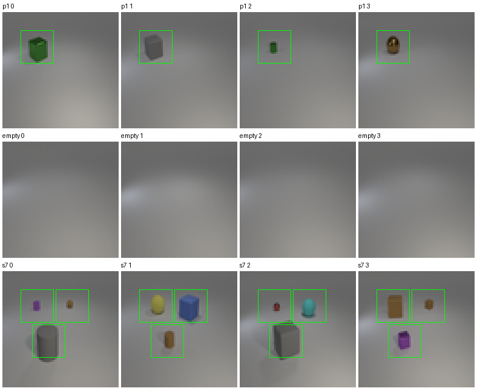

# Review: does sample-and-paste already solve small CLEVR? (step M7)

This file holds what the runs in [the M7 design](design.md) produced. M7 has no verdict yet.

## Runs

Outputs are on the cluster under `/datasets/mmolefe/poe_repair_min/loop-6/m7/`, and logs are in `/datasets/mmolefe/poe_repair_min/loop-6/logs/`.

| Rung | Slurm jobs | Commits | Output | State |
|---|---|---|---|---|
| Smoke render, 4 pictures each of position 1, empty and all three positions | 93710, 93711, 93712 | `337d1be4-15d8bdd` | `smoke/renders/` | passed |
| Full renders, 5,000 pictures each of positions 1, 2, 3 and empty | 93713, 93714, 93715, 93716 | `337d1be4-15d8bdd` | `full/renders/` | running |

## The smoke render

All 16 placed objects landed within 0.002 of the image of where they were aimed. A picture took 4.9 to 5.3 seconds with objects and 4.5
without. Large objects at position 3 reach the edge of the 18-pixel paste window, so the window control in the design decides whether the
window needs fixing before any sample is scored.
