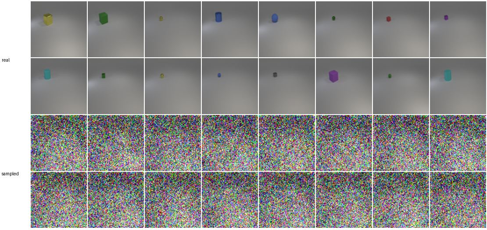
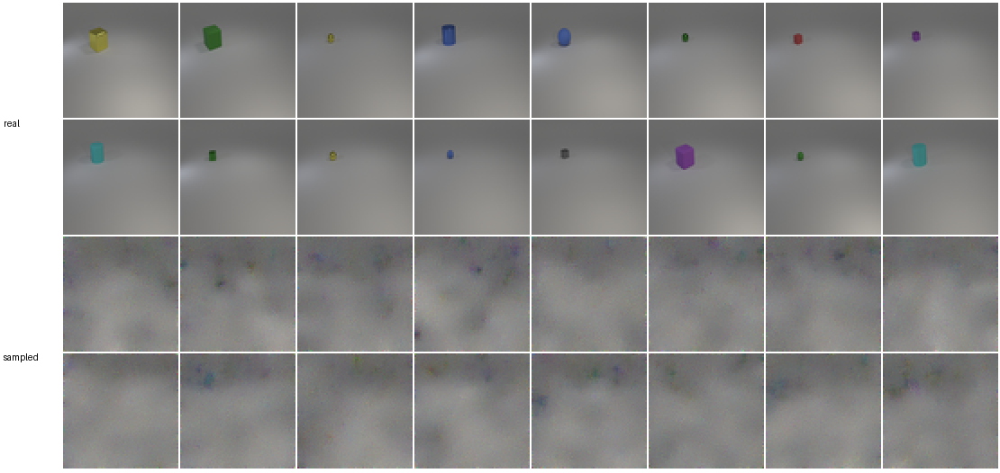
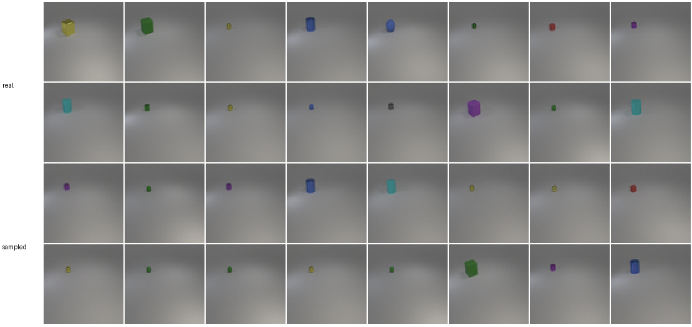
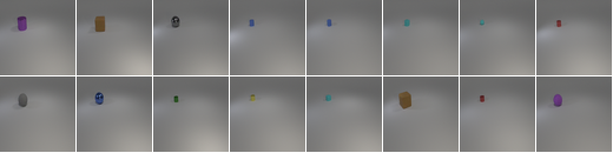
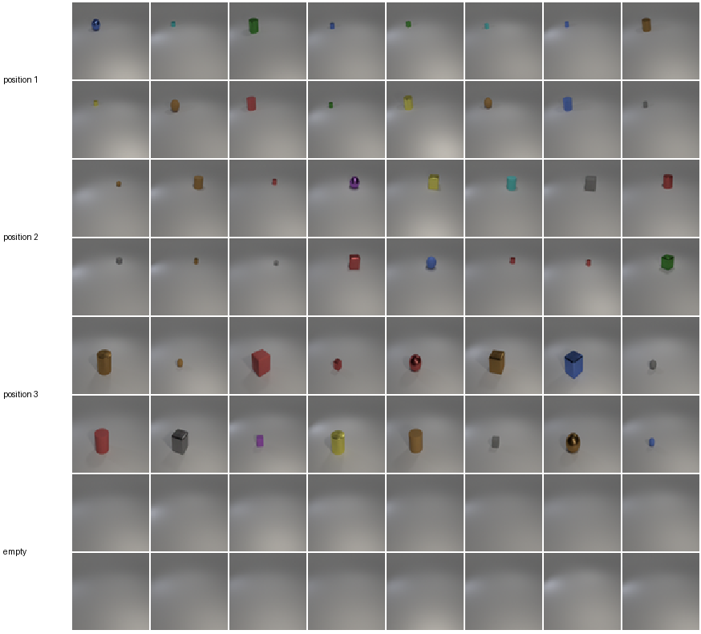
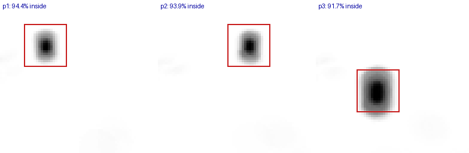

# Review: does sample-and-paste already solve small CLEVR? (step M7)

This file holds what the runs in [the M7 design](design.md) produced. M7's verdict is that paste solves small separated CLEVR, so M7 stops,
in [the paste verdict](#the-paste-verdict) below.

## Runs

Outputs are on the cluster under `/datasets/mmolefe/poe_repair_min/loop-6/m7/`, and logs are in `/datasets/mmolefe/poe_repair_min/loop-6/logs/`.

| Rung | Slurm jobs | Commits | Output | State |
|---|---|---|---|---|
| Smoke render, 4 pictures each of position 1, empty and all three positions | 93710, 93711, 93712 | `337d1be4-15d8bdd` | `smoke/renders/` | passed |
| Full renders of the empty scene, 5,000 pictures | 93716 | `337d1be4-15d8bdd` | `full/renders/empty/` | finished |
| Position 1, first attempt | 93713 | `337d1be4-15d8bdd` | none | stopped by a shared-disk race on `mkdir` |
| Positions 1, 2 and 3, first pass | 93718, 93714, 93715 | `8c0c129a-15d8bdd` for position 1, `337d1be4-15d8bdd` for 2 and 3 | `full/renders/` | ended at 1,000, 996 and about 880 pictures, because the generator's visibility check leaves one file open per call and the node's limit is 1,024 |
| Positions 1, 2 and 3, resumed from those pictures with the handle closed | 93907, 93908, 93909 | `100772b7-15d8bdd` | `full/renders/` | finished, 5,000 pictures per position, each job rendering past the 1,024-file limit |
| Scorer subsets s0 to s7, 250 pictures each, one job at a time | 93949 to 93956 | `100772b7-15d8bdd` | `full/renders/` | finished, 250 of 250 in each subset |
| EDM2 smoke test on the empty scenes, 16,384 images seen, then 16 samples | 94044 | `beaf1219-15d8bdd` | `smoke/models/empty/` | passed, 3 minutes 31 seconds |
| EDM2 overfit on 16 pictures of position 1, EDM2's fixed ramp | 94047 | `50d1d1a1-15d8bdd` | `overfit/models/p1-16/` | failed, the samples are noise |
| 1% rung: 50 pictures per set, 65,536 images seen, batch 256, on one Blackwell | 94073, 94075, 94077, 94079 | `a601dd41-15d8bdd` | `one-percent/models/` | passed: the loss falls from about 0.52 to between -3.22 and -3.89 for all four |
| Full training: 2,000,896 images seen per model, batch 256, one after another on Blackwell | 94081, 94082, 94083, 94084 | `9b852e6f-15d8bdd` | `full/models/` | all four trained, 77 to 78 minutes each on one Blackwell card (W&B `zv6oef8h` for position 1); position 3 restarted once from its start after Slurm requeued it off mscluster112 |
| Samples: 1,024 per model, from seeds 10000, 20000, 30000 and 40000 | 94086, 94087, 94169, 94181 | `ac6f26f7-15d8bdd` | `full/samples/` | finished, 1,024 per model |
| Each expert alone on 256 samples, against 90% | 94182 | `ac6f26f7-15d8bdd` | `full/samples/experts.json` | passed: 256 of 256 in place for each expert, and 256 of 256 empty scenes with no object |
| Scorer: overfit on 16 pictures, then 1,600 train and 400 held out, on CPU | 93978 | `a6c06e83-15d8bdd` | `full/scorer/` | passed: 16 of 16 on the overfit, and 100% at all three positions on the 400 held-out renders against a bar of 99% (W&B `guf6vtho`) |
| EDM2 overfit on 16 pictures of position 1, ramp scaled to the run | 94055 | `0306b4bf-15d8bdd` | `overfit-scaled-ramp/models/p1-16/` | failed: the scorer finds the object in 0 of 16 samples, against a bar of 15 |
| The same overfit at batch 256 | 94066 | `a601dd41-15d8bdd` | `overfit-batch-256/models/p1-16/` | passed: the scorer finds the object at position 1 and nowhere else in 16 of 16 samples, against a bar of 15 |

## The smoke render

All 16 placed objects landed within 0.002 of the image of where they were aimed. A picture took 4.9 to 5.3 seconds with objects and 4.5
without. Large objects at position 3 reach the edge of the 18-pixel paste window, so the window control in the design decides whether the
window needs fixing before any sample is scored.

## Training speed

The EDM2 smoke test trained `edm2-img64-xs` at 6.82 seconds per thousand images on one RTX 3090, with 128 images per GPU pass and 22 GB in use.
At that rate one model takes about 3.8 GPU-hours for 2 million images and the four models take about 15.2, against the design's budget of 8 to
10.

**EDM2's fixed ramp does not train a short run.** With the ramp at its fixed 10 million images, a model trained on 16 pictures for 256,000 images
reached a learning rate of 0.0003, which is 2.5% of the full 0.012. Its loss moved from 1.13 to 1.03, and its samples are noise with the scene's
rough brightness.

Each model now keeps the preset's ramp as a fraction of training, 0.93%, through `edm2_scaled_ramp.py`, which changes no file of EDM2.

**The scaled ramp alone does not pass the overfit rung.** The learning rate reaches 0.012 and the loss falls from 0.88 to -2.28, which is possible because
EDM2's loss includes a learned uncertainty term. The samples show the right floor and lighting with faint coloured blotches, and the scorer finds an
object at position 1 in 0 of 16 (`overfit-scaled-ramp-scorer.json`). At EDM2's batch of 2,048, 256,000 images are only 125 weight updates.

**A batch of 256 passes the overfit rung.** The same 256,000 images now make 1,000 weight updates, against 125 at batch 2,048. The loss falls to -4.78, the
samples look like the training scenes by eye, and the scorer finds the object at position 1 and nowhere else in 16 of 16 (`overfit-batch-256-scorer.json`).
Training runs at 8.08 seconds per thousand images on an RTX 3090, which would make four 2-million-image models about 18 GPU-hours. On an RTX PRO 6000 Blackwell it runs at 2.25 to 2.28 seconds per thousand images after the first minutes, so each full
model takes about 1.5 hours with start-up and the four take about 6 GPU-hours, inside the 9 to 12 approved on board question 48. The full models train there.

**The first full model draws its object in place.** The position 1 expert trained on 2,000,896 images in 77 minutes on one Blackwell card (W&B
`zv6oef8h`). Its first 16 samples, drawn by the training job, each hold one clear object at position 1, and the scorer agrees on 16 of 16. The
expert check on 256 samples follows.

**Each expert alone passes.** On its first 256 samples, each expert draws its object at its own position and nowhere else in 256 of 256,
against a bar of 90%, and the empty-scene model draws no object in 256 of 256 (`experts-alone.json`). The scorer reads these samples, and
the sheet below shows the first 16 of each by eye.

## The window control

**Result: it misses its mark of 95% on all three positions.** Over 256 real renders per position, the share of changed pixels inside the 18 by 18
window is 94.4% at position 1, 93.9% at position 2 and 91.7% at position 3. A pixel counts as changed when a colour channel differs from the mean
empty scene by more than 0.1 on a 0-to-1 scale. The numbers are in `window-control-written-rule.json`.

**Why it misses.** Position 3 sits nearer the camera, so its objects reach 24 pixels tall against a window of 18, and 2,301 of its 3,170 outside
pixels are on the object's own footprint. Positions 1 and 2 have no object pixels outside the window. Their 820 and 977 outside pixels are scattered
across the frame, about 3 per picture, against 0.39 per picture in an empty scene. The breakdown is in `window-diagnosis.json`, where a pixel is on
the footprint if it changes in at least 2% of renders and connects to the position.

**The check changed after it failed.** The owner chose option A on board question 66, before any paste existed: position 3's window becomes 18 wide
and 24 tall, starting on the row where the other two windows end, and the check asks for 95% of each object's own footprint. Under that check the
windows hold 100% of position 1's footprint, 100% of position 2's and 99.8% of position 3's (`window-footprint-tall-p3.json`). Under the written
check the new windows hold 94.4%, 93.9% and 97.6%, so positions 1 and 2 still miss it.

## The paste verdict

**Paste is predicted to reach 7 objects, so M7 stops.** With the tall window at position 3, the paste of experts 1 and 2 puts both objects in
place in 1,024 of 1,024 images, and the paste of all three puts all three in place in 1,024 of 1,024. The paste rate is 1.0 against the bar of
0.906, and no object appears where none was asked (`paste-score.json`). The first 32 images of each count, enlarged and called by eye, agree
with the scorer on 64 of 64. Many pasted objects sit on a faintly lighter square where the expert's floor meets the background's, a seam the
in-place rate does not measure.

**What follows from the design and from the owner's answer on board question 54.** Object count on separated CLEVR positions cannot separate Paper 1
from pasting, so step M6 does not run on these models, and under the owner's answer to question 84 the board closes it as not run once M3, which it waits on, is done. The test where pasting fails is the one the owner chose on 2026-11-24: two experts trained on
one colour each, told what to draw and not where, in [the Stage 2 design](../05-two-experts-by-colour/design.md).

**GPU time.** M7 used about 8.5 GPU-hours against the 9 to 12 approved on board question 48: about 2.9 for the smoke, overfit and 1% rungs, about
5.5 for the four full models including one restart, and about 0.1 for sampling.
