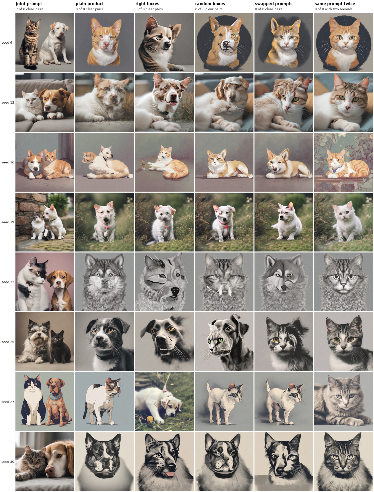
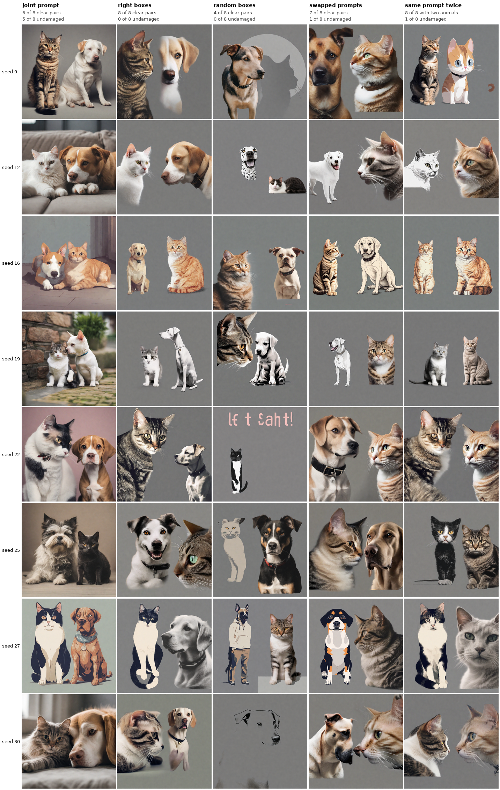
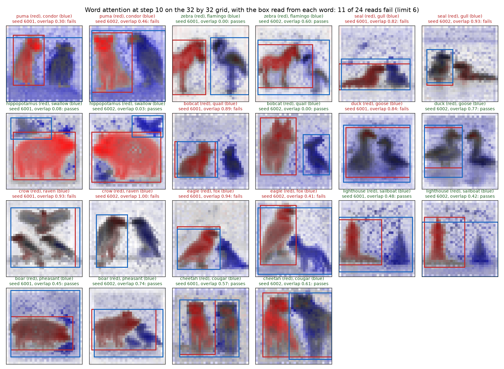

# Does giving each subject its own region bind each body? (step M9)

Step M9 asked whether denoising each subject's prompt inside its own region of the picture draws two separate, correct subjects. With the
regions taken from a joint render that worked, and with each region first denoised alone for 15 of 50 steps, it drew a clear cat and dog on 8
of 8 seeds, but every one as a damaged cut-out on flat grey. Neither way of reading the regions from the word attention passed its limit, so
no region was ever read on CO3's own run. M9 is closed under board question 83. The counts are in [the step's review](review.md), and what a
redesign would change is in [the method review](method-review.md).

## What is in here

Two sheets of cat and dog renders, one figure of word attention with the boxes read from it, and the blind calls, keys, scored results and mask
reads behind them.

## The sheets

### rung-1-six-rows-eight-seeds

**What it shows**

"A cat and a dog" at seeds 9, 12, 16, 19, 22, 25, 27 and 30, one row per seed, under six conditions: the joint prompt, the plain product, and
four ways of fusing the two single-subject predictions by region from step 0 (the right boxes, random boxes of the same sizes, the boxes with
the prompts swapped, and the same prompt in both boxes). Each column's label carries its count of 8. The joint prompt draws a cat beside a dog;
every region condition draws one animal or a fused cat-dog.

**How we got this image**

The renders come from M9's rung 1 run on the cluster, under `/datasets/mmolefe/poe_repair_min/loop-6/m9/`, by
`2-classifier-guidance/scripts/method_search/m9_rung1.py`. They were pulled to the laptop, checked at full size, and laid out eight by six.

**What it lets you say**

Fusing by region from step 0 does not separate the animals, even with the layout of a render that succeeded: right boxes give 0 clear pairs of
8, the same as the plain product.

**What it cannot say**

Anything beyond cat and dog, or about regions with bootstrapping, which is the next sheet.

**Where it came from and what judged it**

Forty-eight pictures were called blind at full size by two reviewers, who agreed on 47, with a third call settling the last. The calls are in
`rung-1-calls-first.csv`, `rung-1-calls-second.csv` and `rung-1-calls-third.csv`, the key in `rung-1-key.json`, and the counts in
`rung-1-result.json`, all beside this card. Judged in the [review](review.md).

### rung-1-bootstrapped-five-rows-eight-seeds

**What it shows**

The same eight seeds under five conditions, with each region first denoised alone over a constant colour for the first 15 of 50 steps. Each
column's label carries its clear pairs and its undamaged pictures, of 8. Right boxes draw a clear cat and dog on every seed, as cut-outs on flat
grey. Random boxes draw two animals on 4. The same-prompt row draws two cats and no dog.

**How we got this image**

The renders come from M9's bootstrap stage, `m9_rung1.py` with `BOOTSTRAP_STEPS = 15`, under the same cluster folder. They were pulled, checked
at full size and laid out eight by five.

**What it lets you say**

Bootstrapped regions in the right places make two separate animals on 8 of 8 seeds, the prompt in each region decides its species, and placement
matters, since random boxes reach 4.

**What it cannot say**

That this is a usable method. Neither reviewer passed any right-box picture as undamaged, against 5 of 8 for the joint prompt, and the boxes came
from a render that had already succeeded.

**Where it came from and what judged it**

Forty pictures were called blind by two reviewers, who agreed on `two_clear` for 38, with a third call settling the 3 they split on. The files are
`rung-1-bootstrapped-calls-first.csv`, `-second.csv`, `-third.csv`, `rung-1-bootstrapped-key.json` and `rung-1-bootstrapped-result.json`. Judged
in the [review](review.md).

## The attention figure

### rung-2-step-10-word-attention-boxes

**What it shows**

For 11 tuning pairs at seeds 6001 and 6002, each subject word's cross-attention at step 10 of CO3's run on a 32 by 32 grid, red for the first
word and blue for the second, dark where both are high. Each panel draws the box read from each word, and its title gives the boxes' overlap
(intersection over union) and whether the read passes. A read fails if a box covers at least 80% of the grid or the overlap is at least 0.8. The
title gives the total: 11 of 24 reads fail, against a limit of 6.

**How we got this image**

The maps were read on the cluster by `2-classifier-guidance/scripts/method_search/m9_rung2.py`'s read stage, through the `Binder` in
`co3_bind.py`, which thresholds each word's map with Otsu's rule and takes the box around it. The maps and boxes were pulled to the laptop and
drawn as 22 panels. Giraffe and tortoise is counted in the 24 reads and left off the figure.

**What it lets you say**

Most maps already hold two separate bodies at step 10, and the reader fails for two visible reasons: the second word lights up both bodies (bobcat
and quail at seed 6001), or its map keeps a background floor so its box spreads across the frame (puma and condor).

**What it cannot say**

Whether regions would fix identity on CO3. No region was read well enough to try. The second reader, where a cell belongs to a word only when that
word's attention beats the other's, also failed, with 10 of 24.

**Where it came from and what judged it**

The reads are in `rung-2-mask-reads.json`, the second reader's in `rung-2-mask-reads-word-beats-other.json`, and the zero-binding control in
`rung-2-zero-binding-check.json`. Judged in the review's [mask check](review.md#rung-2-the-check-on-the-masks).
