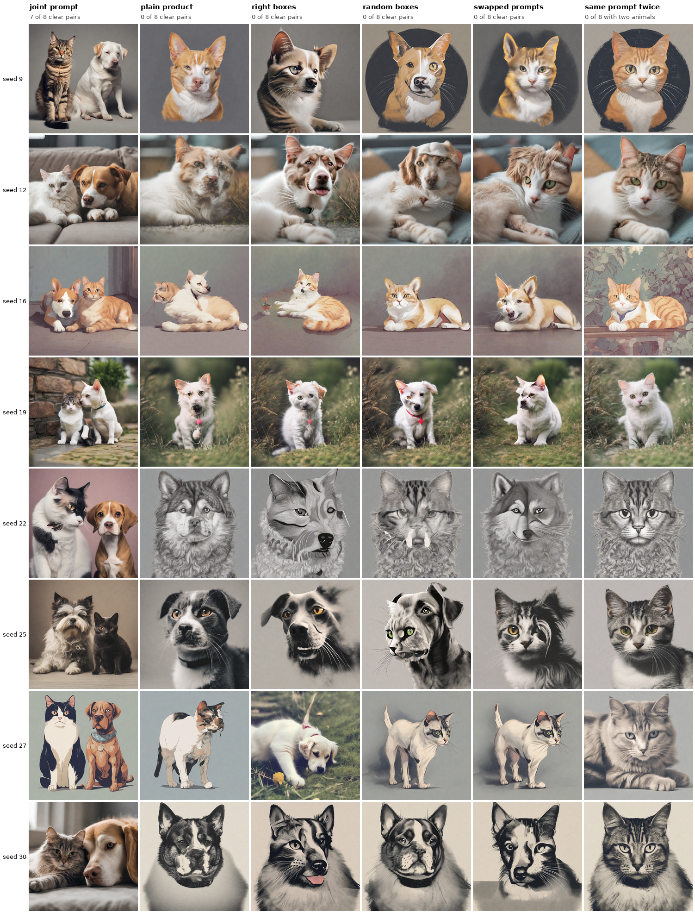
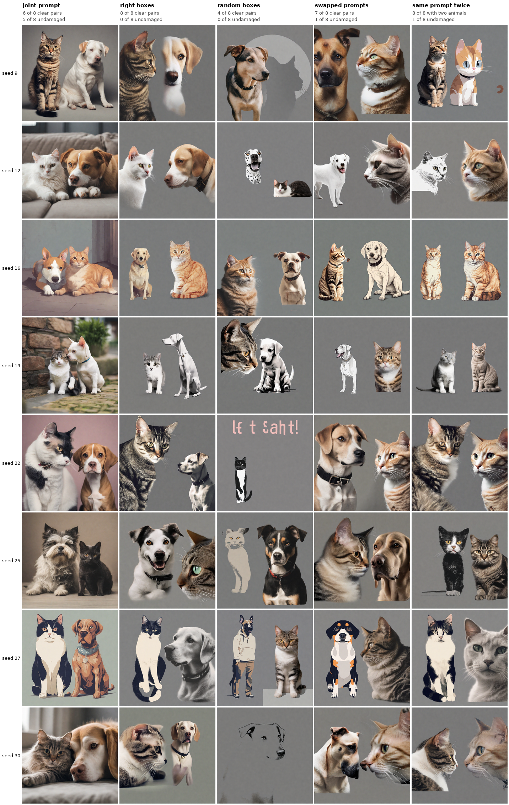

# Review: does giving each subject its own region fix identity? (step M9)

This file holds what the runs in [the M9 design](design.md) produced. With bootstrapping on, rung 1 reaches 8 clear pairs of 8 on right boxes, and its written verdict is "regions without names". All 8 of those pictures are damaged. Rung 2 has not started.

## Runs

Outputs are on the cluster under `/datasets/mmolefe/poe_repair_min/loop-6/m9/`, and logs are in `/datasets/mmolefe/poe_repair_min/loop-6/logs/`.

| Rung | Slurm job | Commits | Output | State |
|---|---|---|---|---|
| Rung 1 smoke, seed 9 | 93719 | `275c54f4-15d8bdd` | none | stopped by the GPU guard, because another process held the card on mscluster107 |
| Rung 1 smoke, seed 9 | 93724 | `275c54f4-15d8bdd` | `smoke/` | passed |
| Rung 1, all 8 seeds | 93794 | `275c54f4-15d8bdd` | `full/` | finished, 23 minutes 50 seconds on one RTX 3090 |
| Bootstrapping smoke, seed 9 | 93852 | `321f458b-15d8bdd` | `smoke/` | finished, 1 hour 59 minutes for 4 renders during a cluster stall |
| Bootstrapping, all 8 seeds | 93906 | `100772b7-15d8bdd` | `full/` | finished, 34 minutes 16 seconds |

## Rung 1 controls on the smoke seed

**Does the joint render match the picture its boxes came from?** ✅ Yes. The mean absolute difference on seed 9 is 0.0 of 255, against a limit of 3.

**Does the regional composer reduce to the plain product?** ✅ Yes. Masks of 0.5 at guidance 7.5 and the plain product at guidance 3.75 differ
by 1.53 of 255 in mean absolute pixel value, against a limit of 3.

## Rung 1 count without bootstrapping

All 48 pictures were called blind at full size by two reviewers, who agreed on 47. A third blind call settled the other one, a joint render on
seed 19, as two bodies with borrowed parts. The calls and key are in `rung-1-calls-first.csv`, `rung-1-calls-second.csv`, `rung-1-calls-third.csv`
and `rung-1-key.json`, and the counts are in `rung-1-result.json`.

| Row | Clear pairs of 8 | Pictures with two separate animals, of 8 |
|---|---|---|
| Joint prompt | 7 | 8 |
| Plain product | 0 | 0 |
| Right boxes | 0 | 0 |
| Random boxes | 0 | 0 |
| Swapped prompts | 0 | 0 |
| Same prompt twice | 0 | 0 |

**What this count can say.** Fusing the two predictions by region from step 0 did not separate the animals on any of the 8 seeds, even with
the layout taken from a render that succeeded. Right boxes drew 6 fused cat-dogs and 2 single animals. The bar calls 0 of 8 a null, and the
oracle-layout plan holds a null until bootstrapping has been run on the same layouts.

## Rung 1 count with bootstrapping

For the first 15 of 50 steps each region was denoised over a constant colour, and the latents were fused. The 32 region pictures were
shuffled with the 8 joint renders and called blind at full size. The two reviewers agreed on `two_clear` for 38 of 40, and a third blind call
settled the 3 pictures they split on for `two_clear` or for the count of animals. The calls and key are in the `rung-1-bootstrapped-*` files, and
the counts are in `rung-1-bootstrapped-result.json`.

| Row | Clear pairs of 8 | Two separate animals, of 8 | Marked undamaged by both reviewers, of 8 |
|---|---|---|---|
| Joint prompt | 6 | 8 | 5 |
| Right boxes | 8 | 8 | 0 |
| Random boxes | 4 | 4 | 0 |
| Swapped prompts | 7 | 8 | 1 |
| Same prompt twice | 0 | 8 | 1 |

**Verdict under the written bar: regions without names.** Right boxes reach 8, which clears the bar of 4, and random boxes reach 4, which is
more than 1 below. Swapped prompts reach 7 and the same prompt reaches 8 pictures with two animals, so both are within 1 of right boxes.
Rung 2 runs under this verdict.

**What the pictures add to that label.** The same-prompt row drew two cats and no dog on all 8 seeds, and the swapped row drew a cat and a dog.
So the prompt a region carries does decide its species. What the two controls show is that any two bootstrapped regions make two objects,
wherever the boxes sit relative to the joint render's layout.

**Why this is not yet a usable method.** Bootstrapping is what separated the animals, since the same fusion without it reached 0 of 8. It also
leaves cut-outs on flat grey, and neither reviewer passed any right-box picture as undamaged, against 5 of 8 for the joint prompt. The joint
renders were 7 clear pairs in the first count and 6 in this one, so a difference of 1 between rows is within how much the calls move.

**What rung 2 tests.** Rung 2 as approved applies regions to CO3 from step 10 with no bootstrapping. It asks whether regions fix identity once
CO3 has already drawn two bodies, which this rung does not answer.

## GPU time

Rung 1 used 3.23 GPU-hours against a budget of about 1: 0.27 for the smoke test, 0.40 for the eight seeds, 1.99 for a bootstrapping smoke test
that ran through a cluster stall, and 0.57 for the eight bootstrapped seeds. With rung 2's 5.3 GPU-hours, M9 comes to about 8.5 against the
6.3 added for it.
