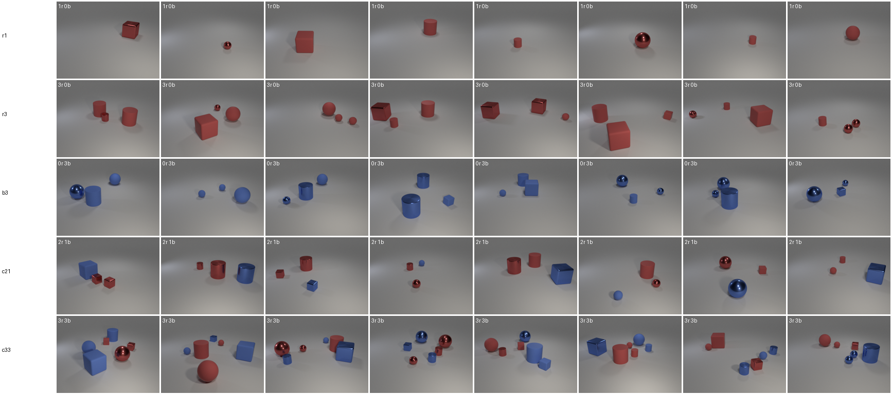

# Review: two experts trained on separate colours (step M10)

This file holds what the runs in [the M10 design](design.md) produced. The renders are under way, and no model has trained.

## Runs

Outputs are on the cluster under `/datasets/mmolefe/poe_repair_min/loop-6/m7/`, and logs are in `/datasets/mmolefe/poe_repair_min/loop-6/logs/`.

| Rung | Slurm jobs | Commits | Output | State |
|---|---|---|---|---|
| GPU rendering test, 8 pictures on one RTX 3090 | 94448 | `8932ce01-15d8bdd` | none | stopped: Blender 2.78c asks for NVIDIA's compiler to build its GPU code, and the cluster has none |
| Render smoke, 8 pictures each of r1, r3, b3, c21 and c33 | 94548 to 94552 | `e60212bf-15d8bdd` | `s2-smoke/renders/` | passed, 4.71 to 5.77 seconds per picture on CPU |
| Expert renders, 5,000 per set, red chain r1 to r3 and blue chain b1 to b3 | 94585 to 94590 | `e60212bf-15d8bdd` | `s2/renders/` | done: 5,000 of 5,000 in each of r1, r2, r3, b1, b2 and b3, none missing, about 6.5 to 7 hours per set on one CPU node |
| Labelled datasets for the two experts: each colour's three sets in one zip labelled by count (r1 as 0, r2 as 1, r3 as 2), plus the 1% and overfit subsets | 95420 | `395c2fb4-15d8bdd` | `m10/data/` | done in 12 minutes 35 seconds: `r-full.zip` and `b-full.zip` hold 15,000 pictures each (5,000 per count, labels 0 to 2), `r-one-percent` and `b-one-percent` 150 each, `r-overfit-18` 18; the packer passed a 12-picture test on the cluster first |
| Overfit: the red expert on 18 pictures (6 per count), 256,000 images seen at batch 256, count labels on, 16 samples per count | 95442 | `29db2cb6-15d8bdd` | `m10/overfit/models/r-overfit-18/` | queued on biggpu |
| 1% of the data: each expert on 150 pictures (50 per count), 65,536 images seen at batch 256 | 95443, 95444 | `29db2cb6-15d8bdd` | `m10/one-percent/models/` | queued after the overfit |
| Scorer renders, 250 per set, every combination of 0 to 3 red with 0 to 3 blue, c00 to c33 | 94765 to 94780 | `e60212bf-15d8bdd` | `s2/renders/` | done: 250 of 250 in each of the 16 sets, 18 to 23 minutes per set |

## The render smoke

Every one of the 40 pictures holds exactly the colours and counts asked for, read from its scene file and checked by eye. Objects sit anywhere
on the floor, and in the scenes of 3 red with 3 blue some touch or partly hide one another.

