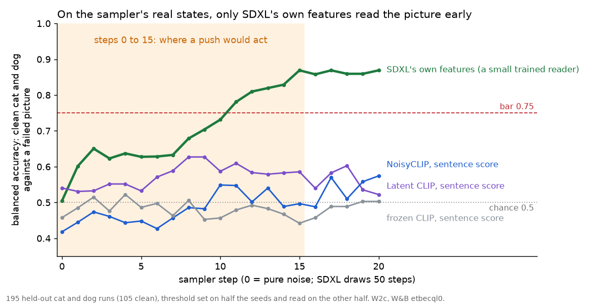
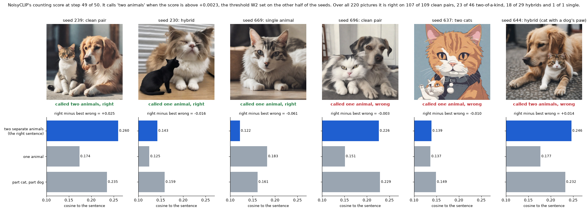

# Loop 9 in one page: can a sentence score tell a half-drawn picture what to become?

**No. At the steps where a push acts, no sentence score reads the picture. SDXL's own features do, so the push should read those instead.** This loop rendered nothing to compare with the rivals: the rival comparison is Loop 6's. What it settles is which reader that comparison should use.

## The answers

| Question | Answer | Settled? |
|---|---|---|
| Can a sentence score read the picture at steps 0 to 15? | No. Every model and wording, on noised pictures and on real sampler states, stays at or below a mean of 0.574, against a 0.75 bar | Yes for sentence scores |
| Is anything there to read that early? | Yes. A small reader on SDXL's own features reaches 0.87 by step 15 | Partly: one reader, on cat and dog only |
| Do sentence scores see plurality even on the finished picture? | Barely. Two cats are called "one animal" about half the time. Counting passes 0.75 for one reader in six, exactly at the bar | Yes |
| Does a model we train ourselves carry to new concepts? | No. 0.758 on digits it trained on, 0.590 on digits it did not | Yes, on digits |
| Does this match or beat a rival? | Not tested here. Loop 6's CO3 comparison is where that happens, and it now has a reader to try | Open |

## What the finished picture shows

Even with no noise left, the counting score misses two-of-a-kind pictures and some hybrids. A score that half-sees plurality on a clean picture cannot steer it from noise.

## How it lines up with the other loops

| Loop | What it found | Same direction? |
|---|---|---|
| 8, abstract checkers on digits | A count checker reads 0.791 in the SDXL-matched window | Yes: trained readers on the model's internals read early |
| 10, the score path | Noise-prediction maps read 0.700, above the noisy canvas at 0.593 | Yes: the model's own signals beat a picture read from outside |
| 6, the CO3 push | CO3 alone makes 11 faithful pairs of 96. The old checker push made 7 and a random push 12 | It needs the reader this loop points to |

## Is the work getting there?

Loop 9 is complete: 9 of its steps are closed, W3 was stopped for lack of a readable step, and binding was left untested by choice. It used about 3 of its 8.7 approved GPU-hours. The decisive experiments for both papers are elsewhere: Loop 6's CLEVR test (M7) and a CO3 push read with SDXL's own features.

Caveats and sources

- **W2 is formally inconclusive.** The positive control's mean was 0.637 against a 0.65 floor, though it beat frozen CLIP by 0.150 (standard error 0.035). See [the W2c review](02c-fair-test/review.md).
- **Two properties are untested.** Position and size, and binding, were not scored, because their labels failed the eye check. See [W2](02-can-it-read/review.md) and [W2d](02d-binding/review.md).
- **One reader, one pair.** The readout result is on cat and dog only, and comparing it with the sentence scores is mixed, because the reader and its input both differ.
- **Sources.** The full verdict is [W5](05-verdict.md). The W&B runs are `70g3qw2f` (W2), `etbecql0` (W2c) and `en52x031` (W4).

