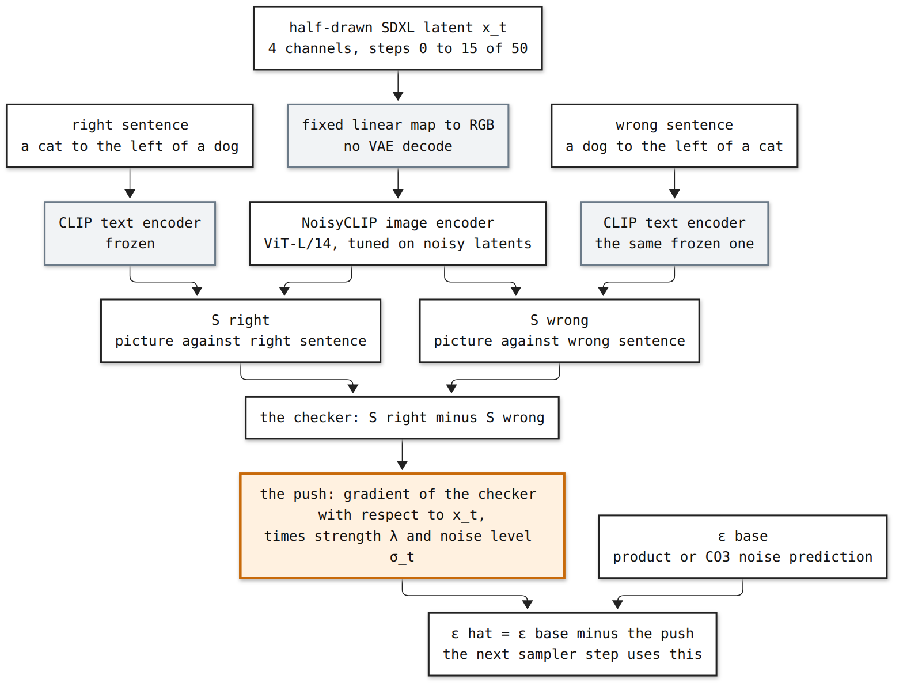

# Reading table: can a sentence score on a noisy latent act as a checker?

This table holds one row for each of the 11 papers this loop was asked to read, each read from its full PDF with appendices. It answers what a noise-aware text and image score can already do on the five abstract properties, and what step W2 should expect. Each row links to that paper's note.

## Table of contents

- [What the reading changes for W2](#what-the-reading-changes-for-w2)
- [What each property has behind it](#what-each-property-has-behind-it)
- [The table](#the-table)
- [Closer papers these cite, not read](#closer-papers-these-cite-not-read)
- [Where sources disagree](#where-sources-disagree)
- [How the rows were checked](#how-the-rows-were-checked)

## What the reading changes for W2

**NoisyCLIP reads worst on the steps this loop pushes.** Recall@1 is the share of images whose right caption ranks first among five captions, so 0.20 is chance. The right caption starts near 0.03 at latent 0 and reaches 0.20 near latent 10 ([Figure 4, p. 10](https://arxiv.org/pdf/2512.08505#page=10)). The caption with the wrong count ranks first more often than the right one until about latent 13 ([Figure 10, p. 23](https://arxiv.org/pdf/2512.08505#page=23)). Both values are read from the plots.

**No listed paper steers a sampler with a sentence-score gradient and measures layout.** The closest noise-aware score, the latent reward model, uses its score only to choose training pairs ([p. 6](https://arxiv.org/pdf/2502.01051#page=6)). Noise Diffusion's own comparison shows direct gradient updates making "limited changes to the image structure" on one prompt ([p. 7](https://arxiv.org/pdf/2411.16503#page=7)).

**A word-swap pair may carry no signal in the additive part of the embedding (inferred).** If CLIP's text embedding were a sum of word vectors, "a cat left of a dog" and "a dog left of a cat" would differ by a fixed vector that flips sign with the order. Only the part that does not add up could then separate them. W2 can measure that part from the text alone, following [the Linear Spaces note](linear-spaces-of-meanings.md).

**The published weights match the brief.** Both projection heads equal base CLIP's exactly, and the vision tower differs ([the comparison output](tools/checkpoint-compare.txt)). The released code leaves out the resize and normalisation, so W2 takes them from the checkpoint's processor config.

## What each property has behind it

| Property | What the 11 papers measure | Gap W2 fills |
|---|---|---|
| Counting | NoisyCLIP's wrong-count caption outranks the right caption until about latent 13 ([p. 23](https://arxiv.org/pdf/2512.08505#page=23)). Two theory papers count objects on CLEVR ([Projective Composition, p. 17](https://arxiv.org/pdf/2502.04549#page=17); [Local Mechanisms, p. 3](https://arxiv.org/pdf/2509.16447#page=3)) | One against two animals on early SDXL latents |
| Prompt match | NoisyCLIP Recall@1 over latents 21 to 30 is 0.506 against 0.145 for frozen CLIP ([p. 14](https://arxiv.org/pdf/2512.08505#page=14)) | Steps 0 to 15, on this project's pairs |
| Spatial relation | Only as a GenAI-Bench skill on ranked images ([NoisyCLIP, p. 24](https://arxiv.org/pdf/2512.08505#page=24)). No paper tests a left-right swap | The first swap test on noisy latents |
| Position and size | Position is measured on CLEVR ([Local Mechanisms, p. 3](https://arxiv.org/pdf/2509.16447#page=3)). No paper measures size | Both, on SDXL |
| Attribute binding | NoisyCLIP's printed failure picks a blue bicycle on a red wall for "a red bicycle against a blue wall" ([p. 30](https://arxiv.org/pdf/2512.08505#page=30)). No paper scores a colour swap | The first colour-swap test on noisy latents |

## The table

| Group | Paper | Model | Pages read | What it reads | What it trained on | How its score enters | When adding is valid | Properties measured | Unseen concepts | Headline number | Copy or avoid (inferred) |
|---|---|---|---:|---|---|---|---|---|---|---|---|
| The model under test | [Early Estimation of Language to Latent Alignment in Diffusion Models](noisyclip.md), arXiv 2512.08505 | SDXL (zero-shot tests on SD3.5 and FLUX.1) | 31 | Noisy SDXL latent passed through a fixed 4-to-3 linear map to RGB, then a fine-tuned CLIP ViT-L/14 image encoder; frozen CLIP text encoder; no timestep input ([p. 9](https://arxiv.org/pdf/2512.08505#page=9)) | 50,000 SDXL latents from steps 20-29 of 50 with rewritten CC12M captions, InfoNCE with in-batch negatives, image encoder tuned, 10 epochs ([p. 8](https://arxiv.org/pdf/2512.08505#page=8)) | No gradient enters a sampler; the dot-product score ranks seeds mid-generation so weak seeds stop early (Best-of-N) ([p. 11](https://arxiv.org/pdf/2512.08505#page=11)) | not addressed ([p. 5](https://arxiv.org/pdf/2512.08505#page=5)) | Prompt match by Recall@1; counting, attribute and spatial only as GenAI-Bench image-ranking skills; no binding or relation swap test; position and size not measured separately ([p. 24](https://arxiv.org/pdf/2512.08505#page=24)) | no: no concept hold-out; the SDXL-trained model is run zero-shot on SD3.5 and FLUX.1 ([p. 13](https://arxiv.org/pdf/2512.08505#page=13)) | Recall@1 for the right caption among 5 (0 to 1, higher is better, chance 0.20) over latents 21-30: 0.506 NoisyCLIP against 0.145 frozen CLIP ViT-L/14 on SDXL; at 150 of 300 Best-of-6 steps its VQAScore is 2% below 300-step CLIP ([p. 14](https://arxiv.org/pdf/2512.08505#page=14)) | Copy the frozen text tower and linear latent map rewritten without the 8-bit step; avoid expecting steps 0-9 to work, since the right caption ranks first below chance there and no swap-word pair or gradient was tested (inferred) |
| Other scores on noisy or generated images | [Diffusion Model as a Noise-Aware Latent Reward Model for Step-Level Preference Optimization](noise-aware-latent-reward.md), arXiv 2502.01051 | SD1.5, SD2.1, SDXL, SD3-Medium | 26 | Noisy latent and timestep through the U-Net, down and middle features average pooled over space, with the last token of the text encoder; up to t = 950 of 1000. ([p. 5](https://arxiv.org/pdf/2502.01051#page=5)) | Pick-a-Pic v1 filtered to 168,539 win-lose pairs and 8,537 ties, Bradley-Terry loss on two noised images under one prompt, uniform t; U-Net and text encoder trainable. ([p. 5](https://arxiv.org/pdf/2502.01051#page=5)) | No gradient: the score ranks K = 4 sampled candidates per step, and the best and worst become a training pair for a LoRA fine-tune. ([p. 6](https://arxiv.org/pdf/2502.01051#page=6)) | not addressed; the only feature arithmetic is a guidance-style boost on the middle-block feature (Eq. 8). ([p. 5](https://arxiv.org/pdf/2502.01051#page=5)) | Counting, attribute binding, spatial relation, position and prompt match are measured on images from the fine-tuned model through GenEval and T2I-CompBench++; object size is not tested. ([p. 18](https://arxiv.org/pdf/2502.01051#page=18)) | no: evaluation uses 500 unique validation prompts and withholds no concept. ([p. 7](https://arxiv.org/pdf/2502.01051#page=7)) | T2I-CompBench++ 2D-Spatial (0 to 1, higher better) on SDXL rises from 0.1936 to 0.2414 after LPO fine-tuning, against 0.2406 for InterComp; GenEval Position rises from 9.25% to 14.00%. ([p. 8](https://arxiv.org/pdf/2502.01051#page=8)) | Copy the true timestep input and the focus on the first steps; avoid spatial pooling and two-images-one-sentence training for left-right and binding sentence pairs (inferred). |
| Other scores on noisy or generated images | [Noise Diffusion for Enhancing Semantic Faithfulness in Text-to-Image Synthesis](noise-diffusion-semantic-faithfulness.md), arXiv 2411.16503 | SD1.4, SD1.5, SD2.0, SD2.1 | 15 | The finished decoded image plus a yes-or-no question; the score is the probability of Yes, and no noisy input is read. ([p. 3](https://arxiv.org/pdf/2411.16503#page=3)) | nothing trained ([p. 5](https://arxiv.org/pdf/2411.16503#page=5)) | An approximate gradient at the final latent chooses 1 of 50 random noises, which is mixed into the starting noise with step size 1 minus the square root of the score; best of the rounds is returned. ([p. 5](https://arxiv.org/pdf/2411.16503#page=5)) | not addressed ([p. 3](https://arxiv.org/pdf/2411.16503#page=3)) | Prompt match is measured by VQA and CLIP scores; attribute binding and spatial relation appear only in example images and through the overall VQA score; counting, position and size are not tested. ([p. 6](https://arxiv.org/pdf/2411.16503#page=6)) | no: no held-out concepts are tested. ([p. 5](https://arxiv.org/pdf/2411.16503#page=5)) | VQA score (0 to 1, higher better, the optimised quantity) after 50 rounds on SD1.4 is 0.9790 on simple prompts, 0.1073 above InitNo, and 0.9578 on complex prompts, 0.1930 above InitNo. ([p. 6](https://arxiv.org/pdf/2411.16503#page=6)) | Copy the random-noise control; avoid reading the layout change as gradient steering, because noise replacement plus best-of-N selection can produce it (inferred). |
| Score decompositions | [CFGComposer: Compositional Audio-Text-to-Motion Generation via Copula Score Correction](cfgcomposer.md), arXiv 2611.15101 | Motion diffusion Transformer (MDM-style) on BEAT, no image model | 9 | All three denoisers read the noisy motion x_t at every step, with Whisper audio features, a caption embedding and, for the joint model, a gesture-window embedding. ([p. 5](https://arxiv.org/pdf/2611.15101#page=5)) | Frozen audio and text experts on BEAT and a motion-caption set; a joint model on 775 clips for 50k steps with x0 regression, uniform t and joint dropout 0.1. ([p. 6](https://arxiv.org/pdf/2611.15101#page=6)) | No classifier gradient: epsilon_total = epsilon_PoE + lambda (epsilon_AT2M - epsilon_PoE) at every step, lambda = 0.7, no cap. ([p. 5](https://arxiv.org/pdf/2611.15101#page=5)) | Adding scores is exact only when the copula score is zero; independence given clean data does not survive noising. ([p. 4](https://arxiv.org/pdf/2611.15101#page=4)) | none of the five in images; prompt match is measured in motion through SRGR, G-MSE and human semantic ratings. ([p. 6](https://arxiv.org/pdf/2611.15101#page=6)) | no: no held-out concepts are tested. ([p. 6](https://arxiv.org/pdf/2611.15101#page=6)) | On BEAT, SRGR (0 to 1, higher better) is 0.9916 and motion FID (lower better) is 27.18, against best fine-tuned baselines of 0.8018 for RoboGesture and 62.31 for DiffSHEG. ([p. 7](https://arxiv.org/pdf/2611.15101#page=7)) | Copy the decomposition and the full-range lambda plot; avoid the guided-against-unguided mismatch and do not read this as evidence for a sentence-score gradient (inferred). |
| Score decompositions | [Composition of Memory Experts for Diffusion World Models](memory-experts-world-models.md), ICLR 2026 | DiT, UViT and U-Net video diffusion models | 27 | Video diffusion experts read noisy frames plus past frames, LoRA-stored history or camera poses; no text ([p. 5](https://proceedings.iclr.cc/paper_files/paper/2026/file/19eae75beed66321d62272e794a9c2ac-Paper-Conference.pdf#page=5)) | Pretrained video diffusion models (DiT, 150k steps on Memory Maze); long-term expert fine-tunes LoRA adapters on the current episode at test time ([p. 16](https://proceedings.iclr.cc/paper_files/paper/2026/file/19eae75beed66321d62272e794a9c2ac-Paper-Conference.pdf#page=16)) | Sum over experts of alpha times the conditional score plus (1 minus alpha) times that expert's baseline score, at every noise level, alpha 2 to 3 (Eq. 6) ([p. 15](https://proceedings.iclr.cc/paper_files/paper/2026/file/19eae75beed66321d62272e794a9c2ac-Paper-Conference.pdf#page=15)) | Under disjoint kernels the contrastive expert keeps kernel shapes and only reweights modes (Prop 1); that assumption does not cover overlapping noised kernels or the product across experts (inferred) ([p. 5](https://proceedings.iclr.cc/paper_files/paper/2026/file/19eae75beed66321d62272e794a9c2ac-Paper-Conference.pdf#page=5)) | none of the five ([p. 6](https://proceedings.iclr.cc/paper_files/paper/2026/file/19eae75beed66321d62272e794a9c2ac-Paper-Conference.pdf#page=6)) | no: evaluates video prediction and recall with no held-out concepts ([p. 18](https://proceedings.iclr.cc/paper_files/paper/2026/file/19eae75beed66321d62272e794a9c2ac-Paper-Conference.pdf#page=18)) | LPIPS perceptual distance 0.097 for the composition against 0.113 for full attention on Memory Maze, DiT, lower is better ([p. 7](https://proceedings.iclr.cc/paper_files/paper/2026/file/19eae75beed66321d62272e794a9c2ac-Paper-Conference.pdf#page=7)) | Copy the margin test and the with-and-without-negative ablation; avoid treating unconditional negatives as evidence for wrong-sentence negatives (inferred) |
| When adding scores or embeddings is valid | [Mechanisms of Projective Composition of Diffusion Models](projective-composition.md), arXiv 2502.04549 | EDM2 U-Net on CLEVR; SDXL for two example figures | 40 | Exact scores of noised distributions in theory; CLEVR experiments use an EDM2 U-Net on 128 by 128 images conditioned on one location or colour ([p. 15](https://arxiv.org/pdf/2502.04549#page=15)) | CLEVR: 50,000 empty scenes, 1,550,000 single-object scenes, 2,500,000 scenes with 1 to 5 objects; no text and image critic ([p. 15](https://arxiv.org/pdf/2502.04549#page=15)) | Background score plus the sum of expert-minus-background score differences at every reverse-diffusion step, unit coefficients, no cap (Eq. 6 and Eq. 8) ([p. 6](https://arxiv.org/pdf/2502.04549#page=6)) | Exact when coordinates split into blocks where each expert differs from an independent background only on its own block (Def 5.2, Thm 5.3); feature-space version has no sampling guarantee unless the map is orthogonal; a right-minus-wrong push fails these conditions when the base mixes right and wrong (inferred) ([p. 6](https://arxiv.org/pdf/2502.04549#page=6)) | Counting and position measured on CLEVR; binding, spatial relation, size and prompt match not tested ([p. 17](https://arxiv.org/pdf/2502.04549#page=17)) | no: tests more objects than any single model saw, with no held-out concepts ([p. 1](https://arxiv.org/pdf/2502.04549#page=1)) | Largest working object count 4 with an empty background against 1 with an unconditional background, models trained on 1 object, CLEVR, EDM2 U-Net ([p. 39](https://arxiv.org/pdf/2502.04549#page=39)) | Copy the mean-difference orthogonality check and read the and-score as what the score sum omits; avoid citing Theorem 5.3 or 6.1 for swap-pair pushes (inferred) |
| When adding scores or embeddings is valid | [Local Mechanisms of Compositional Generalization in Conditional Diffusion](local-compositional-generalization.md), arXiv 2509.16447 | EDM2 U-Net on CLEVR; SDXL base 1.0; Matryoshka Diffusion Model | 36 | EDM2 U-Net on noisy 128 px CLEVR with location or colour conditions; SDXL post-FFN transformer block features for 24 prompts ([p. 9](https://arxiv.org/pdf/2509.16447#page=9)) | CLEVR with 1 to K objects, 500,000 images per object count; SDXL and Matryoshka used pretrained ([p. 22](https://arxiv.org/pdf/2509.16447#page=22)) | No external gradient; CLEVR sampling uses raw conditional scores with no guidance, and the local model denoises patches ([p. 23](https://arxiv.org/pdf/2509.16447#page=23)) | Exact if and only if the distribution factorizes over disjoint pixel or feature sets, each read by one condition (Lemma 1); orthogonal score differences are a necessary check (Lemma 2) ([p. 6](https://arxiv.org/pdf/2509.16447#page=6)) | Counting and position measured on CLEVR; binding, spatial relation, size and prompt match not measured ([p. 3](https://arxiv.org/pdf/2509.16447#page=3)) | partly: object count is held out on CLEVR (trained on 1 to 3, tested up to 12), with no new object types or colours ([p. 26](https://arxiv.org/pdf/2509.16447#page=26)) | Trained on 1 to 3 CLEVR objects, Kmax (objects drawn reliably) is 7 with all objects labelled against 2 with one label, and enforcing local scores lifts the one-label model to 9; SDXL feature cosine is 0.41 to 0.47 within category and 0.27 to 0.33 between ([p. 3](https://arxiv.org/pdf/2509.16447#page=3)) | Copy the Lemma 2 cosine check on cat and dog U-Net differences before training; avoid expecting a whole-image sentence score to move position (inferred) |
| When adding scores or embeddings is valid | [Concept Algebra for (Score-Based) Text-Controlled Generative Models](concept-algebra.md), arXiv 2302.03693 | Stable Diffusion, version not printed | 22 | The diffusion model's noise prediction at the current noisy sample, for the original, new, empty and subspace-spanning prompts ([p. 16](https://arxiv.org/pdf/2302.03693#page=16)) | nothing trained for the method; one deliberately overfitted DreamBooth fine-tune for the toy example ([p. 5](https://arxiv.org/pdf/2302.03693#page=5)) | Each step replaces the prompt's score on the concept subspace with the new prompt's score, then applies classifier-free guidance ([p. 7](https://arxiv.org/pdf/2302.03693#page=7)) | Scores add over two concepts if the image is causally separable with respect to them; a score difference isolates a concept only if the prompts share the other concept's distribution ([p. 5](https://arxiv.org/pdf/2302.03693#page=5)) | Prompt match partly (human ranking of style and content); counting, binding, spatial relation, position and size not tested ([p. 9](https://arxiv.org/pdf/2302.03693#page=9)) | no: rare content and style pairs are used, with no held-out concepts ([p. 8](https://arxiv.org/pdf/2302.03693#page=8)) | In a human ranking of faithfulness to style and content, the average proportion (0 to 1, higher is better) is 0.476 for concept algebra against 0.164 for concept composition and 0.162 for direct prompting, over 49 content and style pairs and 10 raters on Stable Diffusion ([p. 9](https://arxiv.org/pdf/2302.03693#page=9)) | Copy the rule that a sentence pair must differ only on the target property; avoid assuming binding or left-right order is causally separable (inferred) |
| When adding scores or embeddings is valid | [Linear Spaces of Meanings: Compositional Structures in Vision-Language Models](linear-spaces-of-meanings.md), arXiv 2302.14383 | CLIP ViT-L/14; Stable Diffusion 2.1 for pictures | 18 | HuggingFace CLIP ViT-L/14 embeddings of clean images and text; the pre-projection token sequence for Stable Diffusion 2.1 pictures ([p. 5](https://arxiv.org/pdf/2302.14383#page=5)) | nothing trained; pre-trained CLIP, with a randomly initialized encoder as a control ([p. 5](https://arxiv.org/pdf/2302.14383#page=5)) | No gradient enters a sampler; averaged text embeddings replace the prompt embedding that conditions Stable Diffusion ([p. 8](https://arxiv.org/pdf/2302.14383#page=8)) | Text embeddings are sums of factor vectors if and only if embedding differences ignore shared factors, equivalently the factors are conditionally independent given any image (Lemma 2, Corollary 8) ([p. 5](https://arxiv.org/pdf/2302.14383#page=5)) | Prompt match partly (zero-shot labels and retrieval on clean images); counting, two-subject binding, spatial relation, position and size not tested ([p. 7](https://arxiv.org/pdf/2302.14383#page=7)) | no: zero-shot labels are used and the seen and unseen pair split is dropped ([p. 15](https://arxiv.org/pdf/2302.14383#page=15)) | On MIT-States, ideal words reach 11.5% pair accuracy against 10.0% for real-word labels and 7.7% for all 28175 pair labels; on CelebA the worst-group gap is 1.6 points against 10.1, with CLIP ViT-L/14 ([p. 7](https://arxiv.org/pdf/2302.14383#page=7)) | Before training, measure the text difference averaged over both word orders, because the additive part of a sentence swap cannot carry binding or left-right order across both orders (inferred) |
| Training a new encoder | [CLIP goes 3D: Leveraging Prompt Tuning for Language Grounded 3D Recognition](clip-goes-3d.md), arXiv 2303.11313 | CLIP (SLIP ViT-Base) with PointTransformer or PointMLP, no diffusion model | 14 | Clean point clouds through a 3D encoder, clean rendered views through CLIP's image encoder with learned prompts, and template captions through CLIP's text encoder. ([p. 3](https://arxiv.org/pdf/2303.11313#page=3)) | ShapeNet, 52,460 CAD models in 55 categories, as point cloud, render and template caption triplets; InfoNCE with same-class positives; only the 3D encoder and visual prompts train. ([p. 6](https://arxiv.org/pdf/2303.11313#page=6)) | No gradient enters a sampler: the similarity score is used only for zero-shot classification and retrieval. ([p. 5](https://arxiv.org/pdf/2303.11313#page=5)) | not addressed ([p. 4](https://arxiv.org/pdf/2303.11313#page=4)) | none of the five ([p. 6](https://arxiv.org/pdf/2303.11313#page=6)) | partly: zero-shot tests on other datasets, called unseen, with no step removing categories shared with ShapeNet. ([p. 8](https://arxiv.org/pdf/2303.11313#page=8)) | Zero-shot classification accuracy on ModelNet40 is 50.6% for PointTransformer with CG3D against 20.2% for PointCLIP, and 25.6% against 15.4% on real scans in ScanObjectNN. ([p. 7](https://arxiv.org/pdf/2303.11313#page=7)) | Copy the two-way contrastive loss to a frozen CLIP; avoid class-level positives and single-object captions for binding and word-order pairs (inferred). |
| Training a new encoder | [Robust Contrastive Learning against Noisy Views](rince.md), arXiv 2201.04309 | none (ResNet-50, R(2+1)D-18 and graph networks; no generative model) | 20 | Positive and negative pair scores from any encoder pair; tested on images, video-audio and graphs, with no diffusion latent or text-image pair ([p. 3](https://arxiv.org/pdf/2201.04309#page=3)) | CIFAR-10, ImageNet, Kinetics400, ACAV100M and TUDataset, with InfoNCE swapped for RINCE inside existing contrastive methods ([p. 6](https://arxiv.org/pdf/2201.04309#page=6)) | No gradient enters a sampler; RINCE is a training loss with settings q and lambda ([p. 4](https://arxiv.org/pdf/2201.04309#page=4)) | not addressed ([p. 3](https://arxiv.org/pdf/2201.04309#page=3)) | none of the five ([p. 6](https://arxiv.org/pdf/2201.04309#page=6)) | no: no concept hold-out; video encoders are only transferred to UCF-101 and HMDB-51 ([p. 7](https://arxiv.org/pdf/2201.04309#page=7)) | CIFAR-10 top-1 accuracy (%, higher is better) at label noise 0.8: 91.59 RINCE (q=1) against 87.11 InfoNCE, ResNet-50; ImageNet linear evaluation 70.0 against 69.3 for SimCLR ([p. 6](https://arxiv.org/pdf/2201.04309#page=6)) | Use only as a later retraining variant with q 0.1 to 0.5 and lambda 0.01; a large q would down-weight the noisiest latents this project needs, and it does not teach word-order binding (inferred) |

## Closer papers these cite, not read

These sit outside this loop's list, so no claim here relies on them. *Controlling Latent Diffusion Using Latent CLIP* is the nearest: its title describes a CLIP that reads latents and controls a diffusion model.

| Paper | arXiv | Named by | Why it is close |
|---|---|---|---|
| Controlling Latent Diffusion Using Latent CLIP | 2503.08455 | [Early Estimation of Language to Latent Alignment in Diffusion Models](noisyclip.md), p. 15 | CLIP that reads latents directly, with latent diffusion control in its title; nearest prior work on steering with a latent text-image score |
| Dynamic Classifier-Free Diffusion Guidance via Online Feedback | 2509.16131 | [Early Estimation of Language to Latent Alignment in Diffusion Models](noisyclip.md), p. 18 | Uses latent information during reverse diffusion to choose the guidance strength |
| Aesthetic post-training diffusion models from generic preferences with step-by-step preference optimization | 2406.04314 | [Diffusion Model as a Noise-Aware Latent Reward Model for Step-Level Preference Optimization](noise-aware-latent-reward.md), p. 10 | Trains a step-aware preference model that scores intermediate sampling steps through predicted clean images. |
| ReNO: Enhancing one-step text-to-image models through reward-based noise optimization | not printed | [Diffusion Model as a Noise-Aware Latent Reward Model for Step-Level Preference Optimization](noise-aware-latent-reward.md), p. 12 | Optimises the noise against a reward model, according to its title and this paper's listing of it as training-free. |
| Test-time alignment of diffusion models without reward over-optimization | not printed | [Diffusion Model as a Noise-Aware Latent Reward Model for Step-Level Preference Optimization](noise-aware-latent-reward.md), p. 12 | Listed by this paper as a training-free preference method applied to a diffusion model. |
| Initno: Boosting text-to-image diffusion models via initial noise optimization | not printed | [Noise Diffusion for Enhancing Semantic Faithfulness in Text-to-Image Synthesis](noise-diffusion-semantic-faithfulness.md), p. 9 | Optimises the starting noise from text-to-image attention maps. |
| Attend-and-excite: Attention-based semantic guidance for text-to-image diffusion models | not printed | [Noise Diffusion for Enhancing Semantic Faithfulness in Text-to-Image Synthesis](noise-diffusion-semantic-faithfulness.md), p. 9 | Updates the latent at each denoising step from cross-attention between words and image. |
| GLIDE: Towards Photorealistic Image Generation and Editing with Text-Guided Diffusion Models | 2112.10741 | [Mechanisms of Projective Composition of Diffusion Models](projective-composition.md), p. 12 | Cited for out-of-distribution text prompts; trains a noised CLIP and steers sampling with it (description from outside this PDF) |

## Where sources disagree

Each row gives the claim, where it came from and what the page says. No result was changed.

| Paper | Claim | Claim's source | What the page says | Page |
|---|---|---|---|---|
| [Early Estimation of Language to Latent Alignment in Diffusion Models](noisyclip.md) | Task claim: both projection heads are frozen | code/noisyclip/src/train_model_classic.py:48-49 sets requires_grad = not ('text' in name), so visual_projection trains under --only_vision | We exclusively fine-tune the image encoder; projection heads are not mentioned. The released flag leaves visual_projection trainable, but the published checkpoint's visual_projection and text_projection equal base CLIP's exactly (tools/checkpoint-compare.txt) | [p. 6](https://arxiv.org/pdf/2512.08505#page=6) |
| [Early Estimation of Language to Latent Alignment in Diffusion Models](noisyclip.md) | Training settings are lr 5.7e-5, weight decay 0.1, 10 epochs, batch 128, ViT-L/14 | code/noisyclip/src/train_model_classic.py:286-287,304,306,314 defaults are 5 epochs, batch 64, lr 1e-4, weight decay 0.0, clip-vit-base-patch32; the real run's flags are not released | learning rate of 5.7e-5, weight decay of 0.1, 10 epochs, batch size of 128 | [p. 8](https://arxiv.org/pdf/2512.08505#page=8) |
| [Early Estimation of Language to Latent Alignment in Diffusion Models](noisyclip.md) | Phi is the inverse of the encoder | code/noisyclip/src/latent_to_image.py:10-16 uses a fixed linear approximation with hard-coded weights | a transformation (inverse of E) that converts zt into an RGB-like space | [p. 5](https://arxiv.org/pdf/2512.08505#page=5) |
| [Early Estimation of Language to Latent Alignment in Diffusion Models](noisyclip.md) | The training window is latents 20-29 | code/noisyclip/src/train_model_classic.py:180-181 loads a ready-made dataset; no released file selects steps or adds noise | We select a fixed latent interval (20-29) for contrastive training | [p. 6](https://arxiv.org/pdf/2512.08505#page=6) |
| [Early Estimation of Language to Latent Alignment in Diffusion Models](noisyclip.md) | The released script generates the corrupted captions | code/noisyclip/src/corrupt_prompts.py:119 calls exit() before generation | we use the instruction-tuned version of Gemma 3 with 27B parameters | [p. 22](https://arxiv.org/pdf/2512.08505#page=22) |
| [Early Estimation of Language to Latent Alignment in Diffusion Models](noisyclip.md) | Frozen CLIP on basic prompts reaches 19.8% of the final score | paper Table 4 values: 0.183 / 0.296 = 61.8% | CLIP baseline, which only achieves 19.8% | [p. 27](https://arxiv.org/pdf/2512.08505#page=27) |
| [Early Estimation of Language to Latent Alignment in Diffusion Models](noisyclip.md) | Frozen CLIP stays below 0.1 Recall@1 in the first 25 iterations | paper Fig. 4, p. 10: about 0.13 at latent 25, read from the figure | whereas the baseline remains below 0.1 | [p. 10](https://arxiv.org/pdf/2512.08505#page=10) |
| [Early Estimation of Language to Latent Alignment in Diffusion Models](noisyclip.md) | The method remains superior on advanced prompts | paper Table 3, p. 25: Negate 0.517 NoisyCLIP against 0.522 frozen CLIP and 0.523 candidate mean | our method remains superior in assessing alignment | [p. 26](https://arxiv.org/pdf/2512.08505#page=26) |
| [Early Estimation of Language to Latent Alignment in Diffusion Models](noisyclip.md) | Task claim: separation by latent 10 needs qualification | paper Fig. 4 and Fig. 10: the marked crossing is Recall@1 0.20, chance among 5 captions, and the wrong-count caption leads until about latent 13 | NoisyCLIP discriminates the correct caption from the non-factual ones remarkably early, by latent 10 | [p. 10](https://arxiv.org/pdf/2512.08505#page=10) |
| [Early Estimation of Language to Latent Alignment in Diffusion Models](noisyclip.md) | Task claim: the input has no VAE decode | true for SDXL at code/noisyclip/src/latent_to_image.py:9-20; false for the SD3.5 and FLUX.1 tests | requires using the model's VAE for RGB decoding | [p. 9](https://arxiv.org/pdf/2512.08505#page=9) |
| [Diffusion Model as a Noise-Aware Latent Reward Model for Step-Level Preference Optimization](noise-aware-latent-reward.md) | A noise-aware reward model is evidence that a score can steer sampling. | this loop's working idea | The score only selects sampled candidates for fine-tuning; reward fine-tuning with the LRM is listed as future work. | [p. 10](https://arxiv.org/pdf/2502.01051#page=10) |
| [Diffusion Model as a Noise-Aware Latent Reward Model for Step-Level Preference Optimization](noise-aware-latent-reward.md) | The reward model is reliable at high noise. | the paper's framing on p. 2 and p. 9 | Direct preference accuracy is reported only at t = 0 and t = 200 (Table 18); high-noise reliability is supported only by downstream metrics. | [p. 16](https://arxiv.org/pdf/2502.01051#page=16) |
| [Noise Diffusion for Enhancing Semantic Faithfulness in Text-to-Image Synthesis](noise-diffusion-semantic-faithfulness.md) | The updated starting noise stays standard Gaussian for any step size. | this paper, Eq. 10 | The claim assumes Gaussian noise, but Algorithm 1 picks that noise by an argmax that depends on the current latent, so it is not independent of the latent (inferred). | [p. 4](https://arxiv.org/pdf/2411.16503#page=4) |
| [Noise Diffusion for Enhancing Semantic Faithfulness in Text-to-Image Synthesis](noise-diffusion-semantic-faithfulness.md) | The VLM score's gradient drives the change in the picture. | the paper's framing on p. 8 | Methods following the gradient directly show limited structural change; the large changes come with noise replacement, including the random controls in Fig. 6. | [p. 7](https://arxiv.org/pdf/2411.16503#page=7) |
| [CFGComposer: Compositional Audio-Text-to-Motion Generation via Copula Score Correction](cfgcomposer.md) | The copula score vanishes if and only if a and c are independent given x_t. | this paper, p. 4 | The score is a gradient in x, so it also vanishes when the log ratio is a nonzero constant in x for the given a and c (inferred). | [p. 4](https://arxiv.org/pdf/2611.15101#page=4) |
| [CFGComposer: Compositional Audio-Text-to-Motion Generation via Copula Score Correction](cfgcomposer.md) | The PoE baseline instantiates the unit-weight product of Eq. 7. | this paper, p. 4 | Eq. 14 and 15 use guidance 5 and weights 1 and 1.6, normalised, while Algorithm 2 shows no guidance on the joint model, so the difference is not the clean interaction term (inferred). | [p. 4](https://arxiv.org/pdf/2611.15101#page=4) |
| [Composition of Memory Experts for Diffusion World Models](memory-experts-world-models.md) | The long-term expert's negative is the model with no context | Eq. 4 on p. 6 prints the negative as the unadapted weights with the same context c | The contrastive expert is then the model without any context | [p. 5](https://proceedings.iclr.cc/paper_files/paper/2026/file/19eae75beed66321d62272e794a9c2ac-Paper-Conference.pdf#page=5) |
| [Composition of Memory Experts for Diffusion World Models](memory-experts-world-models.md) | Without contrast, stacking experts fails to outperform the base model | Table 4 on p. 9: every no-contrast row (0.170 to 0.192) is below the no-contrast base of 0.203, lower is better | Without contrastive weighting, stacking multiple experts fails to outperform the base model | [p. 9](https://proceedings.iclr.cc/paper_files/paper/2026/file/19eae75beed66321d62272e794a9c2ac-Paper-Conference.pdf#page=9) |
| [Mechanisms of Projective Composition of Diffusion Models](projective-composition.md) | Lemma 5.7 gives a valid KL bound for approximately factorized distributions | Project memory bradley-lemma-5-7-counterexample records a counterexample with KL 2.88 against a bound of 0.89; not rechecked in this read | KL between the ideal composition and the composition is at most the sum of the epsilon terms | [p. 7](https://arxiv.org/pdf/2502.04549#page=7) |
| [Mechanisms of Projective Composition of Diffusion Models](projective-composition.md) | Table 1 Single-object Bayes rows are histograms over 100 images | Page image of Table 1: the row for N=2 sums to 109 and lists 32 images with 3 correct objects; the row for N=6 sums to 43 | each column lists the number of images that contained the given number of objects in correct locations | [p. 17](https://arxiv.org/pdf/2502.04549#page=17) |
| [Local Mechanisms of Compositional Generalization in Conditional Diffusion](local-compositional-generalization.md) | SDXL shows quantitative evidence of feature-space local conditional scores | this paper, p. 9, read against its own Lemma 2, p. 7 | Lemma 2 requires exactly zero cosine between different conditions, while the measured between-category cosine is 0.27 to 0.33; the evidence offered is a within over between ratio (inferred) | [p. 9](https://arxiv.org/pdf/2509.16447#page=9) |
| [Local Mechanisms of Compositional Generalization in Conditional Diffusion](local-compositional-generalization.md) | Approximately compositional distributions become more compositional at higher noise | this paper, p. 17, combining Lemma 3 and Lemma 4 | Lemma 4 bounds KL from the marginal to a conditional at a fixed y, while Definition 3 uses the reverse argument order and conditions on the other pixels, which are also noised, so Lemma 4 does not directly bound Definition 3's errors (inferred) | [p. 16](https://arxiv.org/pdf/2509.16447#page=16) |
| [CLIP goes 3D: Leveraging Prompt Tuning for Language Grounded 3D Recognition](clip-goes-3d.md) | ModelNet10 classes are unseen categories. | this paper, p. 8 | Training uses all 55 ShapeNet categories and no removal of shared categories is described; everyday classes such as chair and table occur in both (inferred). | [p. 6](https://arxiv.org/pdf/2303.11313#page=6) |
| [CLIP goes 3D: Leveraging Prompt Tuning for Language Grounded 3D Recognition](clip-goes-3d.md) | PointCLIP scores 20.2% zero-shot on ModelNet40. | this paper, Table 1 | Table 4 gives PointCLIP 10.1% on ModelNet40, described in the text as single-view. | [p. 14](https://arxiv.org/pdf/2303.11313#page=14) |
| [Robust Contrastive Learning against Noisy Views](rince.md) | q is set between 0.1 and 0.5 in practice | same paper, p. 7 uses q = 0.6 for MoCo v3 and p. 19 reports q = 1.0 results | In practice, we set q ∈ [0.1, 0.5] | [p. 5](https://arxiv.org/pdf/2201.04309#page=5) |
| [Robust Contrastive Learning against Noisy Views](rince.md) | SimCLR baseline is 69.3 on ImageNet | same paper, p. 17: the authors' corrected SimCLR reached 68.9 | achieve 68.9 top-1 accuracy on ImageNet | [p. 17](https://arxiv.org/pdf/2201.04309#page=17) |
| [Robust Contrastive Learning against Noisy Views](rince.md) | RINCE sets new records on all four graph datasets | same paper, Table 3, p. 8: leads on NCI1, PROTEINS and DD are 0.1 to 0.2 points, inside the standard deviations | setting the new records on all four datasets | [p. 8](https://arxiv.org/pdf/2201.04309#page=8) |

## How the rows were checked

The quote check, and what it cannot catch

Each row carries word-for-word quotes for its claims and numbers. `tools/check_quotes.py` checked all 167 quotes against their stated PDF pages and none was missing. The 4 values marked as read from figures rest on a reader's eye, because the script cannot match them in extracted text. Figures 4 and 10 of NoisyCLIP were re-read from the rendered pages. The script confirms that a quote is on its page, and it cannot confirm that a reader interpreted it correctly, so anything a reader concluded is marked inferred. The argument in the Projective Composition note that a right-minus-wrong push falls outside the theorem's conditions is a reader's own short proof, and nobody else has checked it.

