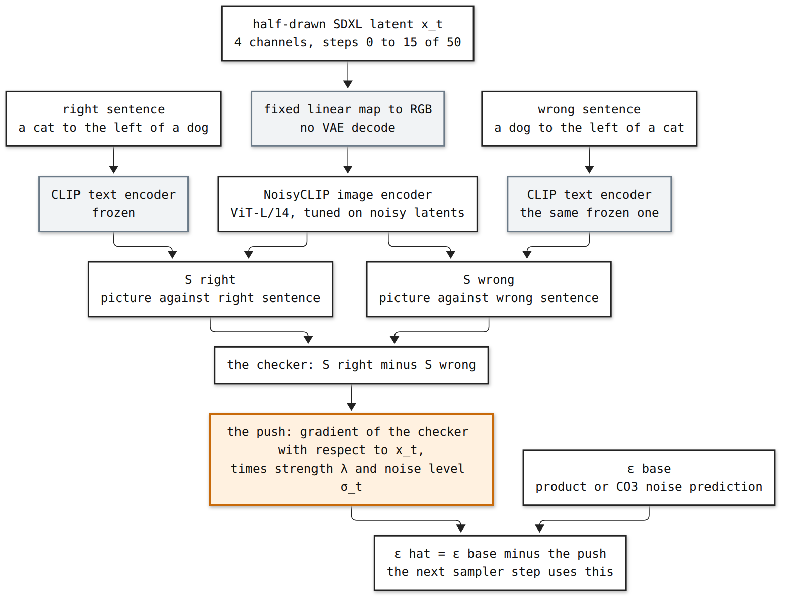

# Can a sentence score read the five properties on a half-drawn latent? (step W2)

This step measures whether pretrained NoisyCLIP can tell a right sentence from a wrong one on SDXL latents at steps 0 to 15 of 50, for each of the five abstract properties. Step W3 pushes only on the steps this one shows can be read, so a property that cannot be read here never reaches a render.

## Table of contents

- [Words this uses](#words-this-uses)
- [The run](#the-run)
- [The pictures and their labels](#the-pictures-and-their-labels)
- [The sentences](#the-sentences)
- [How one score is computed](#how-one-score-is-computed)
- [How a property is judged](#how-a-property-is-judged)
- [Checks before any score is believed](#checks-before-any-score-is-believed)
- [The order of work](#the-order-of-work)
- [What this cannot say](#what-this-cannot-say)

## Words this uses

**Sentence score.** The cosine similarity between the image embedding of a latent and the text embedding of one sentence, from -1 to 1.

**Checker score.** The right sentence's score minus the highest score among its wrong sentences. A positive value means the right sentence won.

**Step.** An index into SDXL's 50 DDIM timesteps. Step 0 is almost pure noise and step 49 is almost finished.

**Balanced accuracy.** The mean of the share of label-1 and the share of label-0 pictures called correctly, from 0 to 1, where 0.5 is chance.

**Threshold half and reading half.** The seeds are split in two. Each decision threshold is chosen on the threshold half and scored on the reading half.

**Word map.** Where one word's cross-attention lands on the picture, on SDXL's 32 by 32 grid.

## The run

**Group.** Runs that try a new idea (group 2). A result here cannot change a claim in Paper 2.

**Varied axis.** The weights of the image encoder: NoisyCLIP (`asiimo/noisyclip`) or frozen CLIP ViT-L/14 (`openai/clip-vit-large-patch14`). Pictures, noise, sentences, input path and thresholding rule are identical.

**Cost:** about 1 GPU-hour on one `bigbatch` card, for the word maps, the recoloured copies and about 110,000 image encoder passes per model. **Buys:** step W2, and the list of steps W3 may push on.

**Environment facts this depends on.** The `co3` python path, the `bigbatch` exclude list, `/datasets` for outputs, and the 200 of 220 latents that live under `/home-mscluster/mmolefe/poe_repair_min_scratch/outputs/` while the other 20 live under `/datasets/mmolefe/poe_repair_min/outputs/`. The code resolves each tile against both roots.

| Result, per property | What it takes |
|---|---|
| Reads | Mean balanced accuracy over steps 0 to 15, on the reading half, is at least 0.75 |
| Beats frozen CLIP | That mean is above frozen CLIP's by more than 1.96 standard errors, from 10,000 bootstrap resamples of the reading half's seeds, matched across the two models |
| Null | The label check passes and the property misses the 0.75 bar |
| Inconclusive | The property's label check fails, either half holds fewer than 8 pictures of either label, or a check in [the section below](#checks-before-any-score-is-believed) fails |

The bars are constants in `2-classifier-guidance/scripts/noise_text_critic/w2_read.py`.

**What would surprise.** NoisyCLIP passing the bar on left-right order or colour binding at steps 0 to 9. Its paper's right caption ranks first less often than chance before latent 10, and CLIP-style text models are known to be weak on word order.

## The pictures and their labels

All pictures come from the 220 labelled cat and dog pictures in `2-classifier-guidance/scripts/rung2/eval_set_catdog_v2.json`. They use no benchmark prompt, held-out pair or held-out seed.

| Property | Pictures | Label 1 | Label 0 |
|---|---|---|---|
| Counting | 185 from the set | `positive` (109) and `wrong pair` (46): two bodies | `hybrid` (29) and `single` (1) |
| Prompt match | 155 from the set | `positive` (109) | `wrong pair` (46) |
| Spatial relation | the 64 relation pictures and their mirror images, 128 | the cat is left of the dog | the dog is left of the cat |
| Position and size | the same 128, less those with no clear size difference | a large cat on the left and a small dog on the right | every other arrangement |
| Attribute binding | two recoloured copies of each of the 64, 128 | red cat, blue dog | blue cat, red dog |

**The 64 relation pictures.** The `positive` tiles sorted by the SHA-256 of their `id`, first 64. No picture is chosen by eye.

**Relation rule.** Each finished latent is noised to `t = 200` with three noise draws. The word maps of "cat" and "dog" are read from SDXL's 32 by 32 cross-attention layers under the prompt "a cat and a dog", with each position renormalised over the prompt's words, then averaged over draws, heads and layers. The cat is left of the dog when the centroid of the cat map's top 10% of positions has a smaller x than the dog's.

**Box rule.** Each word's box is the tight box around the positions above half of that map's maximum. One subject is large when its box area is at least 1.25 times the other's. A picture below that ratio has no clear size difference and leaves the position and size property, and the number left out is reported.

**Mirror images.** Each of the 64 pictures is flipped left to right in pixels and re-encoded with SDXL's VAE. The flip swaps the side label and keeps the sizes, so the relation classes are balanced exactly. A mirror image stays in the same half as its source.

**Colour rule.** Each subject's region is the word map above half its maximum, resized to 1,024 pixels with a Gaussian edge of 16 pixels. Inside it, hue is set to red (0 degrees) or blue (220 degrees), saturation is raised to at least 0.75, and brightness is kept. The two copies are re-encoded with SDXL's VAE.

**Label checks, by eye at full size, before any score is computed.** The 64 relation and box labels are drawn on their pictures and checked, and 32 of the recoloured copies are checked. If fewer than 90% of either set are right, this step stops and files an `ask`.

## The sentences

These are the brief's sentences, frozen here before any score. The brief's "a photo of another pair" is written as one named pair.

| Property | Right sentence | Wrong sentences |
|---|---|---|
| Counting | a photo of a cat and a dog, two separate animals | a photo of one animal; one animal that is part cat and part dog |
| Prompt match | a photo of a cat and a dog | a photo of two cats; a photo of two dogs; a photo of a horse and a sheep |
| Spatial relation | a cat to the left of a dog | a dog to the left of a cat |
| Position and size | a large cat on the left and a small dog on the right | a small cat on the left and a large dog on the right; a small dog on the left and a large cat on the right; a large dog on the left and a small cat on the right |
| Attribute binding | a red cat and a blue dog | a blue cat and a red dog |

**The and-score** is reported beside them on the counting and prompt match labels:

$$
A(x_t) = S(x_t, \text{a cat and a dog}) - S(x_t, \text{a cat}) - S(x_t, \text{a dog}) + S(x_t, \text{empty})
$$

## How one score is computed

1. Load the finished latent $z_0$ and noise it with the DDIM scheduler's `add_noise` at the step's timestep. This is the procedure that produced the kept checker's 0.63 to 0.79 per-step accuracy, and it gives the same scale NoisyCLIP's released code saves as the U-Net input.
2. Apply NoisyCLIP's linear map with weights `(60,-60,25,-70)`, `(60,-5,15,-50)`, `(60,10,-5,-35)` and biases `(150,140,130)`, then clamp to 0 to 255. No VAE decode.
3. Divide by 255, resize the 128 by 128 result to 224 by 224 with bicubic interpolation, and normalise with CLIP's mean and standard deviation. The checkpoint ships no processor file, so these are the base model's values, and the first check below tests them.
4. Run the image encoder and projection, normalise, and take the cosine with each normalised sentence embedding.

Each picture is read at steps 0 to 15, with 4 noise draws per step. The same noise is used for both models, and the checker score is averaged over the 4 draws, as the kept checker's evaluation does. Steps 20, 30, 40 and 49 are also read, as a sanity check only.

## How a property is judged

1. Split the seeds in two. Within each label, seeds are sorted by SHA-256 and alternate between the threshold half and the reading half, and all of a seed's pictures stay together.
2. At each step, choose the threshold that maximises balanced accuracy on the threshold half.
3. Apply it to the reading half and record that step's balanced accuracy.
4. The property's number is the mean over steps 0 to 15.

The steps W3 may push on are those from 0 to 15 whose balanced accuracy on the **threshold half** is at least 0.6.

## Checks before any score is believed

1. **Input path.** On 16 latents at steps 0 and 15, the embedding from this differentiable path and the embedding from the authors' path (`.byte()`, PIL, base CLIP processor) must have a mean cosine of at least 0.99.
2. **Published behaviour.** At step 49, NoisyCLIP's prompt match balanced accuracy must be above 0.6 on the threshold half. If it is not, check the linear map, the resize and the latent scale, then run the authors' script on one latent. If it still disagrees, file the `ask` the brief names.
3. **Checkpoint.** Every `text_model`, `text_projection` and `visual_projection` tensor in NoisyCLIP is compared with base CLIP, and the count that differ is recorded.
4. **Subject guard.** Every sentence and sheet passes `scripts/shared/disallowed_subjects.py`.

## The order of work

1. Smoke test: 8 pictures at 2 steps, both models, every check above that can run.
2. Build the word maps, labels, mirror images and recoloured copies, then look at them.
3. The controls and the full read, logged to W&B project `prime_lab/poe-repair-animals-compose`.
4. Write `review.md` with the table of five properties by step for both models, the verdicts, and a picture beside each number.

## What this cannot say

**These are noised finished pictures.** A latent on the sampler's real path at step 5 is not the same as a finished picture noised to step 5, and a score that reads one may not read the other. W3 tests the real path.

**Reading is not steering.** A score that separates the classes can still have a gradient that changes texture and leaves layout alone, which is what the decoded-image CLIP checker did.

**The labels on position, size and colour come from word maps and a recolouring rule.** The eye check bounds their error at about 10% and does not remove it, and recoloured pictures are easier or harder than real coloured animals in ways this step does not measure.

**One animal pair.** Every picture is a cat and a dog, so nothing here shows the score carries to other subjects.
