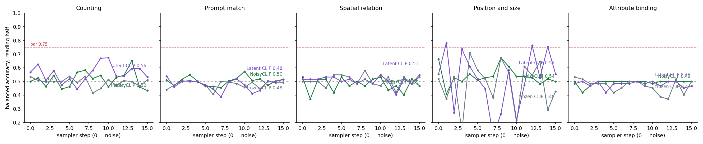
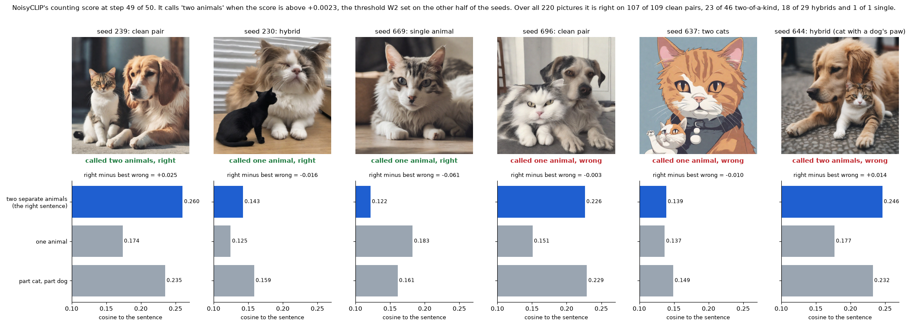

# Review: can a sentence score read the five properties? (step W2)

**State: null on counting, prompt match and left-right order, and inconclusive on position and size and on binding.** No model reads any of the five properties at steps 0 to 15: NoisyCLIP, frozen CLIP and Latent CLIP each stay between 0.46 and 0.56 mean balanced accuracy against the 0.75 bar, and none beats frozen CLIP. Position and size, and binding, are inconclusive rather than null, because their labels failed the eye check (the table below, and the owner's answer to board question 68). NoisyCLIP does read prompt match once the picture is mostly drawn, at steps 30 to 49, so the models and the input path work and the early steps are where reading fails. The [design](design.md) holds the sentences and bars, and the numbers are in [the result file](result.json), from W&B run `70g3qw2f`.

## Result

Each cell is the mean over steps 0 to 15 of balanced accuracy on the reading half of the seeds, with the threshold chosen on the other half. 0.5 is chance, and the bar is 0.75.

| Property | NoisyCLIP | Frozen CLIP | Latent CLIP | Pictures per half (right, wrong) | Verdict |
|---|---|---|---|---|---|
| Counting | 0.515 | 0.496 | 0.560 | 77 and 78, 15 and 15 | null |
| Prompt match | 0.503 | 0.478 | 0.479 | 55 and 54, 23 and 23 | null |
| Spatial relation | 0.479 | 0.506 | 0.507 | 33 and 31, 33 and 31 | null |
| Position and size | 0.538 | 0.482 | 0.510 | 1 and 1, 57 and 55 | inconclusive: 1 right picture per half, under the 8 the design needs, and its labels failed the eye check |
| Attribute binding | 0.492 | 0.467 | 0.481 | 33 and 31, 33 and 31 | inconclusive: the recolouring failed the eye check, so the labels cannot be trusted |

**Against frozen CLIP.** No gap passes 1.96 standard errors except NoisyCLIP on position and size (0.056, standard error 0.015), which rests on 2 right pictures and does not count. Latent CLIP's gaps are marked mixed, because it differs from frozen CLIP in both the model and the input.

**The late steps, as a check that the models work.** These are reading-half balanced accuracies at steps 20, 30, 40 and 49:

| Property | NoisyCLIP | Frozen CLIP | Latent CLIP |
|---|---|---|---|
| Prompt match | 0.67, 0.78, 0.86, 0.82 | 0.52, 0.62, 0.80, 0.80 | 0.49, 0.56, 0.61, 0.70 |
| Counting | 0.50, 0.64, 0.68, 0.71 | 0.49, 0.52, 0.56, 0.67 | 0.55, 0.54, 0.55, 0.54 |

The design's check at step 49 passes, with prompt match on the threshold half at 0.91 for NoisyCLIP and 0.73 for Latent CLIP, against 0.6. NoisyCLIP leads frozen CLIP by 0.15 at step 20 and 0.16 at step 30 on prompt match, so its noise training does move reading earlier. It moves reading to about step 20 of 50, not into steps 0 to 15 where the push would act. The NoisyCLIP paper reports separation by latent 10 of 50 (p. 10). Whether its latent index counts the same way as this sampler's step is not settled (inferred).

**Plurality on finished pictures.** At step 49 NoisyCLIP's counting score is right on 107 of 109 clean pairs, 23 of 46 two-of-a-kind pictures (two cats or two dogs), 18 of 29 hybrids and the 1 single animal. The wrong sentence "one animal that is part cat and part dog" shares both species words with the right one and scores within 0.03 of it on clean pairs, so a two-of-a-kind picture, which matches neither, falls on the wrong side of the threshold half the time. The counting sentences mix the species with the count (inferred from these cosines). [The six-picture sheet](example/noisyclip-counting-on-six-finished-pictures.png) shows the first right call and the first miss of each kind in SHA-256 order, from `2-classifier-guidance/scripts/noise_text_critic/w2_example_sheet.py` over the saved scores.

**The input path.** Our differentiable path from latent to CLIP input, compared with the authors' byte-rounded path through CLIP's own preprocessor, gives image vectors at cosine 0.995 for NoisyCLIP at steps 0 and 15. That passes the 0.99 bar. Frozen CLIP gives 0.989 and 0.987, just under the bar, so its row carries that caveat. It changes no verdict, because every row is null.

**What this means for W3.** The design lets W3 push only on steps whose threshold-half balanced accuracy is at least 0.6. Some steps pass that gate on the threshold half, but none reads on the reading half. Latent CLIP's counting, for example, passes at 7 steps whose reading-half values average 0.56. With 15 wrong pictures per half, one step's balanced accuracy has a standard error of about 0.07 (inferred from the counts), so 0.6 on one half is within reach of chance. The owner is asked on the board whether W3 runs under the written rule or stops here.

## Runs

| Job | Stage | Code | Outcome |
|---|---|---|---|
| 93753 | label smoke test, 4 pictures | `7ab2981c` | Failed in 18 seconds: the code snapshot left out `eval_set_catdog_v2.json` |
| 93795 | label smoke test, 4 pictures | `bec5297b` | Ran in 3 minutes. Left-right labels were right on 4 of 4 by eye. Every box covered the whole 32 by 32 grid, and the colour masks covered the background, so the region rule was replaced |
| 93851 | label smoke test, 8 pictures, new region rule | `9529388a` | Stalled: it started at 20:08 on mscluster89, printed only its start line, and was cancelled at its 90-minute limit. This matches the cluster storage outage below |
| 94092 | label smoke test, 8 pictures, new region rule | `9529388a` | Ran in under 5 minutes. By eye at sheet size: left-right right on 8 of 8, and each recoloured animal carries its own colour with the background unchanged. Size labels are unreliable: on a large cat the word map covers mostly the head, so pictures 04 and 05 read "dog larger" when the animals are about equal, and 03 is doubtful |
| 94093 | labels for all 64 relation pictures | `9529388a` | Ran in 3 minutes; checked by eye below |
| 94094 | scoring smoke test, 24 pictures, steps 0 and 15 | `23599e96` | Failed in 3 minutes: safe loading refused Latent CLIP's checkpoint, which stores numpy numbers under numpy 1's class names |
| 94096 | scoring smoke test | `385dae85` | Ran in 33 seconds: Latent CLIP loaded in safe mode with a strict key match, the checkpoint comparison matched the text side and the projections exactly, and NoisyCLIP's input path passed |
| 94105 | full scoring, 441 latents, steps 0 to 15 and 20, 30, 40, 49, 4 noise draws | `385dae85` | Finished at 05:50 UTC with exit 0; W&B `70g3qw2f` |

## Label check by eye

Job 94093 built the labels for all 64 relation pictures in 3 minutes. A checker read every sheet at sheet size against a fixed guide, and the calls are in [label-check](label-check/eye-labels.csv).

| Label set | Right | Bar | Result |
|---|---|---|---|
| Left-right order, 64 pictures | 62 of 64 (96.9%) | 90% | passes |
| Size, 57 pictures with a size call | 37 of 57 (64.9%) | 90% | fails |
| Recoloured copies, 32 checked | 18 of 32 (56%) | 90% | fails |

Both failures have one cause. The word "cat" lands mostly on the cat's head, so the cat's region is often the head alone. That makes the cat look small in 20 size calls, and leaves the cat's body uncoloured or coloured as the dog in 7 of the 16 checked pictures. The two left-right misses, 43 and 54, are a cat sitting in front of the dog between its front legs, where neither is to the left.

By the design, position and size and attribute binding are held, and the owner decides how they continue.

## Text-only word check

Before any image is read, [this check](word-check/word-check.json) asks whether CLIP ViT-L/14's text encoder, the one NoisyCLIP keeps frozen, can tell word order and colour binding apart at all. It averages each swapped pair over both word orders: what survives is the part of the swap a sum of word slots cannot produce. The ratio is that part's size over twice the swap's size, 0 for a pure sum of word slots and 1 when the whole swap survives. The script is `2-classifier-guidance/scripts/noise_text_critic/word_check.py`, run on the laptop's CPU, over six noun pairs.

| Property | Trained CLIP: ratio, mean (range) | Same encoder with random weights | Swapped sentences' cosine, trained | Swap size, trained, against changing one noun |
|---|---|---|---|---|
| Colour binding, red and blue | 0.72 (0.48 to 0.94) | 0.13 | 0.956 | 0.23 to 0.41 |
| Left-right order | 0.28 (0.22 to 0.33) | 0.08 | 0.965 | 0.19 to 0.34, against 0.63 to 0.87 |

**Binding is carried by the text side.** Most of the colour-swap difference survives averaging both word orders. With random weights the colour-swap direction is the same for every noun pair (mean cosine 0.96 across pairs, a pure slot term), and in trained CLIP it is not (0.24).

**Order is carried weakly.** Swapping the nouns moves a sentence about a third as far as changing one noun, and about a quarter of that move survives averaging. So the text side gives a left-right check a small target, and W2 measures whether the image side can hit it.

This check uses no image, so it bounds what any reader using this text encoder can do and says nothing about NoisyCLIP's image side.

## Cluster access

From 20:25 on 2026-11-23 (laptop time), `ssh mscluster84` refused a new session on the shared connection and then timed out after 200 and 300 seconds. At 21:05 it timed out again after 300 seconds, a direct connection with no shared socket hung for 45 seconds, and the login node `mscluster` hung for 70 seconds even though its port 22 accepts a TCP connection. At 21:44, 21:48, 22:19, 22:23, 22:54, 22:58, 23:31 and 23:34 the login node hung again, for 60 to 90 seconds each time. At 06:21 and 06:23 on 2026-11-24 the login node still failed. Verbose attempts show the network and the key exchange working, and the connection stalling at public-key authentication. With a 30-second keepalive the client gave up after 90 seconds; with none, at 06:29, the server closed the connection after 2 minutes 46 seconds at the same point. The owner's own interactive login succeeded after a few minutes. Once the owner opened a shared connection, sessions started through it still hung, even `hostname`, while `ssh mscluster107`, which only passes through the login node, answered in seconds. Cluster commands now go through `mscluster107`. A stall at that point usually means the server cannot read the home folder that holds `authorized_keys` (inferred). Job 93851's state could not be read during that time.
