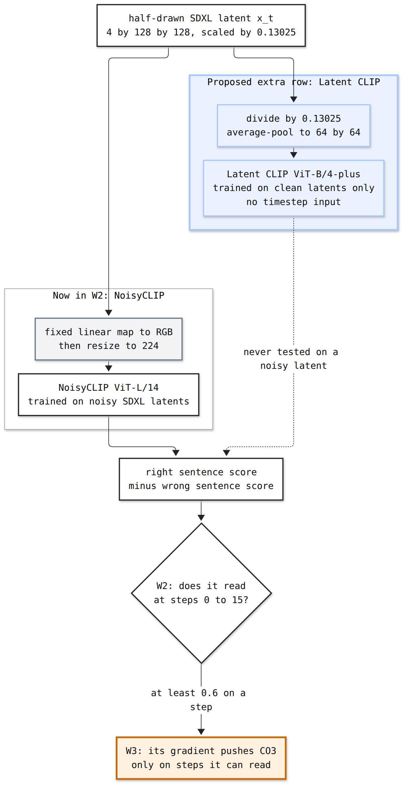

# Does a sentence score's gradient improve CO3? (step W3)

This step adds the gradient of one right-minus-wrong sentence score to CO3 and counts faithful pairs on the 12 tuning pairs, beside CO3 alone and a random push of the same length. It tests the part W2 cannot: whether a score that reads a half-drawn latent can also move the picture.

## Table of contents

- [Words this uses](#words-this-uses)
- [The run](#the-run)
- [Which score is pushed](#which-score-is-pushed)
- [The sentences for each pair](#the-sentences-for-each-pair)
- [How the push enters CO3](#how-the-push-enters-co3)
- [The three rows](#the-three-rows)
- [Checks before any picture is counted](#checks-before-any-picture-is-counted)
- [How pictures are counted](#how-pictures-are-counted)
- [The bars](#the-bars)
- [The order of work](#the-order-of-work)
- [What this cannot say](#what-this-cannot-say)

## Words this uses

**Faithful pair.** A picture with exactly one clear subject A and one clear subject B as separate bodies, with no borrowed parts, that is an intact photograph. The [blind count rubric](../../method-search/01-beat-the-baseline/blind-count-rubric.md) defines it.

**Checker score.** The right sentence's cosine with the latent minus the highest wrong sentence's cosine, as in [the W2 design](../02-can-it-read/design.md#words-this-uses).

**Push length.** The size of the push as a fraction of the size of CO3's guided noise prediction at that step.

## The run

**Group.** Runs that try a new idea (group 2). A result here cannot change a claim in Paper 2.

**Varied axis.** The push added to CO3: none, the sentence score's gradient, or a random direction of the same length. Model, prompts, seeds and CO3's settings are the same in every row.

**Pairs and seeds.** The 12 tuning pairs in `2-classifier-guidance/scripts/checker_choice/splits.json` at seeds 6001 to 6008, 96 pictures per row. No held-out pair, held-out seed or benchmark prompt is used.

**CO3.** The released settings in the replications hub's `co3_common.py`: CFG++ at guidance 0.8, 50 steps, 6 corrected steps.

**Cost:** about 4.5 GPU-hours on one `bigbatch` card, from Loop 6's measured 146.7 seconds per seed across three rows on an RTX 8000, 96 pair and seed combinations, plus the checks. **Buys:** step W3, the first measurement of whether a sentence score's gradient changes what CO3 draws.

**Budget.** W2 at 1.5, W3 at 4.5 and W4 at 2 GPU-hours reach the loop's 8-hour limit exactly. If W2 or the checks overrun so that W3 would pass it, W3 files an `ask` with the cost before rendering.

## Which score is pushed

One score is pushed, chosen by rule from W2's `result.json` before any W3 picture exists.

**The candidates.** NoisyCLIP and Latent CLIP, each on counting and on prompt match. These two properties apply to a joint prompt such as "a puma and a condor". Spatial relation, position and size, and binding need a layout or colour the prompt does not ask for, so they are not candidates here.

**The rule.**

1. For each candidate, list the steps from 0 to 15 whose balanced accuracy on W2's **threshold half** is at least 0.6.
2. Drop candidates with no such step.
3. Keep the candidate with the highest mean balanced accuracy on the threshold half over steps 0 to 15. A tie within 0.005 goes to NoisyCLIP, because its comparison with frozen CLIP is the clean one.
4. The push runs only on that candidate's listed steps.

**If no candidate has a step,** this step records that, renders nothing, and the loop moves to W4.

W2's reading half is never used to choose. Latent CLIP's weights carry no stated licence, so if it is chosen, its pictures and counts stay out of any paper until that is settled.

## The sentences for each pair

W2's sentences are written for a cat and a dog. Here they are filled in from each pair's two subjects, and each sentence passes `scripts/shared/disallowed_subjects.py`.

| Property | Right sentence | Wrong sentences |
|---|---|---|
| Counting | a photo of a puma and a condor, two separate animals | a photo of one animal; one animal that is part puma and part condor |
| Prompt match | a photo of a puma and a condor | a photo of two pumas; a photo of two condors; a photo of a horse and a sheep |

For lighthouse and sailboat, "animal" and "animals" become "object" and "objects". Plurals come from a fixed table in the code, so goose becomes geese and fox becomes foxes. No tuning pair contains a horse or a sheep.

## How the push enters CO3

The gradient of the checker score is scaled to a fixed length and subtracted from both of CO3's two predictions, the same place Loop 6's push enters (`2-classifier-guidance/scripts/method_search/co3_push.py`):

$$
p_t = b\,\lVert\epsilon_g\rVert\,\frac{\nabla_{x_t} D(x_t)}{\lVert\nabla_{x_t} D(x_t)\rVert}, \qquad \hat\epsilon_g = \epsilon_g - p_t, \qquad \hat\epsilon_u = \epsilon_u - p_t
$$

$D$ is the checker score, $\epsilon_g$ is CO3's guided prediction and $\epsilon_u$ its unconditional one. $b = 0.4$, the length [the abstract-checker design](../../abstract-checkers/03-design.md#how-the-push-is-computed) fixes for one checker. Fixing the length means the push has no strength to tune, so no second setting is tried on these pictures.

**The clamp.** NoisyCLIP's linear map clamps to 0 to 255, and a clamped value passes no gradient. Before W3's first render, on the 64 unflipped pictures from W2 noised to steps 0 to 15, one script measures the share of RGB values the clamp saturates and compares a hard clamp with this soft one:

$$
\text{soft}(v) = v - \tfrac{1}{\beta}\log\big(1 + e^{\beta(v - 255)}\big) + \tfrac{1}{\beta}\log\big(1 + e^{-\beta v}\big), \qquad \beta = 0.05
$$

The push uses the soft clamp if the hard clamp saturates more than 5% of values and the soft path's image embedding has a mean cosine of at least 0.99 with the hard path's. Otherwise it uses the hard clamp. The measured values and the choice are recorded in `review.md`, and neither is tuned on W3's pictures. Latent CLIP has no clamp.

## The three rows

| Row | What it does |
|---|---|
| 1. CO3 alone | CO3 as released |
| 2. CO3 with the sentence push | Row 1 plus the push above, on the chosen steps |
| 3. Random push | Row 1 plus a random direction, with row 2's length for the same pair, seed and step |

All three rows are rendered here, so they share a card type and go into one blind count.

## Checks before any picture is counted

1. **Zero push.** The sentence path multiplied by zero reproduces CO3's own loop with a largest absolute latent difference under 1e-5, in one process on one card and dtype.
2. **Two concepts.** Each prompt parses into exactly two concepts for CO3. A pair that does not is reported and left out of all three rows.
3. **The push acts.** The real push changes the final latent, and its length matches $b\lVert\epsilon_g\rVert$ on every pushed step.
4. **Subject guard.** Every sentence and sheet passes the guard. Giraffe and tortoise is counted and stays off every sheet, page and message.

## How pictures are counted

By eye at full size, with no API tokens, under the [blind count rubric](../../method-search/01-beat-the-baseline/blind-count-rubric.md). All 288 pictures are shuffled under neutral names and each gets one call. The key naming the rows is opened only after every call is saved. NoisyCLIP, Latent CLIP and frozen CLIP score no picture this step produces, because one of them does the steering.

## The bars

The standard error comes from 10,000 bootstrap resamples of the 12 pairs, using each pair's matched difference over its 8 seeds.

| Result | What it takes |
|---|---|
| Support | Row 2 leads row 1 by at least 5 of 96 faithful pairs and by more than 1.96 standard errors, and row 3 does not |
| Null | Row 2 has no such lead |
| Inconclusive | The zero-push check fails, or row 3 also leads row 1 by at least 5 of 96 and more than 1.96 standard errors |

A null is reported and the loop goes on to W4, with no second setting tried on the same pictures.

**What would surprise.** A push that raises the checker score at every step and moves no count, which would repeat what the decoded-image CLIP checker did. Row 2 falling below row 1 by 5 or more would mean the score actively pulls CO3 away from faithful pictures.

## The order of work

1. Choose the score by the rule, and write the choice and its numbers into `review.md`.
2. Run the clamp comparison.
3. Smoke test on one pair and one seed for all three rows, and look at the pictures.
4. Run the checks above.
5. Render the three rows, logged to W&B project `prime_lab/poe-repair-animals-compose`.
6. Count blind, open the key, and write `review.md` with the three rows, the verdict and picture sheets.

## What this cannot say

**The score was read on cats and dogs.** W2 measures reading on one pair, and this step applies its steps to 12 other pairs, so a step that reads on cats and dogs may not read on a puma and a condor.

**Reading was measured on noised finished pictures.** The sampler's real path at step 5 differs from a finished picture noised to step 5.

**Twelve pairs and one setting.** A null here says this score at this length did not help CO3. It does not rule out a different length, a different score or a retrained model.
