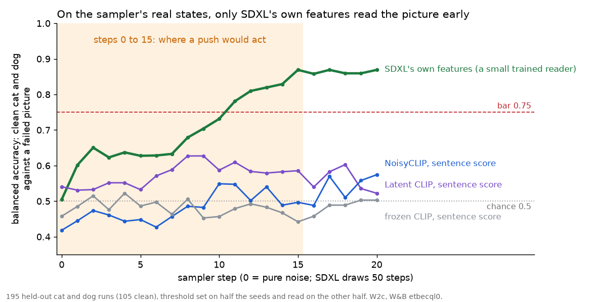

# Verdict: can a sentence score check the abstract properties? (step W5)

**Drop sentence scores as the push's reader, for both papers.** No sentence score reads any property at steps 0 to 15, where a push acts. That holds for pretrained NoisyCLIP, frozen CLIP and Latent CLIP, for our own trained model on concepts it had not seen, and under every fair setting tried. What does read early is a small reader on SDXL's own features: 0.87 by step 15 on real sampler states. That is where the push's reader should come from. This verdict recommends neither a Paper 3 nor a place for sentence scores in either paper, except as a negative result and a baseline.

## One row per property

Each cell is mean balanced accuracy over steps 0 to 15 unless it says otherwise. The bar is 0.75, and chance is 0.5.

| Property | Best sentence score early | On the finished picture (step 49) | Verdict | Evidence |
|---|---|---|---|---|
| Counting (two animals, not one or a hybrid) | 0.561, Latent CLIP | 0.71 at best (NoisyCLIP), 0.750 with species-free ensembled sentences (frozen CLIP) | null | [W2](02-can-it-read/review.md), [W2c](02c-fair-test/review.md) |
| Prompt match (the right pair) | 0.526, NoisyCLIP ensembled | 0.82 (NoisyCLIP) | null | the same |
| Left-right order | 0.507 | not judged | null | [W2](02-can-it-read/review.md) |
| Position and size | 0.538, with 1 right picture per half | not judged | inconclusive: size labels failed the eye check (37 of 57) | [W2](02-can-it-read/review.md) |
| Attribute binding | not scored | not scored | untested by the owner's choice: colour labels 26 of 32 against 90%, part binding too few mixed pairs | [W2d](02d-binding/review.md) |

## What else the loop found

| Question | Answer | Evidence |
|---|---|---|
| Is the setup readable at all early? | Mostly. A readout head on SDXL's features read the clean pair at 0.637 over steps 0 to 15 on noised pictures, under its 0.65 floor, so W2's verdict is formally inconclusive. On real sampler states it read 0.696 over steps 0 to 15 and 0.87 by step 15 | [W2c](02c-fair-test/review.md) |
| Does a trained linear layer on the encoders' vectors read it? | Weakly. At best 0.644 on seen pairs and 0.586 on unseen pairs (NoisyCLIP) | [W2b](02b-linear-probe/review.md) |
| Does our own noise-aware model carry to new concepts? | No. Seen digit pairs 0.758 in the SDXL-matched window, unseen 0.590, digits apart against wrong digits 0.502 | [W4](04-train-our-own/review.md) |
| Did the push run? | No: nothing read at the steps it acts on. W3's code stays ready for a reader that does | [W3](03-does-it-steer/review.md) |
| Does the text side carry binding? | Yes for colour binding (ratio 0.72 against 0.13 for random weights); weakly for word order (0.28 against 0.08) | [the word check](02-can-it-read/review.md#text-only-word-check) |
| Where does CO3 fail at binding? | By pair, not by seed: cheetah × cougar and duck × goose borrow parts in all 7 two-subject pictures, eagle × fox in none | [W2d](02d-binding/review.md) |

## What this hands on

- **Loop 6 (the CO3 push).** Read with SDXL's own features. The readout head reaches 0.87 by step 15 on real states. Note too that CO3's binding failures are fixed per pair.
- **Loop 10 (the score path).** W4's encoder is at `/datasets/mmolefe/poe_repair_min/loop-9/w4/full/encoder.pt` as its baseline. W4 shows that CLIP's frozen words do not carry an image encoder to concepts it never trained on.
- **Both papers.** Sentence scores belong in the paper as a tested baseline that fails early, with the W2c figure above as the evidence.

## Cost

About 3 GPU-hours of the 8.7 approved: W2's labels and scoring, W2c's run and its restart after a node failure, the species-free rescore, W2b, W4 and the colour preparation (estimated from the job times in each review). W3's 4.5 hours were not spent.
