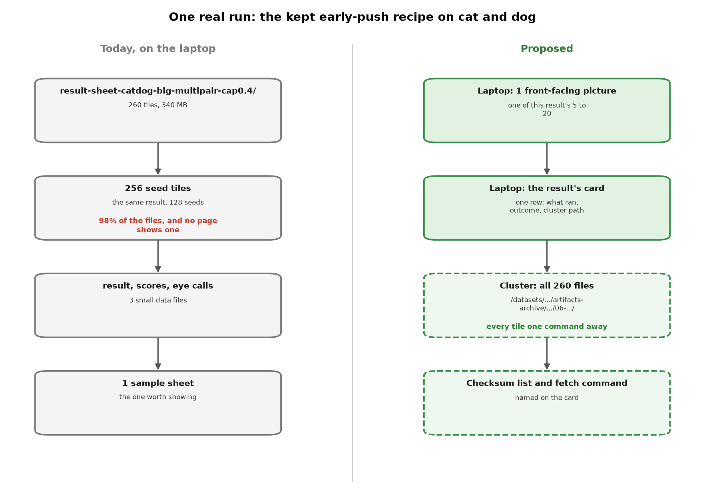
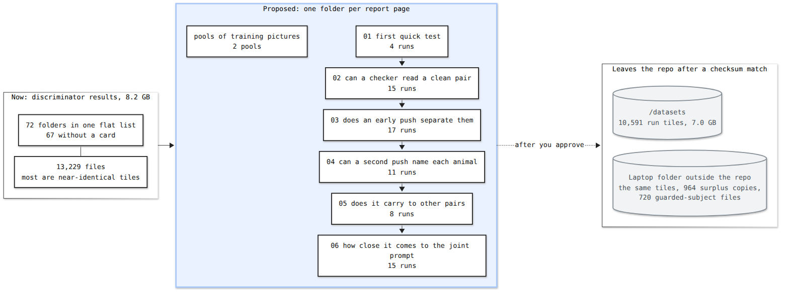
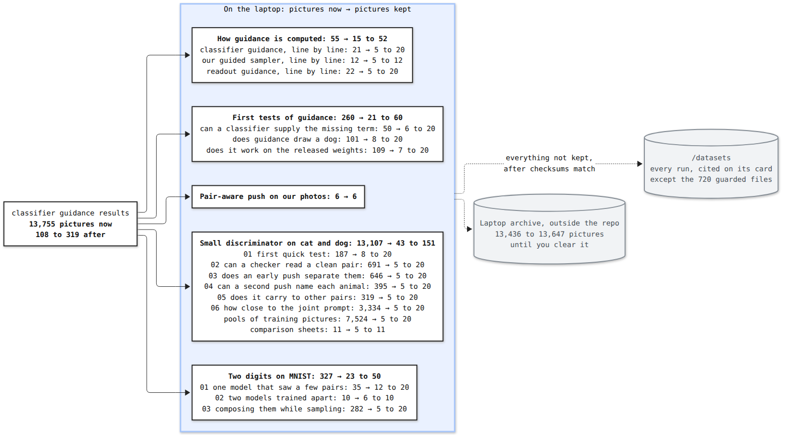

# 🧭 Progress: organising the classifier guidance and inclusive captions artifacts

The laptop keeps one front-facing picture from each run or variant folder, the one good enough to go
in a paper. The cluster holds everything else, and each result's card says exactly where it sits.
Step O1 on the
[progress board](board.json) tracks this work. Counts were measured on 2026-11-22.

<a href="organise-before-after.png"></a>
<a href="organise-plan.png"></a>
<a href="organise-tree.png"></a>

## Table of contents

- [What changes](#what-changes)
- [What stays on the laptop](#what-stays-on-the-laptop)
- [The layout](#the-layout)
- [How a result cites the cluster](#how-a-result-cites-the-cluster)
- [The stages](#the-stages)
- [Who does what](#who-does-what)
- [Pictures worth replacing](#pictures-worth-replacing)
- [Still open](#still-open)

## What changes

| Tree | Result pictures now | Pages show now | Result pictures on the laptop after |
|---|---|---|---|
| `2-classifier-guidance` | 13,755 | 69 | 93 |
| `4-inclusive-captions` | 166 | 11 | 8, plus the 155 web images until the owner decides |

A run with no picture that passed the subject check keeps none on the laptop, and its card cites the cluster.

## What stays on the laptop

1. One picture from each run or variant folder, chosen by opening the candidates. Seeds, checkpoints,
   rounds and settings of one figure count as one. A result keeps 20 pictures at most.
2. Every picture the paper prints. A page showing several variants from one folder keeps the chosen
   one and cites the others on the cluster.
3. The data files a page cites.
4. One card per result.
5. Scenes, decks and walks, because each needs its own files to open.

Everything else in a result moves to the cluster. A second copy waits in the laptop archive at
`/home/molef/PhD/_archive/concept-composition-offload-2026-11-22/` until the owner clears it. That
archive sits outside the repository because the repo's own `_archive/` is tracked in git, and 8 GB
must never enter git history.

The 720 files whose paths name a guarded subject go only to the laptop archive and are never shown
or uploaded.

## The layout

The discriminator's 72 run folders keep their names on the cluster, under the report page that
discusses them, so a name quoted on a page still finds its run. The question folders at the top keep
their names, because each is named by 7 to 28 plans, scripts and pages. Their reading order goes on
the generated results index.

```text
2-classifier-guidance/artifacts/results/
  can-a-classifier-supply-the-missing-term/
  does-classifier-guidance-draw-a-dog/
  does-classifier-guidance-work-on-the-released-weights/
  does-a-pair-aware-push-compose-our-photos/
  does-a-small-discriminator-steer-cat-x-dog/
    01-the-first-quick-test/                     4 runs
    02-can-a-checker-read-a-clean-pair/         15 runs
    03-does-an-early-push-separate-them/        17 runs
    04-can-a-second-push-name-each-animal/      11 runs
    05-does-it-carry-to-other-pairs/             8 runs
    06-how-close-it-comes-to-the-joint-prompt/  15 runs
    pools-of-training-pictures/                  2 pools
    comparison-sheets/                          11 sheets
  can-two-digits-compose-on-mnist/              three numbered stages
  what-each-line-of-classifier-guidance-computes/
  what-each-line-of-readout-guidance-computes/
  what-each-line-of-our-guided-sampler-computes/

4-inclusive-captions/artifacts/results/         reading order on the index:
  does-relabelling-both-shapes-pictures-help-the-toy-product-compose/
  do-inclusive-labels-help-the-product-compose-on-mnist/
  does-the-share-of-two-digit-pictures-help-the-product-compose-on-mnist/
  does-captioning-both-animal-photos-under-each-name-help-poe-compose/
  how-many-photos-the-inclusive-captions-pilot-can-train-on/
  does-any-caption-say-a-cat-and-a-dog/
```

Each result folder on the laptop then holds its card, one picture per run and `on-the-cluster.tsv`.

## How a result cites the cluster

The cluster root is `/datasets/mmolefe/poe_repair_min/artifacts-archive/`, followed by the result's
path in the repo. Each card has one row per run:

| Run | What changed | Outcome | Files | Size | Cluster path |
|---|---|---|---|---|---|

`on-the-cluster.tsv` beside the card lists every moved file with its size and sha256 checksum. The
card also carries the command that brings a run back:

```bash
rsync -a mscluster84:/datasets/mmolefe/poe_repair_min/artifacts-archive/<result path>/<run>/ <run>/
```

## The stages

Each stage ends in a check, and a failed check stops the next one.

1. **Write the file list.** One row per file: old path, new path, size and checksum. The check: rows
   equal files on disk.
2. **Copy each result to `/datasets`.** The check: every checksum on the cluster matches.
3. **Pick the front-facing pictures.** One agent per result opens the candidate sheets at full size,
   checks each against the subject guard and pair ledger, and picks one per run or variant folder.
   The check: no folder keeps two variants, no result passes 20, and no held or guarded picture is
   picked.
4. **Regroup and write the cards.** Put the picks in place, write each card and `on-the-cluster.tsv`,
   repoint the five `rung2` scripts and the page links. The check: no new broken link, and every
   script compiles.
5. **Move the rest out.** Move all other files to the laptop archive and record each in
   `restore-manifest.tsv`. The check: the row count equals the files moved, and a restore of one run
   from the cluster reproduces its checksums.
6. **Close.** Rerun the results index, drain both projects, and confirm `sweep.py` prints
   `new 0  changed 0`.

## Who does what

| Who | Work |
|---|---|
| Session 2 | stages 1, 2, 4, 5 and 6, because they need one owner and one lock |
| Picking agents, one per result | stage 3 |
| Session 3 | applies the old-to-new path table to `plans/`, sent through `requests.md` |
| Session 1 | adds the path table to `RENAMES.md` |

The rules for any deletion, recorded-number change, fixed-folder change or picture overwrite are in
the [decision log](decision-log.md). This plan needs none of the four.

## Pictures worth replacing

These 21 kept pictures passed the subject check but are weak as paper figures. Each run's other renders are on the cluster, so a better one can be swapped in by name.

| Result | Run or picture | Why it is weak |
|---|---|---|
| 02 checker | `result-sheet-catdog-identity` | the plain render with no push, because no guided tile passed |
| 02 checker | `result-sheet-catdog-more3` | the front animal is part cat and part dog |
| 02 checker | `result-sheet-catdog-more3-long` | the two species are hard to tell apart |
| 02 checker | `result-sheet-catdog-more2` | the cat's face is blotchy and overlaps the dog |
| 02 checker | `result-sheet-v4c` | a dark strap crosses the cat's muzzle |
| 02 checker | `result-sheet-v4c-early` | a gold ring sits over the cat's eye |
| 03 early push | `clip-push-sheet-from0`, `-from10`, `-halfdrawn` | three near-identical faint grey heads |
| 03 early push | `result-sheet-catdog-identity-cap0.3` | oversaturated colours |
| 03 early push | `result-sheet-catdog-cap0.3-early-corrector` | oversaturated colours |
| 03 early push | `push-then-pick` | the first two panel captions overlap |
| 05 other pairs | `result-sheet-lion-meerkat-multipair-long` | two meerkats and no lion |
| 06 joint prompt | `result-sheet-catdog-general-rerun` | partly fused faces |
| 06 joint prompt | `joint-catdog-eval` | a malformed cat nose |
| Released weights | `guide/c281_s1_seed12.png` | a spotted big cat with odd anatomy where the class is tabby |
| Released weights | `identity/identity_seed2_plain.png` | one 256-pixel render with odd anatomy |
| Draw a dog | `dog-01-from-an-animal/tiles/seed11__pushs30.png` | one tile standing in for a sheet |
| Pair-aware push | `imagenet-product-check-256.png` | the dogs are recognisable but their faces are distorted |
| MNIST stage 01 | `style-samples-readout.png` | a style sample that shows no run outcome |
| Captions: share of two-digit pictures | `guidance-1-first-six-models.png` | 1440 by 5400 pixels, too tall for a paper page |

## Still open

- **The 155 web images in `does-any-caption-say-a-cat-and-a-dog/images/`.** They are tracked in git
  and on two remote branches. Moving them does not remove them from history, so they stay until the
  owner decides.
- **Clearing the laptop archive.** It stays until the owner approves a deletion pass.
- **The `lora-correction` results (6.6 GB of artifacts).** Its 3,352 run-output files that nothing names are on the cluster and in the laptop archive. The one-picture-per-run rule has not been applied there.
