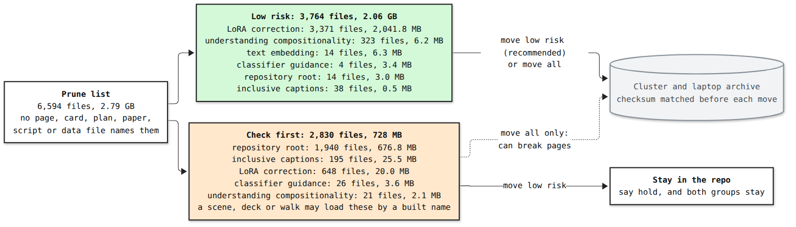

# 🧭 Progress: prune list

Artifact files that nothing in the repository names, so they can leave the repository once the owner approves. Every file listed here is still in the repository. The [full list](prune-list.tsv) gives each file's path, size, reason, risk and proposed move to the laptop archive.

The search reads every page, card, plan, paper, script and data file for the file's name. It cannot see a name a script or scene builds at run time, so files under `scenes/`, `decks/` and `drips/` are marked `check first`.

## By project

| Project | Artifact files | Named by nothing | Size |
|---|---|---|---|
| 1-lora-correction | 2,282 | 667 | 41.4 MB |
| 2-classifier-guidance | 362 | 28 | 3.6 MB |
| 3-understanding-compositionality | 2,932 | 67 | 2.5 MB |
| 4-inclusive-captions | 655 | 233 | 26.1 MB |
| 5-text-embedding-third-expert | 73 | 0 | 0.0 MB |
| repository root | 3,773 | 1,953 | 679.8 MB |
| **All** | 10,077 | 2,948 | 753.4 MB |

## Largest folders

| Project | Folder | Size |
|---|---|---|
| repository root | `drips/present-revision-to-supervisor` | 515.7 MB |
| repository root | `decks/supervisor-meeting` | 160.9 MB |
| 1-lora-correction | `scenes/where-each-condition-lands` | 19.9 MB |
| 1-lora-correction | `results/the-adapter-on-cat-and-dog` | 19.8 MB |
| 4-inclusive-captions | `scenes/how-the-toy-relabelling-experiment-works` | 9.2 MB |
| 4-inclusive-captions | `decks/supervisor-meeting` | 4.8 MB |
| 4-inclusive-captions | `scenes/how-the-inclusive-captions-pilot-works` | 4.7 MB |
| 4-inclusive-captions | `drips/inclusive-captions-mnist-stage` | 3.5 MB |
| 4-inclusive-captions | `scenes/how-the-inclusive-labels-mnist-stage-works` | 3.3 MB |
| repository root | `ideas/direction-gallery` | 2.8 MB |
| 2-classifier-guidance | `scenes/mnist-guidance-explained` | 2.5 MB |
| 3-understanding-compositionality | `scenes/three-ways-a-product-reaches-a-and-b` | 1.6 MB |

## By risk

| Risk | Size |
|---|---|
| check first: a built page may load it | 728.1 MB |
| low | 25.3 MB |
