# Consensus: what failed, which doors are shut, and where the next loops start

This page reads across every attempt in [the what-we-tried ledger](what-we-tried/README.md) (223 entries in six files, as committed at `e0acba53`) and says what the next research loops can build on. It separates ideas that were tested fairly and failed from ideas that failed because the test could not have shown them working, ranks the second group by how much a clean answer would change either paper per GPU-hour, and lists the rules that would have prevented the failures. A loop reads this page and the ledger entries it links before writing any new design. The reviewer's own earlier verdicts are in [the 2026-11-24 review](2026-11-24-review.md), and where this page relies on them it says so.

Every number here is copied from the ledger entry it links, and that entry names the review, picture and W&B run behind it. Disagreements between records are listed in section 6 and are not resolved here.

## Failure kinds, counted

Entries naming each kind on their "Kind of failure" line, out of 223 (an entry can name several; section 3 gives the counting rule and the splits).

| kind | count |
|---|---|
| the idea | 60 |
| done wrong | 36 |
| wrong data | 27 |
| could not measure it | 87 |
| test design | 162 |
| not understood | 23 |

## Words this uses

**Paper 1** composes diffusion models trained apart while sampling, and must beat sampling each model alone and pasting the results ("paste"). **Paper 2** fixes how one frozen model (SDXL) draws two named subjects, and must beat CO3. Some ledger files disagree on which paper an attempt serves; each entry here gives the paper its own ledger entry gives, and section 6 lists the disagreements.

**CO3** is the released composition sampler that corrects steps 0 to 5 of SDXL's 50. **The plain product** (PoE, product of experts) adds the two single-subject noise predictions and subtracts the empty prompt's. **The joint prompt** is SDXL asked for both subjects in one sentence. **The dropped term, r_t,** is the joint prompt's noise prediction minus the plain product's.

**Two clear** is a picture with exactly one clear body of each named subject, neither carrying the other's parts, called blind by two reviewers with a third settling splits, drawing style ignored. **Faithful** is the stricter older call that also needs an intact photograph. **Balanced accuracy** is the mean of a reader's hit rates on its two classes (0.5 is chance, 1.0 perfect). **AUC** (area under the curve) is how often a picture of the good class outscores one of the other class (0.5 is chance). **Within pair** means comparing only pictures of the same subject pair, which removes any effect of which pair it is. **A grey level** is one step of 255 in a pixel value; "moved by 2.3 grey levels" is the mean absolute pixel change between two pictures of the same seed.

**The kept push** is the multi-pair readout checker's gradient added to the noise prediction at strength 30, capped at 0.4 of the prediction's length, on steps 0 to 15. **The LoRA correction** (also "the adapter") is the pooled low-rank adapter trained to supply r_t to the plain product.

**The six kinds of failure**, from [the ledger's README](what-we-tried/README.md): **the idea** (tested fairly, does not work), **done wrong** (right idea, built so it could not show its effect), **wrong data**, **could not measure it** (the instrument could not see the outcome), **test design** (too few pictures, a bar or control that could not separate the answers, or no bar written first) and **not understood** (a wrong belief about the mechanism shaped the design). Only the first closes a door.

Board step codes appear in brackets after the plain name, for example "the box pass against the whole-picture pass (Z13)".

## Contents

- [Failure kinds, counted](#failure-kinds-counted)

1. [What is settled](#1-what-is-settled)
2. [Retry worth it, ranked](#2-retry-worth-it-ranked)
3. [The patterns behind the failures](#3-the-patterns-behind-the-failures)
4. [Rules for every new design](#4-rules-for-every-new-design)
5. [What the papers can claim now](#5-what-the-papers-can-claim-now)
6. [Records that disagree](#6-records-that-disagree)

## 1. What is settled

These are the ideas the ledger marks closed on a test it judges fair, meaning the entry names **the idea** as the kind of failure for the closed part. Each row says how far the closure reaches; a closure on one toy or one pair does not reach SDXL or other pairs unless the row says so. Where several ledger files record the same attempt, the row links each copy.

### Paper 2: readers, signals and pushes on SDXL

| What is shut | The fair test that shut it | The number | Ledger entry | Picture |
|---|---|---|---|---|
| A clean-pair checker (two bodies against one) as CO3's correction | Three checkers read on all 96 reproduced CO3 trajectories at steps 0 to 30, against a bar written first (at least 0.75 sees the failure, under 0.65 at every step does not) | Best balanced accuracy 0.602, 0.617 and 0.648, all under the 0.65 floor | [checker data and whether any checker sees CO3's failure (M5)](what-we-tried/method-search.md#balancing-the-checkers-training-data-and-whether-any-checker-sees-co3s-failure) | 🖼️ Diagram wanted: balanced accuracy against step for the three checkers on CO3's 96 trajectories, with the 0.65 floor and the 0.75 bar drawn and all three lines under the floor |
| A per-place share reader of identity on CO3's states (each latent cell assigned to the closer animal) | Scored within pair over 82 couples of same-pair pictures | Within-pair AUC 0.427, 0.512, 0.439, 0.476, 0.500 and 0.390 at steps 5 to 30; a lookup that knows only the pair scores 0.757 balanced accuracy on fresh seeds | [reading identity cell by cell (M12)](what-we-tried/method-search.md#reading-identity-from-co3s-states-with-no-training-cell-by-cell) | 🖼️ Diagram wanted: across-pair AUC (rising to 0.742) beside within-pair AUC (0.39 to 0.51, around chance) at each step from 5 to 30, with the pair lookup's 0.757 as a line |
| Attention overlap and self-attention instance counts as an identity score on CO3 | Nothing fitted, a positive control that reproduced the source figure within 0.024, scored within pair over 415 couples against labels shuffled 2,000 times | Within-pair AUC 0.540, 0.516 and 0.570 at steps 5, 10 and 15, against shuffled 95th percentiles of 0.599, 0.599 and 0.594 | [a score that names no subject (M15)](what-we-tried/method-search.md#a-score-that-names-no-subject-read-from-sdxls-attention) | 🖼️ Diagram wanted: within-pair AUC at steps 5, 10 and 15 against the shuffled-label band, every point inside the band |
| Noun text similarity, attention overlap or push similarity, averaged per pair over a window, as predictors of which pairs borrow parts; and a checker built on such an early failure signal | Spearman ρ over 12 pairs against a bar committed in code before the run (ρ at least 0.706); the capture changed pictures by 0.0 of 255 | Largest ρ 0.489 (p 0.056); crow and raven reads highest on all three readings and borrows on 0 of 8 seeds | [three readings inside SDXL (Z2)](what-we-tried/leakage.md#which-of-three-readings-inside-sdxl-predicts-which-pairs-borrow-z2), [choosing Paper 2's method (Z4, Z6)](what-we-tried/leakage.md#choosing-paper-2s-method-after-the-first-two-nulls-z4-z6-and-the-method-review) | 🖼️ Diagram wanted: each reading against the borrowed count (0 to 8 of 8) for the 12 pairs, with crow and raven labelled at the top of every reading and 0 borrowed; the loop's what-and-when picture is not used because the reviewer marks it as overclaiming |
| The second noun's text-vector shift as a predictor of borrowing | One test, bar fixed first | ρ −0.023, p 0.54 (95% interval −0.62 to 0.56) | [the free text-encoder check (Z7, stage 1)](what-we-tried/leakage.md#a-free-check-on-the-text-encoder-does-the-second-nouns-vector-move-more-in-pairs-that-borrow-z7-stage-1) | 🖼️ Diagram wanted: the second noun's shift against the borrowed count for the 12 pairs, ρ −0.023 |
| CO3's own per-cell signal as a fix for borrowed parts | Per-cell distance maps on the recorded seed | Both bodies read "cheetah": the cheetah is closer on 80% of all cells at step 5 on cheetah and cougar. One seed per pair | [the per-place free check (Z3)](what-we-tried/leakage.md#whether-a-per-place-signal-finds-the-borrowing-body-read-from-saved-records-z3s-free-check), [choosing Paper 2's method (Z4)](what-we-tried/leakage.md#choosing-paper-2s-method-after-the-first-two-nulls-z4-z6-and-the-method-review) | <a href="../leakage/03-one-fix/free-check/per-place-distance-maps.png">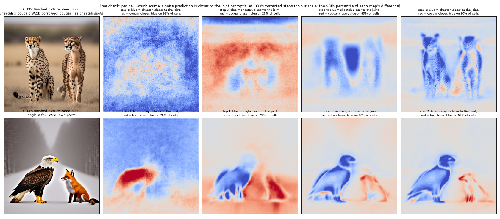</a> |
| Reading each animal's region from its own push at CO3's steps 0 to 2 | The mask rule written for an earlier step | Both masks cover 86% to 98% of the grid with overlaps of 0.76 to 0.99; 5 of 12 reads fail. One seed per pair | [own push on own body (the audit's rerun 3)](what-we-tried/leakage.md#whether-each-animals-own-push-picks-out-its-own-body-at-co3s-corrected-steps-the-audits-rerun-3) | <a href="../leakage/05-audit-rerun-3/push-regions.png">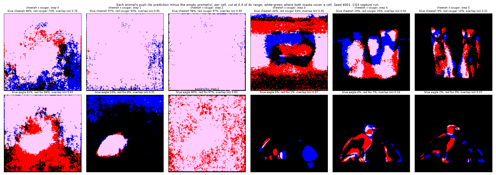</a> |
| Sentence scores (NoisyCLIP, frozen CLIP, Latent CLIP) as an early reader of counting, prompt match or left-right order at SDXL steps 0 to 15, in every fair setting, and a linear layer on their image vectors | Plain, five-wording ensembles, NoisyCLIP's own window, 195 real sampler runs, a third task, species-free wording, and a linear probe on 119 training pairs read on 7 unseen pairs, each with bars fixed first; a positive control on SDXL's own features beside them | No sentence row's mean over steps 0 to 15 reached 0.6 against a bar of 0.75 (best 0.574, Latent CLIP on real states); the probe's best unseen score is 0.586; the readout checker on SDXL's features beat frozen CLIP by 0.150 balanced accuracy (standard error 0.035) | [five properties (W2)](what-we-tried/noise-text-critic-and-score-space.md#sentence-scores-reading-five-properties-on-half-drawn-sdxl-latents-w2), [the fair test (W2c)](what-we-tried/noise-text-critic-and-score-space.md#a-positive-control-and-the-fairest-settings-for-the-sentence-scores-w2c), [species-free counting (W2c, group 4)](what-we-tried/noise-text-critic-and-score-space.md#counting-sentences-that-name-no-species-w2c-group-4), [the linear probe (W2b)](what-we-tried/noise-text-critic-and-score-space.md#a-linear-probe-on-frozen-image-vectors-read-on-unseen-pairs-w2b), [the loop's verdict (W5)](what-we-tried/noise-text-critic-and-score-space.md#the-sentence-score-loops-verdict-w5), [the push that never ran (W3)](what-we-tried/noise-text-critic-and-score-space.md#the-sentence-score-push-on-co3-w3); project copies: [fairness test](what-we-tried/projects.md#testing-whether-the-sentence-score-null-is-fair-with-a-positive-control-and-fairer-settings), [linear probe](what-we-tried/projects.md#one-trained-layer-on-frozen-image-vectors-read-on-unseen-pairs) | <a href="../noise-text-critic/who-reads-early.png">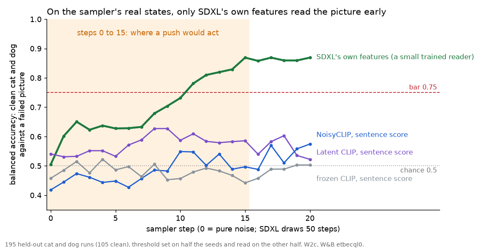</a> |
| The kept push as Paper 2's correction on the plain product and on the joint prompt | Three known failures per sampler, four draws each, against a random push of the same length, bar committed first | Two clear of 12: plain product 0 against 0; joint prompt 2 against 0 | [the kept early push on known failures (Z8)](what-we-tried/leakage.md#the-kept-early-push-on-known-failures-of-three-samplers-z8) | 🖼️ Diagram wanted: the known-failure cases for the plain product and the joint prompt, pushed against randomly pushed, with the two-clear counts (0 against 0, 2 against 0 of 12) |
| Copying the joint prompt as the correction target on these pairs | The joint prompt drawn alone from CO3's starting noise at 192 seeds, called blind | 34 of 192 two clear for the joint prompt against 73 for CO3 on the same seeds (the ledger says this plain count stands on its own; the cosine split beside it is unclear) | [is the joint the wrong target (M14)](what-we-tried/method-search.md#whether-the-joint-prompt-is-the-wrong-target-where-it-fails) | 🖼️ Diagram wanted: a 2 by 2 table of the 192 seeds (both two clear 19, joint only 15, CO3 only 54, neither 104) with one example tile per cell |

### Paper 1: models trained apart

| What is shut | The fair test that shut it | The number | Ledger entry | Picture |
|---|---|---|---|---|
| The digit models' own vote placing the digits | Fresh seeds, 320 canvases per experiment, a held-side control matching to 0.0, a bar taken from an earlier design | Vote 312 clean pairs of 320, coin flip 313 | [the vote against a coin flip (M11)](what-we-tried/method-search.md#the-digit-models-own-vote-against-a-coin-flip) | 🖼️ Diagram wanted: clean pairs of 320 for the vote (312), the coin flip (313), the coin flip without the corrector (301) and paste (299), with the 32-canvas no-effect band |
| The plain product of two CLEVR colour experts, with or without Du et al.'s corrector | Blind eye calls on 288 pictures per row | Exact share 0.000 in both rows; wherever both experts draw at one place the colours add into a dark purple-black object | [two CLEVR experts by colour (M10)](what-we-tried/method-search.md#two-clevr-experts-trained-on-separate-colours) | <a href="../method-search/05-two-experts-by-colour/plain-product-smoke.png">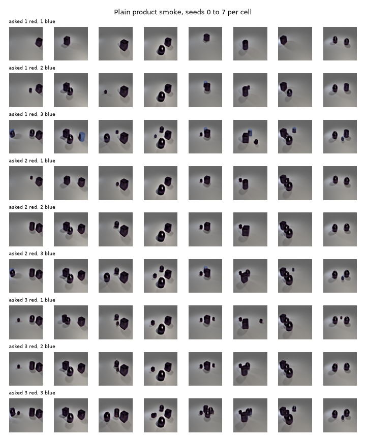</a> |
| Checker pushes on the plain whole-canvas product of two digit experts trained apart | 320 seeds, bar written first (224 of 320), several settings | Plain 0 of 320, both pushes 4, random push 2. The fixed-side control reached only 139 of 320 against its 256, and one expert missed its own-digit check (55 and 57 of 64 against 58) | [step 7b's pushes (A2d, plan 32)](what-we-tried/projects.md#step-7bs-pushes-on-two-digit-experts-trained-apart-a2d-plan-32) | 🖼️ Diagram wanted: either-side canvases without and with both pushes (0 and 4 of 320) beside the fixed-side control (139 of 320) and its bar of 256 |
| Whole-canvas repairs (a background model, an average background, pushes, extra steps) on the original digit models | 320 canvases each, bar written first (under 32 of 320 is no effect) | 0, 0, 0, 1, 0 and 4 clean pairs of 320 | [repairs to the plain product (plan 33, step 1)](what-we-tried/projects.md#repairs-to-the-plain-product-of-two-digit-models-trained-apart-plan-33-step-1) | <a href="../../../../2-classifier-guidance/artifacts/results/can-two-digits-compose-on-mnist/03-composing-the-two-models-while-sampling/01-the-plain-product-draws-nothing/sheets/plain-product-with-both-pushes/digits-4-and-7.png">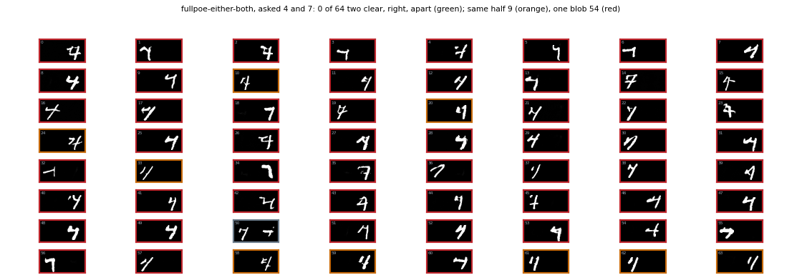</a> |
| A pair-aware checker push composing unseen Colored MNIST combinations beyond what naming digit and colour separately gives | 5,000 matched pictures, a names-only push scaled to the same length, bar written before that control ran | 76.0% right for the pair-aware push against 78.4% for the names-only push (508 won, 625 lost, p 0.9998) | [checker push on coloured-digit experts (Z9, arm 2)](what-we-tried/leakage.md#a-checker-push-on-finished-coloured-digit-experts-against-a-push-that-names-digit-and-colour-separately-z9-arm-2-and-control-a) | <a href="../leakage/09-dcfm-colored-mnist/before-after-plain-product-and-checker-push.png">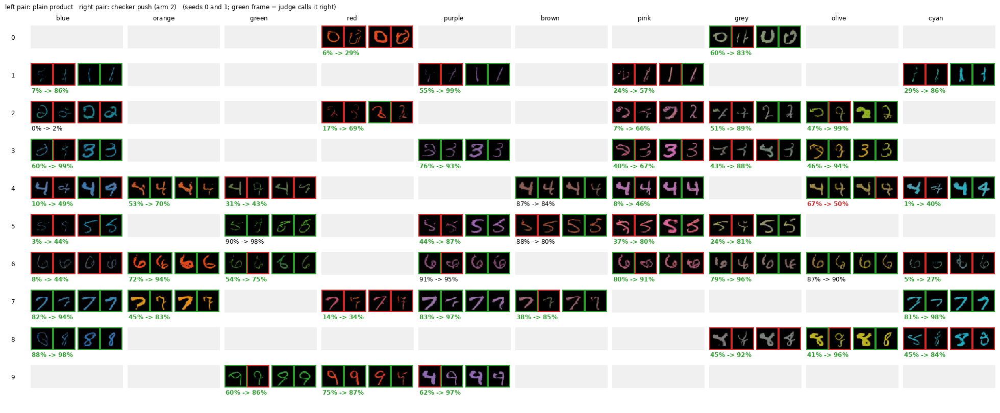</a> |
| A noise-aware image encoder trained against CLIP's frozen text side reaching digits outside its captions | Overfit test 16 of 16, seen digits learned, unseen digits read once at the same noise | Seen 0.758, unseen 0.590; two digits apart against wrong digits 0.502 on unseen. Closed on digits only | [the noise-aware model (W4)](what-we-tried/noise-text-critic-and-score-space.md#a-noise-aware-model-trained-here-read-on-digits-it-never-saw-w4), [project copy](what-we-tried/projects.md#training-our-own-noise-aware-image-encoder-against-clips-frozen-text-side-on-digits) | 🖼️ Diagram wanted: balanced accuracy by step from 14 to 25 for seen digits 0 to 4 (rising to 0.89) and unseen digits 5 to 9 (0.52 to 0.67) |
| Reading digits from the score path (the ten noise-prediction maps) at the digit model's timesteps 999 to 693 | Positive control and overfit test passed | Best 0.513, raw noise 0.493 | [the ten noise predictions (X5)](what-we-tried/noise-text-critic-and-score-space.md#the-digit-models-ten-noise-predictions-read-which-digits-are-present-x5), [project copy](what-we-tried/projects.md#reading-which-digits-are-present-from-the-digit-models-own-noise-predictions) |  |
| Reading which digits are present at the timesteps matched to SDXL's steps 0 to 15 (712 to 480), and one checker reading "where" and "which" together there | A 2 by 2 grid of input against window, a 7.5 times larger wrong-digit pool | 0.555 with two maps; a 7.5 times larger pool adds 0.008; the ten-label signature reaches 0.612, all under 0.75. Closed on this toy | [identity trained apart (V2)](what-we-tried/abstract-checkers.md#an-identity-checker-trained-apart-rehearsed-at-sdxls-noise-level), [the rehearsal at SDXL's noise (V2)](what-we-tried/abstract-checkers.md#the-same-checker-rehearsed-at-sdxls-noise-level) | <a href="../abstract-checkers/10-reading-identity/identity-grid.png">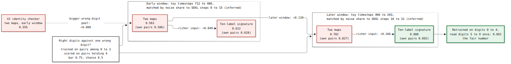</a> |
| Reading digit identity at the digit sampler's steps 27 to 36 | The digit judge itself reading the one-step clean estimate | 0.724 against 0.75; the asked pair found on only 55% of canvases that end clean at step 27 | [is identity visible at all (V6)](what-we-tried/abstract-checkers.md#is-identity-visible-on-the-samplers-states-at-all) | 🖼️ Diagram wanted: the judge's balanced accuracy at steps 27 to 36 (0.655 rising to 0.780) beside the share of canvases whose digits have settled (46% by step 36) |

### The LoRA correction and the sampler questions

| What is shut | The fair test that shut it | The number | Ledger entry | Picture |
|---|---|---|---|---|
| The LoRA alone naming the asked animals on pairs it never saw | 8 new pairs, 192 pictures called blind, "off" taken from an untouched U-Net | Two clear 0, 1, 0, 0, 2 and 0 of 32 at weights 0 to 1.25 (weight 1 against 0: p 0.25); hybrids fall from 29 to 4 while bodies that are not both the asked animals rise from 1 to 28 | [the LoRA weight as a dial (Z10)](what-we-tried/leakage.md#the-pooled-loras-weight-as-a-dial-on-pairs-it-never-saw-z10) | <a href="../leakage/10-co-occurrence-dial/dial-blind-calls.png">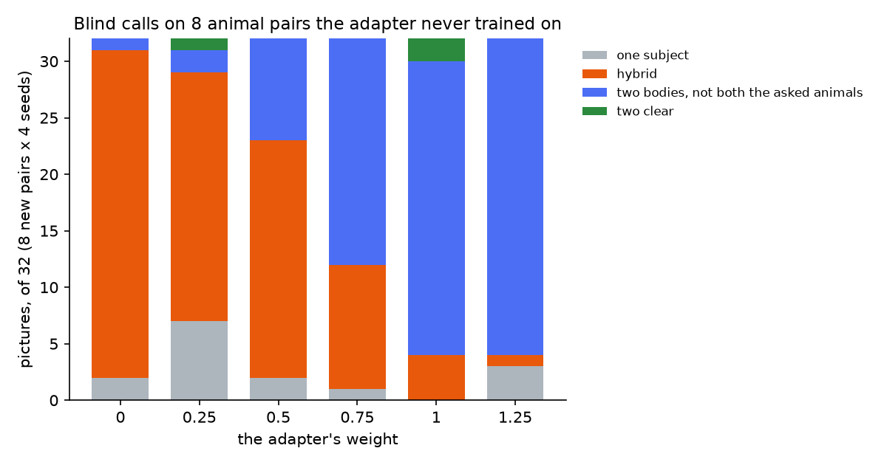</a> |
| Teaching the LoRA what the box rule does (the binding loss's "way a") | Hand boxes drawn on the LoRA's own finished pictures, a best case | 4 of 32 for LoRA plus boxes against 2 for the LoRA alone (p 0.34) | [the LoRA plus own prediction in boxes (option A)](what-we-tried/leakage.md#the-loras-separation-plus-each-animals-own-prediction-in-its-box-option-a-of-the-binding-plan) | <a href="../../../../1-lora-correction/binding/grids/fox-llama.png">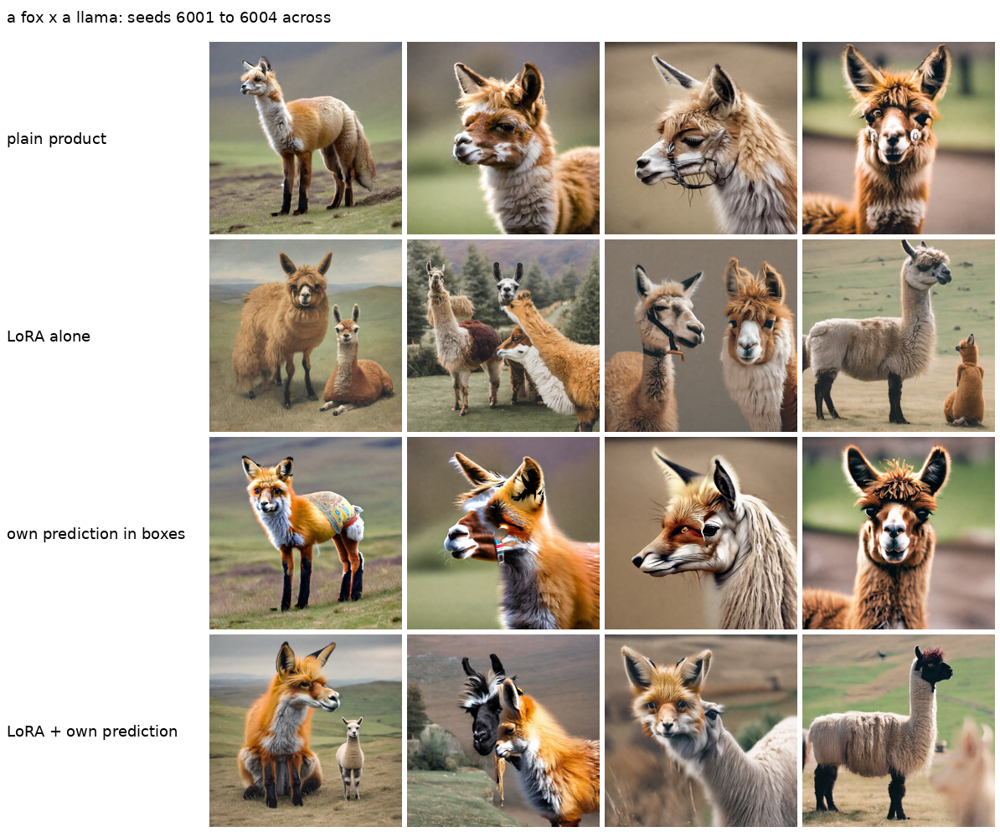</a> |
| Drift onto unseen states as the cause of the adapter's weaker held-out fit, on cat and dog at rank 8, step 30,000 | Bar written first | On-policy cosine 0.817 against 0.860 on cached states | [fit, drift or pair (project 1)](what-we-tried/projects.md#is-the-pooled-adapters-weaker-fit-on-unseen-pairs-caused-by-drifting-onto-states-it-never-trained-on) | 🖼️ Diagram wanted: on-policy cosine by window (0.855, 0.810, 0.815) against the cached 0.860 |
| A shared binding direction in the prompt's text embedding | 75 pairs against a control that keeps the template | 1.19 to 1.57 times against a 2.0 bar | [binding direction](what-we-tried/projects.md#do-all-pairs-leave-the-same-leftover-direction-in-the-prompts-text-binding-direction) | <a href="../../../../1-lora-correction/artifacts/results/what-the-correction-is/does-it-cause-composition/does-the-interaction-term-cause-composition/five-checks-from-three-sides/language_probe_l3_binding.png">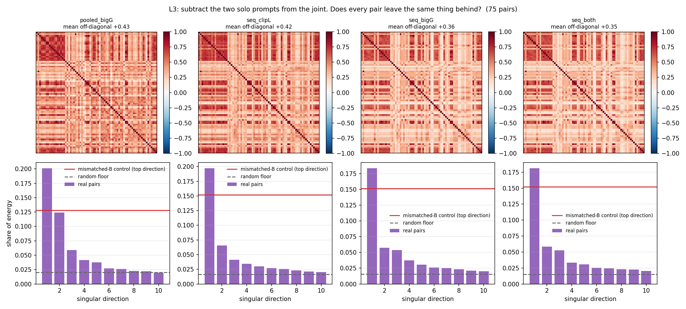</a> |
| Corrections sharing a few directions across runs | A floor built from real row sizes | 1.55 at 1 direction and 1.41 at 8 (the earlier equal-size floor gave 14.2 and 10.8) | [spectrum against a fair floor](what-we-tried/projects.md#do-corrections-share-a-few-directions-across-runs-spectrum-against-a-fair-floor) | 🖼️ Diagram wanted: ratio to the floor at 1 and 8 directions against the equal-size floor (14.2, 10.8) and the real-size floor (1.55, 1.41) |
| The adapter's softness coming from its direction being more off the data manifold | Ratio of normal shares against a null bar of 1.05 | 0.985 on 400 rows | [the tangent-manifold read](what-we-tried/projects.md#keeping-the-adapters-correction-on-the-manifold-the-tangent-manifold-read) | 🖼️ Diagram wanted: normal share of the true correction and the adapter by step window (0.780 against 0.766, 1.665 against 1.628) beside a random direction |
| The adapter's haze being excess energy | One-axis comparison of three penalty doses | Drift moved the wrong way (+0.019 at β 0.05 against −0.054 for the control); the adapter spends 3,400 to 4,700 nats where the true correction costs 7,200 to 10,300 | [charging for energy](what-we-tried/projects.md#charging-the-adapter-for-the-energy-of-its-correction) | 🖼️ Diagram wanted: energy spent per checkpoint by the adapter (3,400 to 4,700 nats) against the true correction at the same states (7,200 to 10,300) |
| A sharp change of meaning at steps 13 to 20 | Steepest rise checked on 9 runs | Inside steps 13 to 20 on 3 of 9 runs in CLIP and 1 of 9 in DINOv2 | [sharp or gradual parting](what-we-tried/projects.md#do-the-corrected-and-plain-runs-part-sharply-or-gradually) | 🖼️ Diagram wanted: separation along the run for the 9 runs with steps 13 to 20 shaded; the steepest rise lands inside on 3 of 9 in CLIP |
| Selection over the plain product's own particles at 16 particles (Feynman-Kac steering) | A reward that was not blind at the judged step | 0 of 128 proposals composed | [Feynman-Kac steering of plain PoE](what-we-tried/projects.md#feynman-kac-steering-of-plain-poe-on-the-compose-scorer) |  |
| A text-space third expert beside the two single experts at full weight, on cat and dog | Bar of 4 of 7 judgeable seeds | Clear cat and dog 0 of 7; the third expert alone gives 2 of 7, which drops to 0 when the two single experts are added. One pair | [the positional "and" vector](what-we-tried/projects.md#the-positional-and-vector-as-a-third-expert) |  |

### Settled facts about the test beds

These are not ideas that failed. They are measured properties of the settings that every new design inherits.

**Paste wins by construction on fixed separated places.** On fixed-half digit canvases paste reaches 287 of 320, leaving 33 canvases of room ([beating the baseline (M1)](what-we-tried/method-search.md#beating-each-papers-simplest-baseline), [project copy](what-we-tried/projects.md#composing-two-digit-models-trained-apart-against-sampling-each-alone-and-pasting)). On CLEVR objects at fixed separated positions paste places every object in 1,024 of 1,024 images ([CLEVR paste (M7)](what-we-tried/method-search.md#pasting-small-clevr-samples-before-any-tuning-on-clevr), [the small CLEVR test (M6)](what-we-tried/method-search.md#the-small-clevr-test-of-each-method)).

<a href="../method-search/01c-clevr-paste-first/paste-three-experts-first-32.png">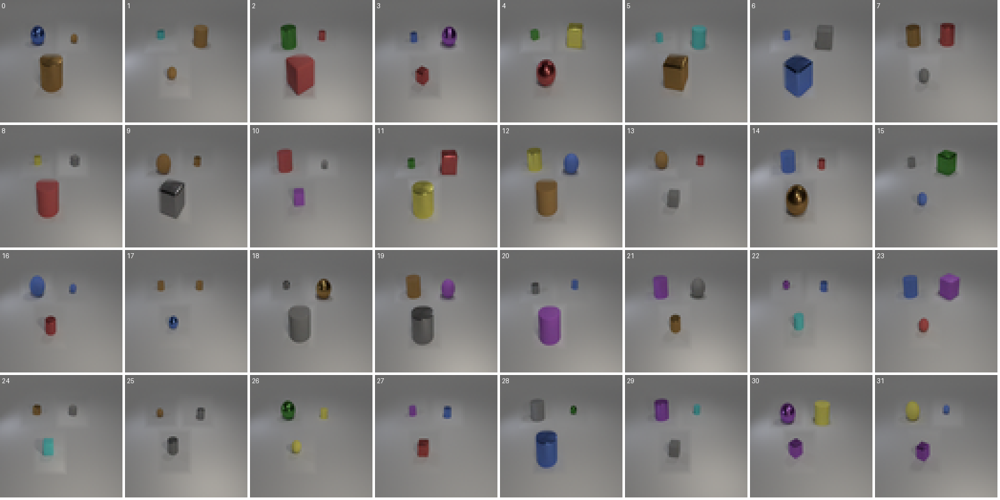</a>

**A digit-blind layout rule clears a plurality bar.** It scores 0.873 balanced accuracy on clean canvases ([the digit test bed (V1)](what-we-tried/abstract-checkers.md#a-repeatable-digit-test-bed)).

<a href="../abstract-checkers/04-environment/digit-blind-reader.png">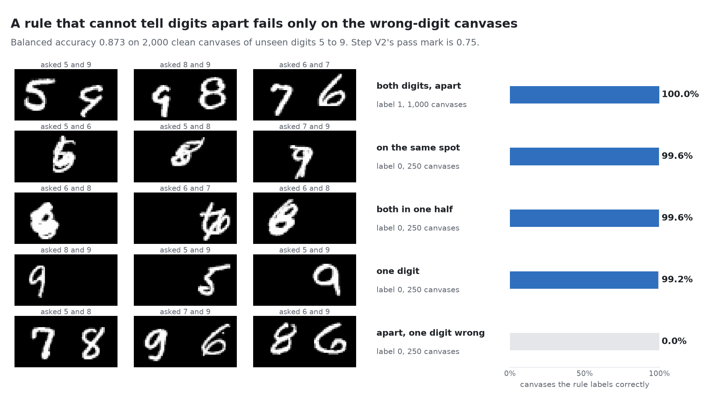</a>

**Pictures do not repeat across hardware.** CO3 trajectories drawn on a Quadro RTX 8000 differ from an RTX 3090 rerun by 3.0 to 27.4 grey levels ([M5](what-we-tried/method-search.md#balancing-the-checkers-training-data-and-whether-any-checker-sees-co3s-failure)); a pushed digit run gave 43 clean pairs of 320 on one node and 41 on another ([the count push (V3)](what-we-tried/abstract-checkers.md#the-count-checkers-push-on-digits-5-to-9)).

🖼️ Diagram wanted: the same CO3 seed drawn on a Quadro RTX 8000 and an RTX 3090 side by side, with their pixel difference map

**A disabled adapter still acts.** With the LoRA attached and switched off, pictures differ from the plain product by a mean of 10.8 grey levels, against 34.5 with it on ([Z10](what-we-tried/leakage.md#the-pooled-loras-weight-as-a-dial-on-pairs-it-never-saw-z10)).

🖼️ Diagram wanted: one seed rendered by an untouched U-Net, by the U-Net with the adapter attached and disabled, and with it on, with the two grey-level differences (10.8 and 34.5) printed

**The body counter cannot name the animal.** The per-class detector reports a dog on 64 of 64 single-cat renders ([base SDXL's cat prompt](what-we-tried/projects.md#does-base-sdxls-cat-prompt-already-draw-dogs)), and the instance count passes two dogs as a composed cat and dog ([strength sweep](what-we-tried/projects.md#does-more-correction-give-more-composition-strength-sweep-with-direction-and-same-size-controls), [Feynman-Kac with the correction](what-we-tried/projects.md#feynman-kac-steering-with-the-rank-32-correction-in-the-proposal)).

<a href="../../../../1-lora-correction/artifacts/results/measuring-composition/the-scorers/can-we-trust-the-compose-score/do-the-successful-cells-contain-both-animals/two-of-the-same-animal/a_cat__x__a_dog_seed10_n2.png">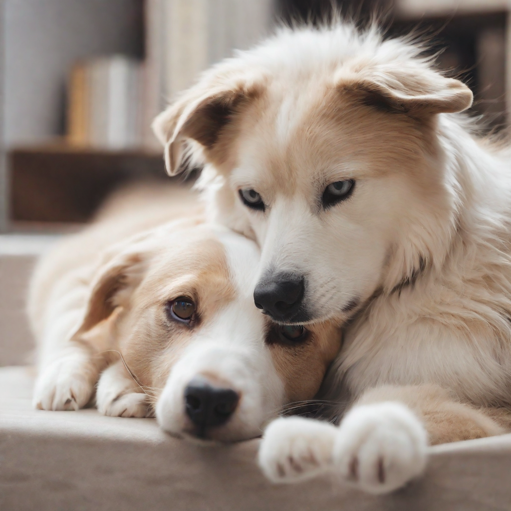</a>

**Laplacian variance counts edges.** On one pair's plain renders it spans 12 to 499 over eight seeds ([tail correctors](what-we-tried/projects.md#corrector-steps-on-the-adapters-own-score-in-the-last-fifteen-steps-to-sharpen-its-renders)), and the `lap` function in one script returns 0 on a straight edge ([hand-back sweep](what-we-tried/projects.md#sweeping-the-step-at-which-the-adapter-hands-the-render-back-to-frozen-sdxl)).

🖼️ Diagram wanted: the eight plain-product seeds of one pair ordered by Laplacian variance from 12 to 499, showing line-art seeds at the top

**The joint prompt is not always a correct target.** It drops a concept on 11 of 32 held-out cells ([does the joint prompt draw both](what-we-tried/projects.md#does-the-joint-prompt-the-adapters-training-target-always-draw-both-concepts)) and draws two clear subjects on 34 of 192 CO3 seeds ([M14](what-we-tried/method-search.md#whether-the-joint-prompt-is-the-wrong-target-where-it-fails)).

🖼️ Diagram wanted: the 11 held-out cells where the joint prompt drops a concept, one tile each

### Closed, but not on a fair test

These entries are marked closed, but the ledger names no fair test of the idea behind the closure. Treat them as stopped. A loop may reopen one only by naming the new evidence against the reason it was closed.

| Closed idea | Why the closure is not a fair test | What would reopen it |
|---|---|---|
| The size-corrected per-place reader ([M12](what-we-tried/method-search.md#correcting-the-per-place-reader-for-each-animals-size)) | The expected sizes came from single-subject renders that fill the frame (box areas 0.39 to 0.94), so the correction had nothing to correct with; the closure is argued | Nothing in the record; the within-pair null of the uncorrected reader already covers it |
| The checker's labels, architecture, head-to-head and short fine-tune ([M2, M8, D3, D5](what-we-tried/method-search.md#the-checkers-labels-its-architecture-the-head-to-head-with-loop-8-and-the-fine-tune-with-the-push), [D3](what-we-tried/reproductions.md#choosing-paper-2s-checker-architecture-d3)) | Closed by the owner's answer to board question 111, which was first put with the push's direction reversed | A held-out identity reader passing (section 2, rank 2) |
| The checker choosing CO3's weight sharpness β ([Z4](what-we-tried/leakage.md#choosing-paper-2s-method-after-the-first-two-nulls-z4-z6-and-the-method-review), [the design](what-we-tried/noise-text-critic-and-score-space.md#the-readout-checker-choosing-co3s-weight-sharpness-at-each-corrected-step-designed-by-the-score-path-loop)) | The only checker could not see CO3's failure (right at best 60% against 65%) | A checker that sees the failure at the steps it would choose |
| The kept push on CO3 ([the CO3 row of M1](what-we-tried/projects.md#adding-the-kept-checker-push-to-co3-on-sdxl), [Z8's CO3 row](what-we-tried/leakage.md#the-kept-early-push-on-known-failures-of-three-samplers-z8)) | The checker's presence outputs never trained on the 12 subjects asked for; Z8's CO3 row was about two pictures deep | A checker trained on the asked subjects that first passes a read on CO3's states |
| An exact shared space where adding scores means adding words ([X6 to X9](what-we-tried/noise-text-critic-and-score-space.md#the-shared-text-and-score-space-and-closing-the-score-path-x6-to-x8-skipped-x9)) | Closed by two theorems, not by a run | Nothing in the record; the block-wise form is open (section 2) |
| A training-pair subspace as a test of transfer ([subspace](what-we-tried/projects.md#does-a-subspace-fitted-on-training-pairs-corrections-carry-to-unseen-pairs)) | The instrument cannot separate "transfers" from "does not" | Transfer is measured by compose rate instead |
| Choosing the side afresh at every step ([plan 33, step 6](what-we-tried/projects.md#letting-the-two-digit-models-choose-their-side-at-every-step-plan-33-step-6)) | Re-choosing lets the side swap; holding the side raised clean pairs to 310 | Superseded by holding the side |
| Plain region fusion from step 0 on SDXL ([no bootstrapping](what-we-tried/projects.md#giving-the-cat-and-the-dog-their-own-regions-on-sdxl-without-bootstrapping)) | The fusion left out MultiDiffusion's bootstrapping stage; 0 of 8 against 7 of 8 for the joint prompt | Superseded by the bootstrapped and later-read region tests |
| "And" vectors built by slot-wise subtraction ([subtraction](what-we-tried/projects.md#the-and-vector-built-by-subtraction-as-a-third-expert)) | The vectors are not prompt-like (start-token slot length 1190 against about 15 for a word) | Superseded by the positional vector, which is closed fairly |
| A third expert written onto the empty prompt's scaffolding ([joint addition only](what-we-tried/projects.md#only-what-the-joint-adds-on-the-empty-prompts-scaffolding)) | Closed by argument (inferred) | Nothing in the record |
| CLIP as a counter of wet animals ([wet animals with CLIP](what-we-tried/projects.md#counting-wet-animals-in-caption-pictures-with-clip)) | An instrument check: 0 of 7 against an 80% pass mark | By-eye calls carry the question instead |
| The design audit of Loops 8, 9 and 10 ([Z5](what-we-tried/leakage.md#an-audit-of-the-designs-of-loops-8-9-and-10-z5)) | A step, not a test | Its three verdict-changing rows sit in section 2 |

## 2. Retry worth it, ranked

Every entry marked "retry worth it" or "unclear", and every unclear part of an entry marked closed or alive, is in one of the rows below; entries that record the same idea are merged into one row with all of their links. The ranking is by how much a clean answer would change either paper, divided by the GPU-hours it needs. A check that needs no GPU (a rescore, an eye call on pictures already on disk, an owner's reading) ranks by its effect alone and sits high.

**Every GPU-hour figure is an estimate.** "Ledger" means the ledger or the review it cites gives the figure. "Mine" means I estimated it from the nearest measured run, which the row names. The LoRA rows serve the LoRA correction, which projects.md files under Paper 2 and leakage.md under Paper 1 (section 6).

### The twelve highest

**1. Each animal's own prediction inside its box, with the extra corrector pass held fixed (Z13, Z7, Z12, Z3, Z4)**

- **Entries:** [the running box pass (Z13)](what-we-tried/leakage.md#running-the-extra-corrector-pass-with-boxes-against-the-same-pass-over-the-whole-picture-z13), [own prediction in hand-drawn boxes (Z7)](what-we-tried/leakage.md#each-animals-own-prediction-inside-its-hand-drawn-box-after-co3s-own-correction-z7), [the box push (Z12, stage A)](what-we-tried/leakage.md#each-animals-own-prediction-applied-as-a-push-inside-its-box-z12-stage-a), [subtracting the other animal (Z3)](what-we-tried/leakage.md#subtracting-the-other-animal-inside-hand-drawn-boxes-late-in-sampling-z3), [regions from each push (Z4)](what-we-tried/leakage.md#choosing-paper-2s-method-after-the-first-two-nulls-z4-z6-and-the-method-review).
- **The fix:** Z7 reached 14 two clear of 48 against CO3's 8 (p 0.073), but measured against CO3 alone the whole-picture pass moved pictures by a median of 24.5 grey levels and the boxed pass by 21.4, so most of the change came from the extra pass; Z12's push moved them by only 2.3. Z13 holds the pass fixed and compares the boxed pass with the whole-picture pass on 96 unused seeds, bar written first.
- **Paper:** 2. **GPU-hours:** 4.2 (ledger, approved and running), so nothing further to spend before it lands.
- **A yes** makes box content the first live correction on CO3; the next spends are seeds 6009 to 6016 (1.7, ledger), Bounded Attention as the rival (about 2, ledger) and Concept Algebra's projection of only the other animal's component (0.8, ledger). **A no** closes the box route on CO3 with Z7, Z12 and Z13 as its record, which leaves the text-side swap (rank 6) and late regions (rank 8) as Paper 2's untested training-free routes.
- **Picture:** <a href="../leakage/07-own-prediction/blind/duck-goose-three-rows.png">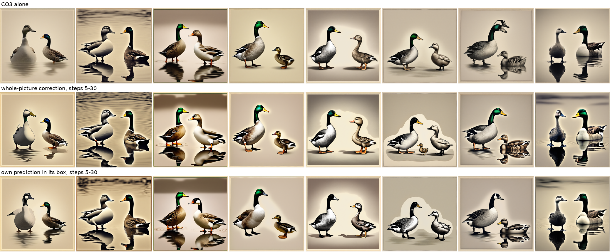</a> <a href="../leakage/12-aligned-classifier-on-co3/grids/zebra-flamingo.png">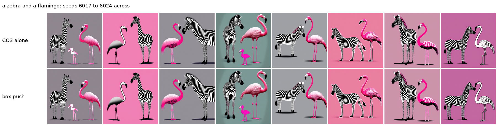</a>

**2. An identity reader scored with pairs held out (the reviewer's 129-weight output; D3, V4, M1, M5)**

- **Entries:** [checker architecture (D3)](what-we-tried/reproductions.md#choosing-paper-2s-checker-architecture-d3), [labels, architecture and fine-tune (M2, M8, D5)](what-we-tried/method-search.md#the-checkers-labels-its-architecture-the-head-to-head-with-loop-8-and-the-fine-tune-with-the-push), [the Paper 2 row of the first baseline (M1)](what-we-tried/method-search.md#beating-each-papers-simplest-baseline), [per-place reader (M12)](what-we-tried/method-search.md#reading-identity-from-co3s-states-with-no-training-cell-by-cell), [balancing the checker data (M5)](what-we-tried/method-search.md#balancing-the-checkers-training-data-and-whether-any-checker-sees-co3s-failure), [the kept checker on CO3](what-we-tried/projects.md#adding-the-kept-checker-push-to-co3-on-sdxl), [an identity checker pushing on CO3 (V4)](what-we-tried/abstract-checkers.md#an-identity-checker-pushing-on-co3-on-sdxl), [the checker choosing β](what-we-tried/noise-text-critic-and-score-space.md#the-readout-checker-choosing-co3s-weight-sharpness-at-each-corrected-step-designed-by-the-score-path-loop), [identity at SDXL-matched noise on the toy](what-we-tried/abstract-checkers.md#an-identity-checker-trained-apart-rehearsed-at-sdxls-noise-level).
- **The fix:** every reader so far learned which pair a picture shows (a pair lookup alone scores 0.757). Train one 129-weight identity output on the kept feature head, score it within pair with each pair held out, against a written bar of within-pair AUC 0.70 and balanced accuracy 0.75. The decoded-estimate judge shows identity is present from step 15 (0.773 balanced accuracy, 0.744 within pair) and weak at steps 5 and 10 (0.567 and 0.610 within pair), so read at the steps where it is present.
- **Paper:** 2. **GPU-hours:** about 0.5 (ledger).
- **A yes** reopens the checker route closed on question 111: the three architecture candidates (about 20, ledger), the checker choosing β (3.1 for a first read, 9.6 in full, ledger) and an identity push on CO3 (5 to 14, ledger). **A no** stops the identity-reader route, which is the reviewer's recorded verdict.
- **Picture:** 🖼️ Diagram wanted: within-pair AUC by step for the decoded-estimate judge (0.567, 0.610, 0.744 at steps 5, 10, 15) with the 0.70 bar the held-out reader must meet

**3. Re-read question 111 and the joint-target split (M14) under the corrected sign**

- **Entries:** [is the joint the wrong target (M14)](what-we-tried/method-search.md#whether-the-joint-prompt-is-the-wrong-target-where-it-fails), [the push direction check (M13)](what-we-tried/method-search.md#whether-the-kept-checkers-push-points-along-the-dropped-term), [D3's closure](what-we-tried/reproductions.md#choosing-paper-2s-checker-architecture-d3), [V4's closure](what-we-tried/abstract-checkers.md#an-identity-checker-pushing-on-co3-on-sdxl).
- **The fix:** question 111 was first answered with the push read as pointing against r_t; the code applies minus the gradient, so it points along r_t (+0.105 at step 0 on CO3). M14's thresholds were negated after that correction, which flipped its condition twice. Restate M14's condition in words, then run it on fresh seeds with more joint-success trajectories than the 34 it had.
- **Paper:** 2. **GPU-hours:** 0 for the owner's re-read; about 3 for the fresh-seed split (mine, from M14's 192 joint renders plus the matching CO3 cosine reads).
- **A yes** (the push follows r_t more where the joint succeeds) confirms the push is a weak copy of the joint prompt and keeps the checker route closed for a stated reason. **A no** removes the reversed-sign reason from the closure, leaving it to rest on rank 2 alone.
- **Picture:** 🖼️ Diagram wanted: the push cosine with r_t by step read from the gradient (negative) and from the push the code applies (positive), split by whether the joint prompt succeeds

**4. Checks that need no GPU**

- **Entries and fixes:**
  - Rescore the saved removal-test rows with every property scored on every canvas instead of chained ([the removal rerun (V5)](what-we-tried/abstract-checkers.md#removing-one-checker-at-a-time-rerun-at-three-times-the-canvases), [the first run](what-we-tried/abstract-checkers.md#removing-one-checker-at-a-time-first-run), [the removal test with identity (V7)](what-we-tried/abstract-checkers.md#the-removal-test-rerun-with-the-identity-checker), [the design audit (Z5)](what-we-tried/leakage.md#an-audit-of-the-designs-of-loops-8-9-and-10-z5)). A yes (no spillover once unchained) turns V5's null into "each checker controls its own property"; a no keeps it null.
  - Per-step fit of the model trained to predict the dropped term on the held-back trajectories ([Z9, arm 4](what-we-tried/leakage.md#a-small-model-trained-to-predict-the-term-the-product-drops-z9-arm-4)). It tells a bar problem (low fit only at steps that do not matter) from a model that cannot learn the term.
  - Read each subject's own signed noise-prediction map on CO3's saved path as a mask, judged by Loop 6's mask rule ([the block-wise shared space (X9)](what-we-tried/noise-text-critic-and-score-space.md#the-shared-text-and-score-space-and-closing-the-score-path-x6-to-x8-skipped-x9)). A yes gives Paper 2 a region reader that names no box by hand; a no closes the block-wise form.
  - Fix how the four views combine in the text-only additivity test and rerun it on the 75 pairs ([additivity gap](what-we-tried/projects.md#does-the-prompts-text-alone-predict-which-pairs-need-a-big-correction-additivity-gap)).
  - Put intervals on the adapter's GenEval and T2I-CompBench means ([the benchmarks](what-we-tried/projects.md#the-adapter-on-geneval-and-t2i-compbench)), and a standard error on NoisyCLIP's lead over frozen CLIP ([linear probe](what-we-tried/projects.md#one-trained-layer-on-frozen-image-vectors-read-on-unseen-pairs)).
  - The per-cell comparison of why the pair-aware push's FID is lower (12.63 against 14.32) while its accuracy is not ([Z9, arm 2](what-we-tried/leakage.md#a-checker-push-on-finished-coloured-digit-experts-against-a-push-that-names-digit-and-colour-separately-z9-arm-2-and-control-a)).
- **Paper:** 2, 1 and both, by item. **GPU-hours:** 0, or under 0.1 for the block-wise read if the saved records lack the per-cell push (ledger).
- **What each changes** is named in its line above.
- **Picture:** 🖼️ Diagram wanted: the removal test columns scored chained (the order column shrinking from 134 to 38 canvases) and unchained (every canvas), side by side

**5. A count that names each animal, applied to the LoRA correction's headline numbers**

- **Entries:** [hand sort behind the 94%](what-we-tried/projects.md#hand-sort-of-the-32-images-behind-the-strength-sweeps-94), [an automatic species judge](what-we-tried/projects.md#an-automatic-judge-that-names-the-species-of-each-body), [both-ness axis on held-out pairs](what-we-tried/projects.md#on-eight-held-out-pairs-do-the-plain-and-corrected-pictures-separate-on-the-both-ness-axis), [nearest cloud and arrow agreement](what-we-tried/projects.md#on-cat-and-dog-does-the-plain-product-land-apart-from-the-joint-prompt-and-the-correction-lift-it-there-nearest-cloud-and-arrow-agreement), [adapter on only for early steps](what-we-tried/projects.md#does-keeping-the-learned-adapter-on-only-for-the-early-steps-change-the-failures), [whether each word attends to its own animal](what-we-tried/projects.md#whether-each-prompt-word-attends-to-its-own-animal), [choosing one adapter by a counting rule](what-we-tried/projects.md#choosing-one-adapter-for-the-review-by-a-counting-rule-protocol-rule-1).
- **The fix:** the 94% strength-sweep rate, the "58 of 64" held-out count and every instance-count verdict count bodies, and the detector cannot tell a cat beside a dog from two dogs. Build the three-state labelled set, label the species judge's set at full size (it got 13 of 19 against a bar of 27 of 30, and 16 of 29 thumbnail labels changed at full size), have a person check the 40-picture labeller sample, and pre-register the count as the bar before the next render.
- **Paper:** 2 (LoRA). **GPU-hours:** about 0.5 (mine; almost all of it is eye labelling of renders already on disk).
- **A yes** (the species count agrees with the body count) lets the 94% and the held-out counts stand as composition rates. **A no** turns them into body counts, and the paper's composition sentences change.
- **Picture:** 

**6. The text-side token swap, with a positive control first, and Bounded Attention as the rival (Z4, Z7 stage 1)**

- **Entries:** [the free text-encoder check (Z7, stage 1)](what-we-tried/leakage.md#a-free-check-on-the-text-encoder-does-the-second-nouns-vector-move-more-in-pairs-that-borrow-z7-stage-1), [choosing Paper 2's method (Z4)](what-we-tried/leakage.md#choosing-paper-2s-method-after-the-first-two-nulls-z4-z6-and-the-method-review).
- **The fix:** the text check measured a correlate of borrowing and never the swap. Run the swap on plain SDXL as a positive control, then the word-order check (CO3 on "a {B} and a {A}"). The swap cannot reach borrowing by the first-named animal (boar and pheasant).
- **Paper:** 2. **GPU-hours:** 0.1 for the control and 1.1 for the word-order check (ledger); about 2 for Bounded Attention (ledger estimate).
- **A yes** gives Paper 2 a training-free fix that touches only the text. **A no** closes the text side. Bounded Attention is owed whatever the answer, because any Paper 2 claim must beat the strongest training-free rival.
- **Picture:** 🖼️ Diagram wanted: CO3 on "a boar and a pheasant" against "a pheasant and a boar" on the same seeds, one row each

**7. A Paper 1 test where paste can fail (M1, M6, M7, M10)**

- **Entries:** [two CLEVR experts by colour (M10)](what-we-tried/method-search.md#two-clevr-experts-trained-on-separate-colours), [the Paper 1 row of the first baseline (M1)](what-we-tried/method-search.md#beating-each-papers-simplest-baseline), [CLEVR paste (M7)](what-we-tried/method-search.md#pasting-small-clevr-samples-before-any-tuning-on-clevr), [the small CLEVR test (M6)](what-we-tried/method-search.md#the-small-clevr-test-of-each-method), [digits against paste](what-we-tried/projects.md#composing-two-digit-models-trained-apart-against-sampling-each-alone-and-pasting).
- **The fix:** Paper 1's method has no measurement anywhere paste can fail. On the two-colour CLEVR test the two count checkers reached only 0.645 and 0.641 against 0.75 because their inputs carry almost no count of small blocks, and the count classifier missed its own bar (0.946 against 0.95, disagreeing with the eye on 127 of 864 pictures). The fix is a signal that keeps the two experts from drawing at the same place, or a checker that reaches 0.75 on held-out pastes from an input that carries the count, judged by blind eye calls against mask paste on scenes whose objects overlap.
- **Paper:** 1. **GPU-hours:** about 10 to 15 (mine: M7 trained four small models and a classifier in about 8.5, and M10 drew four rows of 9,216 small pictures).
- **A yes** is Paper 1's first result that paste cannot match, which is the claim the paper needs. **A no** on a fair version would leave Paper 1 with digit and coloured-digit results only.
- **Picture:** <a href="../method-search/05-two-experts-by-colour/paste-overlap-at-1-red-1-blue.png">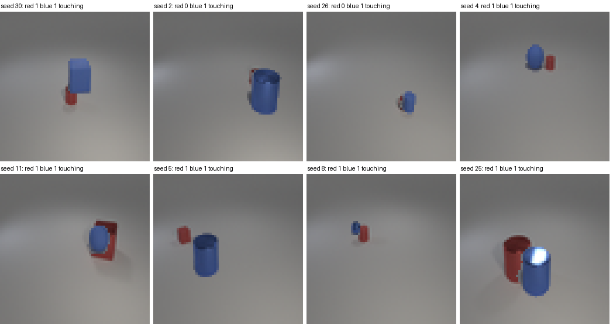</a>

**8. Subject regions read late on CO3, with self-attention bounded (M9)**

- **Entries:** [giving each subject its own region (M9)](what-we-tried/method-search.md#giving-each-subject-its-own-region-of-the-picture), [CO3 with regions from word attention](what-we-tried/projects.md#co3-with-regions-read-from-word-attention), [each prompt its own region (project 3)](what-we-tried/projects.md#giving-each-prompt-its-own-region-of-the-picture), [own push on own body after step 5](what-we-tried/leakage.md#whether-each-animals-own-push-picks-out-its-own-body-at-co3s-corrected-steps-the-audits-rerun-3), [the per-place signal on other seeds](what-we-tried/leakage.md#whether-a-per-place-signal-finds-the-borrowing-body-read-from-saved-records-z3s-free-check).
- **The fix:** every region try separated the subjects with a signal that had not separated them yet. Read regions after step 16 or from CO3's finished picture, bound self-attention between regions, blend in late steps, add CO3's renoise and rescale, and count only undamaged two-clear pictures. A box reader must first pass the mask check (6 or fewer failures in 24 reads).
- **Paper:** 2. **GPU-hours:** about 4.8 for the renders once a reader passes (ledger; the design says 5.3), plus about 0.5 for a capture run on other seeds (mine, from the Z2 capture).
- **A yes** gives Paper 2 a region method that does not need hand boxes. **A no** with bounded attention would close regions on CO3, which no attempt has yet tested.
- **Picture:** <a href="../method-search/04-bind-each-body/rung-2-step-10-word-attention-boxes.png">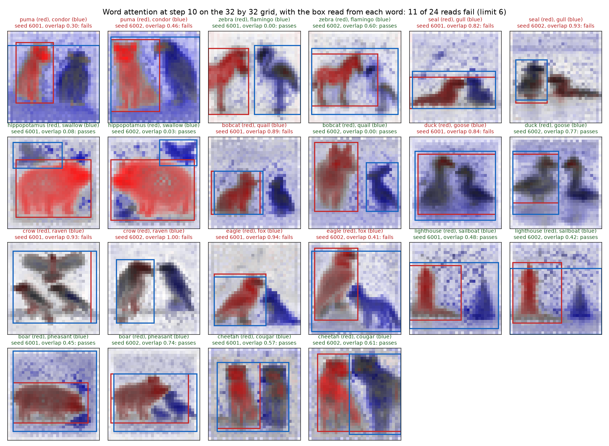</a>

**9. Separating the sampler's error from the model's in the dropped term**

- **Entries:** [Langevin split into sampler and model parts](what-we-tried/projects.md#a-langevin-corrector-to-split-the-correction-into-a-sampler-part-and-a-model-part), [Langevin corrector alone](what-we-tried/projects.md#a-langevin-corrector-alone-adding-nothing-to-the-score-on-cat--dog), [re-weighting the two experts](what-we-tried/projects.md#could-re-weighting-the-two-experts-have-supplied-the-correction), [eight render-time fixes, re-weighting row](what-we-tried/projects.md#eight-render-time-fixes-for-the-adapters-picture-quality-cost), [zero-order noise search](what-we-tried/projects.md#zero-order-search-over-the-starting-noise-on-plain-poe), [twisted SMC](what-we-tried/projects.md#twisted-smc-reweighting-the-plain-products-own-particles), [Feynman-Kac at larger K](what-we-tried/projects.md#feynman-kac-steering-of-plain-poe-on-the-compose-scorer), [SuperDiff at its defaults](what-we-tried/projects.md#superdiff-at-its-own-defaults-and-adding-its-own-missing-residual-back), [the PoE correction in SuperDiff](what-we-tried/projects.md#the-poe-trained-correction-injected-into-superdiff), [an adapter on SuperDiff's residual](what-we-tried/projects.md#an-adapter-trained-on-superdiffs-own-residual).
- **The fix:** each was one seed, one pair or one setting. Named fixes: Langevin at seeds 10 to 12, multiplier 3 and corrector counts 0 to 200 on one device, judged on the seed mean; Langevin alone at 100 steps per level and on a second failing pair; a re-weighting that falls from about 3 early to 1 late; a search verifier that a second head cannot satisfy; a twist that cannot memorise (more positives, no pair identity in the head) and K of 16 or 64; SuperDiff with the number of noise injections changed at a fixed step size; the 47 unrendered SuperDiff cells on final checkpoints; the pre-registered λ sweep on the stopped SuperDiff adapters.
- **Paper:** 2 (filed); the answer also decides whether Paper 1's failures are sampler error. **GPU-hours:** about 2 and 0.7 for the two Langevin runs (ledger), about 1 to 3 for each of the others (mine, from the one-pair, eight-seed runs these entries record).
- **A yes** on any of them splits r_t into a part a sampler can recover and a part it cannot, which is the paper's open question about whether the early compose-rate cliff is a sampler artefact. **A no** across them all leaves that question where it is.
- **Picture:** 

**10. A fair DCFM comparison on Colored MNIST (Z9, Z11)**

- **Entries:** [pair-aware push on coloured digits (Z9, arm 2)](what-we-tried/leakage.md#a-checker-push-on-finished-coloured-digit-experts-against-a-push-that-names-digit-and-colour-separately-z9-arm-2-and-control-a), [an interaction head (Z9, arm 3)](what-we-tried/leakage.md#a-push-from-a-classifiers-interaction-head-meant-to-supply-the-term-the-product-drops-z9-arm-3), [a model predicting the dropped term (Z9, arm 4)](what-we-tried/leakage.md#a-small-model-trained-to-predict-the-term-the-product-drops-z9-arm-4), [the gradient-aligned checker (Z11)](what-we-tried/leakage.md#a-checker-trained-so-its-push-points-along-the-experts-own-direction-z11).
- **The fix:** the reviewer's design trains DCFM-A's step and its two finished-expert baselines in the same code as the push, decided on DCFM's uneven ten-holder split ([the reviewer's DCFM section](2026-11-24-review.md#the-fair-dcfm-match-2026-11-25)). Beside it: a digit-only and a colour-only push at the checker push's length, and the interaction head rebuilt on features that hold the digit (the experts' decoder features).
- **Paper:** 1 against DCFM (the board), both (the ledger). **GPU-hours:** about 17.3 in two rungs, 3.0 then 14.3 (the reviewer's estimate); about 1 for the interaction head (mine, from arm 3's gate run).
- **A yes** puts the gradient-aligned checker (88.8% right against 73.8% for the names-only push on unseen combinations) beside DCFM in one table. **A no** keeps Z11 a single-split result.
- **Picture:** <a href="../leakage/11-gradient-trained-classifier/unseen/unseen-combinations-sheet.png">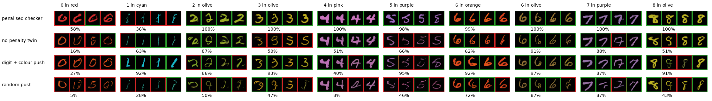</a>

**11. The rivals' printed bars (RTD, CO3, ToMe, CoInD, FKC)**

- **Entries:** [RTD](what-we-tried/reproductions.md#rectify-then-diffuse-rtd-on-t2i-compbench-complex-and-rarebench-concat), [RTD project copy](what-we-tried/projects.md#rerunning-rectify-then-diffuse-rtd-at-its-printed-settings), [CO3](what-we-tried/reproductions.md#co3-on-t2i-compbench-complex-and-rarebench-concat), [ToMe](what-we-tried/reproductions.md#token-merging-tome-on-t2i-compbench-shape-and-texture), [CoInD](what-we-tried/reproductions.md#coind-and-its-composed-baseline-on-celeba), [FKC](what-we-tried/reproductions.md#feynman-kac-correctors-fkc-on-geneval-two-objects), [FKC project copy](what-we-tried/projects.md#feynman-kac-correctors-fkc-and-its-plain-sdxl-baseline-on-geneval).
- **The fix:** RTD's printed 0.4661 ImageReward on Complex stays Paper 2's bar while our rerun of the released code gives 0.2423 with every check passing. A blind eye count of composition on matched RTD and plain SDXL pictures already on disk (0 GPU) tells whether ImageReward is the cause; an H200 rerun with the authors' ImageReward package tells whether the setup is. CO3 needs a rerun at its paper's section 4.1 settings; ToMe needs a pipeline on which plain SDXL returns its printed 0.5408, and seeds 1 and 2.
- **Paper:** 2 (CoInD: 1). **GPU-hours:** 0 for the eye count; about 6 for RTD on Complex (mine, from the 3,063-picture rerun); about 15 for CO3 on the 463 two-subject prompts (mine, from 38.4 seconds a picture) or 33 for the full run (ledger); about 9 for ToMe's two extra seeds (mine, from 57 seconds a picture on 293 prompts); 8.5 for CoInD and 22.6 for FKC (ledger), both marked not owed.
- **A yes** (the printed number comes back) confirms the bar Paper 2 must beat. **A no** on a matched setup lets Paper 2 report the bar it beats as measured, beside the printed one.
- **Picture:** <a href="../reproductions/RTD/why-the-complex-score-misses.png">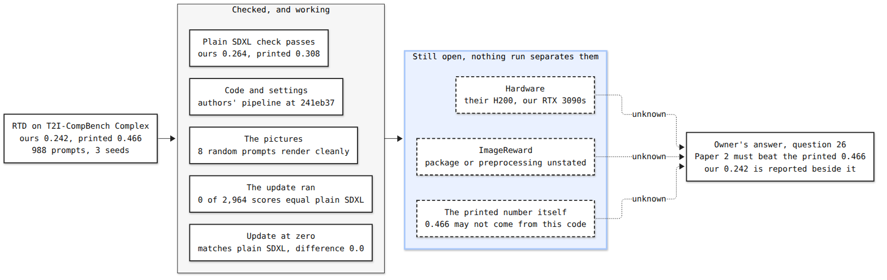</a>

**12. Reading digit identity on the sampler's own states (V6, V7)**

- **Entries:** [identity read on sampler states](what-we-tried/abstract-checkers.md#the-identity-checker-read-on-the-samplers-own-states), [retrained on sampler states](what-we-tried/abstract-checkers.md#the-identity-checker-retrained-on-the-samplers-own-states), [is identity visible at all](what-we-tried/abstract-checkers.md#is-identity-visible-on-the-samplers-states-at-all), [removal with identity (V7)](what-we-tried/abstract-checkers.md#the-removal-test-rerun-with-the-identity-checker), [the first early-noise checker](what-we-tried/abstract-checkers.md#one-checker-for-both-asked-digits-apart-read-at-the-toys-own-early-noise).
- **The fix:** the checker ranked states at an AUC of 0.72 to 0.83 but its zero point drifted; the retrained one memorised (training loss 0.0014). Either test a push at steps 27 to 36 scored on finished pictures, or retrain with fresh noise on one-step clean estimates at every draw, many more states, and held-out seeds of digits 0 to 4 as a positive control, scored against the judge's own 0.724 ceiling.
- **Paper:** 2 (the board); the reviewer notes the digit canvas is Paper 1's shape. **GPU-hours:** about 0.5 for the push test and about 2 for the retrain (mine, from the V6 jobs); 1.5 for V7 (ledger).
- **A yes** shows an identity push can steer even where identity is only partly visible. **A no** closes identity checkers on this digit sampler.
- **Picture:** 🖼️ Diagram wanted: the checker logit on sampler states at steps 27 to 36 for right and wrong canvases, both rising above zero, beside the share of canvases settled

### The rest, ranked

| Rank | Idea and entries | The fix that makes the test fair | Paper | GPU-hours (estimate) | A yes would / a no would | Picture |
|---|---|---|---|---|---|---|
| 13 | Digits from the score path at SDXL-matched noise ([X5](what-we-tried/noise-text-critic-and-score-space.md#the-digit-models-ten-noise-predictions-read-which-digits-are-present-x5), [project copy](what-we-tried/projects.md#reading-which-digits-are-present-from-the-digit-models-own-noise-predictions)) | A probe fitted on all 20,000 training canvases with a confidence interval; a read along the sampler's own path with unshared noise per step | both | about 0.5 (mine, X5 used 0.74) | Show whether 0.700 against 0.75 is the probe's limit or the signal's / close the score path as a reader |  |
| 14 | Sentence scores on binding and mid-run identity on CO3 ([W2d](what-we-tried/noise-text-critic-and-score-space.md#sentence-scores-on-binding-co3s-own-failure-w2d), [W2's two unscored properties](what-we-tried/noise-text-critic-and-score-space.md#sentence-scores-reading-five-properties-on-half-drawn-sdxl-latents-w2), [project copy](what-we-tried/projects.md#reading-five-properties-of-a-half-drawn-cat-and-dog-with-a-sentence-score), [W5](what-we-tried/noise-text-critic-and-score-space.md#the-sentence-score-loops-verdict-w5), [the fairness test's formal label](what-we-tried/projects.md#testing-whether-the-sentence-score-null-is-fair-with-a-positive-control-and-fairer-settings)) and a noise-aware encoder on words CLIP learned beside pictures ([W4](what-we-tried/noise-text-critic-and-score-space.md#a-noise-aware-model-trained-here-read-on-digits-it-never-saw-w4), [project copy](what-we-tried/projects.md#training-our-own-noise-aware-image-encoder-against-clips-frozen-text-side-on-digits)) | Label M1's 192 pushed and random-push pictures by eye to reach 8 per label per half, repair the colour masks, then score; read identity on CO3's states at steps 20 to 30; a cheap transfer test on natural-image words before any SDXL retrain | 2 | 0.3 plus 192 eye labels (ledger); about 1 for the transfer test (mine, from W4's 158-second training); the SDXL version is about 70 (ledger) and not recommended | Reopen sentence scores for binding only / close them; the loop and the design audit both judge a pass unlikely | 🖼️ Diagram wanted: binding labels per pair on CO3 96 tuning pictures (own parts, borrowed, not two), showing only three pairs hold both labels |
| 15 | What holding a side adds over a shared canvas that works ([M11](what-we-tried/method-search.md#the-digit-models-own-vote-against-a-coin-flip)), clutter-trained models ([side road](what-we-tried/projects.md#retraining-the-two-digit-models-with-stroke-clutter-for-one-shared-canvas-plan-33-side-road)), a base the two experts share ([plan 32](what-we-tried/projects.md#step-7bs-pushes-on-two-digit-experts-trained-apart-a2d-plan-32)), extra denoising steps ([plan 33, steps 3 and 4](what-we-tried/projects.md#additions-to-the-own-half-digit-sampler-checker-pushes-settings-and-extra-denoising-steps-plan-33-steps-3-and-4)) | A shared-canvas sampler that draws digits on its own, then the corrector and each push added back one at a time; clutter models that pass their own-digit check | 1 | about 3 (mine, from the M11 rows of 320 canvases) | Give Paper 1 a result without fixed halves / confirm fixed halves are needed on digits | <a href="../../../../2-classifier-guidance/artifacts/results/can-two-digits-compose-on-mnist/03-composing-the-two-models-while-sampling/side-road-training-with-clutter/sheets/fine-tuned-models-whole-canvas-with-both-pushes-and-extra-steps/digits-3-and-6.png">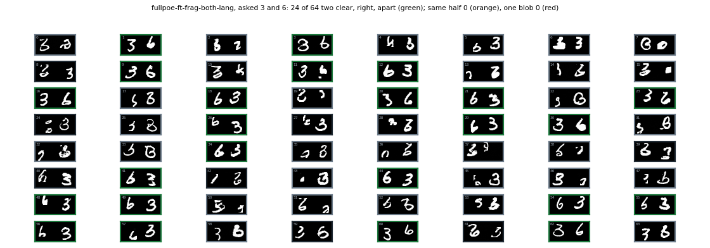</a> |
| 16 | The end-of-text overlap as a predictor of borrowing ([Z2](what-we-tried/leakage.md#which-of-three-readings-inside-sdxl-predicts-which-pairs-borrow-z2)) and the per-cell pattern on more seeds ([Z3 free check](what-we-tried/leakage.md#whether-a-per-place-signal-finds-the-borrowing-body-read-from-saved-records-z3s-free-check)) | Test that one reading (ρ 0.740, the largest of 20 looked at) on new pairs with its bar written first; a capture run on other seeds of the six borrowing pairs | 2 | about 2 (mine, from Z2's 96-picture capture run) | Give a cheap early warning of which pairs borrow / confirm it was one lucky pick of 20 | 🖼️ Diagram wanted: end-of-text overlap against borrowed count for the 12 pairs, ρ 0.740, marked as one of 20 readings looked at |
| 17 | The LoRA correction's held-out rates ([53 held-out pairs](what-we-tried/projects.md#every-sdxl-method-on-the-53-held-out-pairs), [fifteen-pair transfer](what-we-tried/projects.md#transfer-as-a-rate-over-fifteen-held-out-pairs), [on the joint prompt](what-we-tried/projects.md#the-adapter-attached-to-the-joint-prompt-itself), [inside a three-prompt product](what-we-tried/projects.md#the-two-concept-adapter-inside-a-three-prompt-product-prze-4), [across kinds of pair](what-we-tried/projects.md#does-the-adapter-carry-across-kinds-of-pair-and-how-does-it-look-beside-published-models), [on a joint prompt it was not trained for](what-we-tried/projects.md#what-does-the-adapter-do-to-a-joint-prompt-it-was-not-trained-to-repair)) | A pass rule written first with more than 3 hard pairs; the fifteen trainings already approved, each printing its realised pool; rates over sampled cells with damage defined first | 2 (LoRA) | about 10 for more hard pairs (mine); about 500 for fifteen trainings (mine, at 31.8 to 34.9 hours per LoRA run, from Z4); about 1 per sampled-rate check (mine) | Turn single runs and hand-picked sheets into transfer rates / leave the held-out claim at one pooled run |  |
| 18 | LoRA training choices ([self- against cross-attention](what-we-tried/projects.md#adapting-self-attention-as-well-as-cross-attention), [rank](what-we-tried/projects.md#how-much-rank-the-correction-needs), [training longer](what-we-tried/projects.md#training-the-pooled-adapter-longer), [first 10, 25 or 50 steps](what-we-tried/projects.md#training-the-adapter-on-the-first-10-first-25-or-all-50-steps), [reward with a KL anchor](what-we-tried/projects.md#reward-fine-tuning-the-adapter-with-a-kl-anchor-refl-kl-k0-to-k3), [reward first runs](what-we-tried/projects.md#reward-fine-tuning-the-adapter-first-runs-refl-03-and-refl-04-fidelity), [strength above 1](what-we-tried/projects.md#raising-the-correction-strength-above-1), [steps 0 to 9 only](what-we-tried/projects.md#applying-the-correction-on-steps-0-to-9-only), [window inside steps 0 to 10](what-we-tried/projects.md#does-the-window-where-the-correction-works-move-with-the-pairs-settling-step), [difficulty correlation](what-we-tried/projects.md#do-the-corrected-and-plain-runs-part-sharply-or-gradually), [interaction-strength bound](what-we-tried/projects.md#can-a-published-bound-on-interaction-strength-read-from-the-cache-predict-which-pairs-blend), [drift on a larger-correction pair](what-we-tried/projects.md#is-the-pooled-adapters-weaker-fit-on-unseen-pairs-caused-by-drifting-onto-states-it-never-trained-on), [aligning each word's attention with its region, way c](what-we-tried/leakage.md#the-loras-separation-plus-each-animals-own-prediction-in-its-box-option-a-of-the-binding-plan), [is the joint prompt a correct target](what-we-tried/projects.md#does-the-joint-prompt-the-adapters-training-target-always-draw-both-concepts), [training on real photographs](what-we-tried/projects.md#training-the-correction-on-real-photographs-of-both-animals)) | Score the already-trained pair that differs only in layers; three rank runs at the same loss, pool and length; weight decay on with an early stop on held-out drift; a reward run on held-out pairs with identity scored as the worse of the two concepts; more pairs where λ 1 is below ceiling; a finer window grid; fail rates with spread and a scorer that tells a hybrid from a chimera; count dropped concepts in the training cells' joint-prompt targets by eye; sort a larger sample of real both-animal photographs by eye | 2 (LoRA) | about 1 to score the layer pair (mine); about 42 for rank (ledger, three runs of about 14 hours); about 35 each for weight decay, the training window, the reward run and way c (mine, one LoRA run each); about 1 to 3 for each sampling-only item (mine); 0 for the two eye counts | Settle which training choices the paper may claim / keep its ablation figures as unranked sheets |  |
| 19 | Render-time quality fixes ([hand-off to frozen SDXL](what-we-tried/projects.md#handing-the-tail-to-frozen-sdxl-after-step-19-or-29-with-or-without-corrector-steps), [eight render-time fixes](what-we-tried/projects.md#eight-render-time-fixes-for-the-adapters-picture-quality-cost), [tail correctors](what-we-tried/projects.md#corrector-steps-on-the-adapters-own-score-in-the-last-fifteen-steps-to-sharpen-its-renders), [hand-back step sweep](what-we-tried/projects.md#sweeping-the-step-at-which-the-adapter-hands-the-render-back-to-frozen-sdxl), [contrast corrector](what-we-tried/projects.md#adding-the-contrast-corrector-to-the-adapter), [every adapter at three seeds](what-we-tried/projects.md#every-adapter-on-cat-and-dog-at-three-held-out-seeds), [switching off early](what-we-tried/projects.md#switching-the-adapter-off-early-while-drawing-tiger-and-parrot), [spread match and handover](what-we-tried/projects.md#spread-match-and-handing-over-to-a-second-adapter-while-drawing), [projection as a fix](what-we-tried/projects.md#keeping-the-adapters-correction-on-the-manifold-the-tangent-manifold-read)) | A fidelity bar written first that a contrast change cannot pass; a strength ramp across the hand-off; eye reads of the renders already on disk; the corrector's strength and steps recorded and swept | 2 (LoRA) | 0 for eye reads; about 1 per new sweep (mine, from the eight-seed hand-off runs) | Give the paper a quality fix with a rate / keep the quality cost stated as a limitation |  |
| 20 | The classifier-guidance project's cat-and-dog push variants ([presence push, plan 15](what-we-tried/projects.md#a-presence-classifiers-push-on-the-sdxl-cat-and-dog-product-plan-15), [plan 17](what-we-tried/projects.md#a-dog-classifier-on-frozen-sdxl-features-plan-17), [plan 18](what-we-tried/projects.md#a-dog-classifier-trained-the-papers-way-steering-sdxl-from-an-empty-prompt-plan-18), [plan 18 on the product](what-we-tried/projects.md#the-same-dog-push-on-the-sdxl-cat-and-dog-product-plan-18), [small discriminator, A3q](what-we-tried/projects.md#a-small-pair-aware-discriminators-push-on-sdxl-cat-and-dog-judged-on-held-out-seeds-a3q), [discriminators, plans 21 and 22](what-we-tried/projects.md#discriminators-trained-on-called-cat-and-dog-pairs-and-frozen-probes-plans-21-and-22), [own photos, plan 20](what-we-tried/projects.md#a-pair-aware-push-on-models-of-our-own-cat-and-dog-photos-plan-20), [CLIP checkers](what-we-tried/projects.md#clip-checkers-on-finished-pictures-against-half-drawn-guesses), [sampler-state checker, plan 25](what-we-tried/projects.md#a-readout-checker-trained-on-the-samplers-own-states-plan-25), [attention apart](what-we-tried/projects.md#a-push-that-pulls-the-cat-and-dog-attention-maps-apart), [decoded-picture push](what-we-tried/projects.md#clip-checker-pushes-through-the-decoded-picture), [push then pick](what-we-tried/projects.md#push-then-pick-four-pushed-tries-per-seed-with-clip-choosing-one), [bodies then species, plan 26](what-we-tried/projects.md#two-pushes-bodies-early-species-late-plan-26), [hybrid direction, plan 27](what-we-tried/projects.md#subtracting-sdxls-a-hybrid-animal-direction-weighted-by-the-checker-plan-27), [own species per body, plan 28](what-we-tried/projects.md#each-detected-animal-pushed-toward-its-own-species-plan-28), [presence outputs](what-we-tried/projects.md#adding-cat-present-and-dog-present-pushes-or-outputs-to-the-readout-push), [every step, plan 31](what-we-tried/projects.md#bodies-and-species-pushes-on-every-step-plan-31), [many-pair checkers](what-we-tried/projects.md#checkers-trained-across-many-pairs-read-on-lion-and-meerkat), [kept push on 128 seeds](what-we-tried/projects.md#the-kept-push-against-plain-product-the-joint-prompt-and-co3-on-128-seeds), [plan 23 reading](what-we-tried/projects.md#a-readout-checker-built-on-1920-labelled-drawings-plan-23), [plan 30 second question](what-we-tried/projects.md#a-checker-trained-on-78-pairs-plus-cat-and-dog-tested-on-both-new-pairs-plan-30-second-question), [MNIST held-out pairs, A2b](what-we-tried/projects.md#one-mnist-canvas-model-with-a-pair-aware-checker-push-how-good-the-checker-must-be-a2b-first-run)) | Each entry names its own fix (an unrescaled eight-seed sweep, a cap that does not fire every step, hybrids among the negatives, full-size calls, a held window, fresh seeds). All of them must also beat CO3 by M1's bar on held-out pairs before they bear on Paper 2 | 2 | about 0.5 to 2 each (mine, from the eight- and 32-seed sheets) | Little either way: the kept push from this line is already closed on the plain product and the joint prompt (Z8) |  |
| 21 | Inclusive captions and the share of both-subject pictures ([fixed-size corrector](what-we-tried/projects.md#a-langevin-corrector-with-the-set-size-fixed), [adding relabelled pictures](what-we-tried/projects.md#smallest-number-of-relabelled-pictures-adding-to-the-set), [relabelled share](what-we-tried/projects.md#the-caption-model-with-a-random-share-of-pictures-relabelled), [MNIST dial](what-we-tried/projects.md#inclusive-labels-on-mnist-by-the-dial), [MNIST share at guidance 3](what-we-tried/projects.md#share-of-two-digit-pictures-on-mnist-at-guidance-3), [at guidance 1](what-we-tried/projects.md#the-same-mnist-share-models-redrawn-at-guidance-1), [SDXL fine-tunes](what-we-tried/projects.md#sdxl-fine-tunes-that-caption-both-animal-photos-under-each-name), [public captions](what-we-tried/projects.md#do-public-captions-say-a-cat-and-a-dog-and-do-the-pictures-show-both), [usable photos](what-we-tried/projects.md#how-many-cat-and-dog-photos-the-pilot-can-train-on)) | More trainings per share; the judge checked against the eye before any verdict; the 128-seed scoring pass once the photo criterion is settled | 2 (filed) | about 1 to 3 per toy share sweep (mine); the SDXL pass about 2 (mine) | Size the share of both-subject pictures training needs / leave it at one toy reading. These train the model, which Paper 2's constraints place behind every training-free method ([Z4](what-we-tried/leakage.md#choosing-paper-2s-method-after-the-first-two-nulls-z4-z6-and-the-method-review)) |  |
| 22 | The exact toy and shape networks ([experts that like each other's shapes](what-we-tried/projects.md#experts-that-like-each-others-shapes-and-captions-that-compete), [two shape networks](what-we-tried/projects.md#two-separately-trained-shape-networks), [samplers on 2D points](what-we-tried/projects.md#what-samplers-lose-from-an-exact-product-on-2d-points), [co-occurrence the product needs](what-we-tried/projects.md#how-much-co-occurrence-the-exact-product-and-its-samplers-need)) | Measure a real "a cat" expert's weight on dog pictures against the toy's 0.00567 leak; find why the shape check draws noise; more seeds per sampler cell | both | about 1 for the leak measurement (mine); CPU for the rest | Tell whether SDXL sits where the product itself stops drawing the pair / keep the toy's lesson unplaced | <a href="../../../../3-understanding-compositionality/artifacts/results/the-exact-toy/how-much-co-occurrence-the-product-needs/the-leak-dial.png">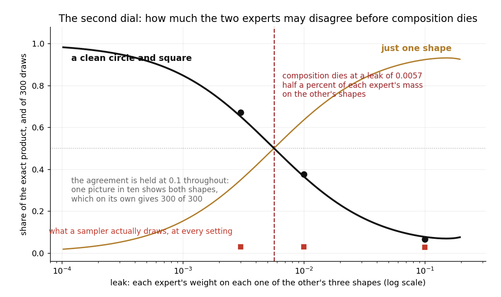</a> |
| 23 | The text-space third expert ([written phrases](what-we-tried/projects.md#written-phrases-as-a-third-expert), [learned "and" token](what-we-tried/projects.md#a-learned-and-token-in-place-of-the-vector), [steering noise by attention](what-we-tried/projects.md#steering-the-starting-noise-apart-by-attention), [word similarity](what-we-tried/projects.md#whether-pairs-with-less-similar-words-compose-more-easily), [minus one half](what-we-tried/projects.md#does-the-joint-prompts-embedding-minus-one-half-carry-the-other-word)) | A weight sweep on the best phrase and a second pair; the planned picture test for the learned token; a loss on the overlap term alone; recompute the similarity file | 2 | about 0.5 each (mine, from seven-seed sheets) | Reopen the text side of composition / leave the positional-vector closure standing |  |
| 24 | Wetness and how SDXL is asked ([dog in the rain](what-we-tried/projects.md#does-a-dog-in-the-rain-come-out-wet-under-the-product), [camel in the rain](what-we-tried/projects.md#does-a-camel-in-the-rain-come-out-wet-under-the-product), [wet captions](what-we-tried/projects.md#how-often-camel-and-dog-captions-mention-wetness), [wet as a third prompt](what-we-tried/projects.md#adding-wet-as-a-third-prompt-for-a-camel-and-a-dog), [product against joint across kinds](what-we-tried/projects.md#the-product-against-the-joint-prompt-across-kinds-of-composition), [eight ways of asking](what-we-tried/projects.md#eight-ways-of-asking-sdxl-for-cats-and-dogs), [fused cat-dog against a photograph](what-we-tried/projects.md#does-a-fused-cat-dog-fit-both-captions-better-than-a-photograph)) | Seed-by-seed eye calls on the 128 renders already made; failure rates on pairs chosen without looking; columns at matched total guidance; within-seed comparison against renders from the same noise | 2 | 0 for the eye calls; about 0.5 to 2 for the new renders (mine) | Decide whether the product loses scene interactions such as wetness / leave the example sheets as illustrations |  |
| 25 | Sheets made for figures, with no rate ([the main grid](what-we-tried/projects.md#the-papers-main-grid-four-methods-on-four-hand-picked-pairs), [one adapter against four methods](what-we-tried/projects.md#one-adapter-against-four-methods-on-four-pairs-at-one-seed), [four scorers on one pair](what-we-tried/projects.md#checking-four-published-scorers-on-one-mug-and-wine-glass-pair)) | Only if a paper sentence cites them: a rate at one checkpoint on fixed pairs and seeds, and a labelled set for the scorers | 2 | about 1 each (mine) | Let a figure carry a rate / keep it as an illustration with no rate |  |

## 3. The patterns behind the failures

### The counts

These counts come from the "Kind of failure" line of all 223 entries at `e0acba53`. An entry counts toward a kind when that line names it, whether as the cause of a failure or as a limit on a pass. Nine mentions were removed because the line negates the kind or applies it to a different attempt. "The idea" was removed from six entries whose line says nothing tested it or it was not the cause ([X9](what-we-tried/noise-text-critic-and-score-space.md#the-shared-text-and-score-space-and-closing-the-score-path-x6-to-x8-skipped-x9), [W2d](what-we-tried/noise-text-critic-and-score-space.md#sentence-scores-on-binding-co3s-own-failure-w2d), [ToMe](what-we-tried/reproductions.md#token-merging-tome-on-t2i-compbench-shape-and-texture), [V5 rerun](what-we-tried/abstract-checkers.md#removing-one-checker-at-a-time-rerun-at-three-times-the-canvases), [V7](what-we-tried/abstract-checkers.md#the-removal-test-rerun-with-the-identity-checker), [digits against paste](what-we-tried/projects.md#composing-two-digit-models-trained-apart-against-sampling-each-alone-and-pasting)). "Test design" was removed from [the species-free wording entry](what-we-tried/noise-text-critic-and-score-space.md#counting-sentences-that-name-no-species-w2c-group-4), where it describes W2's earlier doubt. "Wrong data" was removed from [the identity checker trained apart](what-we-tried/abstract-checkers.md#an-identity-checker-trained-apart-rehearsed-at-sdxls-noise-level), whose line says "Not wrong data". "Could not measure it" was removed from [Z10](what-we-tried/leakage.md#the-pooled-loras-weight-as-a-dial-on-pairs-it-never-saw-z10), where it applies to the earlier "58 of 64" claim.

| Kind | Entries that name it | In an entry that did not pass | Only as a limit on a pass, or on an attempt that never ran |
|---|---|---|---|
| test design | 162 | 128 | 34 |
| could not measure it | 87 | 64 | 23 |
| the idea | 60 | 57 | 3 |
| done wrong | 36 | 35 | 1 |
| wrong data | 27 | 26 | 1 |
| not understood | 23 | 19 | 4 |

**Most entries name more than one kind.** 61 entries name one kind, 102 name two, 34 name three, 7 name four, and 19 name none.

**The idea alone explains few failures.** 164 entries record a failure, a null, an inconclusive result or a closure (their kind line does not open with "none"). Of these, 9 name the idea as the only kind, 48 name it beside other kinds, and 107 never name it. So two thirds of the recorded failures say nothing about whether the idea works.

**The other 59 entries open with "none".** 44 passed their bar or reproduced a printed number, 11 never ran or are still running, 1 is the design audit, which tested nothing, and 3 are diagnoses or records with no bar.

**Where each idea stands**, by the first state the "Idea still alive?" line names: unclear 86, alive 47, closed 46, retry worth it 33, split into parts with different states 6, a finding stated with no state word 4, and "not a failure" 1 (CoMat's reproduction).

| File | Entries | the idea | done wrong | wrong data | could not measure it | test design | not understood |
|---|---|---|---|---|---|---|---|
| method-search.md | 13 | 5 | 4 | 3 | 3 | 7 | 6 |
| leakage.md | 17 | 10 | 2 | 2 | 1 | 10 | 5 |
| reproductions.md | 7 | 3 | 3 | 2 | 2 | 3 | 1 |
| noise-text-critic-and-score-space.md | 12 | 8 | 0 | 3 | 4 | 7 | 1 |
| abstract-checkers.md | 17 | 3 | 2 | 3 | 2 | 4 | 2 |
| projects.md | 157 | 31 | 25 | 14 | 75 | 131 | 8 |

The loops' own files name the idea far more often than the project folders (29 of 66 loop entries against 31 of 157 project entries), because the loops wrote bars first and ran controls; the project folders hold many figure sheets and single-pair reads where test design is the only kind that fits.

### Eight patterns

**1. The instrument could not see the outcome, most often because the counter cannot name the animal.** The detector counts bodies, so "58 of 64" and the 94% strength-sweep rate are upper bounds ([58 of 64](what-we-tried/projects.md#one-pooled-adapter-on-eight-pairs-it-never-trained-on-the-iclr-58-of-64), [hand sort of the 94%](what-we-tried/projects.md#hand-sort-of-the-32-images-behind-the-strength-sweeps-94)); Feynman-Kac steering's 8 of 8 holds a cat beside a dog on only 5 of 8 by eye ([steering with the correction](what-we-tried/projects.md#feynman-kac-steering-with-the-rank-32-correction-in-the-proposal)). Other instruments failed the same way: ImageReward scored RTD's separate lemons and limes at −0.90 against −0.02 for a fused picture ([RTD](what-we-tried/reproductions.md#rectify-then-diffuse-rtd-on-t2i-compbench-complex-and-rarebench-concat)), and the CLEVR count classifier read a red sliver beside a blue block as one of each ([M10](what-we-tried/method-search.md#two-clevr-experts-trained-on-separate-colours)).

**2. Readers learned which pair a picture shows, not what it shows.** A lookup that knows only the pair scores 0.757 balanced accuracy on fresh seeds, above every per-place reader, and within pair those readers sit at 0.39 to 0.51 ([M12](what-we-tried/method-search.md#reading-identity-from-co3s-states-with-no-training-cell-by-cell), [D3](what-we-tried/reproductions.md#choosing-paper-2s-checker-architecture-d3)). Attention overlap's whole gap came from which pairs succeed and vanished within pair ([M15](what-we-tried/method-search.md#a-score-that-names-no-subject-read-from-sdxls-attention)). Discriminators with 17 positives learned the prompt instead of "two separate animals" ([A3q](what-we-tried/projects.md#a-small-pair-aware-discriminators-push-on-sdxl-cat-and-dog-judged-on-held-out-seeds-a3q), [plans 21 and 22](what-we-tried/projects.md#discriminators-trained-on-called-cat-and-dog-pairs-and-frozen-probes-plans-21-and-22)).

🖼️ Diagram wanted: one reader scored across pairs (AUC rising toward 0.74) and within pair (flat at 0.5) on the same pictures, two lines on one axis

**3. Reading or pushing where the input holds almost nothing.** The digit toy's steps 0 to 15 keep a signal share of 0.00004 to 0.0076, 14 to 144 times lower than SDXL's ([the first early-noise checker](what-we-tried/abstract-checkers.md#one-checker-for-both-asked-digits-apart-read-at-the-toys-own-early-noise)); both animals' pushes cover 86% to 98% of the grid at CO3's steps 0 to 2 ([own push on own body](what-we-tried/leakage.md#whether-each-animals-own-push-picks-out-its-own-body-at-co3s-corrected-steps-the-audits-rerun-3)); attention at steps 0 to 9 peaks at 0.0012 against a flat 0.00098 ([steering noise by attention](what-we-tried/projects.md#steering-the-starting-noise-apart-by-attention)). The design audit found no design that wrote down how much of the picture its input held at its steps ([Z5](what-we-tried/leakage.md#an-audit-of-the-designs-of-loops-8-9-and-10-z5)).

<a href="../abstract-checkers/05-does-it-learn/two-noise-levels.png">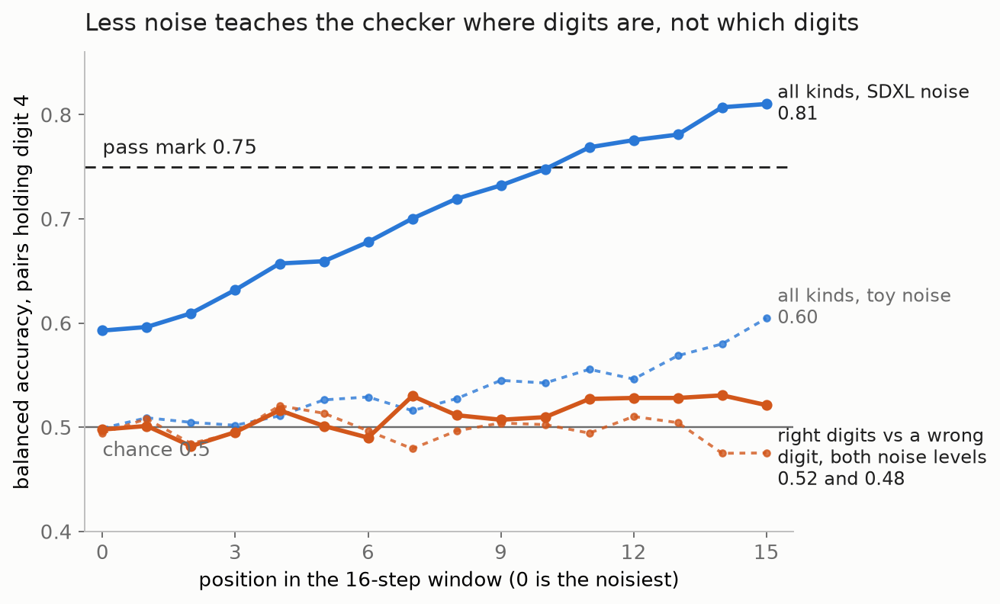</a>

**4. A change too small, too large or clipped to show any effect.** The box push moved pictures by 2.3 grey levels because it was sized by its target direction's median length ([Z12](what-we-tried/leakage.md#each-animals-own-prediction-applied-as-a-push-inside-its-box-z12-stage-a)); the presence push was about 44,000 times too large ([plan 15](what-we-tried/projects.md#a-presence-classifiers-push-on-the-sdxl-cat-and-dog-product-plan-15)); the discriminator's cap cut the push on every step ([A3q](what-we-tried/projects.md#a-small-pair-aware-discriminators-push-on-sdxl-cat-and-dog-judged-on-held-out-seeds-a3q)); the pre-registered Langevin step-size rule chose renders of pure texture noise ([Langevin split](what-we-tried/projects.md#a-langevin-corrector-to-split-the-correction-into-a-sampler-part-and-a-model-part)).

**5. Tests sized below the effect they were looking for.** 48 pictures ended at p 0.073 on the nearest lead any CO3 fix has had ([Z7](what-we-tried/leakage.md#each-animals-own-prediction-inside-its-hand-drawn-box-after-co3s-own-correction-z7)); in M1 six single reviewers passed 7, 0, 6, 4, 4 and 9 of their 48 pictures each, a spread the size of the bar ([M1](what-we-tried/method-search.md#beating-each-papers-simplest-baseline)); three trainings per setting gave gaps of 164 and 178 of 300 ([fixed-size share](what-we-tried/projects.md#share-of-both-shapes-pictures-with-the-set-size-fixed), [adding relabelled pictures](what-we-tried/projects.md#smallest-number-of-relabelled-pictures-adding-to-the-set)). With 12 pairs every 95% interval on ρ spans more than one unit ([Z2](what-we-tried/leakage.md#which-of-three-readings-inside-sdxl-predicts-which-pairs-borrow-z2)).

🖼️ Diagram wanted: the lead needed for p below 0.05 against the number of pictures per row, with Z7 (6 of 48) and Z12 (1 of 96) marked

**6. Comparisons that moved two things at once.** Z7's boxed row also added an extra corrector pass, and that pass over the whole picture moved pictures further from CO3 alone than the boxed pass did (median 24.5 against 21.4 grey levels, [Z7](what-we-tried/leakage.md#each-animals-own-prediction-inside-its-hand-drawn-box-after-co3s-own-correction-z7)); the balanced checker list was also smaller (877 against 2,464 pictures, [M5](what-we-tried/method-search.md#balancing-the-checkers-training-data-and-whether-any-checker-sees-co3s-failure)); SuperDiff's 50-against-200-step comparison changed the step size and the number of noise injections together ([SuperDiff](what-we-tried/projects.md#superdiff-at-its-own-defaults-and-adding-its-own-missing-residual-back)); plan 31 changed the window and the added push together ([plan 31](what-we-tried/projects.md#bodies-and-species-pushes-on-every-step-plan-31)).

🖼️ Diagram wanted: Z7's three rows as a diagram: CO3 alone, the whole-picture pass (24.5 grey levels from CO3 alone) and the boxed pass (21.4), with the one difference each comparison should isolate

**7. The baseline won by construction, or the strongest baseline was missing.** Paste had 33 canvases of room on fixed halves and 1,024 of 1,024 on fixed CLEVR positions ([M1](what-we-tried/method-search.md#beating-each-papers-simplest-baseline), [M7](what-we-tried/method-search.md#pasting-small-clevr-samples-before-any-tuning-on-clevr)); a coin flip placed digits as well as the vote ([M11](what-we-tried/method-search.md#the-digit-models-own-vote-against-a-coin-flip)); a names-only push did as well as the pair-aware push ([Z9](what-we-tried/leakage.md#a-checker-push-on-finished-coloured-digit-experts-against-a-push-that-names-digit-and-colour-separately-z9-arm-2-and-control-a)); best of 16 unweighted draws also reached 8 of 8, so resampling added nothing measured ([steering with the correction](what-we-tried/projects.md#feynman-kac-steering-with-the-rank-32-correction-in-the-proposal)).

<a href="../method-search/01-beat-the-baseline/paper-1-four-rows-first-two-seeds.png">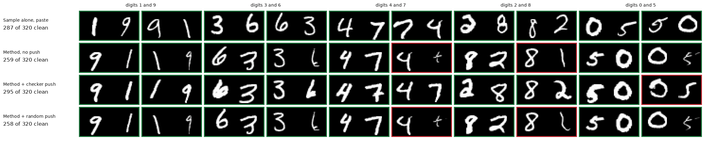</a>

**8. A wrong belief about the mechanism shaped the design.** The push's direction was read from the gradient, whose sign is opposite to the push the code applies, and that reading was put to the owner on question 111 ([M13](what-we-tried/method-search.md#whether-the-kept-checkers-push-points-along-the-dropped-term)); Z3 was read as a test of regions while the content inside each box stayed the joint prediction ([Z3](what-we-tried/leakage.md#subtracting-the-other-animal-inside-hand-drawn-boxes-late-in-sampling-z3)); the noise level times the denoiser Jacobian was read as an off-manifold projector, and it amplifies past step 10 ([tangent manifold](what-we-tried/projects.md#keeping-the-adapters-correction-on-the-manifold-the-tangent-manifold-read)); the energy penalty assumed the haze was excess energy while the adapter under-spends ([energy](what-we-tried/projects.md#charging-the-adapter-for-the-energy-of-its-correction)).

🖼️ Diagram wanted: one saved CO3 state with the checker gradient and the change the push code applies drawn as two arrows pointing opposite ways, cosine −1.0

## 4. Rules for every new design

Each rule is written so a reviewer can check it on the design file before any GPU is spent. The right column names the failures it would have prevented.

| # | Rule | The check on the design file | Failures it would have prevented |
|---|---|---|---|
| 1 | Write the bar first, in words and in code, with every outcome between support and null covered | The design file holds a dated bar, the code holds it as named constants committed before the first run, and the text says what each region of results means, including ties and readings of "below" | [M14's double negation](what-we-tried/method-search.md#whether-the-joint-prompt-is-the-wrong-target-where-it-fails), [the early-steps adapter's undefined "below"](what-we-tried/projects.md#does-keeping-the-learned-adapter-on-only-for-the-early-steps-change-the-failures), [the relabelled share's uncovered result](what-we-tried/projects.md#the-caption-model-with-a-random-share-of-pictures-relabelled), [the hand-back sweep's tie rule](what-we-tried/projects.md#sweeping-the-step-at-which-the-adapter-hands-the-render-back-to-frozen-sdxl), [plan 20's rules added after launch](what-we-tried/projects.md#a-pair-aware-push-on-models-of-our-own-cat-and-dog-photos-plan-20) |
| 2 | Rerun plain SDXL (or the plain baseline) through the same pipeline before calling any rival's miss or any method's win | The result table has a plain row from the same code, prompts, seeds and card type, and its printed number is checked against its own band first | [RTD](what-we-tried/reproductions.md#rectify-then-diffuse-rtd-on-t2i-compbench-complex-and-rarebench-concat), [CO3](what-we-tried/reproductions.md#co3-on-t2i-compbench-complex-and-rarebench-concat), [ToMe](what-we-tried/reproductions.md#token-merging-tome-on-t2i-compbench-shape-and-texture), [FKC](what-we-tried/reproductions.md#feynman-kac-correctors-fkc-on-geneval-two-objects) |
| 3 | Score within a pair, with pairs held out | Every reader or score is reported as within-pair AUC beside a lookup that knows only the pair; training and scoring pairs are disjoint | [M12](what-we-tried/method-search.md#reading-identity-from-co3s-states-with-no-training-cell-by-cell), [M15](what-we-tried/method-search.md#a-score-that-names-no-subject-read-from-sdxls-attention), [D3](what-we-tried/reproductions.md#choosing-paper-2s-checker-architecture-d3), [M5](what-we-tried/method-search.md#balancing-the-checkers-training-data-and-whether-any-checker-sees-co3s-failure) |
| 4 | Check the instrument by eye before trusting it, at full size, on the failure the test is about | A labelled sample of at least 30 pictures holding each failure kind (hybrid, two of one kind, wrong species) is scored by the instrument and by eye, and agreement is reported before any verdict | [58 of 64](what-we-tried/projects.md#one-pooled-adapter-on-eight-pairs-it-never-trained-on-the-iclr-58-of-64), [94% hand sort](what-we-tried/projects.md#hand-sort-of-the-32-images-behind-the-strength-sweeps-94), [ImageReward on RTD](what-we-tried/reproductions.md#rectify-then-diffuse-rtd-on-t2i-compbench-complex-and-rarebench-concat), [CLEVR count classifier](what-we-tried/method-search.md#two-clevr-experts-trained-on-separate-colours), [Laplacian variance](what-we-tried/projects.md#noise-search-with-the-correction-attached-picked-for-sharpness), [the MNIST judge](what-we-tried/projects.md#inclusive-labels-on-mnist-by-the-dial) |
| 5 | Size the test so a real lead can be told from luck | The design states the smallest lead it must detect and shows that the picture count gives that lead p below 0.05 and that one pair cannot carry it; two reviewers call every picture | [Z7](what-we-tried/leakage.md#each-animals-own-prediction-inside-its-hand-drawn-box-after-co3s-own-correction-z7), [M1](what-we-tried/method-search.md#beating-each-papers-simplest-baseline), [Z3](what-we-tried/leakage.md#subtracting-the-other-animal-inside-hand-drawn-boxes-late-in-sampling-z3), [three trainings per share](what-we-tried/projects.md#share-of-both-shapes-pictures-with-the-set-size-fixed) |
| 6 | Change exactly one thing per comparison, and print the composition of each arm | The design lists every difference between the two arms; anything other than the named one is held fixed or given its own arm | [Z7's extra pass](what-we-tried/leakage.md#each-animals-own-prediction-inside-its-hand-drawn-box-after-co3s-own-correction-z7), [M5's size and balance](what-we-tried/method-search.md#balancing-the-checkers-training-data-and-whether-any-checker-sees-co3s-failure), [SuperDiff's steps](what-we-tried/projects.md#superdiff-at-its-own-defaults-and-adding-its-own-missing-residual-back), [plan 31](what-we-tried/projects.md#bodies-and-species-pushes-on-every-step-plan-31), [the count checker against the single checker](what-we-tried/abstract-checkers.md#the-count-checker-read-once-on-digits-5-to-9) |
| 7 | Measure what a push actually does on one saved state before reading anything about it | A smoke run reports the median and largest grey-level change from the unpushed picture, how often the cap fires, and the cosine of the code's own change with the gradient | [Z12's 2.3 grey levels](what-we-tried/leakage.md#each-animals-own-prediction-applied-as-a-push-inside-its-box-z12-stage-a), [plan 15's 44,000 times](what-we-tried/projects.md#a-presence-classifiers-push-on-the-sdxl-cat-and-dog-product-plan-15), [A3q's cap](what-we-tried/projects.md#a-small-pair-aware-discriminators-push-on-sdxl-cat-and-dog-judged-on-held-out-seeds-a3q), [M13's sign](what-we-tried/method-search.md#whether-the-kept-checkers-push-points-along-the-dropped-term) |
| 8 | Write down how much of the picture the input holds at the steps read or pushed | The design states the signal share at those steps, names the measure (variance share ᾱ or amplitude share √ᾱ, never compared across), and gives a positive control that reads at those steps | [the toy's early window](what-we-tried/abstract-checkers.md#one-checker-for-both-asked-digits-apart-read-at-the-toys-own-early-noise), [push masks at steps 0 to 2](what-we-tried/leakage.md#whether-each-animals-own-push-picks-out-its-own-body-at-co3s-corrected-steps-the-audits-rerun-3), [sentence scores at steps 0 to 15](what-we-tried/noise-text-critic-and-score-space.md#sentence-scores-reading-five-properties-on-half-drawn-sdxl-latents-w2), [attention at steps 0 to 9](what-we-tried/projects.md#steering-the-starting-noise-apart-by-attention) |
| 9 | Validate a reader on the sampler's own states, with labels true at the step read | The reader's held-out score is reported on saved sampler states, not only on forward-noised pictures; labels come from steps where the content has settled | [V6 on sampler states](what-we-tried/abstract-checkers.md#the-identity-checker-read-on-the-samplers-own-states), [W2c's 0.637 against 0.696](what-we-tried/noise-text-critic-and-score-space.md#a-positive-control-and-the-fairest-settings-for-the-sentence-scores-w2c), [plan 25](what-we-tried/projects.md#a-readout-checker-trained-on-the-samplers-own-states-plan-25), [CLIP checkers on finished pictures](what-we-tried/projects.md#clip-checkers-on-finished-pictures-against-half-drawn-guesses) |
| 10 | Put the cheapest rival beside every method: paste, a random push of the same length, a names-only push, and best of N at matched compute | Each comparison table has these rows, and a baseline that wins by construction (no room left) is replaced before the run | [fixed halves and fixed CLEVR positions](what-we-tried/method-search.md#beating-each-papers-simplest-baseline), [best of 16](what-we-tried/projects.md#feynman-kac-steering-with-the-rank-32-correction-in-the-proposal), [names-only push](what-we-tried/leakage.md#a-checker-push-on-finished-coloured-digit-experts-against-a-push-that-names-digit-and-colour-separately-z9-arm-2-and-control-a), [the vote against a coin flip](what-we-tried/method-search.md#the-digit-models-own-vote-against-a-coin-flip) |
| 11 | Check the target and the reference draw both subjects before scoring against them | Each reference render is called by eye for both subjects; a target that drops one is excluded and counted | [the joint prompt drops a concept on 11 of 32](what-we-tried/projects.md#does-the-joint-prompt-the-adapters-training-target-always-draw-both-concepts), [cat and dog seed 10](what-we-tried/projects.md#one-adapter-against-four-methods-on-four-pairs-at-one-seed), [seed 14's two cats](what-we-tried/projects.md#the-pooled-adapter-at-full-strength-on-held-out-cat-and-dog) |
| 12 | Keep tuning seeds and reporting seeds apart | The design names the seeds used to choose settings and the fresh seeds used for the verdict, and they do not overlap | [the 128-seed improvement rounds](what-we-tried/projects.md#improvement-rounds-on-the-cat-and-dog-push-over-128-seeds), [plan 33's tuning number](what-we-tried/projects.md#additions-to-the-own-half-digit-sampler-checker-pushes-settings-and-extra-denoising-steps-plan-33-steps-3-and-4), [the per-place reader's 0.688 against 0.632](what-we-tried/method-search.md#correcting-the-per-place-reader-for-each-animals-size), [the 0.888 best of four cells](what-we-tried/abstract-checkers.md#the-identity-checker-read-on-digits-5-to-9-with-robustness-checks) |
| 13 | Draw compared runs on one card type, and compare totals, never single pushed seeds | The design names the card type for every arm; per-seed comparisons of pushed renders are not read | [CO3 across cards](what-we-tried/method-search.md#balancing-the-checkers-training-data-and-whether-any-checker-sees-co3s-failure), [the count push on two nodes](what-we-tried/abstract-checkers.md#the-count-checkers-push-on-digits-5-to-9), [pushed renders differ](what-we-tried/projects.md#the-early-readout-push-on-32-new-seeds-plan-29) |
| 14 | Take "off" from an untouched U-Net, never from the same model with the adapter attached and disabled | The reference renders are drawn in another process or before the adapter loads | [Z10's off switch](what-we-tried/leakage.md#the-pooled-loras-weight-as-a-dial-on-pairs-it-never-saw-z10), [contaminated references](what-we-tried/projects.md#on-cat-and-dog-does-the-plain-product-land-apart-from-the-joint-prompt-and-the-correction-lift-it-there-nearest-cloud-and-arrow-agreement) |
| 15 | Run a reader already known to work through the same protocol before calling a new reader's miss a null | A positive control row, chosen on pictures other than the ones it judges, sits beside every reader | [W2 and W2c](what-we-tried/noise-text-critic-and-score-space.md#sentence-scores-reading-five-properties-on-half-drawn-sdxl-latents-w2), [the CLEVR checkers](what-we-tried/method-search.md#two-clevr-experts-trained-on-separate-colours) |
| 16 | Check the outcome varies before correlating anything with it, and do not gate the question behind an unrelated bar | The design reports the spread of the outcome across units; the tests that answer the owner's question are not placed behind a readability gate | [the interaction-strength bound's fail rate of 1.00](what-we-tried/projects.md#can-a-published-bound-on-interaction-strength-read-from-the-cache-predict-which-pairs-blend), [X9's arithmetic tests behind X5's bar](what-we-tried/noise-text-critic-and-score-space.md#the-shared-text-and-score-space-and-closing-the-score-path-x6-to-x8-skipped-x9) |

## 5. What the papers can claim now

Each claim below names the ledger entry that supports it. A claim not on the supported list has no support in the ledger, whatever chat memory says.

### Paper 1: models trained apart, composed while sampling

**Supported**

- The plain product of models trained apart does not compose. Two digit models on one whole canvas give 0 to 4 clean pairs of 320 under every repair tried ([plan 33, step 1](what-we-tried/projects.md#repairs-to-the-plain-product-of-two-digit-models-trained-apart-plan-33-step-1), [plan 32](what-we-tried/projects.md#step-7bs-pushes-on-two-digit-experts-trained-apart-a2d-plan-32)), and two CLEVR colour experts give an exact share of 0.000 by blind eye, their colours adding into one dark object ([M10](what-we-tried/method-search.md#two-clevr-experts-trained-on-separate-colours)).
- On digits, two models trained apart compose when each holds its own half with the side chosen early and held: 1,200 of 1,280 by the judge, with pushes, on new seeds of the 20 pairs ([plan 33 headline](what-we-tried/projects.md#two-digit-models-trained-apart-each-on-its-own-half-with-the-side-chosen-early-and-held-plan-33-headline-steps-2-5-7-and-8)). The review records this as inconclusive pending the owner's call on 15 tiles, and 257 of 320 from the push steps is a tuning number ([plan 33, steps 3 and 4](what-we-tried/projects.md#additions-to-the-own-half-digit-sampler-checker-pushes-settings-and-extra-denoising-steps-plan-33-steps-3-and-4)).
- The checker's direction does work on digits: the push lifts the unpushed method by 36 of 320 where a random push of the same size changes nothing ([M1](what-we-tried/method-search.md#beating-each-papers-simplest-baseline)), and on unseen digit pairs the count push gives 43 clean pairs of 320 against 0 for the plain product and 1 for a random push, while picking the best of 4 plain samples by the checker gives 0 ([the count push (V3)](what-we-tried/abstract-checkers.md#the-count-checkers-push-on-digits-5-to-9)).
- On Colored MNIST with two holders and finished experts, a checker trained with a gradient-alignment penalty reaches 88.8% right on 50 unseen combinations against 73.8% for a names-only push of the same length (902 won, 153 lost), FID 10.8 against 15.3; one training seed and one judge ([Z11](what-we-tried/leakage.md#a-checker-trained-so-its-push-points-along-the-experts-own-direction-z11)).
- On the exact toy, when the experts' data overlap the sampler, not the product, loses the pair, and a classifier push repairs that sampler loss ([co-occurrence the product needs](what-we-tried/projects.md#how-much-co-occurrence-the-exact-product-and-its-samplers-need), [A1](what-we-tried/projects.md#a-pair-aware-classifier-push-against-a-separate-label-push-on-the-exact-circle-and-square-toy-a1), [the project 3 copy](what-we-tried/projects.md#a-classifier-push-on-the-exact-toy)), while when each expert puts weight on the other's lone shapes the exact product itself draws single shapes (4 and 19 of 300) ([experts that like each other's shapes](what-we-tried/projects.md#experts-that-like-each-others-shapes-and-captions-that-compete)).

**Not supported**

- That Paper 1's method beats paste anywhere. On fixed-half digits it is level (295 against 287, under a bar of 13.54), and no test has been run where paste can fail ([M1](what-we-tried/method-search.md#beating-each-papers-simplest-baseline), [M10](what-we-tried/method-search.md#two-clevr-experts-trained-on-separate-colours)).
- That the models choose their own layout: a coin flip does as well (313 against 312) ([M11](what-we-tried/method-search.md#the-digit-models-own-vote-against-a-coin-flip)).
- Anything about Paper 1's method on CLEVR, which has no measurement ([M10](what-we-tried/method-search.md#two-clevr-experts-trained-on-separate-colours)).
- That a pair-aware push composes unseen combinations beyond attribute guidance ([Z9](what-we-tried/leakage.md#a-checker-push-on-finished-coloured-digit-experts-against-a-push-that-names-digit-and-colour-separately-z9-arm-2-and-control-a)).
- Anything on CelebA, Shapes3D or Colored MNIST as a target, which the owner made context ([CoInD](what-we-tried/reproductions.md#coind-and-its-composed-baseline-on-celeba)).

### Paper 2: fixing how one frozen model draws two subjects

**Supported**

- CO3 lifts matched plain SDXL on two-subject prompts: +0.0950 ImageReward on 463 two-subject Complex prompts (standard error 0.0303), where RTD's matched gain is +0.0011 (standard error 0.0239) ([CO3](what-we-tried/reproductions.md#co3-on-t2i-compbench-complex-and-rarebench-concat), [RTD](what-we-tried/reproductions.md#rectify-then-diffuse-rtd-on-t2i-compbench-complex-and-rarebench-concat)). ToMe's gain over matched plain SDXL matches its printed gain (+0.0677 on Shape, +0.1271 on Texture) ([ToMe](what-we-tried/reproductions.md#token-merging-tome-on-t2i-compbench-shape-and-texture)), and CoMat's Color score reproduces (0.7696 against 0.7827 printed) ([CoMat](what-we-tried/reproductions.md#comat-on-t2i-compbench-color)).
- Our GenEval prompts and scorer return plain SDXL's printed two-object score (0.7399 of 396 images, inside the band around 0.80) ([FKC](what-we-tried/reproductions.md#feynman-kac-correctors-fkc-on-geneval-two-objects)).
- CO3 already separates bodies; its remaining failure is identity, and it is fixed per pair. Cheetah and cougar and duck and goose borrow parts in all 7 of their two-subject pictures while eagle and fox is clean on 8 of 8 ([W2d](what-we-tried/noise-text-critic-and-score-space.md#sentence-scores-on-binding-co3s-own-failure-w2d)). Section 6 lists the disagreement over whether 23 of CO3's 96 tuning pictures are "not two".
- Which pairs borrow is not predicted by how alike the two subjects are, by text, attention or push (largest ρ 0.489 against 0.706) ([Z2](what-we-tried/leakage.md#which-of-three-readings-inside-sdxl-predicts-which-pairs-borrow-z2)).
- SDXL's own features read a half-drawn picture early where sentence scores cannot: a readout checker reaches 0.87 balanced accuracy by step 15 on 195 real sampler runs and beats frozen CLIP by 0.215 (standard error 0.042), while no sentence score's mean over steps 0 to 15 reaches 0.6 ([W2c](what-we-tried/noise-text-critic-and-score-space.md#a-positive-control-and-the-fairest-settings-for-the-sentence-scores-w2c)).
- Identity is present in CO3's decoded state from step 15 (0.773 balanced accuracy, 0.744 within pair) and weak at steps 5 and 10 (0.567 and 0.610 within pair) ([M12](what-we-tried/method-search.md#reading-identity-from-co3s-states-with-no-training-cell-by-cell)).
- The kept push moves CO3's noise prediction along the dropped term at step 0 (median cosine +0.105 against a bar of +0.10), but it does not lift CO3 ([M13](what-we-tried/method-search.md#whether-the-kept-checkers-push-points-along-the-dropped-term), [M1](what-we-tried/method-search.md#beating-each-papers-simplest-baseline)).
- Copying the joint prompt would aim at a worse picture on these pairs: 34 of 192 two clear against CO3's 73 ([M14](what-we-tried/method-search.md#whether-the-joint-prompt-is-the-wrong-target-where-it-fails)).
- The early readout push separates a cat and a dog on new seeds (14 of 32 clean or near-clean at full size, one pair) and one object pair (typewriter and cactus) ([plan 29](what-we-tried/projects.md#the-early-readout-push-on-32-new-seeds-plan-29), [plan 30](what-we-tried/projects.md#the-cat-and-dog-checkers-early-push-on-two-new-pairs-plan-30-first-question)).

**Not supported**

- Any correction that beats CO3. The nearest is each animal's own prediction in its box, 14 against 8 of 48 at p 0.073 with most of the lead from one pair and the extra corrector pass doing more than the boxes ([Z7](what-we-tried/leakage.md#each-animals-own-prediction-inside-its-hand-drawn-box-after-co3s-own-correction-z7)); the box push gave 27 against 26 of 96 ([Z12](what-we-tried/leakage.md#each-animals-own-prediction-applied-as-a-push-inside-its-box-z12-stage-a)); Z13 is running ([Z13](what-we-tried/leakage.md#running-the-extra-corrector-pass-with-boxes-against-the-same-pass-over-the-whole-picture-z13)).
- That similar subjects borrow because they are similar ([Z2](what-we-tried/leakage.md#which-of-three-readings-inside-sdxl-predicts-which-pairs-borrow-z2)), or that regions cannot work, since Z3 tested only subtraction inside boxes ([Z3](what-we-tried/leakage.md#subtracting-the-other-animal-inside-hand-drawn-boxes-late-in-sampling-z3)).
- That the kept push helps CO3, the plain product or the joint prompt ([Z8](what-we-tried/leakage.md#the-kept-early-push-on-known-failures-of-three-samplers-z8), [M1](what-we-tried/method-search.md#beating-each-papers-simplest-baseline)).
- RTD's printed gain over plain SDXL on Complex (+0.1578): on matched pictures it is −0.0214 ([RTD](what-we-tried/reproductions.md#rectify-then-diffuse-rtd-on-t2i-compbench-complex-and-rarebench-concat)). CO3's printed 0.4406 from its released code: our rerun gives 0.3326 ([CO3](what-we-tried/reproductions.md#co3-on-t2i-compbench-complex-and-rarebench-concat)). The RTD-above-CO3 ordering from RTD's table: on our pictures CO3 is above RTD (0.3326 against 0.2423) ([CO3](what-we-tried/reproductions.md#co3-on-t2i-compbench-complex-and-rarebench-concat)).
- That one learned reader of "two separate things" lifts several samplers, the narrow claim the reviewer found open in the literature ([the reviewer's novelty table](2026-11-24-review.md#is-the-contribution-new)): no attempt has shown it lifting even one.

### The LoRA correction, which the ledger files under both papers

**Supported**

- Adding the true correction back causes composition by the body count, with direction mattering and size not, over 8 pairs at 4 seeds; 94% is an upper bound until a count names each animal ([strength sweep](what-we-tried/projects.md#does-more-correction-give-more-composition-strength-sweep-with-direction-and-same-size-controls)).
- The correction must arrive at or before steps 0 to 10, and timing beats amount ([sliding window](what-we-tried/projects.md#when-in-the-run-does-the-true-correction-have-to-arrive-sliding-10-step-window)); the runs part gradually from about step 3 ([sharp or gradual](what-we-tried/projects.md#do-the-corrected-and-plain-runs-part-sharply-or-gradually)).
- A blended animal is wrong content, not a poor-quality picture, over 749 image pairs ([blend or quality](what-we-tried/projects.md#is-a-blended-animal-wrong-content-or-just-a-poor-quality-picture)).
- The adapter beats the plain product on BLIP-VQA on the three Attend-and-Excite sets, at one checkpoint and four seeds ([Attend-and-Excite prompts](what-we-tried/projects.md#the-adapter-against-other-methods-on-the-276-attend-and-excite-prompts)), and draws two animals on 7 of 8 held-out cat and dog seeds where the plain product draws 0 of 8 ([full strength](what-we-tried/projects.md#the-pooled-adapter-at-full-strength-on-held-out-cat-and-dog)).
- The held-out gap is a property of the pair, not of fit or drift, at rank 8 and step 30,000 ([per animal or per pair](what-we-tried/projects.md#does-the-pooled-adapter-learn-per-animal-or-per-pair), [drift](what-we-tried/projects.md#is-the-pooled-adapters-weaker-fit-on-unseen-pairs-caused-by-drifting-onto-states-it-never-trained-on)).
- CLIP is not necessary for the cat-dog fusion: PoE on PixArt-alpha fuses too ([PixArt-alpha](what-we-tried/projects.md#poe-of-cat-and-dog-on-pixart-alpha-a-model-with-no-clip)).

**Not supported**

- "Both named animals present" from the 58 of 64 or the 94% ([58 of 64](what-we-tried/projects.md#one-pooled-adapter-on-eight-pairs-it-never-trained-on-the-iclr-58-of-64), [hand sort](what-we-tried/projects.md#hand-sort-of-the-32-images-behind-the-strength-sweeps-94)).
- A transfer rate over held-out pairs: the fifteen-pair run has not run ([fifteen pairs](what-we-tried/projects.md#transfer-as-a-rate-over-fifteen-held-out-pairs)).
- A win over CO3, ToMe or the joint prompt: those read the sentence naming both subjects and the adapter does not, so only the plain product is a matched comparison ([Attend-and-Excite prompts](what-we-tried/projects.md#the-adapter-against-other-methods-on-the-276-attend-and-excite-prompts), [53 held-out pairs](what-we-tried/projects.md#every-sdxl-method-on-the-53-held-out-pairs)).
- The LoRA naming the animals on new pairs (0 to 2 of 32) ([Z10](what-we-tried/leakage.md#the-pooled-loras-weight-as-a-dial-on-pairs-it-never-saw-z10)).
- Shared directions or a shared subspace behind the correction ([spectrum](what-we-tried/projects.md#do-corrections-share-a-few-directions-across-runs-spectrum-against-a-fair-floor), [subspace](what-we-tried/projects.md#does-a-subspace-fitted-on-training-pairs-corrections-carry-to-unseen-pairs)).
- Any render-time fix for the quality cost ([eight fixes](what-we-tried/projects.md#eight-render-time-fixes-for-the-adapters-picture-quality-cost)).

## 6. Records that disagree

Every disagreement the six ledger files record, grouped by what it is about. None is resolved here; each is for the owner.

### Which paper an attempt serves

- The LoRA correction is filed under Paper 1 in leakage.md ([Z10](what-we-tried/leakage.md#the-pooled-loras-weight-as-a-dial-on-pairs-it-never-saw-z10), [option A](what-we-tried/leakage.md#the-loras-separation-plus-each-animals-own-prediction-in-its-box-option-a-of-the-binding-plan)) and under Paper 2 in every project 1 entry of projects.md ([for example the strength sweep](what-we-tried/projects.md#does-more-correction-give-more-composition-strength-sweep-with-direction-and-same-size-controls)).
- The coloured-digit test serves Paper 1 against DCFM on the board and is filed under Paper 2 by [where Loop 12 ends](what-we-tried/leakage.md#a-checker-push-on-finished-coloured-digit-experts-against-a-push-that-names-digit-and-colour-separately-z9-arm-2-and-control-a).
- The board marks every abstract-checker step as serving Paper 2, while the reviewer notes the digit canvas is Paper 1's shape ([the abstract-checkers group](what-we-tried/abstract-checkers.md)).
- The CLEVR paste test and the small CLEVR test are listed by the board as serving both papers and by the ledger as Paper 1 ([M7](what-we-tried/method-search.md#pasting-small-clevr-samples-before-any-tuning-on-clevr), [M6](what-we-tried/method-search.md#the-small-clevr-test-of-each-method)).
- FKC's GenEval row is a Paper 2 target while the rivals list files FKC as a Paper 1 rival ([FKC](what-we-tried/reproductions.md#feynman-kac-correctors-fkc-on-geneval-two-objects)).

### What CO3 draws, and how its pictures were counted

- CO3 draws two separate bodies in 96 of 96 tuning pictures by Loop 6's first test, while Loop 9's part labels call 23 of the same 96 "not two", for example a boar with two pheasants ([M1](what-we-tried/method-search.md#beating-each-papers-simplest-baseline), [Z3](what-we-tried/leakage.md#subtracting-the-other-animal-inside-hand-drawn-boxes-late-in-sampling-z3), [W2d](what-we-tried/noise-text-critic-and-score-space.md#sentence-scores-on-binding-co3s-own-failure-w2d)). If Loop 9's labels hold, about a third of CO3's failures are extra subjects no borrowed-parts fix can repair.
- M1's two-clear count is 32 of 96 and Loop 9's own-parts count is 40, on two rubrics ([W2d](what-we-tried/noise-text-critic-and-score-space.md#sentence-scores-on-binding-co3s-own-failure-w2d)).
- The same 48 CO3 pictures are called two clear on 5 of 48 in Z3 and 8 of 48 in Z7, by different blind reviewers ([Z7](what-we-tried/leakage.md#each-animals-own-prediction-inside-its-hand-drawn-box-after-co3s-own-correction-z7)).
- The reviewer's four-way pass reports M1's CO3 result as 13 seeds won and 15 lost of 96 on two clear, where Z8's review cites M1 as 7, 12 and 11 faithful pictures; two counts of one run ([Z8](what-we-tried/leakage.md#the-kept-early-push-on-known-failures-of-three-samplers-z8)).
- The reviewer's go condition for Z8 ("at least two samplers pass, one of them the joint prompt") differs from the design's ("plain PoE and the joint prompt both pass"), and the reviewer flagged cheetah and cougar at seed 6001 as already answered while Z8 used it as a CO3 failure ([Z8](what-we-tried/leakage.md#the-kept-early-push-on-known-failures-of-three-samplers-z8)).
- The reviewer calls Z7's own-prediction row "the best any CO3 fix has done", and the review files it as null by its bar; the reviewer notes both are true ([Z7](what-we-tried/leakage.md#each-animals-own-prediction-inside-its-hand-drawn-box-after-co3s-own-correction-z7)).

### The push's direction and the checker route's closure

- Board question 111 closed the checker route partly on the reading that the push points against r_t (median cosine −0.105 at step 0); the checker review, the board's D3 note and the direction check say the push applies minus the gradient and moves along r_t (+0.105). The owner kept the route closed after the correction ("right direction, too weak") ([M13](what-we-tried/method-search.md#whether-the-kept-checkers-push-points-along-the-dropped-term), [M2, M8, D3, D5](what-we-tried/method-search.md#the-checkers-labels-its-architecture-the-head-to-head-with-loop-8-and-the-fine-tune-with-the-push), [D3](what-we-tried/reproductions.md#choosing-paper-2s-checker-architecture-d3), [V4](what-we-tried/abstract-checkers.md#an-identity-checker-pushing-on-co3-on-sdxl)).
- M14 has two readings: the owner's, chosen after the split ("the joint is the wrong target", step 0 only, met by 0.001), and the rule as written with signs negated ("the checker is wrong"). The manager's list says the subject-free score step was closed on the "checker is wrong" verdict, while the owner's later choice reopened it and it ran ([M14](what-we-tried/method-search.md#whether-the-joint-prompt-is-the-wrong-target-where-it-fails)).
- The manager's table says M14's verdict may read the wrong way round after the sign correction, and re-reading it is the owner's call ([D3](what-we-tried/reproductions.md#choosing-paper-2s-checker-architecture-d3), [V4](what-we-tried/abstract-checkers.md#an-identity-checker-pushing-on-co3-on-sdxl)).

### Loop 6's method search

- The M5 review's opening line says the step "has no verdict yet" while its read section gives one, and the board marks it done and closed ([M5](what-we-tried/method-search.md#balancing-the-checkers-training-data-and-whether-any-checker-sees-co3s-failure)).
- The board marks M12 "closed, not run" and names Loop 8's identity checker and an attention-map reader in its proof line, while the review records the per-place reader as run and inconclusive; and the push window after a pass is steps 5 to 15 in one reader's design and 15 to 25 in the next ([M12](what-we-tried/method-search.md#reading-identity-from-co3s-states-with-no-training-cell-by-cell)).
- For M10, the manager's list suggests the push window carried over from digits (noise level 10.5 to 3.8) is too early for CLEVR blocks, while the review's diagnosis concludes noise is not the main cause; the expert check used 32 eye-called samples per count where the design named 256 ([M10](what-we-tried/method-search.md#two-clevr-experts-trained-on-separate-colours)).
- The board marks M9 `todo` while the review records rungs 1 and 2 as run, and the render cost is 4.8 GPU-hours in the review against 5.3 in the design and ladder picture ([CO3 regions from word attention](what-we-tried/projects.md#co3-with-regions-read-from-word-attention)).
- For the CLEVR paste test: the review's line 3 says "M7 has no verdict yet" while the review and board record it; the review calls the expert check "still to run" and also passed; the board marks M6 `todo` while the review says it does not run; the paste-reach chart's footer says no CLEVR paste run exists ([project copy of M7](what-we-tried/projects.md#sampling-each-clevr-generator-alone-and-pasting)). The window control was changed by the owner after it failed and before any paste was scored (question 66), the one disclosed bar change in Loop 6 ([M7](what-we-tried/method-search.md#pasting-small-clevr-samples-before-any-tuning-on-clevr)).

### Loop 12 on leakage

- The board's Z4 note names the text-side token swap as chosen next, while the method file, the verdict and the method review name each animal's own prediction in its box and hold the text-side fix ([Z4](what-we-tried/leakage.md#choosing-paper-2s-method-after-the-first-two-nulls-z4-z6-and-the-method-review)).
- The method file closes regions read from each push "as a fix" on the strength of Z3's null, and the reviewer marks "the null shows regions cannot work as a fix" wrong as stated ([Z4](what-we-tried/leakage.md#choosing-paper-2s-method-after-the-first-two-nulls-z4-z6-and-the-method-review)).
- The method file says the push-region read is "not to be spent", and board question 97 proposed spending it ([Z4](what-we-tried/leakage.md#choosing-paper-2s-method-after-the-first-two-nulls-z4-z6-and-the-method-review)).
- The reviewer marks the what-and-when picture as overclaiming ("earliest window that passes = when borrowing is set"), since no window passed ([Z2](what-we-tried/leakage.md#which-of-three-readings-inside-sdxl-predicts-which-pairs-borrow-z2)).
- Z12's rule written first says a miss closes the box route on CO3, while its review says the result says nothing about box correction at a size that changes pictures, and the board still lists Z12 in progress with stage B on hold; the manager's table gives the half-way median change as 2.2 grey levels against the review's 2.3; the reviewer recommended RunPod RTX 4090s and it ran on cluster RTX 3090s ([Z12](what-we-tried/leakage.md#each-animals-own-prediction-applied-as-a-push-inside-its-box-z12-stage-a)).
- The board carries no Z13 step entry; the owner's yes is recorded only on the manager's status page under questions 114 to 116 ([Z13](what-we-tried/leakage.md#running-the-extra-corrector-pass-with-boxes-against-the-same-pass-over-the-whole-picture-z13)).
- The interaction head pulled pictures to training pairs, which contradicts the reviewer's expectation that this estimator was "the one design in which the pair's absence cannot be learned"; both are recorded ([Z9, arm 3](what-we-tried/leakage.md#a-push-from-a-classifiers-interaction-head-meant-to-supply-the-term-the-product-drops-z9-arm-3)).
- The design audit lists seven pairs of sources that disagree and resolves none, among them whether Loop 8 can read which digits are present ("no, at these noise levels" in its summary against 0.861 on digits 5 to 9) and which verdict Loop 9's sentence-score test carries ([Z5](what-we-tried/leakage.md#an-audit-of-the-designs-of-loops-8-9-and-10-z5)).

### Rival reruns

- The RTD review gives Concat's matched standard error as 0.0983 and the rival reproduction finding recomputes 0.0982; no result file stores it ([RTD](what-we-tried/reproductions.md#rectify-then-diffuse-rtd-on-t2i-compbench-complex-and-rarebench-concat), [project copy](what-we-tried/projects.md#rerunning-rectify-then-diffuse-rtd-at-its-printed-settings)).
- The CO3, ToMe and CoMat reviews each open with "has no verdict yet" while their own tables give verdicts; the reproduced-or-not table holds no Concat row for CO3 or RTD; the rival reproduction finding, read on 2026-11-24, lists CO3 and ToMe as having no verdict and takes neither reading for CoMat ([CO3](what-we-tried/reproductions.md#co3-on-t2i-compbench-complex-and-rarebench-concat), [ToMe](what-we-tried/reproductions.md#token-merging-tome-on-t2i-compbench-shape-and-texture), [CoMat](what-we-tried/reproductions.md#comat-on-t2i-compbench-color)).
- Two papers print different plain SDXL Shape scores for T2I-CompBench (0.5408 and 0.4687) ([ToMe](what-we-tried/reproductions.md#token-merging-tome-on-t2i-compbench-shape-and-texture)).
- FKC's verdict is "not tested, by the owner's choice" in the review and "not comparable" in the rows file and the table; the design says the row waits on its run while the review says it "is not rerun"; the guard picture says all 553 GenEval prompts were rendered while the review says the 99 two-object prompts ([FKC](what-we-tried/reproductions.md#feynman-kac-correctors-fkc-on-geneval-two-objects), [project copy](what-we-tried/projects.md#feynman-kac-correctors-fkc-and-its-plain-sdxl-baseline-on-geneval)).
- The Attend-and-Excite table labels CO3 as DDIM at guidance 7.5 while the per-image score file records CFG++ at 0.8, and the review folder's sidecar intervals differ from the page's ([Attend-and-Excite prompts](what-we-tried/projects.md#the-adapter-against-other-methods-on-the-276-attend-and-excite-prompts)). The 53-pair page's half-widths (0.4163, 0.0934, 0.0831) differ from the review folder's copy (0.4189, 0.0939, 0.0840) ([53 held-out pairs](what-we-tried/projects.md#every-sdxl-method-on-the-53-held-out-pairs)). The benchmark layout sheet lists counting and spatial tasks the result file does not hold ([benchmarks](what-we-tried/projects.md#the-adapter-on-geneval-and-t2i-compbench)).

### Sentence scores and the score path

- W2's own review calls its data null on three properties; the fairness test's review calls W2 inconclusive because the positive control read 0.637 against its 0.65 floor. Board question 79 keeps both, and the design audit says only the label is at stake and that judging the floor on real states (0.696) would set the bar after the result ([W2](what-we-tried/noise-text-critic-and-score-space.md#sentence-scores-reading-five-properties-on-half-drawn-sdxl-latents-w2), [W2c](what-we-tried/noise-text-critic-and-score-space.md#a-positive-control-and-the-fairest-settings-for-the-sentence-scores-w2c), [project copies](what-we-tried/projects.md#reading-five-properties-of-a-half-drawn-cat-and-dog-with-a-sentence-score), [and](what-we-tried/projects.md#testing-whether-the-sentence-score-null-is-fair-with-a-positive-control-and-fairer-settings)).
- X5's null: the review and verdict call it a null by the rule; the independent audit calls it "a fair test of readability and a weak test of additivity"; the alignment check calls the failure "mostly the setup"; the design audit says the window, the probe's data and the borrowed bar could move the 0.05 miss and the null stands. Separately, the verdict credits a 0.655 against 0.511 identity gap to the signature, while Loop 8's identity review finds the signature adds 0.049 (0.612 against 0.563) in the same window ([X5](what-we-tried/noise-text-critic-and-score-space.md#the-digit-models-ten-noise-predictions-read-which-digits-are-present-x5)).
- Closing the score path: the session closed it by the data-processing inequality; the audit agrees only for "a new source of information" and leaves it open as coordinates to compose in. On the shared space, the session replaced it, and the audit finds the exact form closed by theory and the block-wise form open ([X9](what-we-tried/noise-text-critic-and-score-space.md#the-shared-text-and-score-space-and-closing-the-score-path-x6-to-x8-skipped-x9)).
- How far W4's digit null reaches: the review says an SDXL version would read only trained pairs; the design audit says digits are the harder transfer, so that extension is possibly wrong ([W4](what-we-tried/noise-text-critic-and-score-space.md#a-noise-aware-model-trained-here-read-on-digits-it-never-saw-w4)).
- Whose fault the sentence-score failure is: the alignment check says "the idea, not the setup"; the independent audit says binding and a mid-run identity reader on CO3 after step 10 were never scored ([W5](what-we-tried/noise-text-critic-and-score-space.md#the-sentence-score-loops-verdict-w5)).
- The independent audit quotes lines in the β-choosing design about "preference pairs an LPO-style LoRA could train on", while the file now holds 45 lines and says the once-per-picture row "can never be the method"; the design audit infers it was rewritten after the audit ([β choice](what-we-tried/noise-text-critic-and-score-space.md#the-readout-checker-choosing-co3s-weight-sharpness-at-each-corrected-step-designed-by-the-score-path-loop)).
- Number slips recorded between the sentence-score files: Latent CLIP's counting mean is 0.560 in the review and 0.561 in the loop verdict; NoisyCLIP's step-30 lead is 0.16 against 0.167 in the file; Latent CLIP's 7 passed steps average 0.56 against 0.538; the loop summary says two properties were not scored while the review scores them; the fairness test scored 220 pictures in the review against 185 in the result file; "every sentence model passes the clean pair" at step 49 while Latent CLIP reads 0.62 and 0.60; the species-free rescore is listed as job 94131, cancelled, while its numbers come from job 94210 ([reading project copy](what-we-tried/projects.md#reading-five-properties-of-a-half-drawn-cat-and-dog-with-a-sentence-score), [fairness project copy](what-we-tried/projects.md#testing-whether-the-sentence-score-null-is-fair-with-a-positive-control-and-fairer-settings)). W4's files disagree in four places and W2b's in three, on window timesteps, the training window, the cost's source, an unseen low of 0.527 against 0.526, the random control's verdict and the smoke test's size ([W4 project copy](what-we-tried/projects.md#training-our-own-noise-aware-image-encoder-against-clips-frozen-text-side-on-digits), [W2b project copy](what-we-tried/projects.md#one-trained-layer-on-frozen-image-vectors-read-on-unseen-pairs)). The X5 probe diagram says a linear probe on 4 by 4 pooling while the design and file say a convolutional probe on 2 by 2 ([X5 project copy](what-we-tried/projects.md#reading-which-digits-are-present-from-the-digit-models-own-noise-predictions)).

### The digit checkers

- The count push's clean pairs on unseen digits are 43 of 320 in the recorded run, 41 in a rerun on another node, and 36 in the brief handed to Loop 15 and in the method-search review; Loop 15 flagged it ([V3](what-we-tried/abstract-checkers.md#the-count-checkers-push-on-digits-5-to-9)).
- The right-against-wrong-digits bar was moved off the count step to the identity checker after the rehearsal missed it; the reviewer records this as a bar moved ([the count checker on digits 5 to 9](what-we-tried/abstract-checkers.md#the-count-checker-read-once-on-digits-5-to-9)).
- V5's null label was in the code before the run, while the design's wording of null was widened afterwards to fit it ([V5 rerun](what-we-tried/abstract-checkers.md#removing-one-checker-at-a-time-rerun-at-three-times-the-canvases)).
- The identity checker's robustness bars were committed after the 0.888 grid result and before the digits 5 to 9 result, by the reviewer's reading of commit times ([V6](what-we-tried/abstract-checkers.md#the-identity-checker-read-on-digits-5-to-9-with-robustness-checks)).

### The LoRA correction's records

- The 58 of 64 held-out rate is 0.961 in the hard-and-easy note against 0.906 in the review; the review says the draft and figure carry 0.96 while the figure data carry 0.906; the note names three pairs hardest at 0.9375 while cat and dog in the same file is lower at 0.875; the note counts the walrus's missing tusks against the adapter while the joint prompt's picture shows none ([58 of 64](what-we-tried/projects.md#one-pooled-adapter-on-eight-pairs-it-never-trained-on-the-iclr-58-of-64)).
- The 94% sort: the audit card gives the true rate as about 87% to 94%, the plan 75% to 94%, and the page finds no arithmetic for 87%; the card and the pictures disagree on seal and walrus seed 9 and elephant and penguin seeds 9 and 11 ([hand sort](what-we-tried/projects.md#hand-sort-of-the-32-images-behind-the-strength-sweeps-94)).
- The hand-back sweep page records seven disagreements: what `k` means, the count "unchanged at 9 of 10 cells" against 5 of 50 differing comparisons, sharpness falling "on almost every cell" against 8 and 7 of 10, where the references are stored, four broken references against three and one ambiguous, "Nothing has run" against a dated run, and `lap` named Laplacian variance while returning 0 on a straight edge ([hand-back sweep](what-we-tried/projects.md#sweeping-the-step-at-which-the-adapter-hands-the-render-back-to-frozen-sdxl)).
- The fifteen-pair transfer rate's verdict is pointed at review 03 by the root index and at review 04 by the transfer page; review 03 holds one pooled run and review 04 says nothing has run ([fifteen pairs](what-we-tried/projects.md#transfer-as-a-rate-over-fifteen-held-out-pairs)).
- The every-adapter card says 10 adapter columns plus a control while the sheet has 10 in all, and says "every adapter" while the sheets hold 23 and the script lists 25 ([every adapter](what-we-tried/projects.md#every-adapter-on-cat-and-dog-at-three-held-out-seeds)).
- The paper's Figure 5 prints cat and lion and elephant and turtle while the sheets name cat and dog and elephant and penguin; the sheet has five method columns, the caption six and the figure register four; the card says Langevin keeps one animal on the first three rows while the tent row is unclear ([one adapter against four methods](what-we-tried/projects.md#one-adapter-against-four-methods-on-four-pairs-at-one-seed)).
- The main grid's card says the plain product fuses or drops one on the lighthouse row while the tile shows both ([main grid](what-we-tried/projects.md#the-papers-main-grid-four-methods-on-four-hand-picked-pairs)); a session note says the mug and wine glass joint image "shows both objects" while the picture shows a fused mug and goblet ([four scorers](what-we-tried/projects.md#checking-four-published-scorers-on-one-mug-and-wine-glass-pair)).
- The paper caption says the correction runs during the first 10, 25 or 50 steps while the figure heading says "Steps it trains on" ([training window](what-we-tried/projects.md#training-the-adapter-on-the-first-10-first-25-or-all-50-steps)); the layout file calls a limitations tile "product with the adapter" while the caption calls it the uncorrected hybrid ([on the joint prompt](what-we-tried/projects.md#the-adapter-attached-to-the-joint-prompt-itself)); the main text says the adapter draws all three things for triples with objects and "stops at two" animals, while the renders show two dogs and three animals, and the figure register says a bar was written first where the review step has none ([three-prompt product](what-we-tried/projects.md#the-two-concept-adapter-inside-a-three-prompt-product-prze-4)).
- The grids card lists three pairs for the published-models grid while the picture holds one ([kinds of pair](what-we-tried/projects.md#does-the-adapter-carry-across-kinds-of-pair-and-how-does-it-look-beside-published-models)); the grids card calls any change on an unrepaired joint prompt "damage" while the page calls the chess-row hourglass a reading ([joint prompt it was not trained for](what-we-tried/projects.md#what-does-the-adapter-do-to-a-joint-prompt-it-was-not-trained-to-repair)).
- The self-attention finding scores the compose rate on two held-out cells while the rank finding says four ([self-attention](what-we-tried/projects.md#adapting-self-attention-as-well-as-cross-attention)); the rank grids print end-of-training drift under pictures from earlier checkpoints, and the card and sidecar disagree on the runs' loss space ([rank](what-we-tried/projects.md#how-much-rank-the-correction-needs)).
- The detector disagrees with the eye on cat and dog in the window experiment ([sliding window](what-we-tried/projects.md#when-in-the-run-does-the-true-correction-have-to-arrive-sliding-10-step-window)) and on two hand-off tiles (5 of 8 by count against 7 of 8 by eye) ([hand-off](what-we-tried/projects.md#handing-the-tail-to-frozen-sdxl-after-step-19-or-29-with-or-without-corrector-steps)); the early-steps adapter's two labellers disagree (171 hybrids and 98 one-concept by eye against 236 and 41 by judge) ([adapter on early](what-we-tried/projects.md#does-keeping-the-learned-adapter-on-only-for-the-early-steps-change-the-failures)).
- The blended-animal test's noise sign differs between sources (−0.05 against +0.0461), and the page says the verdict holds at either sign ([blend or quality](what-we-tried/projects.md#is-a-blended-animal-wrong-content-or-just-a-poor-quality-picture)).

### The classifier-guidance project

- Plan 15's card says no head was trained, while the folder holds a picture titled as pushed after 7,500 training steps ([plan 15](what-we-tried/projects.md#a-presence-classifiers-push-on-the-sdxl-cat-and-dog-product-plan-15)); plan 18 says plan 17's classifier "drew no dog" while plan 17's call is unwritten ([plan 17](what-we-tried/projects.md#a-dog-classifier-on-frozen-sdxl-features-plan-17)); plan 18 calls a tile one cat while the full-size tiles show one animal with features of both ([plan 18 on the product](what-we-tried/projects.md#the-same-dog-push-on-the-sdxl-cat-and-dog-product-plan-18)).
- The ImageNet guidance eye count at scale 10 is 13, 12 and 14 of 16 in the route targets against 9, 11 and 10 in instruction 13, and the tile-by-tile eye count makes all three classes inconclusive while the sheet-read count does not ([ImageNet guidance](what-we-tried/projects.md#classifier-guidance-on-the-authors-released-256-px-imagenet-weights)).
- Plan 22's task boxes are unticked while a commit and the rung 2 review record both failed checks ([plans 21 and 22](what-we-tried/projects.md#discriminators-trained-on-called-cat-and-dog-pairs-and-frozen-probes-plans-21-and-22)); the 2,000-step checker reads 0.63 at step 0 in the checker loop against 0.510 in plan 25 ([plan 25](what-we-tried/projects.md#a-readout-checker-trained-on-the-samplers-own-states-plan-25)); the joint prompt's attention overlap is 0.22 to 0.44 in the walk against 0.225 to 0.394 in the file ([attention apart](what-we-tried/projects.md#a-push-that-pulls-the-cat-and-dog-attention-maps-apart)); the review says plan 27's weighted and fixed columns match while the files differ on 3 of 8 seeds ([plan 27](what-we-tried/projects.md#subtracting-sdxls-a-hybrid-animal-direction-weighted-by-the-checker-plan-27)).
- The improvement rounds disagree on how often the cap cut the push ("most steps" against 35.5%), on the pair count (over 200 against 243) and on damaged pictures (3, 4 and 3); the kept cap 0.4 round meets the damage limit on one verdict and misses it on another, and the owner chooses ([improvement rounds](what-we-tried/projects.md#improvement-rounds-on-the-cat-and-dog-push-over-128-seeds)).
- Plan 23's plan says it trains with no labels while its script counts only API-called faithful joint drawings as real ([plan 23](what-we-tried/projects.md#a-readout-checker-built-on-1920-labelled-drawings-plan-23)).
- Plan 32's review says most plain canvases hold one saturated blob while the judge gives 99 one shape and 194 two shapes not both clear ([plan 32](what-we-tried/projects.md#step-7bs-pushes-on-two-digit-experts-trained-apart-a2d-plan-32)). Plan 33's review says the extra steps were not adopted and also that the chosen setting includes them, and says zero extra steps leave the sampler unchanged while 58 of 64 canvases differ ([plan 33, steps 3 and 4](what-we-tried/projects.md#additions-to-the-own-half-digit-sampler-checker-pushes-settings-and-extra-denoising-steps-plan-33-steps-3-and-4)). Plan 33's final test seeds are 64 to 127 in the plan and 128 to 191 in the launcher's command and the review; the headline count is the judge's on the card and the eye's in the review's bars; the review says "Nothing has run" beside dated readings and calls 124 the first non-zero composition while earlier runs reached 4 and 139 ([plan 33 headline](what-we-tried/projects.md#two-digit-models-trained-apart-each-on-its-own-half-with-the-side-chosen-early-and-held-plan-33-headline-steps-2-5-7-and-8)).
- M1's CO3 smoke sheet calls puma and condor seed 6001 "clear puma, clear bird" while the blind count calls the full run's picture two bodies, and the design gives 38.4 seconds a picture against the review's 43.2 ([kept push on CO3](what-we-tried/projects.md#adding-the-kept-checker-push-to-co3-on-sdxl)).
- The oracle-layout plan lists seed 20 while the design, sheets and result files use seed 30, and the binding design says a count under 4 stops the idea while the step's design holds it until bootstrapping ([regions without bootstrapping](what-we-tried/projects.md#giving-the-cat-and-the-dog-their-own-regions-on-sdxl-without-bootstrapping)). The review says any two bootstrapped regions make two objects wherever the boxes sit, while random boxes gave 4 of 8 against 8 of 8; the joint prompt's seed 25 is clear in one count and absent in the other ([regions with bootstrapping](what-we-tried/projects.md#cat-and-dog-regions-on-sdxl-with-bootstrapping)).

### The compositionality toy and the other projects

- The wet-camel reader called seed 9 dry while the full-size render shows drops on the chin and neck ([camel in the rain](what-we-tried/projects.md#does-a-camel-in-the-rain-come-out-wet-under-the-product)); the CLIP wetness denominator is 7 of 122 fetched pictures in the write-up against 90 accepted pictures in the script and figure ([wet animals with CLIP](what-we-tried/projects.md#counting-wet-animals-in-caption-pictures-with-clip)); the wet-word search gives 2,574 hits in 4 files against 788 in 2 files ([wet captions](what-we-tried/projects.md#how-often-camel-and-dog-captions-mention-wetness)).
- The two shape-network runs disagree about whether one expert reproduces its own pictures ([two shape networks](what-we-tried/projects.md#two-separately-trained-shape-networks)).
- Trainings at the same relabelling setting give 252 against 74 of 300 ([adding relabelled pictures](what-we-tried/projects.md#smallest-number-of-relabelled-pictures-adding-to-the-set)); two runs with 200 swapped pictures and the same seed numbers give 0, 0, 3 and 175, 0, 37 with no record of why ([fixed-size share](what-we-tried/projects.md#share-of-both-shapes-pictures-with-the-set-size-fixed)).
- The text-space third expert's counts disagree: the subtraction vector's clear pairs 1 against 0 on seed 3, "two animals" 0 against 1 on seed 4, the best phrase's two-animal tiles 5 against 6, the number of third experts tried, and the plain product's distance from the joint image (47.05 against 34.69) ([subtraction](what-we-tried/projects.md#the-and-vector-built-by-subtraction-as-a-third-expert), [written phrases](what-we-tried/projects.md#written-phrases-as-a-third-expert), [one animal or two](what-we-tried/projects.md#do-the-text-encoders-already-say-one-animal-or-two)).

### Readings left to the owner

These entries record a rule that reads two ways, and the owner has not chosen.

- Whether the additivity test passes on any one view or must hold across views ([additivity gap](what-we-tried/projects.md#does-the-prompts-text-alone-predict-which-pairs-need-a-big-correction-additivity-gap)).
- Whether ten early steps are "below" the other settings by means or by intervals ([adapter on early](what-we-tried/projects.md#does-keeping-the-learned-adapter-on-only-for-the-early-steps-change-the-failures)).
- Whether rank 16 in the hand-back sweep is null by the five-seed rule or a support on one cell by the script's logic ([hand-back sweep](what-we-tried/projects.md#sweeping-the-step-at-which-the-adapter-hands-the-render-back-to-frozen-sdxl)).
- Whether the base cat prompt leaks dogs (64 detector hits) or has a clean floor (0 by classifier and eye) ([base SDXL's cat prompt](what-we-tried/projects.md#does-base-sdxls-cat-prompt-already-draw-dogs)).
- Whether the joint prompt reads as two things in the text encoders (+0.111 against +0.50 as a position, or a move of +0.643 from the singles) ([one animal or two](what-we-tried/projects.md#do-the-text-encoders-already-say-one-animal-or-two)).
- Whether the both-shapes share threshold is "about 9%" or the rule's null ([fixed-size share](what-we-tried/projects.md#share-of-both-shapes-pictures-with-the-set-size-fixed)), and which reading the relabelled-share result takes ([relabelled share](what-we-tried/projects.md#the-caption-model-with-a-random-share-of-pictures-relabelled)).
- Whether a fused cat-dog fitting both captions supports the fusion explanation ([fused against a photograph](what-we-tried/projects.md#does-a-fused-cat-dog-fit-both-captions-better-than-a-photograph)), and whether the missing camel count is unreachable or still owed ([camel in the rain](what-we-tried/projects.md#does-a-camel-in-the-rain-come-out-wet-under-the-product)).
- Whether admitting dial 0.6 turns the MNIST inclusive-label null into inconclusive ([MNIST dial](what-we-tried/projects.md#inclusive-labels-on-mnist-by-the-dial)).
- Whether the bootstrapped regions count as "support" or "regions without names", since both rows of the bar table apply ([regions with bootstrapping](what-we-tried/projects.md#cat-and-dog-regions-on-sdxl-with-bootstrapping)).
