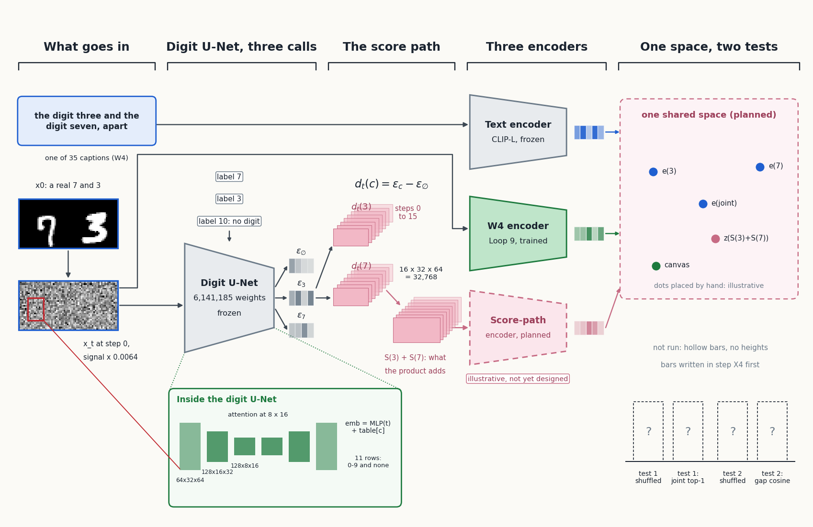
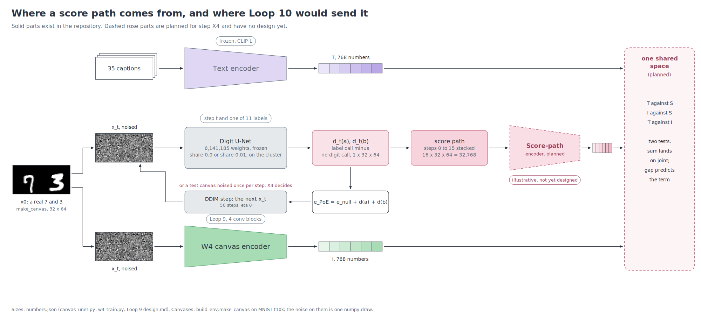
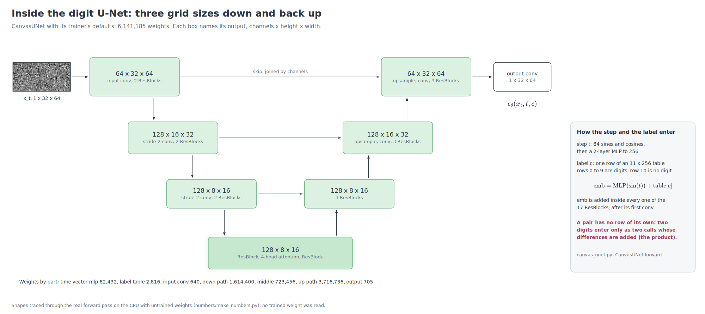
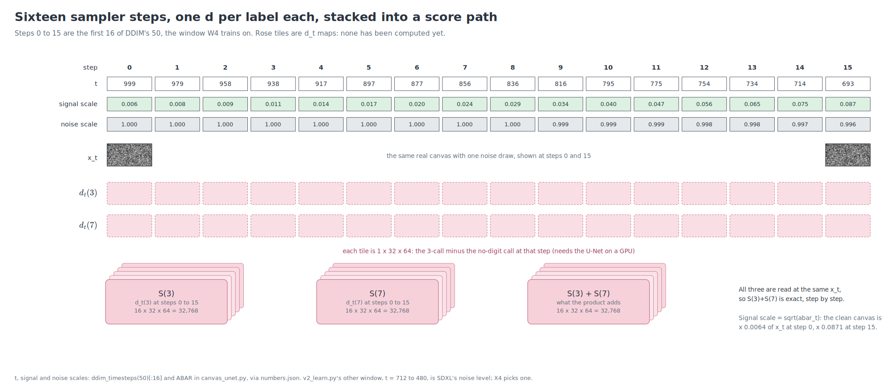
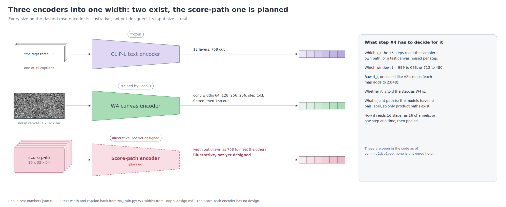
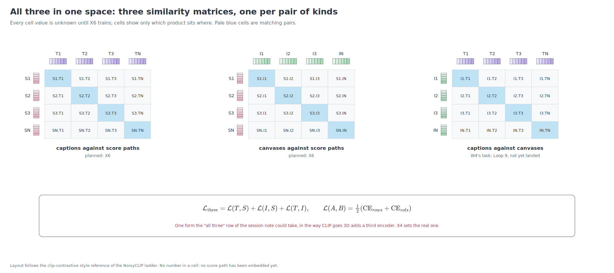
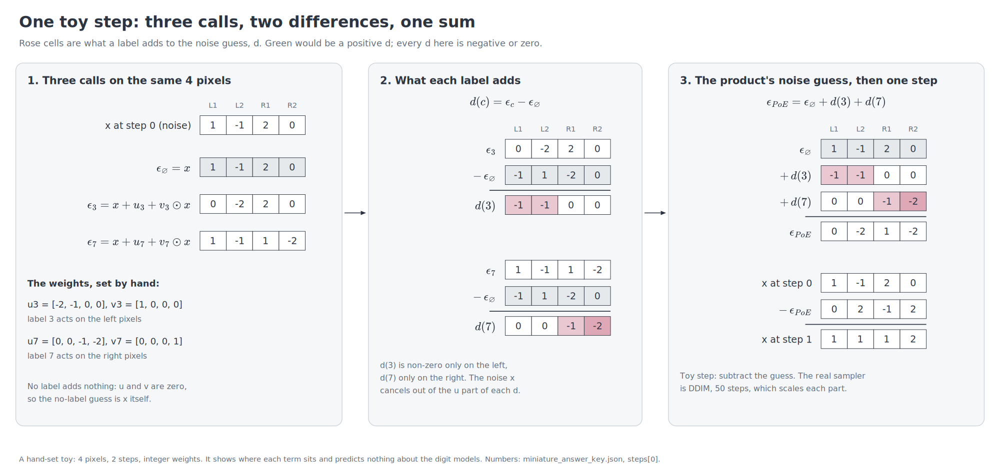
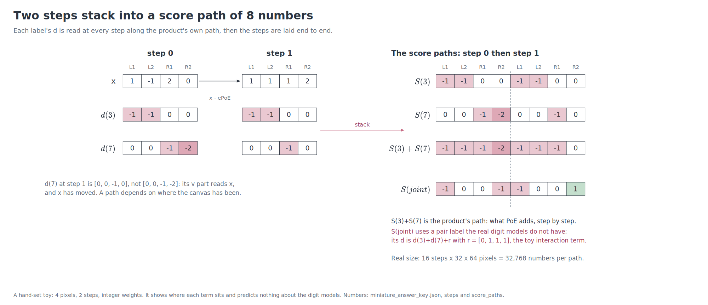
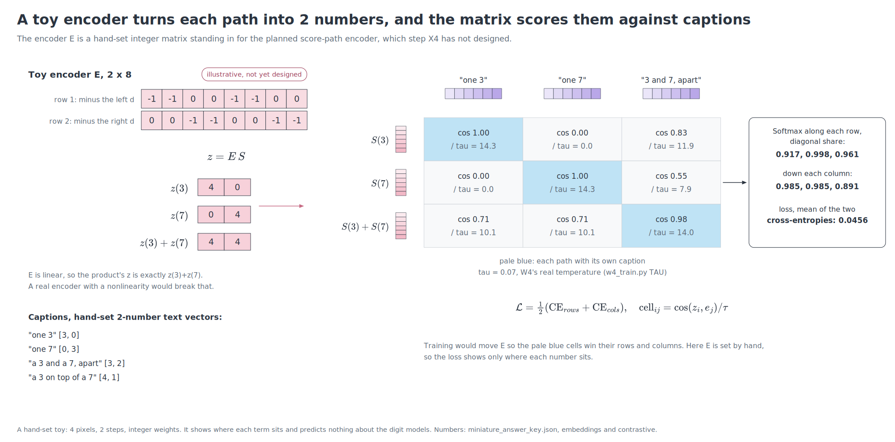
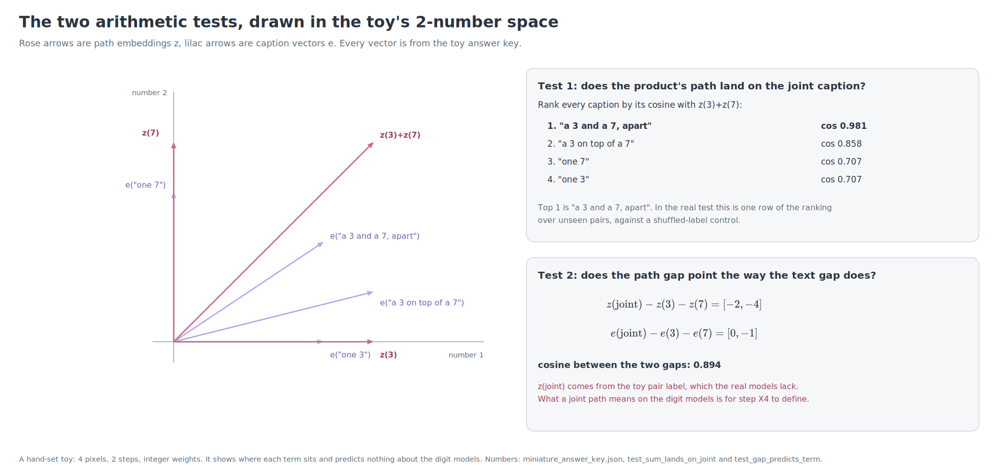

# The score path on digit canvases: a zoom ladder

Loop 10 asks whether a score path can share one contrastive space with captions and noisy canvases. This ladder shows what a score path is before any of that is designed: where it comes from in the digit model, its real size, and, in a 4-pixel toy, where $d_t$, the product's sum and a contrastive score each sit. The question itself is in [the session 10 prompt](../../prompts/session-10-the-score-path-as-a-third-space.md).

Read top to bottom. Solid parts on every figure exist in the repository and carry real sizes; dashed rose parts belong to the score-path encoder, which step X4 has not designed, and are marked "illustrative, not yet designed". Rose is the one colour this ladder adds to the NoisyCLIP ladder's key.

## Overview: one canvas and one caption, end to end

The canvas is real, built with V1's `make_canvas` from MNIST's test images. The noise on it is one numpy draw at step 0's real signal scale, 0.0064. The dots in the shared space are placed by hand and the four test bars are hollow, because nothing has run.

## Level 0: the system

[Where a score path comes from](0.5-network-view/sys0-where-the-score-path-sits.png): the frozen U-Net gives $d_t(a)$ and $d_t(b)$ at each step, sixteen steps stack into a path, and a planned encoder would send it to the space where CLIP-L's text vectors and Loop 9's W4 canvas vectors sit. The DDIM loop is drawn because $x_t$ can come from the product's own run or from a test canvas noised per step, and the code allows both. One sampler step with the product and a checker is already drawn in [where the two checkers sit](../../../../../2-classifier-guidance/artifacts/scenes/digit-map-checkers/0.5-network-view/dc0-where-the-checkers-sit.png), from the digit-map ladder, and is linked here instead of redrawn.

## Level 0.5: the network view

   

**The U-Net.** [Inside the digit U-Net](0.5-network-view/sp1-inside-the-digit-unet.png) opens the overview's grey trapezoid: 64 by 32 by 64 down to 128 by 8 by 16 with 4-head attention in the middle, 6,141,185 weights, and the step and label joined as one 256-number vector. The label table has 11 rows, so a pair is never one condition.

**Where $d_t$ comes from.** The three calls and the two subtractions are drawn in [where the two maps come from](../../../../../2-classifier-guidance/artifacts/scenes/digit-map-checkers/0.5-network-view/dc2-where-the-two-maps-come-from.png), from the digit-map ladder, which then scales each map to add to 2,048.

**The path.** [Sixteen steps make a score path](0.5-network-view/sp2-sixteen-steps-make-a-score-path.png) prints the real timesteps, 999 down to 693, and the clean canvas's share of $x_t$ at each, from 0.006 to 0.087. Its $d_t$ tiles are empty because this ladder computed none. The ten-label $d_t$ maps were computed by the step that read which digits are present, and [the score-path finding](../../../../../2-classifier-guidance/report/does-the-score-path-carry-which-digits-are-present.md) reports what they carry.

**The encoders.** [Three encoders into one width](0.5-network-view/sp3-the-planned-score-path-encoder.png) puts the planned score-path encoder beside the two that exist and lists what X4 must decide for it.

**The space.** [Three similarity matrices](0.5-network-view/sp4-three-spaces-three-matrices.png) shows where each product would sit if all three kinds share one space. No cell has a value.

## Level 2: the miniature

   

Four pixels, two steps and integer weights set by hand, computed by [the miniature script](2-miniature/miniature.py) into [its answer key](2-miniature/miniature_answer_key.json).

**$d_t$ and the product's sum** sit on [one toy step](2-miniature/mm1-one-step-three-calls.png): the no-label call returns $x$, the label 3 call changes the left pixels, and $d(3) + d(7)$ plus $\epsilon_\varnothing$ gives $\epsilon_{\mathrm{PoE}} = [0, -2, 1, -2]$.

**The score path** is [two steps laid end to end](2-miniature/mm2-two-steps-make-a-score-path.png). $d(7)$ changes between steps because its $v$ part reads the moving canvas.

**The contrastive score** sits on [the toy encoder and matrix](2-miniature/mm3-the-encoder-and-the-contrastive-score.png): each cell is a cosine divided by W4's real temperature 0.07, and the loss is the mean of the row and column cross-entropies, 0.0456.

**The two tests** are drawn in [the toy's 2-number space](2-miniature/mm4-the-two-tests-in-miniature.png): the product's path ranks "a 3 and a 7, apart" first, and the path gap and text gap have cosine 0.894. Both numbers come from hand-set weights and predict nothing.

## Level 3: the code

[The code walk](3-code/walk-the-digit-environment.md) quotes 16 blocks from `canvas_unet.py`, `v2_learn.py`, `w4_train.py` and `build_env.py` at commit `2dcb2beb`, each beside its equation, and `3-code/check_quotes.py` confirms every quote matches. It ends with what the code settles and what it leaves to X4.

## The close

[The score path, read through a small network](read-through-a-small-network.md): one sentence, the toy and real paths side by side, the miniature's equation, what the toy cannot say, and the session note's notation last. Symbols are in [the notation table](NOTATION.md).

Which numbers are real, which are illustrative, and what was skipped

**Real, with their source.** Every U-Net size, the weight count 6,141,185 and the weights by part come from building `CanvasUNet` on the CPU with untrained weights ([the numbers script](numbers/make_numbers.py), output in `numbers/numbers.json`, commit `2dcb2beb`). Timesteps 999 to 693 and their signal and noise scales come from `ddim_timesteps` and `ABAR`. The 35 captions, $\tau = 0.07$, CLIP-L's 768-number text vector and W4's widths 64, 128, 256 and 256 come from `w4_train.py` and Loop 9's W4 design. The held-out pairs come from `canvas_sheet.py`. The canvas is a real MNIST test canvas built by `make_canvas` ([its script](overview/make_canvas_3_7.py), indices in `overview/canvas-3-7.json`).

**Illustrative.** The noise draw on the canvas (numpy seed 10, not the sampler's own noise). Every size on the score-path encoder, including its 768-number output. The dots in the overview's shared space. Every number in the miniature, which is hand-set. The summed three-way loss in sp4, one possible form.

**Not computed here.** This ladder computed no $d_t$ map, no score path and no similarity score, because those need the U-Net's weights on a GPU. The ten-label $d_t$ maps were computed by the step that read which digits are present, in both windows, and [the score-path finding](../../../../../2-classifier-guidance/report/does-the-score-path-carry-which-digits-are-present.md) holds its verdict. No similarity score from the digit models exists, because steps X6 to X8, which would train a text-aligned reader of the path and test it, were dropped on board question 76.

**Older labels on four figures.** These figures are not redrawn and still carry labels from before the presence read. [Sixteen steps make a score path](0.5-network-view/sp2-sixteen-steps-make-a-score-path.png) draws only steps 0 to 15 (timesteps 999 to 693) and says no $d_t$ is computed yet; the own-encoder step judges steps 14 to 25, and the presence read used both windows. [The score-path encoder](0.5-network-view/sp3-the-planned-score-path-encoder.png), [the three similarity matrices](0.5-network-view/sp4-three-spaces-three-matrices.png) and [the overview](overview/ov0-the-score-path-as-a-third-space.png) mark the encoder and its tests as planned, and board question 76 dropped those steps.

**Skipped.** Level 1 (Codex image renders), by this loop's rule of no image-generation runs. The rebuild-from-fundamentals companion, which this loop's hand-back did not ask for. The route file under `plans/`, because this loop writes only inside this folder.

**The style.** Kept from [the NoisyCLIP ladder's record](../../../../../2-classifier-guidance/artifacts/scenes/noisyclip-sentence-score/ladder.json): the annotated-explainer overview and clip-contrastive deep dives, drawn with a copy of its `figure_kit.py`, whose crossing and overlap checks pass on every figure here. The new `score-path` family is in `score_path_family.py`, which registers itself with the skill's `style_samples.py` when imported; [its sample](style-sample-score-path.png) draws it in each style.

