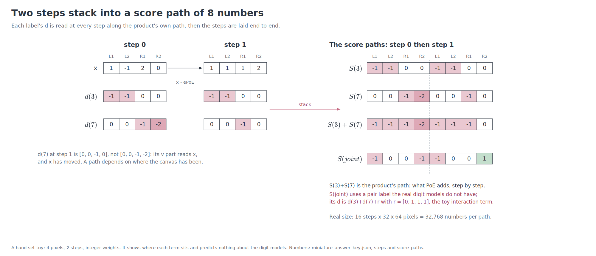
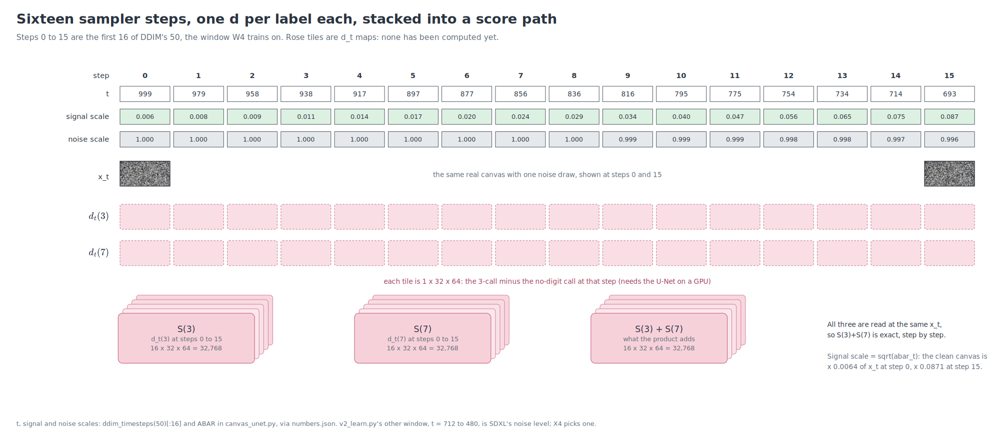

# The score path, read through a small network

**In one sentence.** At every sampler step the digit model is asked three times about the same noisy canvas (no digit, a 3, a 7), the two differences say what each digit label adds, and a score path is those differences kept for sixteen steps instead of being summed away.

## The pair of pictures

 

On the left, the miniature: 4 pixels and 2 steps, so a path is 8 numbers you can add by hand. On the right, the real thing: 2,048 pixels and 16 steps, so a path is 32,768 numbers that no run has computed yet.

## The simple equation

In the miniature, the model is $\epsilon(x, c) = x + u_c + v_c \odot x$, so

$$d(c) = u_c + v_c \odot x .$$

The $u$ part is the same wherever the canvas is. The $v$ part reads $x$, so $d(7)$ changes from $[0, 0, -1, -2]$ at step 0 to $[0, 0, -1, 0]$ at step 1 because the canvas moved. That is the one thing a score path carries that a single step does not: how what a label adds changes as the picture forms.

The toy encoder is one 2 by 8 integer matrix, so the product's path lands exactly on the sum of the two single paths, $z(3) + z(7) = [4, 4]$, and ranks the caption "a 3 and a 7, apart" first at cosine 0.98 against 0.86 for "a 3 on top of a 7" ([the two tests figure](2-miniature/mm4-the-two-tests-in-miniature.png)). A real encoder has nonlinearities, so on the digit models the sum is not guaranteed, and that is what step X8's first test measures.

## What the small network cannot say

**It is hand-set.** Every weight, caption vector and the encoder were chosen to show where each term sits. The toy's cosines of 0.98 and 0.89 predict nothing about the digit models.

**Its joint path uses a label the real models lack.** The toy has a "3 and 7" label whose $d$ is $d(3) + d(7) + r$. The digit models have 11 labels (0 to 9 and no digit), so on them a joint path has no definition yet, and the gap test cannot run until step X4 gives it one ([the code walk's last section](3-code/walk-the-digit-environment.md#what-the-code-settles-and-what-it-leaves-open)).

**It reads one trajectory.** The toy reads every $d$ along the product's own run. A path read on a test canvas noised once per step would give different numbers, and the code allows both.

## The source's notation, last

$$\epsilon_\theta(x_t, t, c), \qquad d_t(c) = \epsilon_\theta(x_t, t, c) - \epsilon_\theta(x_t, t, \varnothing), \qquad \epsilon_{\mathrm{PoE}} = \epsilon_\varnothing + d_t(a) + d_t(b)$$

$$S(c) = \big[\, d_{t_0}(c),\ d_{t_1}(c),\ \dots,\ d_{t_{15}}(c) \,\big] \in \mathbb{R}^{16 \times 32 \times 64}, \qquad t_k = \texttt{ddim\_timesteps(50)}[k]$$

$\epsilon_\theta$ is the frozen digit U-Net, $\varnothing$ is label 10, and $t_0 = 999$ down to $t_{15} = 693$ is the window W4 uses. $S(a) + S(b)$ is the product's path. A score-path encoder $f_S$ would map $S$ to a vector compared with the text vector $g(\text{caption})$ by $\cos(f_S(S), g(\text{caption}))/\tau$, with $\tau = 0.07$ if it follows W4; $f_S$ has no design yet.
