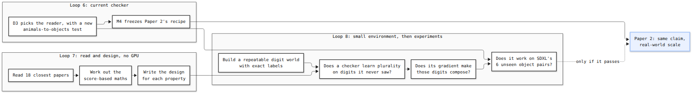
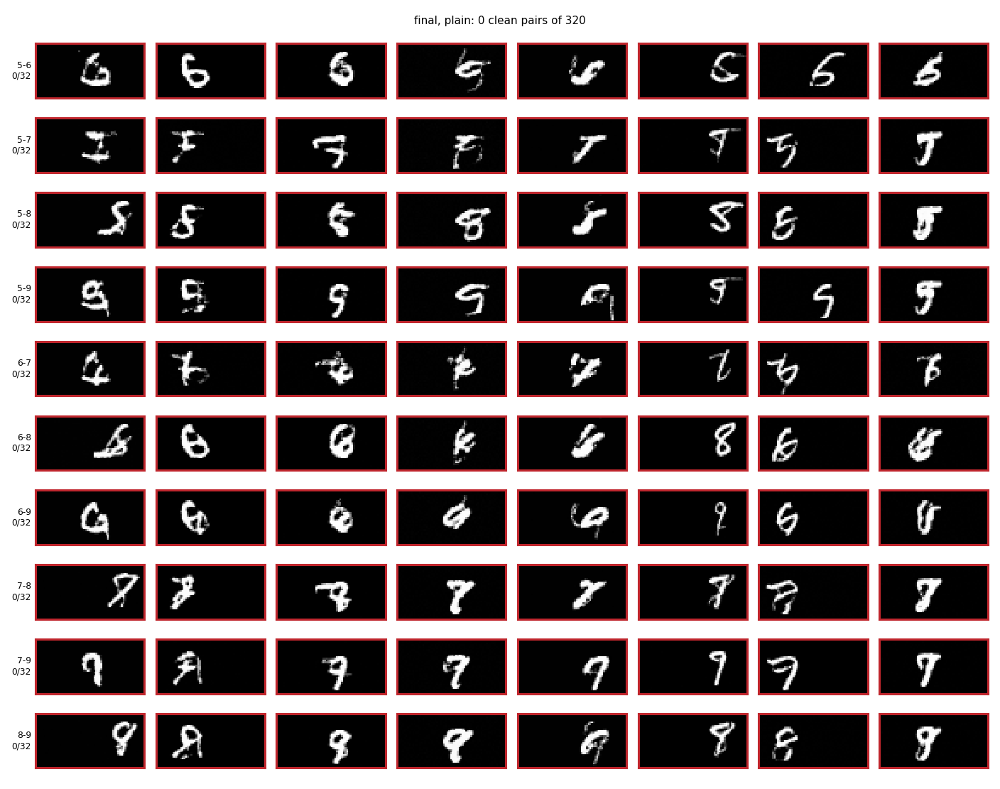
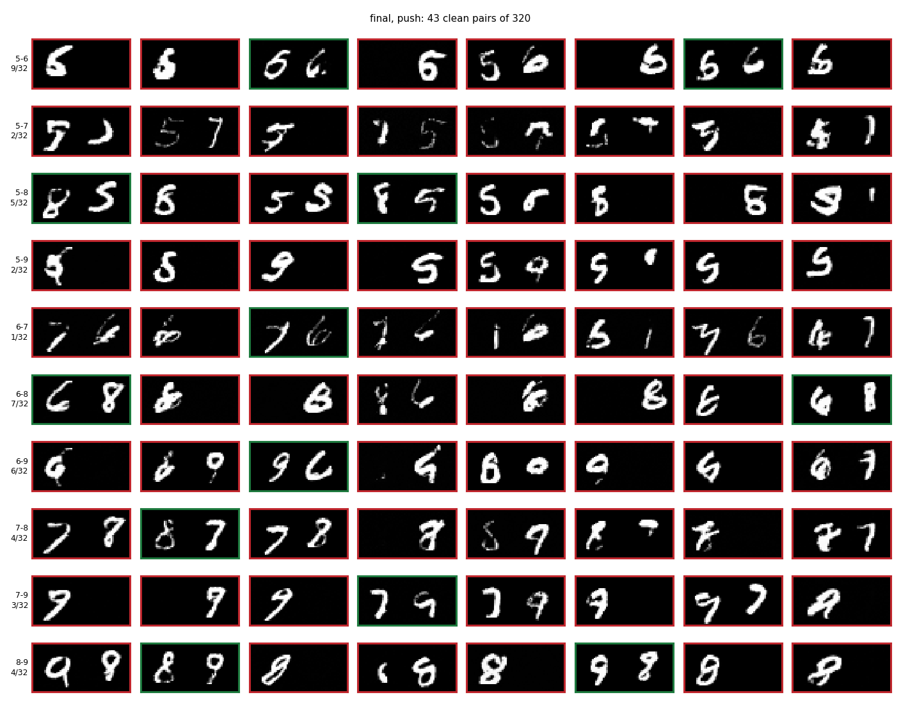
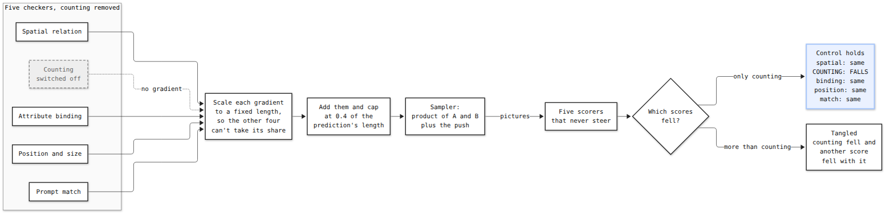

# Loop 8: a checker that learns a property across concepts, tested on digits

Loop 8 tests whether a small checker can learn a property that holds for any concept (first, two separate subjects) on concepts it never trained on, and whether its gradient then makes the product of experts compose. It serves the CO3 paper, which the board calls "Paper 2" and [the problem statements](../../problem-statements.md#paper-2-restoring-plurality-in-one-model) call restoring plurality in one model ([the session 8 brief](../../prompts/session-8-test-abstract-checkers.md)). Its owner code is `s8`. On 2026-11-24 the board (`python3 scripts/progress_board.py show`) has V1 small repeatable environment **done**, V2 checker learns plurality on unseen digits **done**, V3 its gradient composes unseen digits **done**, V5 remove-one-checker rehearsal on digits **doing**, and V4 abstract checker on SDXL's unseen objects **todo**, which also waits on Loop 6's step D3 (todo).

Loop 7 (`s7`, steps U1 to U3, all done) wrote the two files this loop tests: [the score view](../../abstract-checkers/02-score-view.md) and [the design](../../abstract-checkers/03-design.md). The picture above, from `artifacts/notes/progress/abstract-checkers/how-the-loops-fit.mmd`, does not show step V5.

## The idea

The checker never sees a concept's name or its appearance. It sees only where each asked concept acts on the noisy picture. On the digit toy, "where digit $a$ acts" is the size of the change that label $a$ makes to the frozen model's noise prediction at each pixel ([the design](../../abstract-checkers/03-design.md#what-it-reads-on-the-digit-toy)). The checker trains on digits 0 to 4, is tested on digits 5 to 9, and its gradient is then added to the product of the two digit labels while sampling. On SDXL the same checker would read each subject word's cross-attention map, train on animal pairs and be tested on six object pairs such as microscope × test tube ([the design](../../abstract-checkers/03-design.md#step-v4-does-it-work-on-sdxls-unseen-objects)).

**A real example**

Asked for 5 and 6 on a 32 by 64 canvas, the plain product draws one fused glyph. Over the 10 pairs among digits 5 to 9 at 32 seeds each, it draws one blob on 297 of 320 canvases. With the count checker's push, 161 canvases hold two separate digits and 43 are clean pairs (two clear, right digits, one per half), and the pair 5 and 6 gives 9 clean pairs of 32 ([the V3 review](../../abstract-checkers/06-does-it-compose/review.md#what-the-push-does-to-a-canvas)).

| Plain product, digits 5 to 9 | With the count checker's push |
|---|---|
|  |  |
| 0 clean pairs of 320 | 43 clean pairs of 320 |

**The digit environment Loop 10 builds on**

| Fact | Value | Source |
|---|---|---|
| Canvas | 32 by 64 pixels, one greyscale channel, holding pasted 28 by 28 MNIST digits | `H, W, D = 32, 64, 28` in [the build script](../../../../../2-classifier-guidance/scripts/abstract_checkers/build_env.py) and [the canvas code](../../../../../2-classifier-guidance/scripts/mnist/canvas_sheet.py); [the V1 design](../../abstract-checkers/04-environment/design.md) |
| What the canvas can express | count, right digits and left-right order. A digit fills 28 of 32 rows, so position, size and above-below have no room, and grey digits carry no colour to bind | [the digit rehearsal](../../abstract-checkers/03-design.md#the-digit-rehearsal) |
| Splits | `train`: digits 0 to 4, their 10 pairs, 20,000 canvases from the MNIST training file. `seen_test`: the same 10 pairs, 2,000 canvases from the MNIST test file. `unseen_test`: the 10 pairs among digits 5 to 9, 2,000 canvases from the test file. No digit 5 to 9 enters `train`, and pairs mixing the two ranges appear in no split | [the V1 design](../../abstract-checkers/04-environment/design.md#the-data) |
| Canvas kinds per asked pair | `apart` (4 of 8): both asked digits, one per half. `overlaid`, `same_half`, `single` and `wrong` (1 of 8 each). `wrong` holds one asked digit and a different digit apart from it, so only the asked pair decides its label | [the V1 design](../../abstract-checkers/04-environment/design.md#the-data) |
| Data hash | `f70b0fb362e13e255ad332ba14ca93dfb5cf051a5dfd3c86eb30482931d5a5f3`, identical on two rebuilds on the laptop and on the cluster. The data sits at `/datasets/mmolefe/poe_repair_min/loop-8/v1/data/` | [the V1 review](../../abstract-checkers/04-environment/review.md) |
| Digit model `share-0.0` | `/home-mscluster/mmolefe/poe_repair_min_scratch/mnist-canvas/models/share-0.0/unet.pt`. One class-conditional U-Net, 40,000 training steps, label 10 is the null label. It saw one digit per canvas, of any digit 0 to 9, and never two digits on one canvas. Each example's label is replaced by the null label 10% of the time | [the V1 design](../../abstract-checkers/04-environment/design.md#run-settings); `training_batch` in [the canvas model](../../../../../2-classifier-guidance/scripts/mnist/canvas_unet.py), lines 134 to 163; [the MNIST canvas review](../../../../../2-classifier-guidance/plans/review/a2b-mnist-digits-on-a-canvas.md#words-this-file-uses) |
| Digit model `share-0.01` | `/home-mscluster/mmolefe/poe_repair_min_scratch/mnist-canvas/models/share-0.01/unet.pt`. Same recipe and 40,000 steps, with two digits on 1% of its training canvases. The two-digit canvases come from the 40 pairs outside the five held-out pairs (0 and 3, 1 and 9, 3 and 4, 3 and 6, 4 and 7), so it saw all 10 pairs among digits 5 to 9 together. A two-digit canvas gives one training example per digit, labelled with that digit | [the V3 design](../../abstract-checkers/06-does-it-compose/design.md#what-this-cannot-say); [the MNIST canvas review](../../../../../2-classifier-guidance/plans/review/a2b-mnist-digits-on-a-canvas.md#words-this-file-uses), its run table row "Three U-Nets at shares 0, 0.01, 0.1"; [the canvas model](../../../../../2-classifier-guidance/scripts/mnist/canvas_unet.py), lines 140 to 144 |
| Sampler | DDIM, 50 steps, eta 0, timesteps evenly spaced from 999 to 0 out of 1,000. The product is $\epsilon_\varnothing + g\sum_\text{labels}(\epsilon_\text{label} - \epsilon_\varnothing)$ at $g = 1$ | `ddim_timesteps` and `product_eps` in [the canvas model](../../../../../2-classifier-guidance/scripts/mnist/canvas_unet.py); [the V1 design](../../abstract-checkers/04-environment/design.md#run-settings) |
| Noise at sampler steps 0 to 15 | timesteps 999 to 693, where the signal share $\bar\alpha$ runs from 0.00004 to 0.0076. SDXL's steps 0 to 15 have the $\bar\alpha$ of toy timesteps 712 to 480 (0.0058 to 0.0949), which are toy sampler steps 14 to 25 | [the V2 review](../../abstract-checkers/05-does-it-learn/review.md#the-result); [the V2 design](../../abstract-checkers/05-does-it-learn/design.md#the-rehearsal-at-sdxls-noise-level-board-question-64) |
| Judge | `judge-v3/judge.pt` through `two_experts.call_two`. A clean pair needs each digit called at confidence 0.9 | [the V3 design](../../abstract-checkers/06-does-it-compose/design.md#run-settings-for-test-1); [the V3 review](../../abstract-checkers/06-does-it-compose/review.md#what-this-cannot-say) |
| The trained count checker | `/datasets/mmolefe/poe_repair_min/loop-8/v2/count-final/count-head-map.pt`, W&B `tyhrpyov` | [the V3 design](../../abstract-checkers/06-does-it-compose/design.md#words-this-uses) |

## The principle

Two separate subjects look the same in where-each-concept-acts maps whatever the concepts are, so a checker that sees only those maps has nothing concept-specific to memorise, and it should carry over to concepts it never saw ([the design](../../abstract-checkers/03-design.md#what-every-checker-shares); [the session 8 brief](../../prompts/session-8-test-abstract-checkers.md#background)). The maps carry little appearance, so the checker moves layout, and the product's own labels have to supply which concepts appear ([the design](../../abstract-checkers/03-design.md#what-this-design-cannot-say); [the V3 review](../../abstract-checkers/06-does-it-compose/review.md#what-the-push-does-to-a-canvas)).

The push rests on a noisy classifier's gradient adding to the sampler's score. The checker estimates the label probability for its own training pictures, and the product it steers is a different distribution, so [the score view](../../abstract-checkers/02-score-view.md#step-3-what-a-classifiers-gradient-adds) calls the push "a useful tilt with no exactness guarantee". Several checkers' logs add exactly only when each checker trains on pictures that pass the earlier ones ([Step 7](../../abstract-checkers/02-score-view.md#step-7-the-chain-rule-removes-the-assumption)), and removing one leaves the others unchanged only when each has its own fixed length ([Step 8](../../abstract-checkers/02-score-view.md#step-8-the-cap-couples-the-checkers)).

## The theory, with its equation

The two inputs on the digit toy, from [the design](../../abstract-checkers/03-design.md#what-it-reads-on-the-digit-toy):

$$
m_a = \frac{|\epsilon_a - \epsilon_\varnothing|}{\sum_p |\epsilon_a - \epsilon_\varnothing|_p}, \qquad m_b = \frac{|\epsilon_b - \epsilon_\varnothing|}{\sum_p |\epsilon_b - \epsilon_\varnothing|_p}
$$

The push, with each checker's gradient scaled to a fixed length, from [the design](../../abstract-checkers/03-design.md#how-the-push-is-computed):

$$
\hat\epsilon_t = \epsilon_{\text{product}} - \lVert\epsilon_{\text{product}}\rVert \sum_{k} b\,\frac{\nabla_{x_t}\ell_k}{\lVert\nabla_{x_t}\ell_k\rVert}, \qquad b = \frac{0.4}{\sqrt{K\,\big(1 + (K-1)\,\bar\rho\big)}}
$$

- $\epsilon_a$, $\epsilon_b$: the frozen model's noise prediction at $x_t$ under asked label $a$ or $b$. Changing $a$ moves $m_a$ to wherever that digit's label changes the prediction.
- $\epsilon_\varnothing$: the prediction under the null label 10. It is subtracted, so $m_a$ holds only what the label adds.
- $\sum_p$: the sum over the 2,048 pixels, so each map adds to 1. A strong and a weak response with the same shape give the same map. The V2 run multiplies each map by 2,048 before the network ([the V2 design](../../abstract-checkers/05-does-it-learn/design.md#run-settings)).
- $\epsilon_{\text{product}}$: the plain product of the two labels' predictions. Its norm sets the push's scale, so a bigger prediction gets a proportionally bigger push.
- $\ell_k$: checker $k$'s logit. Its gradient passes through the checker, the two maps and the frozen model's three calls ([the V3 design](../../abstract-checkers/06-does-it-compose/design.md#run-settings-for-test-1)). Only the direction survives the division by its norm.
- $b$: the push length as a fraction of $\lVert\epsilon_{\text{product}}\rVert$. At $b = 0$ the sampler is the plain product. On the seen pairs, clean pairs of 320 went 0, 8, 20 and 40 at $b$ of 0, 0.1, 0.2 and 0.4 ([the V3 review](../../abstract-checkers/06-does-it-compose/review.md#choosing-the-push-length)).
- $K$: the number of checkers pushing at once. One checker gives $b = 0.4$, and three in V5 give a smaller $b$ each.
- $\bar\rho$: the mean pairwise cosine of the checkers' gradients, clipped at 0. As the gradients align, $\bar\rho$ rises and $b$ falls, keeping the average total length near 0.4.
- $t$: the pushed steps. The design pushed sampler steps 0 to 15. V3 pushed sampler steps 15 to 25 (timesteps 693 to 489), where the checker had trained ([the V3 design](../../abstract-checkers/06-does-it-compose/design.md#run-settings-for-test-1)).

**Where the picture and the design differ.** [The removal-test picture](../../abstract-checkers/remove-one-checker.png) draws a box "Add them and cap at 0.4 of the prediction's length" after the per-checker scaling. [The design](../../abstract-checkers/03-design.md#how-the-push-is-computed) says "No shared cap runs", and voids a row whose total length passes 0.6 of the product's norm on more than 5% of pushed steps. Both stand as written.

## The objective, with its bar

Each step's measured quantity, then its bar copied from the design file that recorded it before the run.

| Step | Measured quantity, scale and direction | Bar as recorded | Source |
|---|---|---|---|
| V1 | the data hash over two rebuilds; the largest absolute pixel difference between the plain sampler and the zero push, lower is better | "two rebuilds print the same data hash, and the largest absolute pixel difference between the plain sampler and the zero push is under 1e-5 on all 20 pairs at 8 seeds, in one process on one card and dtype" | [the V1 design](../../abstract-checkers/04-environment/design.md#what-counts-as-a-result) |
| V2, as designed | balanced accuracy, the mean of the share of label-1 and of label-0 canvases called right, 0 to 1, 0.5 is chance, higher is better | "Map reader on `unseen_test`: balanced accuracy over steps 0 to 15 at least 0.75 and within 0.05 of `seen_test`, and at least 0.75 on `apart` against `wrong`" | [the V2 design](../../abstract-checkers/05-does-it-learn/design.md#what-counts-as-a-result); `MIN_BA`, `MAX_GAP` and `MIN_APART_WRONG` in [the V2 script](../../../../../2-classifier-guidance/scripts/abstract_checkers/v2_learn.py) |
| V2, the count checker's read (board question 69) | the same balanced accuracy, at the 16 toy timesteps matching SDXL's noise (712 down to 480), with `apart` and `wrong` as label 1 | "The map reader on `unseen_test`: balanced accuracy at least 0.75, and within 0.05 of `seen_test`" | [the V2 design](../../abstract-checkers/05-does-it-learn/design.md#reading-digits-5-to-9-with-the-count-checker-board-question-69) |
| V3 | clean pairs of 320 on the 10 unseen pairs at seeds 1000 to 1031, by the judge, higher is better; standard errors from 10,000 bootstrap resamples of the 10 pairs | "The checker's push beats the plain product by more than 1.96 standard errors, and the random push does not" | [the V3 design](../../abstract-checkers/06-does-it-compose/design.md#run-settings-for-test-1) |
| V5 | per removal row, three judge scores in a chain: share with two separate digits; of those, share with both asked digits; of those, share in the asked order. Percentage points, higher is better | "All three checkers together beat the plain product on the full chain by more than 1.96 standard errors. Each removal lowers its own column by at least 6.25 percentage points and more than 1.96 standard errors, its random-push row falls by the same rule, and no other column moves by both more than 4.2 points and more than 1.96 standard errors" | [the digit rehearsal](../../abstract-checkers/03-design.md#the-digit-rehearsal) |
| V4 | faithful pairs of 48 on the six SDXL object pairs at seeds 6001 to 6008, by the blind count rubric at full size, higher is better | "The push leads plain PoE by at least 3 of 48 faithful pairs and by more than 1.96 standard errors over 10,000 bootstrap resamples of the six pairs" | [the design](../../abstract-checkers/03-design.md#step-v4-does-it-work-on-sdxls-unseen-objects) |

## Where it stands

GPU-hours spent: 5.72 of the loop's 30 ([the V3 review](../../abstract-checkers/06-does-it-compose/review.md)). None of these results is on [the void list](../../void-list.md) as of 2026-11-24.

**V1, done: passed**

Two rebuilds give the identical data hash on the laptop and on the cluster. The zero push and a repeat of the plain sampler each differ from the plain sampler by 0.0 in the largest absolute pixel difference, against a bar of 1e-5, on 20 pairs at 8 seeds. W&B `xv6mbklb` ([the V1 review](../../abstract-checkers/04-environment/review.md)).

**V2, done on the board: the review's status line reads "null"**

The review's first line is "Status: null", and the same paragraph says the count checker then passes on digits 5 to 9. The board marks V2 done with the note "Count checker 0.791 on digits 5 to 9 vs 0.782 on 0 to 4 (bar 0.75, gap 0.009), W&B tyhrpyov; identity checker missed at 0.555". The board's proof for V2 reads "over steps 0 to 15", and the count checker was read at toy timesteps 712 to 480, which are toy sampler steps 14 to 25. Both sources are reported as written. All numbers below are balanced accuracy, 0 to 1, where 0.5 is chance ([the V2 review](../../abstract-checkers/05-does-it-learn/review.md)).

| Read | Map reader | Raw reader (reads the canvas, told the asked digits) | Verdict recorded |
|---|---|---|---|
| Designed checker on digits 5 to 9, toy steps 0 to 15, W&B `a562r799` | 0.540 (bar 0.75); gap to digits 0 to 4 0.0002 (bar 0.05); `apart` against `wrong` 0.501 (bar 0.75) | 0.500; it did not train (final loss 0.6931, label 0 on every read) | null |
| Rehearsal at SDXL's noise, pairs holding digit 4 | 0.704 (bar 0.75); `apart` against `wrong` 0.511 (bar 0.75) | 0.713; 0.514 | miss |
| Count checker, pairs holding digit 4 | 0.774 (bar 0.75), gap 0.007 | 0.775 | pass |
| Identity checker (`apart` against `wrong` only), pairs holding digit 4 | 0.555 (bar 0.75) | 0.556 | miss |
| Count checker on digits 5 to 9, W&B `tyhrpyov` | 0.791 against 0.782 on digits 0 to 4, gap 0.009 (bar 0.75, gap at most 0.05) | 0.754, gap 0.033 | support |

The count checker on digits 5 to 9 rises from 0.63 at the noisiest pushed step to 0.92 at the least noisy, and each of the 10 unseen pairs scores between 0.77 and 0.81. The identity checker rises from 0.48 to 0.65 across the same window, and the review puts the limit on "the noise level and the training data and not the maps", because the raw reader scores the same ([the V2 review](../../abstract-checkers/05-does-it-learn/review.md#two-checkers-at-sdxls-noise-level)).

**V3, done: support**

On the 10 pairs among digits 5 to 9, using `share-0.0` and $b = 0.4$, W&B `qhusod91` ([the V3 review](../../abstract-checkers/06-does-it-compose/review.md#the-result)):

| Row, 320 canvases | Clean pairs | Two separate digits, any identity | Lead over plain, standard error |
|---|---:|---:|---|
| Plain product | 0 | 3 | |
| Count checker's push | 43 | 161 | 43, standard error 7.58 |
| Random push of the same length | 1 | 4 | 1, standard error 0.96 |
| Best of 4 starting seeds, picked by the checker | 0 | 2 | |

The zero push differs from plain by 0.0 (bar under 1e-5). The push also raises damaged canvases from 0 to 12. Test 2, on `share-0.01`, does not run, because Test 1 passed.

**V5, doing: no result yet**

`artifacts/notes/progress/abstract-checkers/08-remove-one-checker/` did not exist when this page was written at 08:23 on 2026-11-24, so there is no design or review file. The rehearsal as Loop 7 designed it runs eleven rows of 320 canvases on the 10 unseen pairs, with three checkers (count, right digits, left-right order), on `share-0.0` because V3 passed Test 1 ([the digit rehearsal](../../abstract-checkers/03-design.md#the-digit-rehearsal)). Its right-digits checker trains on `apart` against `wrong`, the same task V2's identity checker missed at 0.555 (inferred link between the two).

**V4, todo: no result yet**

It waits on V3 (done) and on Loop 6's D3 (todo) ([the board](../../board.json)). When it runs it reports against plain PoE and against CO3 alone, and Loop 6's step M8 compares this count checker with Loop 6's own ([the session 8 brief](../../prompts/session-8-test-abstract-checkers.md#objectives)).

## The closest papers from the reading

**[Diffusion Sampling Path Tells More](../01-reading/sampling-path-tells-more.md)** reads the per-step norm of the conditional minus unconditional prediction at a shared $x_t$ ([p. 5](https://arxiv.org/pdf/2505.23343#page=5)), which is exactly the size that Loop 8's maps divide away. Keeping 4 of 50 seeds by the summed early norm lifts SD1.5's GenEval two-object score from 0.354 to 0.518 ([p. 8](https://arxiv.org/pdf/2505.23343#page=8)), where Loop 8's best of 4 seeds picked by its checker found 0 clean pairs of 320.

**[NoiseCLR](../01-reading/noiseclr.md)** trains on the divergence $\epsilon_\theta(x_t, d_k) - \epsilon_\theta(x_t, \phi)$ ([p. 5](https://arxiv.org/pdf/2312.05390#page=5)), the signed form of Loop 8's map before the absolute value and the division. Loop 8 tried signed differences as one of its three named variations, and on the inner test it scored 0.495 on `apart` against `wrong` ([the V2 review](../../abstract-checkers/05-does-it-learn/review.md#the-inner-test)).

**[Your Diffusion Model is Secretly a Zero-Shot Classifier](../01-reading/diffusion-classifier.md)** finds single-timestep class accuracy peaks at middle noise, near $t = 500$, and is weak near $t = 1000$ ([p. 4](https://arxiv.org/pdf/2303.16203#page=4)). Loop 8's identity checker read digit identity at 0.48 to 0.65 between toy timesteps 712 and 480, and its count checker read layout well over the same window.

**[Composable Diffusion](../01-reading/composable-diffusion.md)** samples the same sum of conditional minus unconditional predictions that the toy's plain product uses, and lists fused hybrids, "usually" when objects are in the centre, as its failure ([p. 13](https://arxiv.org/pdf/2206.01714#page=13)). The toy's plain product draws one blob on 297 of 320 unseen canvases.

## What it suggests for the separate-experts paper

That paper's method adds a trained checker $C_t(\text{both concepts present}\mid x_t)$ to the merged experts ([the problem statements](../../problem-statements.md#paper-1-composing-experts-that-never-met)). V3 is the nearest evidence in this loop: a checker that never saw digits 5 to 9 pushed a model that never saw two digits on one canvas from 0 to 43 clean pairs of 320, and choosing among plain samples by the same checker found none. This suggests the paper keep a checker that reads only where each expert's label acts, trained on concept pairs other than the test pair, so it never needs a joint image (inferred). The toy has one model and one null prediction, and two experts trained apart have two null predictions, so each map would subtract its own expert's null (inferred, untested). The push moved layout far more than identity (161 two separate digits, 43 right), so in this paper identity has to come from each expert, which fits a setting where each expert holds one concept (inferred). The push also needs to sit at noise levels where the checker reads, since at toy timesteps 999 to 693 the designed checker read at chance (inferred from V2). A score-path representation could keep the size of each expert's effect across steps, which the maps discard and which Sampling Path Tells More uses to rank seeds, and could then pick a placement before the push starts (inferred).

## What it suggests for the CO3 paper

V4 has not run, so nothing here is measured on SDXL. The digit results suggest the paper keep count and identity as two separate checkers, because one plurality checker learned layout and stayed at chance on which digits, while a split count checker passed and an identity checker missed at SDXL-matched noise (inferred from V2). SDXL's steps 0 to 15 match the toy's timesteps 712 to 480 by signal share, where the count checker read 0.63 to 0.92, so a count push on SDXL's earliest steps has a chance of reading something, though the V2 review notes that equal signal share in pixels and in SDXL's latents is not equal difficulty (inferred). CO3 already draws two bodies in all 96 tuning pictures and fails on borrowed parts, wrong species and extra subjects ([the design](../../abstract-checkers/03-design.md#the-question-head-binding-and-the-right-identity)), so a count push alone targets a failure CO3 rarely makes, and its likely gain is on the plain product (inferred). The fixed length per checker and the chained training from the score view should stay in any multi-checker push. Identity is the open half: at these noise levels it was unreadable from one step's map and from the raw canvas, and whether a stack of steps (a score path) holds identity that one step loses is untested, which makes it a question for Loop 10's step X5 (inferred).
