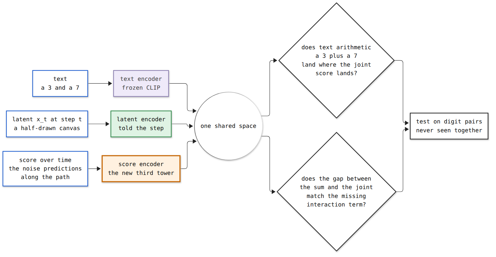
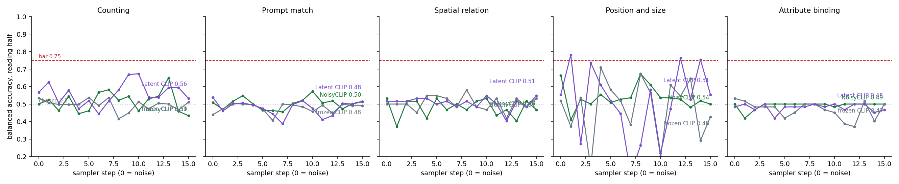
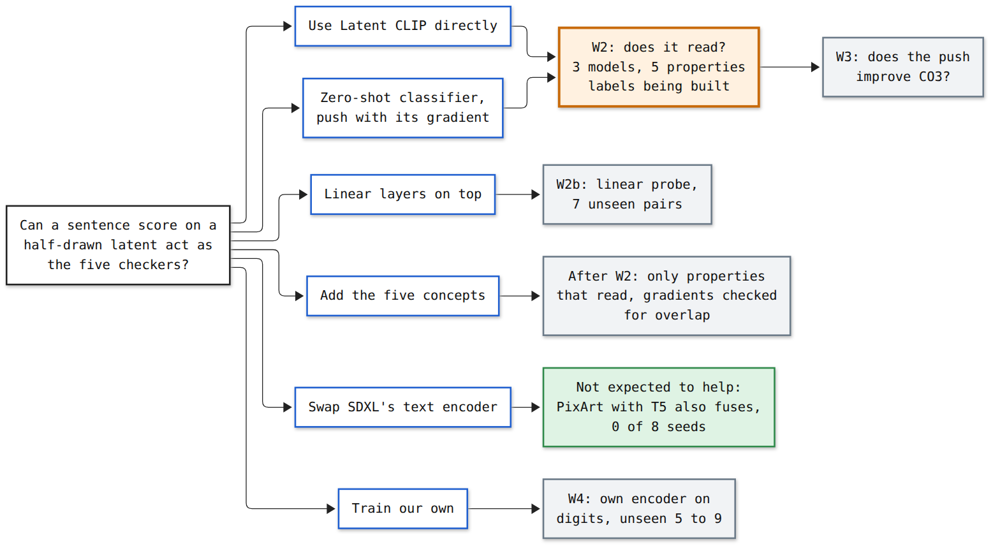

# Loop 9, turn concepts into scores: a sentence score on a half-drawn latent as the checker

Loop 9 tests whether a noise-aware text and image model can stand in for the five abstract checkers (counting, prompt match, spatial relation, position and size, attribute binding) by scoring a half-drawn latent against a right and a wrong sentence, so that the score's gradient becomes the CO3 paper's push ([the session prompt](../../prompts/session-9-turn-abstract-concepts-into-scores.md)). Its owner code is `s9`. On the board today W1, W1b and W2 are done, W2c is in progress, W2b, W2d and W4 are ready to start, and W3 and W5 are waiting ([the board](../../board.json)). The board marks W2d as serving both papers and every other step as serving the CO3 paper.

## The idea

A sentence score is the cosine between a latent's image vector and one sentence's text vector, and the loop's checker score is the right sentence's cosine minus the highest wrong sentence's cosine ([the W2 design](../../noise-text-critic/02-can-it-read/design.md#words-this-uses)). On SDXL's cat and dog latents from `2-classifier-guidance/scripts/rung2/eval_set_catdog_v2.json`, counting is read as "a photo of a cat and a dog, two separate animals" against "a photo of one animal" and "one animal that is part cat and part dog" ([the W2 sentences](../../noise-text-critic/02-can-it-read/design.md#the-sentences)). Three readers are tried on the same pictures: NoisyCLIP (CLIP ViT-L/14 with its image side tuned on noisy SDXL latents), frozen CLIP ViT-L/14, and Latent CLIP. Each finished latent is noised back to steps 0 to 15 of SDXL's 50, the steps where the push would act.

If a score reads a property early, W3 adds its gradient to CO3 on the 12 tuning pairs at a fixed length ([the W3 design](../../noise-text-critic/03-does-it-steer/design.md)). W4 trains the loop's own reader on digit canvases instead: a small image encoder for noisy 32 by 64 pixel canvases, trained against the frozen CLIP text encoder on captions such as "the digit three and the digit seven, apart", then tested on digits 5 to 9, which no training canvas or caption contains ([the W4 design](../../noise-text-critic/04-train-our-own/design.md)).

The loop's sketch of the three-way space ([its source](../../noise-text-critic/three-way-space-idea.mmd)) puts W4's text-and-canvas pair as two of three towers. The third tower, the score-path encoder, belongs to Loop 10 by the owner's choice of 2026-11-24, and Loop 10's training waits for W4's model ([the session prompt](../../prompts/session-9-turn-abstract-concepts-into-scores.md#what-is-already-known)).

**W4's design, recorded in full because Loop 10 reuses it.** Every line below is from [the W4 design](../../noise-text-critic/04-train-our-own/design.md) unless it names `2-classifier-guidance/scripts/noise_text_critic/w4_train.py`.

**Data.** Step V1's `dataset.npz` under `/datasets/mmolefe/poe_repair_min/loop-8/v1/data/`, refused unless its hash is in `DATA_HASHES` in `abstract_checkers/v2_learn.py`. Split `train` holds 20,000 canvases of digits 0 to 4, `seen_test` 2,000 canvases of digits 0 to 4, and `unseen_test` 2,000 canvases of digits 5 to 9, read once after everything is frozen. The five canvas kinds and labels are V1's: `apart` is label 1, and `overlaid`, `same_half`, `single` and `wrong` are label 0.

**Captions.** One true caption per canvas. Two separate digits, one per half (`apart`, `wrong`): "the digit three and the digit seven, apart". Both digits on one spot (`overlaid`): "the digit three on top of the digit seven". Both digits in one half (`same_half`): "the digit three and the digit seven on the same side". One digit (`single`): "one digit three". In every two-digit caption the lower digit is named first, so a caption says nothing about left and right. The training bank holds only captions naming digits 0 to 4, which by the script's `all_captions` comes to 35 captions (5 single-digit captions plus 3 forms for each of the 10 pairs; computed from the code).

**Reading an asked pair (a, b).** The right sentence is "the digit a and the digit b, apart". The wrong sentences are "one digit a", "one digit b", "the digit a on top of the digit b", "the digit a and the digit b on the same side", and, for every other digit c from zero to nine, "the digit a and the digit c, apart" and "the digit b and the digit c, apart".

**Encoders.** Text: the frozen text encoder and text projection of `openai/clip-vit-large-patch14`, one 768-number vector per sentence. Image: four convolution blocks of widths 64, 128, 256 and 256, each with group normalisation and a SiLU activation, halving the grid after each block. A learned embedding of the step index shifts and scales each block's features. The final grid is flattened, so left and right stay distinct, and a linear layer gives a 768-number vector. In the script the step embedding has 128 numbers, the group normalisation uses 8 groups, and the output is normalised to unit length (`w4_train.py`, `FilmBlock` and `NoisyDigitEncoder`).

**Training.** 8,000 updates at batch 256 with Adam at learning rate 2×10⁻⁴. Each example draws a canvas and one of the 16 timesteps `ddim_timesteps(50)[:16]`, then noises the canvas to it. These settings are fixed, and no variation is tried after the unseen split is read.

**Scoring.** Each test canvas is read at each of the 16 steps with 4 noise draws, and its checker score is averaged over the draws. Each step's threshold is chosen on the even-indexed half of each `seen_test` pair, the seen score is read on the odd-indexed half, and the same thresholds are applied once to all of `unseen_test`.

**State.** W4 is `todo` and ready on the board. Its design exists and its script and job file exist (`w4_train.py`, `w4.sbatch`). No `04-train-our-own/review.md` exists, so W4 has no result.

## The principle

The loop rests on one assumption: that a model trained to match text with latents keeps enough of CLIP's text space for a right-minus-wrong cosine to read a property from a half-drawn latent, and that the gradient of that cosine points toward pictures with the property ([the session prompt](../../prompts/session-9-turn-abstract-concepts-into-scores.md#background)). NoisyCLIP's paper is the reason to expect the reading: it tunes only the image side on SDXL latents 20 to 29 of a 50-step run and keeps the text side frozen ([the NoisyCLIP note](../../noise-text-critic/01-reading/noisyclip.md), p. 6).

The text side bounds what any such reader can do. A text-only check on CLIP ViT-L/14's text encoder found colour binding carried (ratio 0.72, on a scale where 0 means a pure sum of word slots and 1 means the whole swap survives) and left-right order carried weakly (ratio 0.28) ([the word check](../../noise-text-critic/02-can-it-read/review.md#text-only-word-check)).

W4 adds a second assumption: that the frozen text vectors for "seven" or "nine" carry enough about digit shape for an image encoder trained only on 0 to 4 to line up with them. Its design lists a pass on `apart` against `wrong` for unseen digits as the result that would surprise ([the W4 design](../../noise-text-critic/04-train-our-own/design.md#the-bars)).

## The theory, with its equation

The push W3 adds to CO3, as [the W3 design](../../noise-text-critic/03-does-it-steer/design.md#how-the-push-enters-co3) writes it:

$$
p_t = b\,\lVert\epsilon_g\rVert\,\frac{\nabla_{x_t} D(x_t)}{\lVert\nabla_{x_t} D(x_t)\rVert}, \qquad \hat\epsilon_g = \epsilon_g - p_t, \qquad \hat\epsilon_u = \epsilon_u - p_t
$$

- $D(x_t)$ is the checker score, the right sentence's cosine minus the highest wrong sentence's cosine. It rises as the latent looks more like the right sentence than the best wrong one.
- $\nabla_{x_t} D / \lVert\nabla_{x_t} D\rVert$ keeps only the direction that raises $D$, so a steeper score does not make a longer push.
- $\lVert\epsilon_g\rVert$ is the size of CO3's guided prediction at that step. The push grows and shrinks with it.
- $b = 0.4$ is the push length as a fraction of $\lVert\epsilon_g\rVert$, fixed by the abstract-checker design, so W3 has no strength to tune.
- $\hat\epsilon_g$ and $\hat\epsilon_u$ are CO3's guided and unconditional predictions after the same $p_t$ is taken from both, so their difference is unchanged (arithmetic on the equation).

The and-score W2 reports beside the sentences, as [the W2 design](../../noise-text-critic/02-can-it-read/design.md#the-sentences) writes it:

$$
A(x_t) = S(x_t, \text{a cat and a dog}) - S(x_t, \text{a cat}) - S(x_t, \text{a dog}) + S(x_t, \text{empty})
$$

- $S(x_t, \cdot)$ is the sentence score, a cosine from -1 to 1. $A$ rises when the joint sentence matches the latent by more than the two single sentences explain, measured from the empty sentence.

W4's training loss, as [the W4 design](../../noise-text-critic/04-train-our-own/design.md#the-model-and-its-training) writes it:

$$
\mathcal{L} = -\log \frac{\exp(\cos(f(x_t, t), g(c^\star)) / \tau)}{\sum_{c \in \text{bank}} \exp(\cos(f(x_t, t), g(c)) / \tau)}, \qquad \tau = 0.07
$$

- $f(x_t, t)$ is the trained image encoder's vector for the noisy canvas at step index $t$. Training moves it toward its own caption's text vector.
- $g(c)$ is the frozen CLIP text vector of caption $c$. It never moves.
- $c^\star$ is the canvas's true caption. The loss falls as its cosine rises against every other caption in the bank.
- The bank is every training caption, each naming only digits 0 to 4, so no unseen digit's name reaches the loss.
- $\tau = 0.07$ is the temperature. A smaller $\tau$ makes the softmax sharper, so small cosine gaps cost more.

## The objective, with its bar

The measured quantity in every reading step is balanced accuracy: the mean of the share of label-1 and the share of label-0 pictures called correctly, from 0 to 1, higher is better, with 0.5 as chance. A threshold is chosen on one half of the seeds and the accuracy is read on the other half, then averaged over steps 0 to 15. W3 instead counts faithful pairs out of 96 pictures by eye under the blind count rubric. The bars below are copied from each design, which fixed them before its run.

**W2, from [its design](../../noise-text-critic/02-can-it-read/design.md#the-run).** The bars are constants in `w2_read.py`.

| Result, per property | What it takes |
|---|---|
| Reads | For NoisyCLIP and for Latent CLIP separately, mean balanced accuracy over steps 0 to 15, on the reading half, is at least 0.75 |
| Beats frozen CLIP | That mean is above frozen CLIP's by more than 1.96 standard errors, from 10,000 bootstrap resamples of the reading half's seeds, matched across the models. For Latent CLIP this is a mixed comparison |
| Null | The label check passes and the property misses the 0.75 bar |
| Inconclusive | The property's label check fails, either half holds fewer than 8 pictures of either label, or a check in the section below fails |

**W2b, from [its design](../../noise-text-critic/02b-linear-probe/design.md#the-bars).** A linear probe per model, property and step, on 7 held-out pairs.

| Result, per model and property | What it takes |
|---|---|
| Support | On the unseen pairs, balanced accuracy averaged over steps 0 to 15 is at least 0.75 and within 0.05 of the seen score |
| Null | It misses either condition |
| Inconclusive | Either unseen class has fewer than 30 pictures, or the probe scores below 0.55 on the seen test at every step |

**W2c, from [its design](../../noise-text-critic/02c-fair-test/design.md#the-bars-fixed-before-any-w2c-score).** These were written after W2's scores were seen, with every addition taken from outside this data and the bars fixed before any W2c score.

| Result | What it takes |
|---|---|
| **Control holds** | The readout checker's mean over steps 0 to 15 on the clean-pair task of the 220 pictures is at least 0.65, and above frozen CLIP's plain sentence score by more than 1.96 standard errors |
| **A sentence score reads** | Any sentence row (plain or ensembled, any of the three models) reaches the W2 bar, a mean of at least 0.75 over steps 0 to 15, on any task in Group 2 or Group 3 |
| **W2 stands** | The control holds and no sentence row reads: the setup is readable and sentence scores do not read it at steps 0 to 15 |
| **W2 is inconclusive** | The control does not hold: this protocol cannot show reading at these steps even for a reader known to work |
| **The finished-picture check** | At step 49, where almost no noise is left, each sentence row should read counting (plurality, two separate animals against a hybrid or one animal) and the clean-pair task at 0.75 or more. W2 found NoisyCLIP at 0.71, frozen CLIP at 0.67 and Latent CLIP at 0.54 on counting at step 49. A row that fails this check cannot be expected to read plurality earlier, so the review reports it beside every early-step number |
| **In-window reading** | NoisyCLIP's mean over steps 20 to 29 reaching 0.75 on prompt match is reported as context; the push acts at 0 to 15, so it changes no W3 gate on its own |

**W2d, from [its design](../../noise-text-critic/02d-binding/design.md#bars).**

| Result | What it takes |
|---|---|
| **Finished-picture check** | At least 0.75 on the reading half for the clean latent, before any early step counts |
| **Reads early** | A mean of at least 0.75 over steps 0 to 15, as in W2 |
| **Enough pictures** | At least 8 of each label in each half, as in W2. Fewer, and the result is inconclusive |
| **Labels hold** | The two labellers agree on at least 80% of the pictures they both call `own_parts` or `borrowed`. Less, and the rule is too loose to score against |

The same design fixes two more rules after the labels and before any score:
- **Pair-only baseline.** Every reader is compared with a reader that predicts, for each pair, that pair's majority label on the threshold half. A reader that does not beat it by more than 1.96 standard errors reads the pair, not binding.
- **Within-pair test.** The main binding result uses only pairs holding both labels, with each picture's score centred on its pair's mean before the threshold.

**W3, from [its design](../../noise-text-critic/03-does-it-steer/design.md#the-bars).** Row 1 is CO3 alone, row 2 CO3 with the sentence push, row 3 CO3 with a random push of row 2's length. The standard error comes from 10,000 bootstrap resamples of the 12 pairs, using each pair's matched difference over its 8 seeds.

| Result | What it takes |
|---|---|
| Support | Row 2 leads row 1 by at least 5 of 96 faithful pairs and by more than 1.96 standard errors, and row 3 does not |
| Null | Row 2 has no such lead |
| Inconclusive | The zero-push check fails, or row 3 also leads row 1 by at least 5 of 96 and more than 1.96 standard errors |

**W4, from [its design](../../noise-text-critic/04-train-our-own/design.md#the-bars).** The numbers are step V2's, and they are constants in `w4_train.py` (`MIN_BA = 0.75`, `MAX_GAP = 0.05`, `MIN_APART_WRONG = 0.75`, `FLOOR_BA = 0.55`, `OVERFIT_RIGHT = 15`).

| Result | What it takes |
|---|---|
| Support | On `unseen_test` over steps 0 to 15, balanced accuracy is at least 0.75, within 0.05 of the seen score, and at least 0.75 on `apart` against `wrong` |
| Null | The overfit test passes and the frozen model misses any of those three |
| Inconclusive | The overfit test fails, or the model scores below 0.55 on the seen half at every step, because then it has not learned the task |

W4's control is V1's layout-only rule, which scores 0.5 on `apart` against `wrong`, so a model above 0.75 there is reading which digits are present. Its overfit test asks at least 15 of 16 fixed canvases to get their true caption.

## Where it stands

| Step | Board state | File that holds the verdict | What is recorded |
|---|---|---|---|
| W1, the reading | done | [the reading table](../../noise-text-critic/01-reading/reading-table.md) | Board note: 11 of 11 papers read in full (258 PDF pages), 167 quotes found on their pages, 4 read from figures; the published NoisyCLIP projection heads equal base CLIP |
| W1b, Latent CLIP read | done | [the Latent CLIP note](../../noise-text-critic/01-reading/latent-clip.md) | Board note: 21 of 21 pages read, 30 quotes on their pages, 1 read from a figure |
| W2, does a sentence score read | done | [the W2 review](../../noise-text-critic/02-can-it-read/review.md); finding: [can a sentence score read the five properties](../../../../../2-classifier-guidance/report/the-sentence-score/can-a-sentence-score-read-the-five-properties.md) | Below |
| W2b, linear probe | todo, ready | finding: [does a linear probe on frozen image vectors read unseen pairs](../../../../../2-classifier-guidance/report/the-sentence-score/does-a-linear-probe-on-frozen-image-vectors-read-unseen-pairs.md) | In the finding |
| W2c, positive control and fair test | doing | finding: [is the sentence-score test fair](../../../../../2-classifier-guidance/report/the-sentence-score/is-the-sentence-score-test-fair.md) | In the finding |
| W2d, binding | todo, ready | none yet (`02d-binding/review.md` does not exist); the labels are in [the part-binding calls](../../noise-text-critic/02d-binding/part-binding-calls.csv) | No score yet. The part-binding labels on CO3's 96 pictures pass their bar, below |
| W3, does the push improve CO3 | todo | none yet | No result. Board question 70 records the owner's answer of 2026-11-24 to stop W3 and record that W2 found no readable step from 0 to 15 |
| W4, our own reader on digits | todo, ready | finding: [does our own noise-aware model read unseen digit pairs](../../../../../2-classifier-guidance/report/the-sentence-score/does-our-own-noise-aware-model-read-unseen-digit-pairs.md) | In the finding |
| W5, verdict | todo | none yet (`05-verdict.md` does not exist) | No result |

**W2's result.** Each cell is the mean over steps 0 to 15 of balanced accuracy on the reading half of the seeds, with the threshold chosen on the other half, on a 0 to 1 scale where 0.5 is chance and the bar is 0.75 ([the W2 review](../../noise-text-critic/02-can-it-read/review.md#result), numbers in [its result file](../../noise-text-critic/02-can-it-read/result.json), W&B run `70g3qw2f`).

| Property | NoisyCLIP | Frozen CLIP | Latent CLIP | Verdict |
|---|---|---|---|---|
| Counting | 0.515 | 0.496 | 0.560 | null |
| Prompt match | 0.503 | 0.478 | 0.479 | null |
| Spatial relation | 0.479 | 0.506 | 0.507 | null |
| Position and size | 0.538 | 0.482 | 0.510 | inconclusive: 1 right picture per half, under the 8 the design needs, and its labels failed the eye check |
| Attribute binding | 0.492 | 0.467 | 0.481 | inconclusive: the recolouring failed the eye check, so the labels cannot be trusted |

Balanced accuracy (y, 0 to 1) against SDXL sampler step 0 to 15 (x), one line per reader and one panel per property, from [the W2 result file](../../noise-text-critic/02-can-it-read/result.json).

**The two sources disagree on W2's verdict.** The board's note for W2 reads "null on all five at steps 0-15 (best mean 0.56, bar 0.75)", and the review's opening line reads "null on every property". The review's own result table marks counting, prompt match and spatial relation null, and position and size and attribute binding inconclusive. Board question 68 records the owner's answer to report those two as inconclusive until better labels exist.

**No reader beats frozen CLIP.** The only gap above 1.96 standard errors is NoisyCLIP on position and size (0.056, standard error 0.015), which rests on 2 right pictures and does not count ([the W2 review](../../noise-text-critic/02-can-it-read/review.md#result)).

**Reading starts later than the push acts.** Reading-half balanced accuracy on prompt match at steps 20, 30, 40 and 49 is 0.67, 0.78, 0.86 and 0.82 for NoisyCLIP, 0.52, 0.62, 0.80 and 0.80 for frozen CLIP, and 0.49, 0.56, 0.61 and 0.70 for Latent CLIP. NoisyCLIP leads frozen CLIP by 0.15 at step 20 and 0.16 at step 30 on prompt match. The review reads this as noise training moving reading to about step 20 of 50, outside the steps 0 to 15 where the push would act. NoisyCLIP's paper reports separation by latent 10 of 50 (p. 10), and the review leaves open whether that index counts the same way as this sampler's step (inferred there) ([the W2 review](../../noise-text-critic/02-can-it-read/review.md#result)). The NoisyCLIP note adds that the paper's marked point at latent 10 is where the right caption reaches Recall@1 of 0.20, which is chance among five captions ([the NoisyCLIP note](../../noise-text-critic/01-reading/noisyclip.md), p. 10, Fig. 4).

**The counting sentences mix species with count.** At step 49 NoisyCLIP's counting score is right on 107 of 109 clean pairs, 23 of 46 two-of-a-kind pictures (two cats or two dogs), 18 of 29 hybrids and the 1 single animal. The wrong sentence "one animal that is part cat and part dog" scores within 0.03 cosine of the right one on clean pairs ([the W2 review](../../noise-text-critic/02-can-it-read/review.md#result), with [the six-picture sheet](../../noise-text-critic/02-can-it-read/example/noisyclip-counting-on-six-finished-pictures.png)). W2c's group 4 rescores counting with sentences that name no species, and it has no result yet ([the W2c design](../../noise-text-critic/02c-fair-test/design.md#group-4-counting-with-sentences-that-name-no-species)).

**The labels.** By eye, left-right order was right on 62 of 64 pictures (96.9%, bar 90%), size on 37 of 57 (64.9%) and the recoloured copies on 18 of 32 (56%). Both failures come from the word "cat" landing mostly on the cat's head ([the W2 review](../../noise-text-critic/02-can-it-read/review.md#label-check-by-eye)).

**The input path.** NoisyCLIP's differentiable path gives image vectors at cosine 0.995 with the authors' byte-rounded path at steps 0 and 15, against a 0.99 bar. Frozen CLIP gives 0.989 and 0.987, just under the bar, and the review says this changes no verdict because every row is null ([the W2 review](../../noise-text-critic/02-can-it-read/review.md#result)).

**What W3 was left with.** Some steps pass the 0.6 gate on the threshold half and none reads on the reading half: Latent CLIP's counting passes at 7 steps whose reading-half values average 0.56. With 15 wrong pictures per half, one step's balanced accuracy has a standard error of about 0.07 (inferred in the review from the counts) ([the W2 review](../../noise-text-critic/02-can-it-read/review.md#result)).

**W2d's labels hold, and binding failure on CO3 is mostly a property of the pair.** The two blind labellers agreed on 91 of 96 calls, and on 69 of the 73 pictures both called `own_parts` or `borrowed` (94.5%, against the 80% bar). After a third look settled the five disagreements, the final counts are 40 `own_parts`, 33 `borrowed` and 23 `not_two`. Within one pair the 8 seeds nearly always fall the same way: eagle × fox is 8 `own_parts`, cheetah × cougar and duck × goose are 7 `borrowed` each, and only bobcat × quail, seal × gull and puma × condor hold both labels. The design therefore adds a pair-only baseline and a within-pair test before any score, and on CO3's row alone the within-pair test has 7 `own_parts` and 15 `borrowed`, under the 8-per-label-per-half minimum, so it is inconclusive by design until the owner chooses whether to label the push and random rows ([the W2d design](../../noise-text-critic/02d-binding/design.md#part-binding-on-co3s-pictures)).

**The two sources disagree on whether W3 is still open.** Board question 70 records the owner's answer to stop W3 and go on to W2b and W4. The board still lists W3 as `todo` and waiting on W2 and W2c, and the W2c design says its result "decides whether W3 runs" ([the W2c design](../../noise-text-critic/02c-fair-test/design.md#run)).

The loop's map of the owner's ideas and the step that tests each ([its source](../../noise-text-critic/ideas-and-where-they-land.mmd)). It was drawn while W2's labels were being built, so its W2 box shows that earlier state.

## The closest papers from the reading

**[Your Diffusion Model is Secretly a Zero-Shot Classifier](../01-reading/diffusion-classifier.md).** It scores a caption with the diffusion model's own noise-prediction error and needs no separate text and image reader, and its single-timestep accuracy on Pets is weakest at the two noise ends and peaks near t = 500 (about 46% of 37 classes, read from the figure), which fits W2's finding that the high-noise steps do not read ([p. 4](https://arxiv.org/pdf/2303.16203#page=4)).

**[Text-to-Image Diffusion Models are Zero-Shot Classifiers](../01-reading/diffusion-zero-shot-classifiers.md).** It runs a right caption against a swapped one on two-object CLEVR renders, the protocol W2d needs, and finds CLIP ViT-L/14 at chance on every binding task (53% on Color|Shape against Imagen's 73%, chance 50%) ([p. 9](https://arxiv.org/pdf/2303.15233#page=9)).

**[Are Diffusion Models Vision-And-Language Reasoners?](../01-reading/diffusion-itm.md)** It scores the conditional minus the unconditional error, the same difference a score path stacks, and reads colour binding on CLEVR at 84.5% against CLIP RN50x64's 53.0% while spatial relations stay near chance at 43.9% ([p. 18](https://arxiv.org/pdf/2305.16397#page=18)).

**[ImageBind](../01-reading/imagebind.md).** It trains each new encoder only against a frozen image and text pair, which is the shape Loop 10 would use to train a score-path encoder against W4's frozen text-and-canvas pair (inferred in the reading table) ([p. 4](https://arxiv.org/pdf/2305.05665#page=4)).

## What it suggests for the separate-experts paper

The separate-experts paper needs a checker $C_t$ that reads "both concepts present" on a noisy canvas built from two experts that never met ([the problem statements](../../problem-statements.md#paper-1-composing-experts-that-never-met)). W4 is the loop's only step on digit canvases, and it has no result, so the loop's results so far suggest nothing measured for this paper. If W4 passes its bar on digits 5 to 9, a caption-trained reader would be a candidate checker for unseen digit pairs that needs no labelled pair images (inferred). W2's null says a CLIP-family score is not usable at the earliest steps on SDXL, which suggests keeping this paper's trained, noise-aware checker rather than swapping in a sentence score (inferred). A score-path representation could add a checker that reads the two experts' own predictions $d_t$ along the path instead of the canvas, aligned to W4's caption space in the way the three-way sketch draws it (inferred). The reading's caution applies: DiffusionITM's unclipped hard-negative loss collapsed within one epoch ([p. 18](https://arxiv.org/pdf/2305.16397#page=18)), so any loss that pushes a product away from a hybrid needs that clip (inferred).

## What it suggests for the CO3 paper

W2 found no sentence score from NoisyCLIP, frozen CLIP or Latent CLIP that reads counting, prompt match or left-right order at steps 0 to 15, and the CO3 paper's kept recipe pushes on steps 0 to 15 ([the W2 review](../../noise-text-critic/02-can-it-read/review.md), [the problem statements](../../problem-statements.md#paper-2-restoring-plurality-in-one-model)). This suggests dropping a zero-shot sentence score as the push's checker and keeping the trained readout checker, pending W2c's positive control, which tests whether that checker reads the same pictures under W2's protocol (inferred). NoisyCLIP does read prompt match from step 30 (0.78) onward, which suggests a use as a late judge or seed ranker, the use its own paper makes of it, rather than as a push (inferred). W2d tests part binding on CO3's own 96 pictures, the failure CO3 still makes, and has no score yet. Its labels already show CO3's borrowed parts clustering by pair (cheetah × cougar and duck × goose borrow on 7 of 8 seeds each, eagle × fox on none), which suggests reporting the CO3 paper's binding results per pair and checking any binding checker against a pair-only baseline (inferred from [the W2d design](../../noise-text-critic/02d-binding/design.md#part-binding-on-co3s-pictures)). A score-path representation could add a reader of $d_t$, which the reading table's papers find more stable across noise draws than the raw prediction (Li et al., [p. 4](https://arxiv.org/pdf/2303.16203#page=4)). Whether $d_t$ at steps 0 to 15 carries the pair any earlier than the latent does is untested, and Li et al.'s weak high-noise accuracy is evidence against it (inferred).
