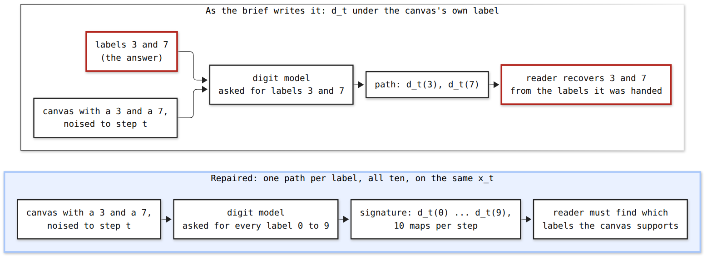

# Ideas for the score path, and the assumptions under each (step X3)

This page lists every idea that the [reading table](01-reading/reading-table.md) and [the five loop pages](02-the-loops/) suggest, cuts each into the assumptions it rests on, and marks each one. Step X4 designs one experiment from what survives. Nothing here has been run.

The picture shows the repair the whole page rests on (assumption A1 below). Its source is [the diagram file](03-score-path-defined-two-ways.mmd).

## Table of contents

- [Words this uses](#words-this-uses)
- [How each assumption is marked](#how-each-assumption-is-marked)
- [A. The score path itself](#a-the-score-path-itself)
- [B. Ideas for one shared space](#b-ideas-for-one-shared-space)
- [C. The two arithmetic tests](#c-the-two-arithmetic-tests)
- [D. Ideas for the two papers that need no training](#d-ideas-for-the-two-papers-that-need-no-training)
- [What survives, for X4](#what-survives-for-x4)
- [Where sources disagree](#where-sources-disagree)

## Words this uses

**Digit model.** The class-conditional pixel U-Net on 32 by 64 canvases in `2-classifier-guidance/scripts/mnist/canvas_unet.py`. Its labels are the digits 0 to 9 and a null label 10. `share-0.0` never saw two digits on one canvas, and `share-0.01` saw two digits on 1% of its canvases.

**$d_t(c)$.** $\epsilon_\theta(x_t, t, c) - \epsilon_\theta(x_t, t, \varnothing)$: what label $c$ adds to the digit model's unconditional noise prediction at step $t$.

**Signature.** The ten maps $d_t(0), \dots, d_t(9)$ computed on one noisy canvas $x_t$ at one step. A **signature path** is the stack of signatures over a window of steps for one canvas and one noise draw. This is the repaired score path of A1.

**The early window.** Sampler steps 0 to 15 of the digit model's 50-step DDIM, timesteps 999 to 693, the window the brief names.

**The SDXL-matched window.** Sampler steps 14 to 25 of the digit model, timesteps 712 to 480. By that timestep range the digit model's 50-step DDIM steps are 15 to 25 (timesteps 693 to 489), since step 14 is timestep 714 (`ddim_timesteps` in `canvas_unet.py` line 167). These carry the same share of signal as SDXL's steps 0 to 15 ([the V2 review](../abstract-checkers/05-does-it-learn/review.md)).

**The separate-experts paper** and **the CO3 paper.** Paper 1 and Paper 2 of [the problem statements](../problem-statements.md), the targets and the scoreboard.

## How each assumption is marked

| Mark | Meaning |
|---|---|
| holds | a file or paper page already shows it |
| needs a check | nothing shows it either way yet; the check is named |
| wrong as stated | a file or paper page contradicts it as written; the repair is given |
| dead | it cannot be made true on this data; what replaces it is given |

## A. The score path itself

Every idea in B and C reads a score path, so these assumptions come first.

| # | Assumption | Mark | Evidence, and the repair or check |
|---|---|---|---|
| A1 | A score path is $d_t(c)$ under the canvas's own condition, stacked over steps | wrong as stated | Computing $d_t(3)$ and $d_t(7)$ for a canvas holding a 3 and a 7 hands the answer to the reader, because the labels choose the path (the picture above). **Repair:** compute the signature, all ten $d_t(c)$ on the same $x_t$, so the digits reach the path only through the canvas. This is the form both zero-shot classifiers score: every class on one shared noisy input ([Clark and Jaini, p. 5](https://arxiv.org/pdf/2303.15233#page=5); [Li et al., p. 4](https://arxiv.org/pdf/2303.16203#page=4)). |
| A2 | Steps 0 to 15 of the digit sampler are the window that matters for SDXL | wrong as stated | The digit sampler's steps 0 to 15 run from timestep 999 to 693, where the share of the clean canvas left, $\sqrt{\bar\alpha_t}$, goes from 0.006 to 0.087 (`canvas_unet.py` lines 36 to 38 and 167). SDXL's signal-to-noise ratio is 144 times higher at step 0, and SDXL's steps 0 to 15 match the digit model's steps 14 to 25 ([the V2 review](../abstract-checkers/05-does-it-learn/review.md)). **Repair:** read both windows and report each. The early window answers the brief, and the SDXL-matched window answers what would carry to SDXL. |
| A3 | The signature carries which digits are present in those windows | needs a check | Against: Loop 8's map reader on the noisy canvas scored 0.540 balanced accuracy (0.5 is chance) over the early window ([the V2 review](../abstract-checkers/05-does-it-learn/review.md)), and Li et al.'s single-step accuracy peaks at middle noise, about 46% near t = 500 on Pets, read from Fig. 3 ([p. 4](https://arxiv.org/pdf/2303.16203#page=4)). For: $d_t$ is the model's own inference, trained at every noise level, and Loop 8's count checker read 0.63 to 0.92 in the SDXL-matched window ([the Loop 8 page](02-the-loops/loop-8-test-abstract-checkers.md)). **Check:** X5. |
| A4 | The noise draw does not dominate the signature | needs a check | On SDXL the correction's direction is not shared across runs, and per-seed maps of its size agree only weakly: Pearson r 0.074 at step 0, 0.241 at step 10 and 0.290 at step 20, on cat and dog at seeds 42 to 49 ([What does the correction look like?](../../../../1-lora-correction/report/what-the-correction-is/what-does-the-correction-look-like.md#no-directions-shared-across-runs)). A cosine of about 0.002 between the same pair at two seeds is held only in a project memory note of 2026-08-11 and is not cited as a finding. **Repair for training:** build each batch from one noise draw shared across canvases, so the draw carries no label, and pair positives across draws ([DCR, Algorithm 1, p. 13](https://arxiv.org/pdf/2603.04803#page=13); [the NoiseCLR note](01-reading/noiseclr.md)). **Check:** X5 reports the probe with the noise draw held out. |
| A5 | What a reader learns from the signature is the digits, and not the path's length | needs a check | The summed squared length $\sum_t \lVert d_t \rVert^2$ alone ranks seeds of one prompt by quality ([Sampling Path Tells More, p. 7](https://arxiv.org/pdf/2505.23343#page=7)). **Check:** a length-only baseline beside every reader, and one variant with each $d_t$ scaled to unit length. |
| A6 | A probe on the raw injected noise is a useful comparison | holds, and is weak | The injected noise holds no digit by construction, so its probe reads 0.5 and the X5 bar's "0.1 above the raw noise" reduces to "at least 0.6". The bar stays as the brief writes it. X4 adds the probe on the noisy canvas $x_t$ beside it, because that is what Loops 8 and 9 read and what the signature has to beat to be worth a third space (inferred). |

## B. Ideas for one shared space

| Idea | Serves |
|---|---|
| B1. Text and signature paths in one space, a frozen text encoder and a trained signature encoder | both papers: a reader of the experts' own predictions |
| B2. Noisy canvases and signature paths in one space | both papers |
| B3. All three in one space, as ImageBind and CLIP goes 3D do | both papers |

**B1. Text with signature path.**

| # | Assumption | Mark | Evidence, and the repair or check |
|---|---|---|---|
| B1a | The frozen text encoder separates the captions the canvases need | holds | W4 uses the frozen text side of `openai/clip-vit-large-patch14`, and its captions name the lower digit first, so no left-right order is needed ([W4's design](../noise-text-critic/04-train-our-own/design.md)). CLIP's text side keeps which word goes with which noun, ratio 0.72 against 0.13 for random weights ([the word check](../noise-text-critic/02-can-it-read/review.md)). |
| B1b | An encoder trained on digits 0 to 4 reads canvases of digits 5 to 9 | wrong as stated | In the signature, a 5 shows up in the channel $d_t(5)$. An encoder trained only on 0 to 4 never sees channels 5 to 9 carry a digit, so weights tied to a channel cannot transfer (inferred). **Repair:** read each label's channel with one shared network and pair it with that label's text vector, $f = \text{pool}_k\, \phi\big(d_{t}(k),\, g(\text{"the digit } k\text{"})\big)$, so an unseen digit enters through its name. |
| B1c | The positives are informative | holds | The caption is fixed by the canvas, and the signature reaches the canvas only through $x_t$ after the repair in A1. |
| B1d | Training the encoder fits the compute limit | needs a check | Each signature costs 11 forward passes of the digit model per step (ten labels and the null) over 12 to 16 steps. X4 sets the cost line from the measured step time in [the throughput page](../../../../environment/hpc/throughput.md) and caches signatures once. |

**B2. Canvas with signature path.**

| # | Assumption | Mark | Evidence, and the repair or check |
|---|---|---|---|
| B2a | Matching a canvas to its own signature teaches something | wrong as stated | The signature is a fixed function of $x_t$ and $t$, so the positive pair always agrees and a contrastive loss only asks a small canvas encoder to copy what the digit model computes (inferred). **Repair:** drop B2 as its own trained space. Its question, whether the digit model's view of $x_t$ reads more than a small encoder on $x_t$, is the X5 probe comparison, at a fraction of the cost. The owner may keep it at the X4 check. |
| B2b | Position and score agree on where each digit sits | needs a check | The correction on SDXL lands on a centred face when averaged over 8 seeds ([What does the correction look like?](../../../../1-lora-correction/report/what-the-correction-is/what-does-the-correction-look-like.md#no-directions-shared-across-runs)). On digits it is unmeasured. **Check:** X7 draws $d_t(a)$ and $d_t(b)$ over the canvas at a few steps, with no training. |

**B3. All three in one space.**

| # | Assumption | Mark | Evidence, and the repair or check |
|---|---|---|---|
| B3a | Training only the new encoder against a frozen pair aligns it to text | needs a check | ImageBind's new encoders reach text through images alone ([its note](01-reading/imagebind.md)). CLIP goes 3D found the two losses together beat either alone, 23.9% against 19.1% and 19.7% zero-shot ([its note](../noise-text-critic/01-reading/clip-goes-3d.md)). |
| B3b | W4's canvas encoder exists to bind against | needs a check | W4 has no result yet ([the Loop 9 page](02-the-loops/loop-9-turn-concepts-into-scores.md)). B3 waits for it, as the brief's rule for X6 says. |
| B3c | Binding through the canvas adds anything over B1 | needs a check | The signature is a function of the canvas, so B3's text alignment cannot beat W4's own (inferred). B3 is worth running only if B1 and W4 both pass. |

## C. The two arithmetic tests

**C1. The sum lands on the joint caption.** The product sampler's path for digits $(a, b)$, embedded, retrieves "the digit $a$ and the digit $b$, apart" among all captions.

| # | Assumption | Mark | Evidence, and the repair or check |
|---|---|---|---|
| C1a | A product path exists for any pair, unseen ones included | holds | The product sampler takes any two labels (`canvas_unet.py`, `product_eps`). Its signature path is computed on the sampler's own $x_t$ at each step. |
| C1b | The product draws the joint, so the joint caption is the right answer | wrong as stated | With each digit model free to draw on either side, the product draws two clear digits on 4 of 320 canvases ([the classifier-guidance page](02-the-loops/classifier-guidance-line.md)). Expecting the joint caption would score the encoder against a picture that was not drawn. **Repair:** the right caption is the one Loop 8's digit judge assigns to the final canvas. Report retrieval separately for product paths that end composed and paths that end fused. |
| C1c | Adding two score predictions is the score of the noised product | wrong as stated | It holds only at t = 0. At every noisy step the sum of noised scores differs from the noised product's score ([RRR, p. 4](https://arxiv.org/pdf/2302.11552#page=4)). **Repair:** read C1 in both windows, and expect it cleaner in the later one. |
| C1d | Text vectors add the way scores do | needs a check | ImageBind's claim that summed embeddings compose rests on example retrievals, and its one measured sum moves MSR-VTT Recall@1 from 36.1% to 36.8% ([its note](01-reading/imagebind.md)). **Check:** in X8, compare $g(a) + g(b)$ with $g(\text{joint})$ in the text space alone, before any path. |

**C2. The gap predicts the interaction term.** The joint path's embedding minus the product's lines up with the text gap $g(\text{joint}) - g(a) - g(b)$.

| # | Assumption | Mark | Evidence, and the repair or check |
|---|---|---|---|
| C2a | A joint score path exists on the digit models | dead | No digit model has a joint label. Its labels are the digits 0 to 9 and a null, and a two-digit canvas enters training once per digit it holds, so the expert for 7 means "a canvas with a 7 on it, sometimes beside another digit" (`canvas_unet.py` lines 3 to 5). This holds for `share-0.01` as well. **Replacement:** on digits the missing term can be defined by Loop 8's count checker, $-\sigma_t \nabla_{x_t} \log C_t(\text{apart} \mid x_t)$, the push that took the product from 0 to 43 clean pairs of 320 on unseen digits ([the Loop 8 page](02-the-loops/loop-8-test-abstract-checkers.md)). The test becomes: does embed(product path with the push) minus embed(product path) line up with the text gap? |
| C2b | Part of a joint-minus-product gap is not the interaction term | holds | At noisy steps an exact product would still differ from the summed scores ([RRR, p. 4](https://arxiv.org/pdf/2302.11552#page=4)), so the comparison needs a pair-shuffled control and both windows. |
| C2c | The test with a real joint prompt belongs on SDXL | needs a check | SDXL has the joint prompt, so $\epsilon(\text{joint}) - \epsilon_{\text{PoE}}$ is defined there. The brief requires an `ask` with its cost before any SDXL work; X4 files it only if C2's digit form passes. |

## D. Ideas for the two papers that need no training

The owner chose on 2026-11-24 to carry the reading's suggestions here. Each one changes another loop's plan, so a survivor goes to that loop through `requests.md` when X9 lands, and only the digit forms run here.

| Idea | For | # | Assumption | Mark | Evidence, and the repair or check |
|---|---|---|---|---|---|
| D1. Keep the seeds with the largest early score-path length | both papers | D1a | Path length tracks composition, not only quality | needs a check | It lifts GenEval two-object on SD1.5 from 0.354 to 0.518 keeping 4 of 50 seeds, and counting drops on SDXL from 0.409 to 0.325 ([Sampling Path Tells More, p. 8](https://arxiv.org/pdf/2505.23343#page=8)). **Check:** on digits, from the product paths X5 caches anyway, compare the length of paths that end composed with paths that end fused. |
| | | D1b | It costs nothing extra | holds | The product already computes each $d_t$ while sampling. |
| D2. Judge a render by the diffusion model's own error for the right caption against a swapped one | both papers | D2a | Enough noise samples make it stable | holds, at a cost | About 100 noise samples per caption pair for DiffusionITM to plateau ([p. 18](https://arxiv.org/pdf/2305.16397#page=18)). |
| | | D2b | It applies to digits | wrong as stated | The digit labels have no order or relation to swap. **Repair:** on digits its form is the per-label error readout of the signature, so it becomes X5's no-training baseline. The swapped-caption form stays an SDXL suggestion for Loop 6. |
| | | D2c | Guided predictions are fine to judge with | wrong as stated | Guidance made Li et al.'s classifier worse at every weight above 0 ([Fig. 8, p. 18](https://arxiv.org/pdf/2303.16203#page=18)). **Repair:** judge from unguided predictions. |
| D3. Read each subject's $d_t$ at CO3's step 10 as a map of which body it acts on | the CO3 paper | D3a | CO3 already separates the bodies | holds | None of M1's 288 CO3 pictures is one subject or a fused hybrid ([the Loop 6 page](02-the-loops/loop-6-find-the-best-method.md)). |
| | | D3b | Each subject's map lands on its own body | needs a check | Averaged over seeds the correction lands on one centred face, and per-seed maps agree weakly ([the correction finding](../../../../1-lora-correction/report/what-the-correction-is/what-does-the-correction-look-like.md#no-directions-shared-across-runs)). Needs SDXL, so it is Loop 6's to run. |
| D4. Set CO3's concept weights from a path average in place of one step's distance $d_k = \lVert \epsilon^{C} - \epsilon^{c_k} \rVert$ | the CO3 paper | D4a | One step's distance is noisy enough to matter | needs a check | CO3's weights follow $d_k$ at each corrected step (Eq. 14 and 15, [CO3 p. 5 to 6](https://arxiv.org/pdf/2509.25940v2#page=5)); nothing measured how much $d_k$ moves from step to step. Needs SDXL, so it is Loop 6's to run. |
| D5. Feed each expert's signature path to the separate-experts paper's early side vote | the separate-experts paper | D5a | The vote's current input is too weak to choose | holds | The two ways of sharing the canvas score 1.58 against 1.59 thousandths at step 4 ([the classifier-guidance page](02-the-loops/classifier-guidance-line.md)). |
| | | D5b | Signatures separate the two arrangements | needs a check | Untested; the digit form fits in X8 on the same cached paths. |
| D6. Add a Langevin corrector to CO3, repeating each reverse step at the same noise level with noise scaled by $\sqrt 2$ | the CO3 paper | D6a | The gain carries from CLEVR to SDXL | needs a check | On a score model, U-HMC lifts 5-cube CLEVR accuracy from 57.4% to 62.3% at equal score evaluations ([RRR, Table 2, p. 6](https://arxiv.org/pdf/2302.11552#page=6)). Against it on SDXL: a Langevin corrector on the plain product composed cat and dog on 0 of 8 held-out seeds, against 8 of 8 for the joint prompt, in every ten-step window tried ([the corrector-alone finding](../../../../1-lora-correction/report/is-the-gap-the-samplers-or-the-models/does-a-corrector-alone-produce-two-animals.md)). Whether it adds to CO3, which already separates the bodies, is untested and is Loop 6's to run. |

## What survives, for X4

**One experiment survives on digits:** does the signature path of a noisy digit canvas carry its digits, and does an encoder that reads it, aligned to a frozen text encoder, read digits it never trained on? It rests on A1 to A6 and B1 with the repairs above. B2 is folded into the probe comparison, B3 waits on W4, and C1 and C2 run in X8 on the same cached paths in their repaired forms.

Its parts, for X4 to design:

1. **The probe (X5).** A linear probe for "which digits are present" on the signature path, against the same probe on the noisy canvas and on the raw noise, in the early window and in the SDXL-matched window, with the noise draw held out between training and test.
2. **The no-training readouts (X5).** The per-label error readout (D2's digit form) and the path length (D1, A5), so a trained reader has to beat both.
3. **The trained reader (X6).** B1 with the shared per-label network of B1b, trained on digits 0 to 4 with one noise draw per batch, read once on digits 5 to 9.
4. **The arithmetic (X8).** C1 with the judge's caption, and C2 with the count checker's push as the missing term.

**Passed to other loops at X9, if they survive:** D1 and D2 on SDXL, D3, D4 and D6 to Loop 6, and D5 to the classifier-guidance line.

## Where sources disagree

| Claim | One source | The other source |
|---|---|---|
| A joint score path exists from `share-0.01` for the 10 pairs among digits 5 to 9 it saw | [this loop's brief](../prompts/session-10-the-score-path-as-a-third-space.md), "What is already known" | `canvas_unet.py` lines 3 to 5: labels are single digits, so no joint label exists on any digit model |
| The interaction term's direction is specific to the seed, cosine about 0.002 | this loop's brief, citing a measurement | [the correction finding](../../../../1-lora-correction/report/what-the-correction-is/what-does-the-correction-look-like.md#no-directions-shared-across-runs) records no cosine across seeds; it records size-map agreement of r 0.074 to 0.290. The 0.002 is in a project memory note only |
| The brief's steps 0 to 15 match SDXL's early steps | this loop's brief, X5 | [the V2 review](../abstract-checkers/05-does-it-learn/review.md): SDXL's steps 0 to 15 match the digit model's steps 14 to 25 |
