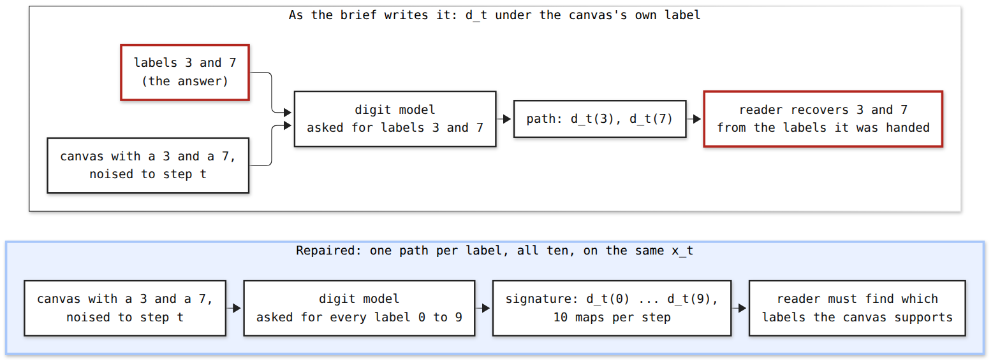

# Does a digit canvas's score path carry its digits, and can text read it? (step X4)

This is the one experiment that survives [the ideas page](03-ideas.md#what-survives-for-x4). It asks, on the digit canvases, whether the digit model's own noise predictions for all ten labels on a noisy canvas carry which digits are present, and whether an encoder that reads them, aligned to a frozen text encoder, reads digits it never trained on. Nothing runs on a GPU before the owner answers this page's `ask`.

The experiment reads the repaired form at the bottom of the picture.

## Table of contents

- [Words this uses](#words-this-uses)
- [What is already measured](#what-is-already-measured)
- [The fixed parts](#the-fixed-parts)
- [Run group 1, step X5: does the signature carry the digits](#run-group-1-step-x5-does-the-signature-carry-the-digits)
- [Run group 2, step X6: a text-aligned reader of the signature](#run-group-2-step-x6-a-text-aligned-reader-of-the-signature)
- [Run group 3, step X8: unseen digits and the two arithmetic tests](#run-group-3-step-x8-unseen-digits-and-the-two-arithmetic-tests)
- [Cost and what it buys](#cost-and-what-it-buys)
- [What this cannot say](#what-this-cannot-say)
- [The question for the owner](#the-question-for-the-owner)

## Words this uses

**Signature.** At one step $t$ and one noisy canvas $x_t$, the ten maps $d_t(c) = \epsilon_\theta(x_t, t, c) - \epsilon_\theta(x_t, t, \varnothing)$ for $c = 0, \dots, 9$, signed and unnormalised. A **signature path** is the signatures stacked over a window of steps for one canvas and one noise draw.

**Error readout.** Ten numbers per step, $e_c = \lVert \epsilon - \epsilon_\theta(x_t, t, c) \rVert^2 - \lVert \epsilon - \epsilon_\theta(x_t, t, \varnothing) \rVert^2$, where $\epsilon$ is the noise that made $x_t$. A more negative $e_c$ means label $c$ explains the noise better. This is the zero-shot classifier of [Li et al.](01-reading/diffusion-classifier.md) and [Clark and Jaini](01-reading/diffusion-zero-shot-classifiers.md) on digits, and it needs no training.

**Path length.** Ten numbers, $\sum_t \lVert d_t(c) \rVert^2$ over the window, the quantity [Sampling Path Tells More](01-reading/sampling-path-tells-more.md) ranks seeds by.

**Early window.** The 16 timesteps `ddim_timesteps(50)[:16]`, 999 down to 693, the brief's steps 0 to 15. The share of the clean canvas in $x_t$, $\sqrt{\bar\alpha_t}$, runs from 0.006 to 0.087.

**SDXL-matched window.** The 16 timesteps 712, 696, ..., 480 in `SDXL_MATCHED` of `2-classifier-guidance/scripts/abstract_checkers/v2_learn.py` line 46, which carry the same $\bar\alpha$ as SDXL's steps 0 to 15 ([the V2 review](../abstract-checkers/05-does-it-learn/review.md)).

**Presence accuracy.** For each digit, the balanced accuracy of calling "this digit is on the canvas" (0 to 1, 0.5 is chance), averaged over the digits in the split.

**Balanced accuracy, `apart` against `wrong`.** On canvases with two separate digits, the balanced accuracy of telling the asked pair from a canvas where one digit is wrong. Layout alone scores 0.5 here, so it measures which digits are present.

## What is already measured

| What was read | Window | Which digits | `apart` against `wrong` | Source |
|---|---|---|---|---|
| Loop 8's map reader: $\lvert d_t \rvert$ for the asked pair only, each map normalised to sum to 1 | early | 0.540 on all kinds | 0.501 | [the V2 review](../abstract-checkers/05-does-it-learn/review.md) |
| The same reader | SDXL-matched | 0.704 on all kinds, rising from 0.59 to 0.81 across the window | 0.511 | [the V2 review](../abstract-checkers/05-does-it-learn/review.md#the-rehearsal-at-sdxls-noise-level) |
| Loop 8's raw reader, the noisy canvas plus the asked pair | SDXL-matched | 0.713 on all kinds | 0.514 | the same section |

Loop 8's readers learned where digits sit and not which digits they are. The signature differs from Loop 8's maps in three ways: it holds all ten labels, so a wrong digit shows up in its own channel; it keeps the sign; and it keeps each map's size. Those are the three things this experiment tests.

## The fixed parts

**Model.** `/home-mscluster/mmolefe/poe_repair_min_scratch/mnist-canvas/models/share-0.0/unet.pt`, frozen, the model Loop 8's V2 and V3 used. It never saw two digits on one canvas. `share-0.01` is not used, because no digit model has a joint label ([the ideas page, C2a](03-ideas.md#c-the-two-arithmetic-tests)).

**Data.** Loop 8's V1 `dataset.npz` under `/datasets/mmolefe/poe_repair_min/loop-8/v1/data/`, refused unless its hash is in `DATA_HASHES` of `v2_learn.py`. Nothing in that folder is written. `train` holds 20,000 canvases of digits 0 to 4, `seen_test` 2,000 of digits 0 to 4, and `unseen_test` 2,000 of digits 5 to 9. The five kinds are V1's: `apart`, `overlaid`, `same_half`, `single` and `wrong`.

**Noise.** Each canvas is noised with draws from a seeded generator. Training and test use different draws, so no reader can match a test canvas by its noise. In group 2 every batch shares one draw across all its canvases ([the ideas page, A4](03-ideas.md#a-the-score-path-itself)).

**Storage.** Signatures are average-pooled 4 by 4, to 10 maps of 8 by 16 per step, and cached in float16 under `/datasets/mmolefe/poe_repair_min/loop-10/`. Code goes to `2-classifier-guidance/scripts/score_space/`. Every run logs to W&B project `prime_lab/poe-repair-animals-compose`.

**Jobs.** `bigbatch` only, one job at a time, excluding mscluster44, 45, 50, 51, 57, 61, 65, 68, 71 to 76 and 82.

## Run group 1, step X5: does the signature carry the digits

**Verdict.** [The score-path finding](../../../../2-classifier-guidance/report/does-the-score-path-carry-which-digits-are-present.md) holds this step's verdict and the numbers behind it.

**Group.** Runs that try a new idea (group 2 of the conventions). A result here changes no claim in either paper.

**Question.** Can a linear probe on the signature read which digits are present, in either window, better than the same probe on the noisy canvas and on the raw noise?

**Varied axis.** What the probe reads. The data, labels, probe, noise draws and windows are the same for every row.

| Row | What the probe reads, per step | Size per step |
|---|---|---|
| Signature | the ten $d_t(c)$ maps, pooled 2 by 2 | 10 by 16 by 32 |
| Noisy canvas | $x_t$, pooled 2 by 2 | 1 by 16 by 32 |
| Raw noise | the injected $\epsilon$, pooled 2 by 2 | 1 by 16 by 32 |
| Error readout | $e_0, \dots, e_9$, no training | 10 |
| Path length | $\lVert d_t(c) \rVert^2$ per label, and summed over the window | 10 |
| Shuffled labels | the signature with presence labels permuted | 10 by 16 by 32 |

The window is a second axis, read as its own comparison: every row is run once in the early window and once in the SDXL-matched window, and the two are never mixed in one number.

**Probe.** One small convolutional probe, the same architecture for every input that has a grid, chosen on board question 72 because a linear probe cannot follow a digit that moves: it read presence at only 0.779 on the signature and 0.764 on the noisy canvas at timestep 100, against the control's 0.9 ([the X5 review](05-signal/review.md)). The signature (10 channels), the noisy canvas and the raw noise (1 channel each) are average-pooled 2 by 2 to 16 by 32, normalised per channel on the fitting canvases, and read by three 3 by 3 convolutions (32, 64 and 64 channels, the last two with stride 2, each with group normalisation and SiLU), then the maximum and the mean over the grid, then one linear layer to one output per digit. Its training is fixed before any run: 1,500 updates at batch 256, Adam at $10^{-3}$ with weight decay $10^{-4}$, class-balanced binary cross-entropy. It is trained per step, and the shuffled-label row uses the same probe. The error readout and the path length have no grid, so they keep logistic regression with its L2 strength chosen by 5-fold cross-validation on the fitting canvases. Each window is also read once with its 16 steps stacked, by logistic regression: the signature pooled to 2 by 4 per map, 1,280 numbers, and the path length summed over the window. Code: `x5_signal.py --probe conv`.

**Data.** 4,000 canvases from `train` to fit and the 2,000 of `seen_test` to read, digits 0 to 4 throughout. Digits 5 to 9 are not read in X5.

**The ladder.**

1. **Smoke test.** One batch of 128 canvases through the signature at one step: shapes, finite values, and the measured time per forward pass, written to the review.
2. **Positive control.** At timestep 100, where the canvas keeps 0.946 of its signal, the probe on the noisy canvas must reach presence accuracy of at least 0.9, on the full read's 4,000 fitting and 2,000 reading canvases, as the first part of the full read (board question 74). The signature's value at timestep 100 is reported beside it and does not gate, because on a nearly clean canvas the label changes the prediction little. Timestep 0 is not used, because the noise prediction on an almost clean canvas is near zero for every label.
3. **Overfit.** The probe fitted and read on the same 16 canvases must call at least 15 right.
4. **1% of the data.** 40 fitting canvases and 20 reading canvases, to check the code end to end. It carries no verdict.
5. **Full read.** Every row in both windows.

**The bar, as the brief writes it.** Presence accuracy on the signature of at least 0.75 at some step from 0 to 15, and at least 0.1 above the same probe on the raw noise.

| Result | What it takes |
|---|---|
| Support | The bar holds in the early window |
| Support at SDXL's noise only | The bar misses in the early window and holds in the SDXL-matched window |
| Null | The positive control and the overfit test pass, and the bar misses in both windows |
| Inconclusive | The canvas row misses the positive control, or the overfit test fails |

**Reported beside the bar, and not part of it.** The signature against the noisy canvas in each window, `apart` against `wrong`, the error readout, and the path length. A trained reader is only worth building if the signature beats the error readout, which needs no training, so the review states that gap.

**What would surprise.** The signature reading presence above 0.75 in the early window, where the canvas holds at most 8.7% of its signal and Loop 8's maps read 0.540. That would mean the model's ten predictions carry identity that a probe on the pixels cannot find.

## Run group 2, step X6: a text-aligned reader of the signature

Runs only if X5 gives support in at least one window, and only in the window or windows that passed.

**Group.** Runs that try a new idea (group 2).

**Varied axis.** What the encoder beside the frozen text encoder reads: the signature path, or the noisy canvas. The canvas row is W4's trained model, reused and not retrained, so X6 waits for W4 ([the Loop 9 page](02-the-loops/loop-9-turn-concepts-into-scores.md)).

| Variation | What is matched | Runs when |
|---|---|---|
| Text with canvas | W4's model, the baseline | W4 lands |
| Text with signature path | captions against signature paths | X5 passes |
| All three | the signature encoder trained against W4's frozen canvas encoder and the frozen text encoder, as ImageBind and CLIP goes 3D do | X5 passes, W4 passes, and text with signature passes |
| Canvas with signature path | dropped as its own space ([the ideas page, B2a](03-ideas.md#b-ideas-for-one-shared-space)); the X5 probe comparison answers its question | the owner keeps it at this page's `ask` |

**The signature encoder.** One small network $\phi$ reads each label's channel together with that label's text vector, and the results are pooled over labels:

$$
f(\text{path}) = W \cdot \frac{1}{10} \sum_{k=0}^{9} \phi\big(d_{\text{window}}(k),\; g(\text{"the digit } k\text{"})\big)
$$

- $d_{\text{window}}(k)$ is label $k$'s maps over the window's 16 steps, pooled to 8 by 16.
- $g$ is the frozen text side of `openai/clip-vit-large-patch14`, W4's text encoder.
- $\phi$ has the same weights for every label, so a digit the encoder never trained on enters through its name ([the ideas page, B1b](03-ideas.md#b-ideas-for-one-shared-space)).
- $W$ maps to W4's 768-number space.

**Loss, captions and length.** W4's exactly: cross-entropy over the bank of 35 captions naming digits 0 to 4, temperature 0.07, 8,000 updates at batch 256, Adam at $2\times10^{-4}$ ([W4's design](../noise-text-critic/04-train-our-own/design.md)). Each batch shares one noise draw. Four draws per canvas are cached.

**The ladder.** Smoke test of 20 updates, overfit 16 canvases with at least 15 given their true caption, 1% of the data for 1,000 updates, then full training.

**The bar, the brief's default, the same as V2 and W4.** On `unseen_test` in the passing window: balanced accuracy at least 0.75, within 0.05 of `seen_test`, and at least 0.75 on `apart` against `wrong`. Null if the overfit test passes and the frozen model misses any of the three. Inconclusive if the overfit test fails or the seen score stays below 0.55 at every step.

**Control.** The same encoder with $\phi$'s label input replaced by a learned vector per label: it cannot read an unseen digit by construction, so a gap between the two rows on digits 5 to 9 is what the text input buys.

## Run group 3, step X8: unseen digits and the two arithmetic tests

Runs on the X6 encoder that passed, in its window. Both tests are in their repaired forms from [the ideas page](03-ideas.md#c-the-two-arithmetic-tests).

**The product paths.** Loop 8's V3 sampler on `share-0.0`: DDIM with 50 steps and eta 0, the product of the two asked labels, on the 10 pairs among digits 5 to 9, 32 seeds each, once without a push and once with V3's count-checker push at its recorded settings. That is 640 canvases. Each canvas's signature path is taken on the sampler's own $x_t$ in the window. Loop 8's digit judge reads each final canvas.

**Test 1, the sum lands on the caption of what was drawn.** Each product path's embedding retrieves its top-1 caption from the bank of all 145 captions over digits 0 to 9 (45 pairs in each of three two-digit forms, and 10 single digits). The right caption is the one the digit judge gives the final canvas, and accuracy is reported separately for canvases judged as two clear digits and canvases judged fused or single.

| Result | What it takes |
|---|---|
| Support | Top-1 accuracy on canvases judged as two clear digits is at least 0.75, and the same encoder on label-shuffled paths is within 0.05 of chance |
| Null | The encoder passed X6 and misses the 0.75 |
| Inconclusive | Fewer than 40 canvases are judged as two clear digits, so the accuracy has too few cases |

Test 1 also reads the text side alone first: does $g(a) + g(b)$ sit nearer $g(\text{joint})$ than any other caption?

**Test 2, the gap follows the missing term.** On digits the missing term is the count checker's push, $-\sigma_t \nabla_{x_t} \log C_t(\text{apart} \mid x_t)$, the push that took the product from 0 to 43 clean pairs of 320 ([the Loop 8 page](02-the-loops/loop-8-test-abstract-checkers.md)). For each pair and seed, take $\Delta = f(\text{path with push}) - f(\text{path without push})$, and the text gap $\Delta_{\text{text}} = g(\text{joint}) - g(a) - g(b)$, and compute their cosine.

| Result | What it takes |
|---|---|
| Support | The mean cosine over the 320 pairs and seeds is above 0, and its 95% bootstrap interval lies above the interval of the same cosine with the text gaps shuffled across pairs |
| Null | The two intervals overlap |
| Inconclusive | The push moves the embedding by less than the spread between two noise draws of the same canvas, so $\Delta$ is noise |

**What would surprise.** Test 2 passing. The push was trained on layout labels with no text, so a gap that lines up with a text gap would mean the shared space puts "two apart" in the direction the captions put it.

## Cost and what it buys

**Throughput, inferred from measured numbers.** The digit model has 6,141,185 weights ([the ladder's numbers](00-ladder/README.md)). One training step at batch 128 takes 157 ms on a `bigbatch` RTX 3090 ([the one-model MNIST finding](../../../../2-classifier-guidance/report/classifier-guided-poe/24-mnist-one-model.md)). A forward pass alone is taken as a third of that, about 50 ms per 128 canvases, or about 2,500 canvas forward passes per second. X5's smoke test measures the real figure and the review replaces this estimate.

| Group | Forward passes | GPU-hours |
|---|---|---|
| X5 | 6,000 canvases × 30 timesteps (two windows of 16, sharing two) × 11 labels, about 2.0 million. The two windows as run (early 999 to 693, matched 712 to 480, from `05-signal/full.json` `windows`) share no timestep, so the run read 32 distinct timesteps; the estimate stays as planned | about 0.5, with fitting and the ladder |
| X6 | 20,000 canvases × 4 draws × 16 timesteps × 11 labels, about 14 million, cached once, then 8,000 updates per training | about 2.5 |
| X6, all three | one more training on the cached signatures | about 0.5 |
| X8 | 640 canvases × (50 sampler steps × 3, plus 16 × 11), about 0.2 million, plus the judge and the embeddings | about 0.5 |
| Total | | about 4 |

**Cost:** about 4 GPU-hours on `bigbatch`, under the loop's limit of 6. No run is planned to pass 3 GPU-hours. If X5's measured throughput puts any group past 3 GPU-hours or the loop past 6, the run stops and files an `ask` with a cheaper version.

**Buys:** steps X5, X6 and X8; a measured answer to whether a diffusion model's own predictions for every label carry identity at SDXL's early noise, the half of the task Loop 8's readers could not read; and, if they do, whether those predictions can share a space with captions and follow the push that composes digits.

**Storage.** About 0.5 GB for X5 and about 6 GB for X6's cache, in float16 on `/datasets`.

## What this cannot say

- Digits hold count, which digits and left-right order. They hold no attribute binding, size or position beyond the two halves, so nothing here bears on CO3's borrowed parts.
- The digit model is a pixel U-Net with eleven labels. SDXL reads text through cross-attention, and its noise predictions live in a latent space, so a pass here says the idea can work and not that it works on SDXL.
- Test 2 uses the count checker's push as the missing term. On SDXL the missing term is $\epsilon(\text{joint}) - \epsilon_{\text{PoE}}$, which exists there and not on digits.
- The error readout uses the true injected noise, which a sampler does not know. It is a judge on forward-noised canvases, never an input to a push.

## The question for the owner

Filed with `progress_board.py ask`, holding X5:

> Loop 10 X4: may X5 to X8 run as designed in `score-space/04-design.md`, about 4 GPU-hours on bigbatch (X5 about 0.5)? The digit model's steps 0 to 15 hold at most 8.7% of the canvas, and SDXL's steps 0 to 15 match its steps 14 to 25, so X5 reads both windows. If the brief's bar misses in the early window and holds in the SDXL-matched window, should X6 go ahead in that window?

Default if unanswered: X5 runs both windows as designed, and X6 goes ahead only in a window where the bar holds.
