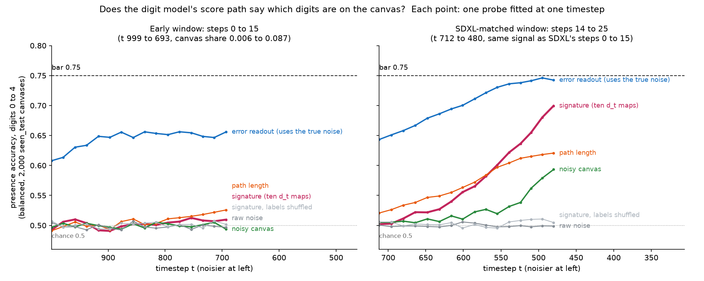

# Does the score path carry which digits are present? (step X5 review)

**Status: null by the written rule.** The signature, the ten maps $d_t(0), \dots, d_t(9)$ on one noisy canvas, reads digit presence at best at 0.700 (balanced accuracy, 0 to 1, 0.5 is chance), at timestep 480 in the SDXL-matched window, against a bar of 0.75. In the brief's early window it reads at chance, 0.513 at best. The probe and the pipeline work: the positive control passed at full size. The design is [the X4 design](../04-design.md#run-group-1-step-x5-does-the-signature-carry-the-digits), and the run is W&B `gq51nl74`.

Each point is one probe, fitted at one timestep on 4,000 `train` canvases and read on the 2,000 `seen_test` canvases with a different noise draw. The numbers are in [the result file](full.json), copied from `/datasets/mmolefe/poe_repair_min/loop-10/x5/conv/full.json`, and the figure is drawn by `2-classifier-guidance/scripts/score_space/x5_figure.py`. [The probe-input diagram](what-each-probe-reads.png) shows where each line's input comes from.

## Table of contents

- [The result against the bar](#the-result-against-the-bar)
- [What the other inputs read](#what-the-other-inputs-read)
- [The ladder, and the two probe changes](#the-ladder-and-the-two-probe-changes)
- [What this means for X6 to X8](#what-this-means-for-x6-to-x8)
- [Cost](#cost)
- [Still open](#still-open)

## The result against the bar

The bar, fixed in `x5_signal.py` before the full read as `MIN_PRESENCE = 0.75` and `MIN_OVER_NOISE = 0.10`: the signature reads presence at 0.75 or more at some step of a window, and at least 0.1 above the probe on the raw noise at that step.

| Window | Signature, best step | Raw noise at that step | 0.75 met | 0.1 over noise met | Result |
|---|---|---|---|---|---|
| Early, t 999 to 693 | 0.513 at t 754 | 0.50 | no | no | miss |
| SDXL-matched, t 712 to 480 | **0.700** at t 480 | 0.499 | no | yes, by 0.20 | miss |

Both windows miss, the control and the overfit test passed, so the design's table makes this **null**. The signature is still rising at the last step of the matched window: 0.680 at t 495 and 0.700 at t 480.

## What the other inputs read

Presence accuracy at the first, middle and last step of each window, and the best balanced accuracy on `apart` against `wrong` (two separate digits, the asked pair against one wrong digit; layout alone scores 0.5).

| Input | Early t 999 | t 836 | t 693 | Matched t 712 | t 585 | t 480 | Best `apart` against `wrong` |
|---|---:|---:|---:|---:|---:|---:|---|
| Signature, ten $d_t$ maps | 0.493 | 0.502 | 0.510 | 0.502 | 0.565 | **0.700** | 0.655 at t 480 |
| Noisy canvas $x_t$ | 0.497 | 0.496 | 0.494 | 0.505 | 0.523 | 0.593 | 0.576 at t 480 |
| Raw noise | 0.505 | 0.497 | 0.497 | 0.500 | 0.504 | 0.499 | about 0.5 |
| Error readout, 10 numbers | 0.608 | 0.656 | 0.656 | 0.643 | 0.711 | 0.742 | 0.681 at t 480 |
| Path length, 10 numbers | 0.491 | 0.501 | 0.526 | 0.521 | 0.572 | 0.621 | 0.576 at t 480 |
| Signature, labels shuffled | 0.50 to 0.51 throughout | | | | | | about 0.5 |

**The signature reads more than the canvas it is computed from.** In the matched window it leads the noisy canvas from about t 600 onward, by 0.107 at t 480, with the same probe on both. The model's ten predictions make the digits easier to read than the pixels at this noise.

**It reads which digits, not only where.** On `apart` against `wrong` it reaches 0.655. [Loop 8's map reader](../../abstract-checkers/05-does-it-learn/review.md#the-rehearsal-at-sdxls-noise-level), which read only the asked pair's two maps, normalised and unsigned, scored 0.511 on the same comparison in the same window. The ten signed, unnormalised maps carry the identity Loop 8's maps dropped, though not to 0.75.

**The path length is not the signal.** It reads 0.621 at t 480, below the signature's 0.700, so the signature is not reaching its score by the size of its maps alone.

**The error readout is a different kind of input.** It reads 0.61 to 0.66 in the early window, where nothing else reads at all, and peaks at 0.746 at t 495. It compares each label's prediction with the noise that made the canvas. Knowing that noise and $x_t$ together gives back $\sqrt{\bar\alpha_t}\,x_0$, the clean canvas scaled down, so its score partly reflects access to the noise and cannot be had during sampling (inferred). It stays what the design calls it: a judge on canvases noised from a known picture, never an input to a push.

**The window read as one path carries something no single step does.** A linear probe on all 16 steps stacked, each map pooled to 2 by 4, reads 0.607 in the early window, where every single step reads 0.49 to 0.51. In the matched window the stack reads 0.674. In this read the 16 steps share one noise draw, so a linear combination across steps can partly cancel that draw (inferred). A sampler's own path does not share its noise this way, so this does not yet say a sampled score path carries the digits.

## The ladder, and the two probe changes

| Job | Probe | Rung | Result | Bar |
|---|---|---|---|---|
| 94160, 8.5 min | linear | smoke | shapes right, values finite, 2,714 canvas forward passes a second | runs |
| | | positive control, t 100, 1,000 fitting canvases | signature 0.779, noisy canvas 0.764 | 0.9 for both: **missed** |
| | | overfit | 16 of 16 | 15 |
| 94180, about 10 min | convolutional | positive control, t 100, 1,000 fitting canvases | signature 0.802, noisy canvas 0.890 | 0.9 for both: **missed** |
| | | overfit | 16 of 16 | 15 |
| 94184, 25.5 min | convolutional | positive control, t 100, 4,000 fitting and 2,000 reading canvases | noisy canvas **0.950**, signature 0.904 | 0.9 on the canvas only: passed |
| | | full read | the tables above | the bar above |

The linear probe could not follow a digit that moves across the canvas, so the owner chose on board question 72 to give every grid input one small convolutional probe. At 1,000 fitting canvases that probe still left the canvas row at 0.890, and the owner chose on board question 74 to rerun the control at the full read's size with only the canvas row gating. The 1% reads of both ladders (40 fitting canvases) scored 0.57 to 0.59 and carried no verdict. No bar was changed.

## What this means for X6 to X8

The brief says that if X5 misses, X6 does not run and the verdict says why. By that rule X6 to X8 do not run. The finding still says something the brief did not expect: in the SDXL-matched window the score path carries more about which digits are present than the canvas it was computed from, and the advantage grows with every step toward less noise. The window stops at t 480 because that is where SDXL's step 15 falls. This is reported to the owner through board question 76 before step X9 writes the verdict.

## Cost

About 0.74 GPU-hours on `bigbatch` RTX 3090s: 8.5, about 10 and 25.5 minutes. The design budgeted about 0.5 for X5 and 6 for the loop.

## Still open

- Whether a probe trained across both windows at once, or a later window, reaches 0.75. Trying it on this data needs a new design, per the brief.
- Whether the signature computed along the sampler's own path, where the noise is not shared across steps, reads the same.
- Whether the stacked window's 0.607 in the early window comes from cancelling the shared noise draw, as inferred above.
