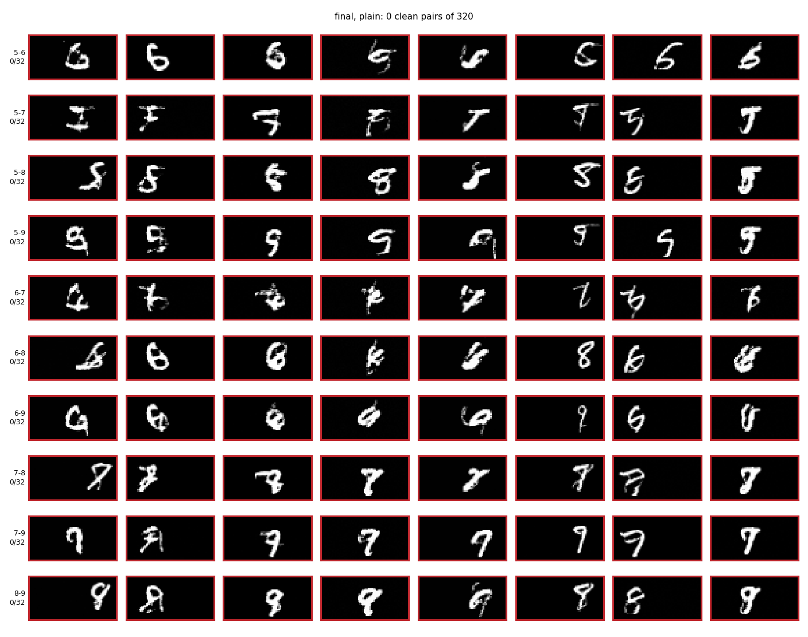
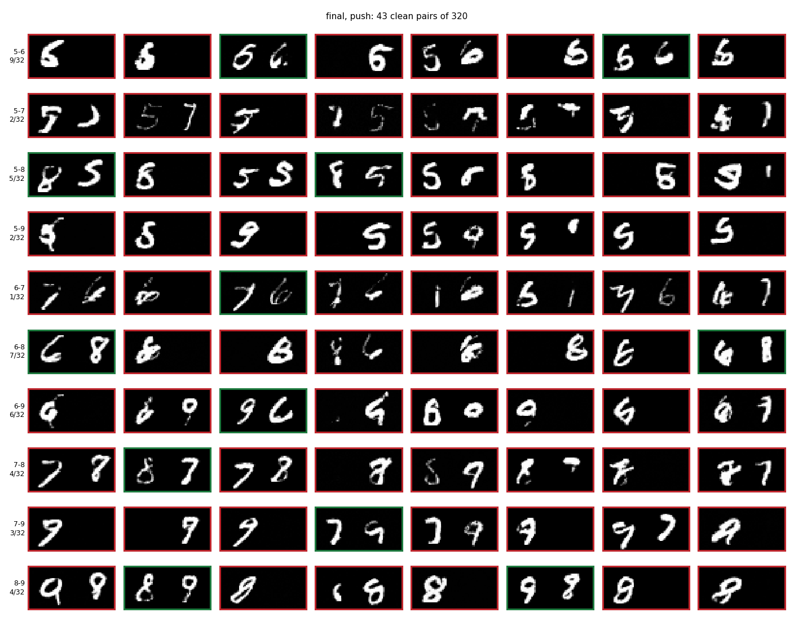
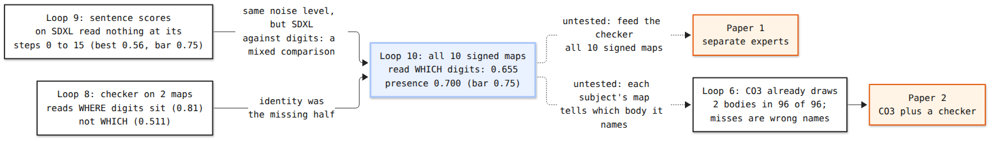

# Loop 10 in one page: does a diffusion model's own score path say what is in the picture?

**The short answer.** Partly, and not yet enough. On small digit canvases, the digit model's own noise predictions for all ten digit labels say which digits are present better than the noisy picture does (0.700 against 0.593 on a 0-to-1 scale where 0.5 is chance). That is still short of the bar of 0.75 set before the run. So no shared text-and-score space was trained. This loop gives both papers a direction to try, and no new method or rival-beating result.

## Table of contents

- [What was asked](#what-was-asked)
- [What was found](#what-was-found)
- [Conclusive or inconclusive](#conclusive-or-inconclusive)
- [Are we level with the rivals yet](#are-we-level-with-the-rivals-yet)
- [How it fits the other loops](#how-it-fits-the-other-loops)
- [Are we getting there](#are-we-getting-there)
- [Where the evidence lives](#where-the-evidence-lives)

## What was asked

Both papers fail at one place. Adding two prompts' noise predictions (a product of experts) loses the part that a single joint prompt would carry, so two subjects fuse into one. Other loops score the half-drawn picture. This loop asked whether the model's own predictions along the way, the **score path**, could be read like a third language beside words and pictures. If they could, adding sentences might predict what adding predictions does.

## What was found

*Each line is one kind of input to the same small reader, asked "is this digit on the canvas?". Left: the noisiest steps. Right: the steps whose noise matches SDXL's first 16 steps. Red is the score path. Green is the noisy picture itself.*

| What the reader looked at | Digits read correctly, at the SDXL-matched noise | What it means |
|---|---|---|
| The score path (the model's ten predictions) | **0.700** | the best a sampler could use |
| The noisy picture | 0.593 | what Loops 8 and 9 read |
| Pure noise | 0.499 | chance, the floor |
| The model's error against the true noise | 0.746 | best of all, and a sampler never has the true noise, so it can judge and cannot steer |
| Bar, set before the run | 0.75 | |

**The new piece is identity.** Telling the right two digits from a canvas with one wrong digit, the score path scores 0.655. Loop 8's checker, which read only the two asked labels' maps, scored 0.511 there, which is chance. Loop 8's checker could tell where digits sit but not which they are. The score path reads which, part of the way.

## Conclusive or inconclusive

| Question | Answer | How sure | Why |
|---|---|---|---|
| Does the score path read the digits at the brief's steps 0 to 15? | No | conclusive for digits | every input read 0.49 to 0.53 on 2,000 held-out canvases, and the control showed the reader works (0.950 on a nearly clean canvas) |
| Does it read them at SDXL's matching noise? | Yes, below the bar | conclusive that it misses 0.75 | 0.700 against 0.75, and 0.20 above chance. One run, with no confidence interval computed |
| Does it read more than the picture? | Yes | strong | it leads by 0.106 with the same reader, and the gap grows toward less noise |
| Can it share a space with sentences? | Unknown | not tested | the brief stops training when the signal check misses, and the owner agreed (board question 76) |
| Does any of this hold on SDXL? | Unknown | not tested | digits are a 6-million-weight pixel model with 11 labels; SDXL reads text through attention |

## Are we level with the rivals yet

**No, and this loop could not have moved it.** It renders nothing, so it has no grid to set beside a rival's and no benchmark score.

The project-wide picture, from the scoreboard Loop 4 keeps:

| Paper | Rival target | Our number | Side-by-side picture against the rival |
|---|---|---|---|
| Paper 1, separate experts | Bradley-Local, 5 objects on CLEVR (the most objects that still succeed) | none yet | none yet |
| Paper 2, CO3 plus a checker | CoMat 0.7827 on T2I-CompBench Color; ToMe 0.6051 Shape and 0.6894 Texture; RTD 0.4661 ImageReward on Complex; FKC 0.78 on GenEval two objects; Bradley-Local 5 objects on CLEVR | none yet | none yet |

All 7 target rows read `ours: null`, and all qualitative comparisons read 0 pairs ([the scoreboard](../scoreboard.json)).

**The closest thing to "they fuse, ours separates" is on digits, from Loop 8**, on pairs the model never saw together:

| Plain product of two digit labels: 0 clean pairs of 320 | With Loop 8's checker push: 43 clean pairs of 320 |
|---|---|
|  |  |

Green frames are canvases the digit judge calls two clean, right digits. This shows plurality restored on a toy and is not a rival comparison. Loop 6's direct test against the simplest rival gives a tie on digits (295 against 287 of 320 for pasting two samples side by side, inside a margin of 13.54). On SDXL it gives a loss: CO3 with the push makes 7 faithful pairs of 96, CO3 alone makes 11 ([the Loop 6 page](02-the-loops/loop-6-find-the-best-method.md)).

## How it fits the other loops

*Solid arrows are measured results. Dashed arrows are suggestions nobody has run yet.*

**Well aligned on the problem.** Loops 6, 8 and 10 now point at the same gap from three directions. Loop 6 finds that CO3 already draws two bodies in 96 of 96 pictures and fails on naming them. Loop 8's checker reads where digits are and not which. Loop 10 finds that the which-information is in the model's signed predictions. The next useful checker reads identity.

**One mismatch to keep in mind.** Loop 9 read SDXL and Loop 10 read digits at the same noise level, so their numbers cannot be set against each other as cause and effect.

## Are we getting there

**This loop: finished, on budget, and narrower than hoped.** It read, designed, measured and wrote its verdict in about two and a half hours on 2026-11-24. It used 0.74 of its 6 GPU-hours and stopped at the planned check, so the three training and testing steps (X6 to X8) never ran. It answered the question it could answer cleanly.

**The project: not yet at the rivals.** The board shows 46 of 79 steps done. Neither paper has its first number on the scoreboard. The results that look strongest (1,200 of 1,280 digit pairs for Paper 1, and 54 of 128 cat and dog pictures by eye for Paper 2) are both on the void list, because each was tuned on its own test seeds ([the void list](../void-list.md)).

**What would move it.** These are untested suggestions this loop passed on:

| Suggestion | For | Who runs it | Cost |
|---|---|---|---|
| Feed the identity checker all ten signed maps, where it now reads two normalised maps | Paper 1 | Loop 8 | a retrain of an existing checker |
| Read each subject's own map at CO3's corrected steps, to tell which body carries which name | Paper 2 | Loop 6 | SDXL calls per subject |
| Judge renders by the model's own error for the right caption against a swapped one | both | Loop 6 | many noise samples per caption, and no training |

## Where the evidence lives

Files, runs and caveats

- The full verdict, one row per variation: [the verdict](09-verdict.md).
- The measurement, with every input at every step: [the X5 review](05-signal/review.md), and W&B run `gq51nl74` in `prime_lab/poe-repair-animals-compose`. Jobs 94160, 94180 and 94184 on `bigbatch`.
- Why the score path had to be redefined before anything ran: the original definition fed the answer in. See [the ideas page](03-ideas.md#a-the-score-path-itself).
- The design and the owner's three answers (board questions 71, 72, 74 and 76): [the design](04-design.md).
- The reader was changed twice before the verdict read: a straight-line reader could not follow a digit that moves, so it became a small convolutional reader, and its check was rerun at full size. No bar was changed. Both are recorded in the X5 review.
- The error readout's 0.746 uses the noise that made each test canvas. A sampler does not have that noise, so the number belongs to a judge and does not show what a push could do.
- No confidence intervals were computed for X5. The 0.700 against 0.75 gap is one run on 2,000 canvases.

