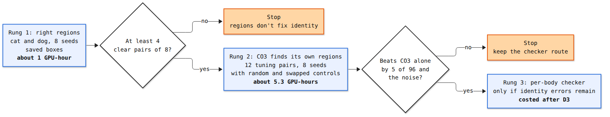

# Binding each body to its subject: design and cost

This page tests whether giving each subject its own region fixes the error CO3 still makes. CO3 drew two separate bodies in all 96
tuning pictures, and only 11 were faithful, because bodies borrow parts, take the wrong species or gain an extra subject. Session 6
runs rungs 1 and 2 as step M9, and rung 2 starts only if rung 1 reaches its bar.

## The change to the sampler

Each subject's prediction acts only inside its own soft mask, from step 0 in rung 1 and from step 10 in rung 2:

$$
\hat\epsilon = \epsilon_u + g\,\big[m_A(\epsilon_A-\epsilon_u) + m_B(\epsilon_B-\epsilon_u)\big]
$$

$\epsilon_u$ is the unconditional prediction, $g$ is the guidance, $\epsilon_A$ and $\epsilon_B$ are the predictions for each subject
alone, and $m_A$ and $m_B$ are masks that sum to 1 at every latent cell.

## The three rungs

| Rung | Question | Runs on | Rows | Stop rule | Cost |
|---|---|---|---|---|---|
| 1 | Do the right regions fix identity at all? | Cat and dog, 8 seeds with saved boxes | Joint prompt, plain product, right boxes, random boxes, swapped prompts, same prompt twice | Under 4 clear pairs of 8 with the right boxes stops the idea | About 1 GPU-hour, 48 renders plus 4 previews |
| 2 | Can CO3 find its own regions and improve? | M1's 12 tuning pairs at seeds 6001 to 6008 | CO3 alone (reused), its own masks, swapped masks, random masks | No lead over CO3 alone stops the idea | About 5.3 GPU-hours, 288 renders plus a smoke test |
| 3 | Does a trained per-body checker add anything? | The same tuning pairs | Rung 2's best row, with and without the checker | Runs only if rung 2 leads and identity errors remain | Costed after step D3 chooses the architecture |

**Rung 1** uses [the oracle-layout plan](../../../3-understanding-compositionality/plans/10-what-poe-loses-when-it-composes/is-the-layout-the-missing-piece.md).
Its boxes, masks and composer are on disk, and its bar of 4 clear pairs of 8 was written on 2026-11-04. The boxes come from joint
renders that already drew a cat and a dog, so this rung is an upper bound and supports no claim.

**Rung 2** reads each subject's word attention map at step 10 and turns the pair into masks with `poe_repair/composers/_regional_masks.py`.
Steps 0 to 9 stay CO3's own. The bar is M1's: on faithful pairs of 96, a lead of at least 5 and more than 1.96 standard errors over CO3
alone. A lead from random masks equal to the real one means the regions are doing nothing. A zero-binding run must reproduce CO3's loop
to under 1e-5 on one card and dtype. Counts are blind, at full size, under neutral names.

**The rung 2 cost** uses 60 seconds per picture. CO3 with the push measured 58.3 seconds on an RTX 8000, and binding adds two model
calls on 40 of the 50 steps. Rungs 1 and 2 together cost about 6.3 GPU-hours.

## What each result would mean

**Rung 1 fails.** Knowing where each body is does not fix identity on SDXL, so regions are ruled out for Paper 2.

**Rung 2 leads.** Paper 2's contribution moves from a trained checker toward regions the sampler finds for itself. MultiDiffusion uses
given regions and RPG uses regions from a language model, so both become closer rivals, and the claim is that no outside layout is
needed.

**Rung 2 ties.** The two-body layout is not the limit, and identity is decided before step 10 or by the subject predictions themselves.

## What this cannot say

Tuning pairs and seeds support no paper claim. Rung 1 covers one pair. Word attention can miss a subject at step 10, so rung 2 may fail
because of its masks while regions still work, and rung 1 is what separates those two readings.
