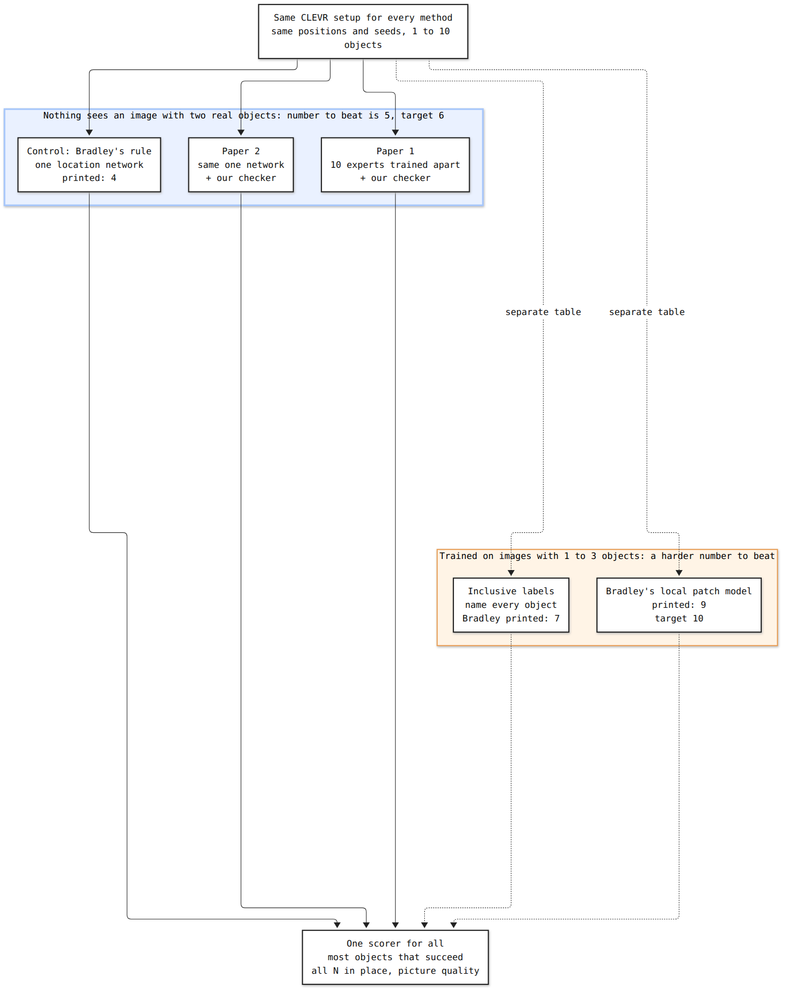

# CLEVR scaling plan: how many objects survive as experts are added

This experiment tests how far composition holds as more objects are asked for, for both papers. Paper 1 adds experts that were
trained apart. Paper 2 uses one network composed with itself, plus our checker. Session 5 writes each run's design from this page,
and the [fairness audit](fairness-audit.md) records why each rule below exists.

## What each method does

Every method runs on models trained for the same length, at the same positions and seeds.

| Method | Models trained | How it makes N objects | What it is for |
|---|---|---|---|
| One network | One location network and one empty-background network | Bradley's rule: add the scores, asking the same network about each position | The rival's rule on our models |
| One network with checker | The same two networks | That composition plus our checker | Paper 2 |
| Experts | One expert per position and the same background network | Add the N experts' scores | Shows what training apart does alone |
| Experts with checker | The same experts | That composition plus our checker, once step M4 has frozen it | Paper 1 |
| Sample and paste | The same experts | Sample each expert alone, then paste its object onto one background | The control Paper 1 has to beat |

Bradley notes that with an empty background the sampler acts as if each model
["pastes" an object](https://arxiv.org/pdf/2502.04549#page=2), so experts at fixed positions could score well with no real
composition. That is why the paste control is required.

## The order of the runs

**Data rungs.** The first rung is single-object CLEVR at 64 pixels from the public
[CLEVR generator](https://github.com/facebookresearch/clevr-dataset-gen). The second is 128 pixels, Bradley's image size. Blender is
not on the cluster's path, so the first step is to install it and time one batch of renders.

**A small test before the go or no-go.** Step M7 trained 2 and 3 experts at 64 pixels with 5,000 images per model, on positions
outside Bradley's 12, and scored sample-and-paste before any tuning. Three experts cannot draw 7 objects, so M7 reads how often each
expert's object is right and applies Bradley's rule. [Paste is predicted to reach 7 objects](how-far-sample-and-paste-reaches.png) when
that rate is at least 90.6%, if objects succeed independently. Paste placed every object in 1,024 of 1,024 images at both 2 and 3
experts, a rate of 1.0, and each expert placed its own object in 256 of 256 samples
([M7's review](../method-search/01c-clevr-paste-first/review.md)). Object count with position-conditioned experts therefore cannot
separate Paper 1 from paste, so step M6 does not run on these models, and Stage 2 below is Paper 1's test where pasting fails, chosen
by the owner on 2026-11-24. M7 supports no claim.

**Stage 1: the expert ladder.** Train the background, the one-network control and experts 1 and 2, then test 2 objects. Add one
expert per rung and test one more object. Earlier experts are never retrained.

**Stage 2: two experts holding several objects.** Model A sees only red objects and model B only blue, each 1, 2 or 3 at a time and
anywhere in the frame. Each model takes its count as a class label, so the 2 models pair into 9 scenes of 2 to 6 objects. Success is
x red and y blue objects, all separate. A third model seeing only green, with scenes up to 9 objects, runs only with the owner's yes and
only if a row holds every scene up to 6. These models see real multi-object images, so this is its own table and does not count toward
the one-object target. Giving each model its own half of the image is not allowed, because that is two pictures pasted side by side.
Sample-and-paste has no row here, because nothing tells it where each object goes. Loop 6's
[Stage 2 design](../method-search/05-two-experts-by-colour/design.md) holds the bars, the scorer and the cost.

These models are told which objects to draw and not where, as the digit and SDXL models are, so Stage 2 is the like-for-like test of a
checker. Position-conditioned models already paste their objects, which leaves a checker nothing to add. Beside the plain product, Stage 2
runs two rows. The first adds Loop 8's count checker, retrained on these models' maps at the noise levels of the sampler's early steps and
pushing only on those steps, as in [its digit test](../abstract-checkers/06-does-it-compose/review.md). The second samples
the product with Du et al.'s MCMC corrector, which separates a better sampler from a new mode.

**Inclusive labels do not run here.** Training a diffusion model on inclusive captions is too heavy for the main results, so they get
one appendix paragraph, written from the existing toy, MNIST and SDXL results.

## The rules, fixed before the first run

1. Each new expert must draw its one object at its position in at least 90% of 256 samples, read by the scorer, so a weak expert is
   not read as a scaling limit. It gets one training, and a failure is reported. The 90% is our own mark. Bradley's one-object model
   places its object in [100 of 100 hand-counted images](https://arxiv.org/pdf/2502.04549#page=17).
2. Positions are Bradley's [12 printed locations](https://arxiv.org/pdf/2509.16447#page=23), used in his printed order.
3. Models use his (x, y) location conditioner and the [32-step Heun sampler with 65 model calls](https://arxiv.org/pdf/2502.04549#page=15).
4. The one-network control should reach about 4 objects, the number Bradley prints for it. If it falls short at our training length,
   the shortfall is printed beside every comparison with it.
5. The ladder stops after two failed object counts in a row, or at 10 objects.
6. At the first failed count, the N groups that each leave one expert out are tested, to separate the number of experts from one bad
   position. At 10 experts that is 10,240 images, where testing every smaller group would take 1,036,288.
7. In Stage 1, no model and no checker sees a real image holding two objects. The checker trains only on samples from the models
   and composites pasted from them at random positions, and the position sets used for evaluation are held out. A checker trained
   without composites is reported beside it. A checker that sees real multi-object images does not count toward the 7-object target.
8. The scorer trains on real rendered images of 1 to 12 objects, reads objects at the requested positions as well as the total, must
   reach 99% on held-out renders, and is never used to train a checker.
9. The picture-quality bar is a threshold in the scorer's code, written before the first run.

## How every method is scored

Every method uses 1,024 images per object count and reports three things.

**Most objects that succeed.** A count K succeeds when K objects appear in at least 50% of images and at least K-2 appear in at
least 90%. This is Bradley's rule.

**Images with all N objects in place.** This is the count behind Projective Composition's 98 of 100 at 5 objects and 97 of 100 at
6. A person also checks 100 images per count at full size under neutral file names, so those numbers sit directly beside ours.

**Picture quality.** A count with the objects in place but a degraded image does not pass.

## What counts as a win

Printed numbers are context, because Bradley trains on 134 million images and our full length is 8 million. A win needs all of these
at equal training length:

- more objects that succeed than the one-network control;
- at least 7 objects on both the automatic scorer and a hand count of 100 images, read with the same rule for K, because Bradley's rule already places all 6 in 97 of 100 images and first clearly fails at 7;
- for Paper 1, a win on Stage 2 by the bars in its design, because paste places every object with position-conditioned experts.

| Table | Printed context | What we need |
|---|---|---|
| One object seen, one network | 6 in place in 97 of 100 images, first clear failure at 7 | **7 objects, and more than the control** |
| Experts trained apart | No rival prints this | **7 objects, and more than the control and the paste** |
| Two experts holding several objects | No direct rival. Bradley's colour model reaches 4 after training on 1 to 3 objects, on a different task | A new table |

## What it costs

All costs are estimates. Step M7 measured 6.82 seconds per thousand images on one RTX 3090 at 128 images per GPU pass, so a model costs
about 3.8 GPU-hours for 2 million images and 15.2 for 8 million. An earlier lone probe ran at 4.05 seconds, and this table uses the slower
measured rate.

Rendering is measured at 5.46 seconds per single-object image and 4.50 per empty scene on one 28-thread CPU node, with 32-pixel render
tiles. At 20,000 images per model, the size of our earlier CLEVR sets, ten experts plus the background and the control take about 359
node-hours, or 60 hours on all six `bigbatch` slots. How many images each expert needs is still open, and the owner chooses it before
the full render starts.

| Stage | Models | GPU-hours at a quarter of that length | GPU-hours at the full length |
|---|---|---|---|
| Small test before the go or no-go (step M7) | 4 | about 8.5, measured | not needed |
| Ladder, up to 2 experts | 4 | about 15 | about 61 |
| Ladder, up to 6 experts | 8 | about 30 | about 121 |
| Ladder, up to 10 experts | 12 | about 46 | about 182 |
| Two experts holding several objects (Stage 2) | 2, plus M7's empty-scene model | about 7.6, plus about 67 CPU node-hours for rendering, from Loop 6's design | not costed |
| A green expert and scenes up to 9 objects, only with the owner's yes | 1 more | about 4, plus about 33 CPU node-hours | not costed |
