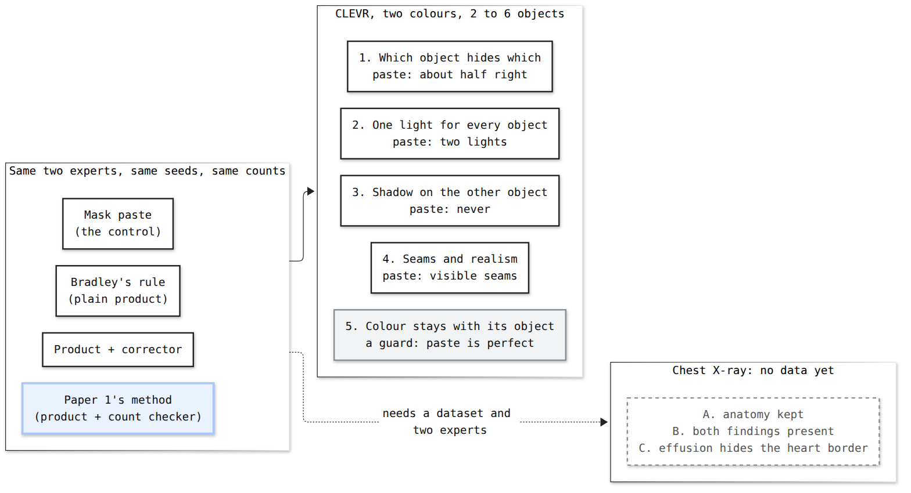

# Paper 1's evaluation plan: measures where pasting fails

Paper 1 composes two diffusion models trained on separate data. Counting objects cannot tell its method from pasting: on CLEVR,
pasting each expert's sample onto one background puts every object in place in 1,024 of 1,024 images
([the paste finding](../../../../2-classifier-guidance/report/the-method-search/does-sample-and-paste-already-solve-small-clevr.md)).
A composition earns its name only where two objects affect each other in one picture: one hides the other, both lie under one light,
one casts a shadow on the other, the picture has no seams, and on a chest X-ray one finding changes how another looks. Pasting cannot
produce any of these, because it never draws the two objects together. This page names a measure for each, what it reads, its bar,
and the data it needs. Every measure scores every method the same way.

## Table of contents

- [Words this uses](#words-this-uses)
- [The methods every measure scores](#the-methods-every-measure-scores)
- [How a difference counts](#how-a-difference-counts)
- [CLEVR measures](#clevr-measures)
- [Chest X-ray measures](#chest-x-ray-measures)
- [What it costs](#what-it-costs)
- [What this plan cannot tell you](#what-this-plan-cannot-tell-you)
- [Reviewer questions](#reviewer-questions)
- [Still open](#still-open)

## Words this uses

**Expert.** A small diffusion model trained on one kind of image only, here one CLEVR colour or one chest X-ray finding.

**Mask paste.** Each expert samples its own image, and the second image's foreground (pixels that differ from the mean empty scene
by more than 0.1 on a 0-to-1 scale) is laid over the first. It is the control Paper 1 has to beat, defined in
[Loop 6's Stage 2 design](../method-search/05-two-experts-by-colour/design.md).

**Bradley's rule.** The plain product: add the two experts' noise predictions and subtract the empty-scene model's, then sample as
usual. It is the composition rule of Projective Composition (arXiv 2502.04549), run here on our experts.

**Reference renders.** Real CLEVR images drawn by Blender with both colours in one scene, under one light. No method trains on them.
They tell each reader what a correct answer looks like, and they set the realism measure's target.

## The methods every measure scores

All four rows use the same two experts and the same empty-scene model from the two-colour CLEVR test, step M10, each expert trained
on 2,000,896 images, at the same seeds and requested counts.

| Row | What it does | Why it is here |
|---|---|---|
| Mask paste | the two experts' samples, one laid over the other | the control: right wherever the objects need nothing from each other |
| Bradley's rule | the plain product of the two experts | the published composition rule, on our models |
| Product with Du et al.'s corrector | the plain product with MCMC steps between sampling steps | separates a better sampler from a new signal |
| Paper 1's method | the plain product plus the count checker's push | the method the paper claims |

Bradley's printed CLEVR numbers come from models trained on 134 million images, against our full length of 8 million
([CLEVR scaling plan](clevr-scaling-plan.md#what-counts-as-a-win)). They stay as context beside each table and are never a bar.

## How a difference counts

A rate (a share of images or objects) differs between two rows when the lead is at least 5 points and more than 1.96 standard errors,
the margin Loop 6 uses for every comparison. A distance or a score with no natural rate (realism distance) differs when the 95%
bootstrap interval of the difference, over images, excludes zero. Each reader passes its own check on reference renders before it
scores any sample, and a reader that misses its check makes that measure inconclusive.

Paper 1 wins a measure when its row beats mask paste and Bradley's rule on that measure by the margin above. The corrector row is read
beside it: if the corrector matches Paper 1's row, the gain belongs to better sampling. Colour binding is a guard and is judged the
other way (see measure 5).

## CLEVR measures

These run on the two-colour test's 9 scenes of 2 to 6 objects (1, 2 or 3 red with 1, 2 or 3 blue), plus one crowded condition
described under measure 1.

| Measure | What it reads | Bar | Data it needs | Pasting, expected |
|---|---|---|---|---|
| 1. Which object hides which | where a red and a blue object overlap, whether the overlap shows the nearer object | Paper 1 leads paste and Bradley's rule by the margin, on at least 200 overlapping pairs per row | 500 crowded reference renders with their scene files | about half right, because the blue layer is always on top (predicted, not measured) |
| 2. One light for every object | whether every object's shadow points the same way | the same | 1,024 reference renders per scene, with each render's key-light position recorded | fails when the two experts' samples were lit from different sides |
| 3. A shadow falling on the other object | where objects stand within one object width, whether one's shadow darkens the other | the same, by two blind reviewers | the generated images only | never, because each object was drawn alone |
| 4. Seams and realism | how far the images sit from reference renders, and how easily a small classifier tells them apart | realism distance: lower than paste and Bradley's rule, interval excluding zero; classifier accuracy: lower by the margin | 1,024 reference renders per scene | the lighter seams already seen around pasted objects |
| 5. Colour stays with its object | the share of objects whose pixels mix red and blue | a guard: Paper 1's share is at most paste's plus 5 points | the generated images only | near zero, because paste never mixes colours |

**1. Which object hides which.** CLEVR's camera looks down on a floor, so of two overlapping objects the one whose base sits lower in
the image is nearer and should cover the other. The reader splits each image into red and blue objects by hue, finds each red and blue
pair whose outlines overlap, and calls the pair right when at least 80% of the overlapping pixels carry the nearer object's colour.
Reader check: on the 500 crowded reference renders, where the scene file gives each object's depth, the reader is right on at least
95% of overlapping pairs. Objects at 64 pixels seldom touch, so the crowded condition asks 3 red with 3 blue, and both the reference
renders and the method's images are generated until each row has 200 overlapping pairs. The CLEVR generator rejects scenes where
objects sit close or hide each other, so the crowded reference renders run with its minimum distance and minimum visible pixels per
object turned down, and the page reporting them says which values were used.

**2. One light for every object.** Each training render has its own jittered light, so two separately drawn samples can be lit from
different sides. For every object the reader takes the direction from the object's base to the centre of the dark pixels beside it.
An image passes when every pair of objects' shadow directions differ by no more than the reference spread: the 95th percentile of the
same spread over the reference renders, all lit by one light. Reader check: composites built by pasting objects from two reference
renders whose recorded key lights differ by at least 90 degrees fail at least 95% of the time. The share of passing images is
compared across rows.

**3. A shadow falling on the other object.** Where a red and a blue object stand within one object width of each other, two reviewers
call each image without knowing its row: the nearer object's shadow falls on the other, it does not, or it cannot be told at 64 pixels.
Their agreement is reported, and a third reviewer settles disagreements. One hundred such images per row are called. If more than half
of the reference renders' calls are "cannot be told", the measure is reported as unreadable at this size and dropped from the claims.

**4. Seams and realism.** The realism distance is the kernel Inception distance (KID) between each row's images and the reference
renders, per scene and averaged over the 9 scenes, because it is unbiased at a thousand images where FID is not. The classifier test
trains a small network to tell reference renders from one row's images on half of each and reports its accuracy on the other half, where
0.5 means it cannot tell them apart. Reader check: the classifier separates reference renders from mask pastes at better than 0.5 by
more than 1.96 standard errors, which shows it can see the known seam.

**5. Colour stays with its object.** An object counts as mixed when more than 10% of its pixels carry the other colour's hue. Paste
keeps colours apart by construction, so this measure cannot show Paper 1 ahead. It guards against a method that gains on measures 1 to
4 by blending the two objects into one, which the two-colour test's exact count already fails as a merged object.

## Chest X-ray measures

No chest X-ray data, expert or design exists in this project yet. The environment pages list no X-ray dataset, and no rival prints
an X-ray composition number ([limits](limits.md#chest-x-ray)). The measures below say what a design must read, so the data and the
experts can be chosen to support them.

The two pairs are tuberculosis with silicosis, and pleural effusion with cardiomegaly. Effusion is the sharper test: fluid in the lower
chest can hide the heart's left border, so a correct composite of a large heart and an effusion shows a weaker border than a large heart
alone. The owner's working hypothesis is that both experts agree on anatomy, so a product keeps ribs, spine and lungs, while each expert
treats the other's finding as unlikely. It is a hypothesis to test, and measures A and B test its two halves.

| Measure | What it reads | Bar | Data it needs |
|---|---|---|---|
| A. Anatomy kept | an anatomy segmenter finds both lungs and the heart, and the heart-to-chest width ratio falls inside the range of real images with the same findings | share of images passing; Paper 1 leads paste and Bradley's rule by the margin | real images per finding to set the range; a segmenter trained on real images |
| B. Both findings present | a classifier trained on real labelled images gives each finding a probability above its own threshold, fixed on real images | the same | real images with each finding alone and both together, for the classifier only |
| C. One finding changes the other | for effusion with cardiomegaly, the contrast along the heart's left border | the composites' border contrast lies closer to real images holding both findings than to real images with a large heart alone, and closer than paste's, interval excluding zero | real images with cardiomegaly alone and with both findings |

Pasting needs its own definition here, because a finding is not an object with an outline. The proposal is two pastes: lay the second
expert's finding region (the lower lung zone for effusion, from the anatomy segmenter's mask) over the first expert's image, and the
pixel average of the two images. Both are scored as rows.

Each expert trains on images holding its finding and not the other, so neither ever sees both. Images holding both findings are used
only by the measures' readers, as the two-colour test uses its two-colour renders only for its scorer. Silicosis has few public images,
and images holding tuberculosis and silicosis together are rarer still, so that pair may only be measurable by A and B. The public
datasets that label effusion and cardiomegaly (NIH ChestX-ray14 and CheXpert are the usual ones) are named from memory and have not been
checked on this machine.

## What it costs

All of this is scoring and rendering. Loop 4 runs none of it.

| Part | CPU node-hours | GPU-hours |
|---|---:|---:|
| Reference renders, 1,024 per scene for 9 scenes, at M7's 7-second budget per multi-object render | about 18 | none |
| Crowded reference renders, 500 | about 1 | none |
| Extra method images for the crowded condition, 4 rows until 200 overlapping pairs each | none | under 1, estimate, since one overlap rate is not yet known |
| Readers, the realism distance and the classifier test | about 2 | under 1 |
| Eye calls for measure 3, 100 images per row with two reviewers | about 2 hours of reading per reviewer | none |
| Chest X-ray | not costed until data and experts exist | not costed |

All figures are estimates.

## What this plan cannot tell you

**Whether these effects are readable at 64 pixels.** CLEVR objects at 64 by 64 cover a few dozen pixels and their shadows fewer, so
measures 2 and 3 each start with a reader check that can declare them unreadable. A larger image size would cost more renders and
longer training.

**How the experts' own training data limits them.** The renderer that drew each expert's training scenes rejects crowded scenes, so
neither expert has seen its own objects hide each other often. A method that fails measure 1 may be meeting the experts' limit rather
than its own.

**Anything about Bradley's longer-trained models.** Every row here runs on experts trained for a quarter of our full length. Bradley's
printed numbers sit beside the tables as context.

## Reviewer questions

Loop 14 lists the questions a reviewer will ask of Paper 1 (its step G2, `artifacts/notes/progress/gaps/02-reviewer-questions-paper-1.md`).
Each one that a measure can answer is mapped to a row above, and any question no measure answers becomes a row here.

## Still open

1. Whether the corrector row should share Paper 1's checker budget or run at its own tuned setting.
2. Who calls measure 3 and the X-ray reads: the owner, a second person, or a person with radiology training for the X-rays.
3. Which chest X-ray dataset, and whether silicosis is measurable at all with public data.
4. Whether pasting on X-rays should be the region paste, the pixel average or both, as proposed above.
