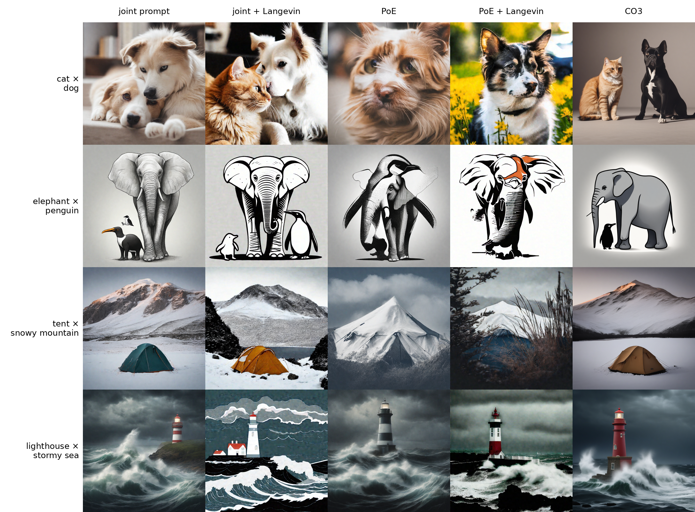

# PRZE-2: the Langevin corrector as reviewer PrzE's MCMC baseline

Retrospective of the walk over [the PRZE-2 plan](../../../1-lora-correction/plans/prove-the-langevin-corrector-for-the-six-column-figure.md), 2026-11-11, step 8 of [the review route](../../../plans/route-answer-the-iclr-reviews.md). The walk map is [EXECUTE_WALK.md](../../../1-lora-correction/artifacts/drips/answering-the-reviewers/prove-the-langevin-corrector-for-the-six-column-figure/EXECUTE_WALK.md).

## 1. The update on two Gaussians

**The request.** Check the corrector's unadjusted Langevin update on two Gaussian experts against the exact stationary mean and variance, at four step sizes.

**The problem.** The chain's exact stationary variance is V / (1 − δ/(2V)), which reaches the product's 0.3077 only as δ shrinks; a check against 0.3077 fails correct code at large δ.

**What was done.** `1-lora-correction/scripts/check_langevin_two_gaussians.py` runs 200,000 independent chains of the same update as `run_poe_langevin` at δ = 0.005, 0.02, 0.05 and 0.1, and passes a step size when mean and variance sit within 3 Monte Carlo standard errors of the chain's own exact values; the gap to 0.3077 is printed beside it.

**Where the results live.** The printed table; commit `6b102c31`.

**Before and after.** Every row PASS. Bias to 0.3077: +0.0025, +0.0103, +0.0272, +0.0597; doubling δ from 0.05 to 0.1 grows the bias 2.2 times.

**Depends on.** Nothing earlier.

## 2. Corrector first against step first

**The request.** Measure the order difference on the same toy.

**The problem.** Our corrector settles the latent before each DDIM step; the paper corrects after it.

**What was done.** `1-lora-correction/scripts/check_langevin_order.py` diffuses the two experts along SDXL's own schedule (50 DDIM levels), uses the exact product score, and runs both orders at c = 1, 3 and 10 with k = 20.

**Where the results live.** The printed table; commit `24976455`.

**Before and after.** KL divergence to the product: plain PoE 2.25 (variance 0.0013, a collapse); at c = 3 corrector first 0.00309, step first 0.00171. c moves the KL 150-fold, order under 2-fold. Our order was kept.

**Depends on.** Chunk 1's update.

## 3. The two drivers

**The request.** Joint-prompt Langevin and unadjusted HMC drivers, each byte-identical to the plain sampler at zero corrector steps.

**The problem.** The laptop has no torch, and the main cluster checkout was 71 commits behind with 19 untracked files blocking a fast-forward.

**What was done.** `poe_repair/methods/_corrector_drivers.py` (`run_joint_langevin`, `run_poe_uhmc` with k counting iterations of L = 5 leapfrog steps), two composers, a stand-in-UNet test and an SDXL check, run from a clean worktree on `/datasets` as Slurm 84583.

**Where the results live.** `paper_review/logs/prze2-identity-84583.out`; commits `945f48e5`, `5d358f1a`, `d0b582ed`, `51be069c`.

**Before and after.** `4 passed`; both SDXL comparisons `max |diff| = 0.000e+00 PASS`.

**Depends on.** Chunk 1's update rule.

## 4. The setting

**The request.** Choose c and k on the tuning pairs by a rule written first.

**The problem.** The agreed grid cost about 29 GPU-hours, unadjusted HMC most of it; the reviewer asked for one MCMC baseline, not a tuned grid.

**What was done.** Langevin only, c = 3, k = 20 over all 50 levels, no grid, written into protocol rule 3 with a dated history row before any review corrector image.

**Where the results live.** [The protocol](../../../1-lora-correction/report/paper-review/protocol.md), rule 3, and [its history](../../../1-lora-correction/report/paper-review/history.md).

**Before and after.** Tuning cost 29 GPU-hours planned, 0 spent.

**Depends on.** Chunk 3's drivers.

## 5. The tiles for Figure 5

**The request.** The comparison figure from one starting latent per row, CO3 included.

**The problem.** Bigbatch's 6-jobs-per-user cap was held by the baselines session, so Slurm 84596 never started.

**What was done.** `1-lora-correction/scripts/review_r6_renders.sbatch` ran on mscluster107 card 0 (RTX 8000): 16 tiles (joint, joint + Langevin, PoE, PoE + Langevin) and 4 CO3 tiles at seed 10, all from `latents/seed10.pt`, then a contact sheet. The appendix slot R6 was then dropped and its tiles folded into Figure 5 (R2), beside ours; SuperDiff was dropped from every table and figure.

**Where the results live.**  [the card](../../../1-lora-correction/artifacts/results/against-other-methods/samplers-and-correctors/does-a-langevin-corrector-fix-the-product/README.md); commits `379695a6`, `6e60016e`, `08c2a3e7`.

**Before and after.** Called by eye at seed 10: PoE fuses 3 of 4 pairs; PoE + Langevin keeps one of the two things on those 3; joint + Langevin, CO3 and ours show both on all 4.

**Depends on.** Chunks 3 and 4.

## The stop point

Bar: the check prints PASS at all four step sizes, both drivers match at k = 0, and the corrector's figure tiles are built from the frozen setting. Met: PASS. Time box 2 hours; about 3 hours 35 minutes used, past the box by your `go`. The bar came first; the walk ended on your `stop`.

## Decisions

| Decision | Options | Chosen | Who | Why |
|---|---|---|---|---|
| Pass bar for the check | 3 standard errors of the chain's own exact values; fixed 2% | 3 standard errors | default you accepted | the chain's exact variance is not 0.3077 |
| Predictions before each test | you; me | me | you | |
| Keep our corrector order | ours; the paper's | ours | you | the order moves KL under 2-fold |
| What HMC's k counts | UNet calls; iterations | iterations | you (`fix b`) | |
| Correctors in the review | Langevin and unadjusted HMC; Langevin only | Langevin only | you (`fix langevin only`) | half the GPU time |
| Tuning grid | three c values; none | none, c = 3, k = 20 | you (`fix no grid`) | the reviewer asked for the baseline, not a grid |
| Launch path | worktree on `/datasets`; reconcile first | worktree | you (`run`) | the cluster checkout could not fast-forward |
| Where the corrector shows in the paper | appendix R6; R6 with ours; Figure 5 | Figure 5 (R2) | you (`fix a`) | R6 without ours showed no contrast with our method |
| SuperDiff | keep; drop everywhere | drop everywhere | you | it does not claim to fix hybrids |

## Dead ends and not done

- Instruction 4 of the plan, your PASS or MISS on the contact sheet, is open.
- PRZE-2's figure line is open until Figure 5 is assembled (route step 13), and its two paper-text lines belong to step 13.
- Figure 5's width: 0.48 text width in `paper/iclr-56173/figures.md` against full width in the layout sheet.
- Four `eval-superdiff` jobs (Slurm 84592, 84593, 84595, 84597) render tiles nothing uses; the cancel was refused by this session's permissions and is yours to run.
- The worktree `/datasets/mmolefe/poe_repair_min/worktrees/prze2` is kept; remove it with `git worktree remove` from the cluster checkout once the main checkout is reconciled.
- The main cluster checkout is 71 commits behind with 19 untracked files; `/reconcile-machines`.
- No report finding: no bar was pre-registered for the figure, so the seed-10 observation stays a route row.
- Byte-match of the new joint tile against the earlier one failed on hardware (mean 0.92 grey levels; Blackwell against RTX 8000), same picture.

## The family table

| Kind | Id | Serves | State |
|---|---|---|---|
| this session | `afd3106a-798a-4f57-a01b-e7ee95e53231` | the walk | closed |
| Slurm | 84583 | chunk 3 identity | completed |
| Slurm | 84596 | chunk 5 | cancelled, never started |
| nohup on mscluster107 card 0 | log `paper_review/logs/prze2-r6-107.out` | chunk 5 | finished, exit 0 |
| agent | pillar cadence audit | cadence | finished |
| agent | cross-reference cadence pass | cadence | finished, 32 links |

---

Validation, 2026-11-11: 11 relative links and 2 image sources resolve on disk (0 missing); 9 commit ids exist in this repository; numbers checked against the printed tables of both check scripts, the Slurm 84583 log and the R6 log. No Codex review was run.
