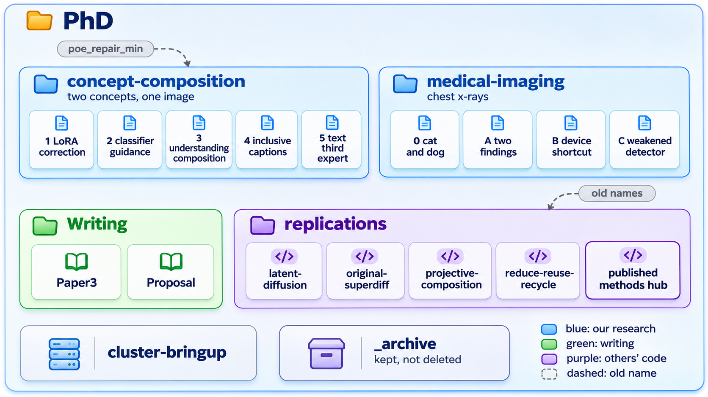

# The PhD layout, as one picture

The PhD folder sorted by kind of work, as the [PhD organogram](/home/molef/PhD/ORGANOGRAM.md)
stands on 2026-11-13: two research portfolios with their projects, writing, replications with the
published-methods hub, cluster bring-up, and the archive.

## the-phd-layout.png

**What it shows**

Blue cards are our research portfolios: concept-composition with its five projects and
medical-imaging with its four. Green is writing (Paper3 and the Proposal). Purple is other people's
code in `replications/`, with the published-methods hub outlined. Dashed grey arrows run from old
folder names (`poe_repair_min`, and the reproductions' old top-level names) to where they now point.

**Where it came from**

Drawn by Codex from the prompt in [the prompt file](diagram-prompts.md) (Empty direction, one
image), checked against that prompt's faithfulness note, and embedded in the repository README
under "Where this repo sits in the PhD". Redraw it when the organogram's folders change.
