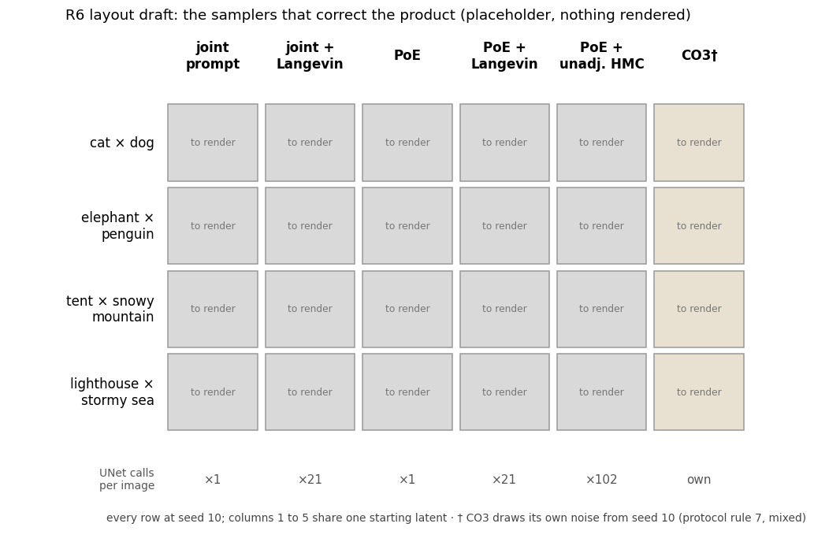
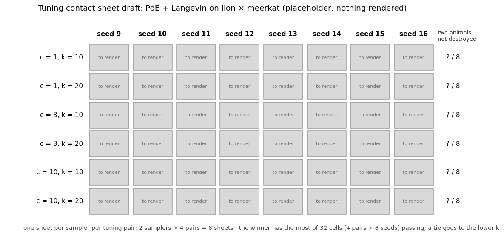

# Does a Langevin corrector fix the product?

Appendix figure R6 of the ICLR 56173 revision and what leads to it, for reviewer PrzE's request for an MCMC corrector baseline. The plan is [PRZE-2](../../../plans/prze-2-langevin-corrector.md); the slot is R6 in [the layout sheet](../../../report/paper-review/layout-sheet.md).

## six-columns-layout-draft.png

**What it is.** The layout R6 will fill, with no image rendered yet: rows are the four Figure 5 pairs at seed 10, columns are joint, joint + Langevin, PoE, PoE + Langevin, PoE + unadjusted HMC and CO3, and the bottom line gives UNet calls per image at k = 20 (unadjusted HMC with 5 leapfrog steps per iteration). The CO3 column is tinted because it starts from its own noise. `stated`

**How it was made.** Drawn with matplotlib from the slot's row and column lists on 2026-11-11, before any corrector render, so the layout can be agreed first. Replaced by `six_columns.png` once piece 5 renders.

## tuning-sheet-layout-draft.png

**What it is.** The layout each of the 8 tuning contact sheets will take (2 samplers by 4 tuning pairs): rows are the six grid settings, columns are seeds 9 to 16, and the right column counts the cells showing two animals and not destroyed. No tile is rendered. `stated`

**How it was made.** Drawn with matplotlib on 2026-11-11 from the grid in the PRZE-2 plan's task 4, before any tuning cell ran.
