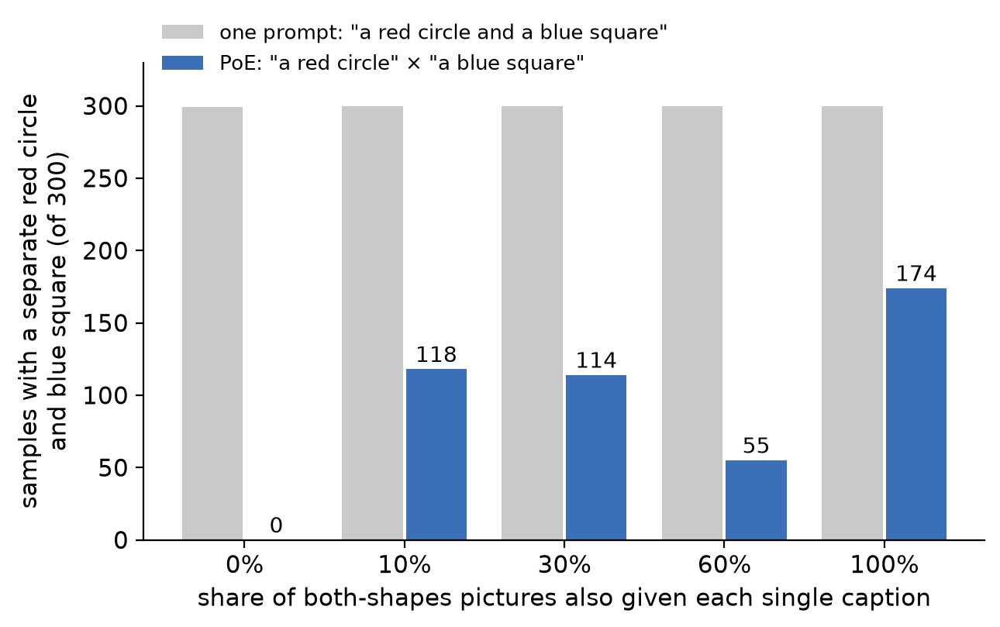
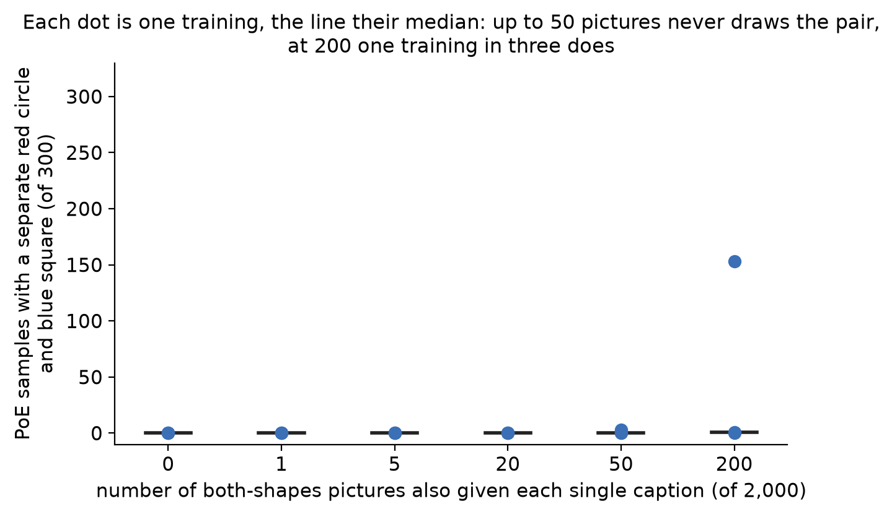

# What PoE needs from training to draw two things at once

This write-up follows one question from SDXL down to a small model we can control completely, and
back up again. Every figure in this folder is drawn by
`artifacts/notes/what-poe-loses-when-it-composes/plain_figures.py` from the saved samples and counts
in the folder above, and the fuller record of each result is that folder's [results card](../README.md).

## The finding

We trained a text-conditioned latent diffusion model, built like SDXL, on pictures of red circles,
blue squares and pictures holding both, then combined "a red circle" and "a blue square" by PoE.

**When the both-shapes training pictures carry only the joint caption, PoE never draws the two
shapes apart.** Across 4 trainings it gave 0 of 300 samples with a separate red circle and blue
square, while the same models given the joint caption "a red circle and a blue square" drew both
shapes in 299 or 300 of 300.

**Giving some both-shapes pictures the single captions as well makes it possible, but not
reliable.** With 1, 5, 20 or 50 such pictures (out of 2,000), all 12 trainings stayed at 0 to 3
of 300. With about 200, five trainings gave 118, 149, 153, 1 and 0 of 300: three drew the pair
and two did not. Single trainings at higher shares (600, 1,200 and 2,000 pictures) gave 114, 55 and
174 of 300, each from one training only.

So the toy shows that the single captions on both-shapes pictures are necessary for PoE to draw
both shapes in this model, and that even 10% of them is not sufficient on every training.

## The problem we started from

SDXL is given the one prompt "a cat and a dog" (top row) and draws both animals. Asked instead
for PoE of "a cat" and "a dog" (bottom row), where each prompt guides the sampler on its own and
the two pushes are added, it draws one animal carrying parts of both: a cat's ears over a dog's
muzzle. The question all of the work below asks is what PoE needs from the model's training to
draw two animals instead of one.

SDXL is too large to change its training freely, so we built a small model where we can.

## Words this uses

**PoE (product of experts).** Each caption defines an expert, a probability over pictures. PoE
multiplies the two experts, so it favours pictures both experts like. In a diffusion model this is
done at every denoising step by adding each caption's push to the empty-caption estimate:
estimate = empty + 3 × [("a red circle" − empty) + ("a blue square" − empty)], where 3 is the
classifier-free guidance strength.

**Both-shapes picture.** A training picture holding a red circle and a blue square side by side.

**Separate red circle and blue square.** How a sample is scored. Each pixel is assigned to the
nearest of four colours: background, red, blue, or purple (red and blue mixed). A sample counts
when it has a red region and a blue region of at least 12 pixels each, apart from each other. This
rule read 100 of 100 of the model's own reconstructions of known pictures correctly.

**Out of 300.** Every count is 300 samples from one trained model with one setting.

## The model

**The VAE** takes a 16 × 32 colour picture and compresses it to 128 numbers, then decodes those
numbers back into a picture, the same kind of compression SDXL's VAE does at a larger size.

**The denoiser** takes three inputs: a noisy version of those 128 numbers, how much noise is in it,
and one of four captions ("a red circle", "a blue square", "a red circle and a blue square", or an
empty caption). It outputs its estimate of the clean 128 numbers, from which the noise estimate
follows.

**Sampling** starts from pure noise, removes it step by step under a caption (or under the PoE sum
above), and the VAE decodes the result into a picture.

## What the model is trained on

6,000 pictures: 2,000 of a single red circle (at one of three positions), 2,000 of a single blue
square, and 2,000 holding both, each with the caption "a red circle and a blue square". That is the
left half. The one thing we change between trainings is on the right: a chosen share of the
both-shapes pictures is added a second time under "a red circle" and a third time under "a blue
square" (outlined in green). We trained five models, at shares of 0%, 10%, 30%, 60% and 100%. At
10% that is about 200 extra pictures under each single caption.

## The main result

Each row is one trained model, each column one way of asking it, and each cell shows four samples
with the count out of 300 under them.

**At 0%, PoE fails** (third column, top row). 0 of 300 samples are a separate circle and square;
the samples are faint purple smears spread over the positions. That is the same fused-animal
failure as SDXL's, in shapes. The model is not broken: the same model, asked with the joint caption
(fourth column), draws both shapes 299 of 300 times.

**At 10% and above, these single trainings drew both shapes part of the time**: 118, 114, 55
and 174 of 300. Most of the remaining samples are two shapes whose colours have drifted toward
purple, which the scorer does not count. Each row here is one training, and the next section shows
that a 10% training does not always come out this way.

**The single captions still mean one shape** up to 60%: "a red circle" alone gives only red in at
least 285 of 300, and "a blue square" only blue in at least 295. At 100% they slip to 250 and 234,
because the square caption itself starts drawing the pair.

<table><tr>
<td></td>
<td>

**The count does not climb with the share.** Grey bars are the joint caption, near 300 in every
model. Blue bars are PoE: zero at 0%, then between 55 and 174 with no upward trend. Each bar is one
training, and the next section shows how much one training can differ from another.

</td></tr></table>

## How many relabelled pictures it takes

<table><tr>
<td></td>
<td>

The same model, trained with an exact number of both-shapes pictures also given each single
caption: 0, 1, 5, 20, 50 or 200 out of 2,000. Each number was trained three times with different
random seeds, 18 trainings in all, each scored on 300 PoE samples.

**Up to 50 pictures, no training draws the pair** (0 to 3 of 300 in all 15). **At 200, one training
of three does** (153 of 300), and the other two give 1 and 0. In every training the single captions
stayed pure (300 of 300 of their own colour) and the joint caption drew both shapes in at least 267
of 300.

The rule for reading this was written before the run: a training draws the pair at 30 or more of
300 with both single captions at 240 or more, and the threshold is the smallest number at which all
three trainings do. No number met it. "One relabelled picture is enough" is contradicted: all three
trainings at 1 gave 0. Counts: `../toy-caption-threshold.json`; script:
`artifacts/notes/what-poe-loses-when-it-composes/toy_caption_threshold.py`.

</td></tr></table>

**Guidance strength does not rescue 0%.** The same 0% model drawn at guidance strengths 1, 2, 3, 5
and 7 gives at most 1 of 300. Figure: [caption model across guidance](../caption-model-across-guidance.png).

## How we got to that model

The model above is the fifth thing we built. The four before it explain why the result looks the
way it does.

### 1. Experts written as exact formulas

<table><tr>
<td></td>
<td>

We first wrote each expert as a formula: a circle expert that puts most of its probability on
three single-circle pictures and a little on the both-shapes picture, and the same for squares.
With formulas, PoE's answer can be computed exactly, with no training and no sampler.

**The exact answer is the both-shapes picture once each expert gives it even 0.1%** (green, 300 of
300). The step-by-step sampler (blue) only finds it reliably when each expert gives it about 30% to
90%, by which point the two experts are close to the same expert.

</td></tr></table>

### 2. Experts that also give a little probability to the other shape

<table><tr>
<td></td>
<td>

A real text-conditioned "a cat" expert also gives some probability to pictures of dogs. Here
each expert keeps 10% on the both-shapes picture and also gives a little to each of the other
expert's single shapes.

**At 1% per shape, PoE's exact answer is the both-shapes picture only 113 times in 300**, and at
10% only 20; the rest are a single shape. Probability on the other shape works against composing.

</td></tr></table>

### 3. Why the sampler misses what the formula finds

Both experts give the both-shapes picture 10%. The step-by-step sampler normally adds the two
experts' noise estimates (left). At high noise that sum is not the noise estimate of the product.
With the correct estimate for the product (right), which the formulas let us compute, the same
sampler gives 300 of 300. **The sampler loses the pair at the point where the two estimates are
added**, not anywhere else in the sampler. The six samples shown on the left are the first six
drawn; two of them happen to be pairs, against 15 of 300 overall.

### 4. Two separately trained networks

We then trained two small denoisers, one on circle pictures and one on square pictures, each with
the same share of both-shapes pictures, and added their estimates. PoE gave 0 of 300 at every share
from 0% to 50%, and the two networks drifted toward each other before it changed: at 50% the circle
network gave only red in 151 of 300. Numbers: `../toy-trained-experts.json`. SDXL is one network that
reads captions, not two networks, which is why step 5 is the model the finding rests on.

### 5. One caption-conditioned latent diffusion model

The finding at the top.

### 6. A different kind of expert: circle × square ÷ empty background

Here there is no both-shapes picture in training at all. The experts are a circle at any of three
positions, a square at any of three positions, and an empty background, and PoE is circle × square ÷
background. **On a grey background it draws a circle and a square in layouts no training picture
holds**, 202 of 300 exactly and 210 of 300 with the step-by-step sampler. On a white background it
draws one near-black blob (0 and 9 of 300): red and blue are both darker than white, so the formula
prefers stacking both shapes in the same place and subtracting the background.

So the finding at the top holds for the model SDXL resembles, a caption-conditioned model whose
experts come from captions. It is not a rule for every way of building experts.

## Back to SDXL

The toy says to give SDXL's both-animal training photos the single captions too. A pilot does that
with a LoRA fine-tune on 550 photos (200 of a cat, 200 of a dog, 150 of both). In one training
(middle row), the both-animal photos are captioned only jointly. In the other (bottom row), each
time a both-animal photo is used it is captioned "cat" 40% of the time, "dog" 40%, jointly 10% and
left blank 10%. The plain SDXL row is the starting point.

**On these six seeds, PoE of "a cat" and "a dog" still draws one animal in every picture, in both
trainings.** What changes is the kind of animal: with joint captions only, several are fused
cat-dogs; with the single captions added, most are a clean cat or a clean dog. That matches step 2
above, where giving each expert probability on the other's pictures turns PoE's answer into a
single shape. The pilot's real test is 128 seeds per training, which has not been run; eight seeds
cannot carry a finding. The pilot's own record is
[the inclusive-captions walk](../../../drips/inclusive-captions-pilot/EXECUTE_WALK.md).

## What this does not show

**The 10% to 100% shares were trained once each.** At 200 pictures, three trainings gave 153, 1
and 0, so a single training at those shares can land anywhere in that range. Three trainings per
share would settle whether higher shares are reliable.

**The count understates two shapes in frame.** Many uncounted PoE samples are a reddish circle
beside a bluish square, which is two things in frame with their colours mixed.

**The toy has two shapes, three positions and one picture size.** Nothing here says where SDXL's
equivalent of the share sits, or how much probability its "a cat" gives to dogs.
