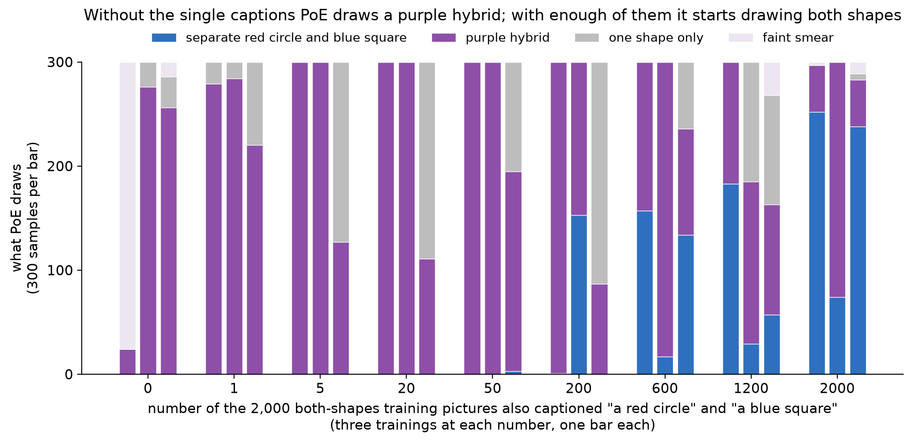
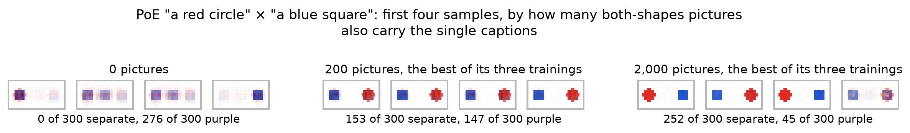
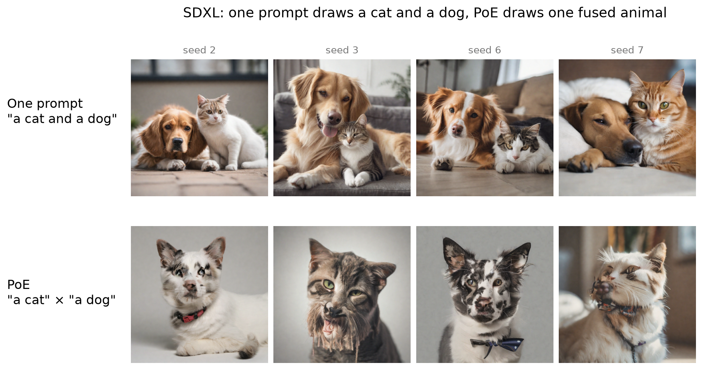
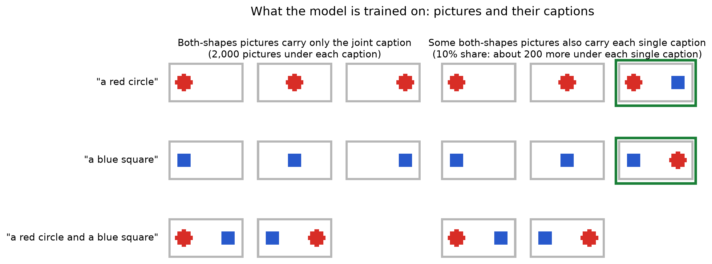
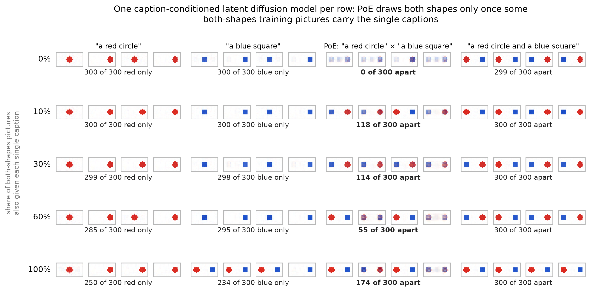
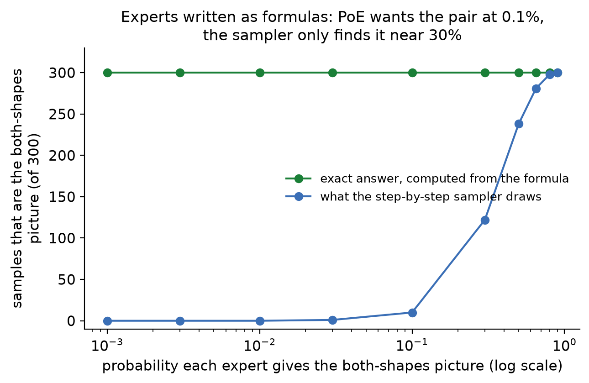
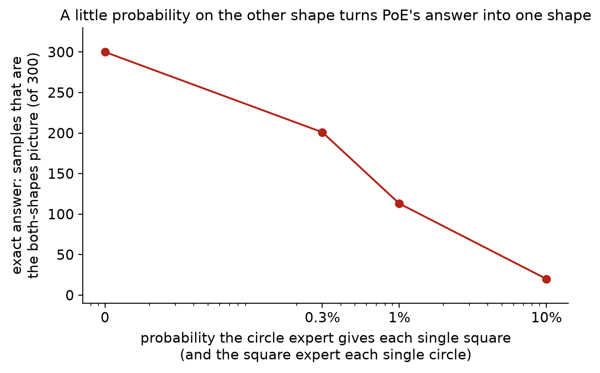
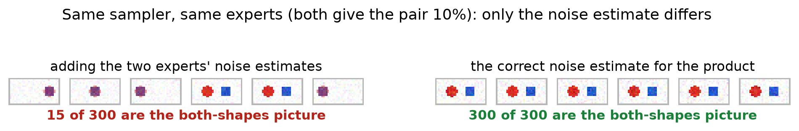
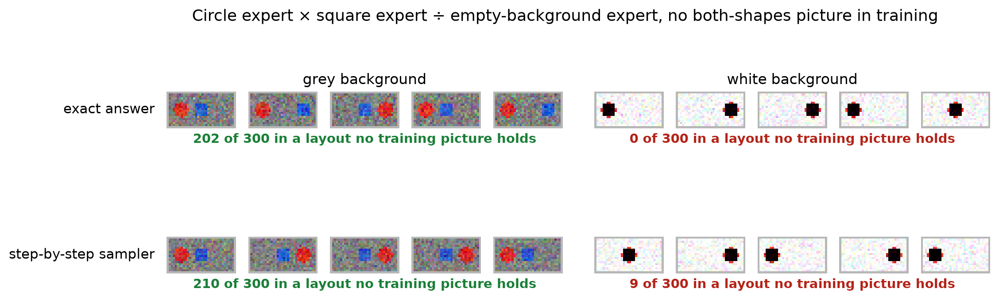

# What PoE needs from training to draw two things at once

This write-up follows one question from SDXL down to a small model we can control completely, and
back up again. Every figure in this folder is drawn by
`artifacts/notes/what-poe-loses-when-it-composes/plain_figures.py` from the saved samples and counts
in the folder above, and the fuller record of each result is that folder's [results card](../README.md).

## The question

PoE on SDXL fails: asked for "a cat" × "a dog", it draws one fused animal. Is part of the reason
how the training pictures that show both things are captioned? A photo of a cat and a dog is
usually captioned "a cat and a dog", almost never just "a cat" or just "a dog". So the "a cat"
expert may never have learned that a picture holding a dog can still be "a cat".

## The answer in a small model

**Yes, in a small model built like SDXL.** When the training pictures holding both shapes carry
only the joint caption, PoE of "a red circle" × "a blue square" draws a purple hybrid, and it
never draws the two shapes separately. When enough of those pictures are also captioned with each
single name, PoE starts drawing a separate red circle and blue square, in up to 252 of 300 samples.
It does not do so on every training, and never in all 300 samples.

Each bar is one trained model and its 300 PoE samples, split by what each sample shows. The x-axis
is how many of the 2,000 both-shapes training pictures were also captioned "a red circle" and
"a blue square". Each number was trained three times with different random seeds, 27 trainings in
all.

**From 0 to 50 pictures, PoE draws no separate pair.** In all 15 trainings, at most 3 of 300
samples are a separate red circle and blue square. Most samples are a purple hybrid, the two shapes
merged into one blob; the rest are a single shape, and one training draws a faint smear instead.

**From 200 pictures up, a separate pair appears.** The median count over three trainings rises
from 1 of 300 at 200 pictures to 134 at 600, 57 at 1,200 and 238 at 2,000. The trainings at each
number disagree a lot (153, 1 and 0 at 200; 157, 17 and 134 at 600; 183, 29 and 57 at 1,200;
252, 74 and 238 at 2,000), so the rise is clear across the whole range but not between neighbouring
numbers.

What those bars look like. At 0 pictures, the samples are purple blobs. At 200 and 2,000 (the
best of each number's three trainings), they are a red circle beside a blue square.

**The model can draw the pair; PoE is the part that fails.** In every one of the 27 trainings, the
joint caption "a red circle and a blue square" drew both shapes in at least 267 of 300 samples.

**The single captions still mean one shape.** Up to 600 pictures, "a red circle" alone drew only
red in at least 290 of 300 samples, and "a blue square" alone only blue in at least 294. At 2,000
these slip to between 223 and 264, because with every both-shapes picture under the single
captions, each single caption sometimes draws the pair itself.

## The problem we started from

SDXL is given the one prompt "a cat and a dog" (top row) and draws both animals. Asked instead
for PoE of "a cat" and "a dog" (bottom row), where each prompt guides the sampler on its own and
the two pushes are added, it draws one animal carrying parts of both: a cat's ears over a dog's
muzzle. The question all of the work below asks is what PoE needs from the model's training to
draw two animals instead of one.

SDXL is too large to change its training freely, so we built a small model where we can.

## Words this uses

**PoE (product of experts).** Each caption defines an expert, a probability over pictures. PoE
multiplies the two experts, so it favours pictures both experts like. In a diffusion model this is
done at every denoising step by adding each caption's push to the empty-caption estimate:
estimate = empty + 3 × [("a red circle" − empty) + ("a blue square" − empty)], where 3 is the
classifier-free guidance strength.

**Both-shapes picture.** A training picture holding a red circle and a blue square side by side.

**Separate red circle and blue square.** How a sample is scored. Each pixel is assigned to the
nearest of four colours: background, red, blue, or purple (red and blue mixed). A sample counts
when it has a red region and a blue region of at least 12 pixels each, apart from each other. This
rule read 100 of 100 of the model's own reconstructions of known pictures correctly.

**Out of 300.** Every count is 300 samples from one trained model with one setting.

## The model

**The VAE** takes a 16 × 32 colour picture and compresses it to 128 numbers, then decodes those
numbers back into a picture, the same kind of compression SDXL's VAE does at a larger size.

**The denoiser** takes three inputs: a noisy version of those 128 numbers, how much noise is in it,
and one of four captions ("a red circle", "a blue square", "a red circle and a blue square", or an
empty caption). It outputs its estimate of the clean 128 numbers, from which the noise estimate
follows.

**Sampling** starts from pure noise, removes it step by step under a caption (or under the PoE sum
above), and the VAE decodes the result into a picture.

## What the model is trained on

6,000 pictures: 2,000 of a single red circle (at one of three positions), 2,000 of a single blue
square, and 2,000 holding both, each with the caption "a red circle and a blue square". That is the
left half. The one thing we change between trainings is on the right: a chosen share of the
both-shapes pictures is added a second time under "a red circle" and a third time under "a blue
square" (outlined in green). We trained five models, at shares of 0%, 10%, 30%, 60% and 100%. At
10% that is about 200 extra pictures under each single caption.

## Every caption, one training per share

One trained model per row, from an earlier run that relabelled a random share of the both-shapes
pictures (0%, 10%, 30%, 60%, 100%: about 0, 200, 600, 1,200 and 2,000 pictures). Each column is one
way of asking the same model. This shows all four captions side by side; the counts in each row are
from one training, and the bars above show how much a second or third training can differ.

**Guidance strength does not rescue 0 pictures.** The 0% model drawn at guidance strengths 1, 2,
3, 5 and 7 gives at most 1 of 300 separate pairs. Figure: [the caption model across guidance](../caption-model-across-guidance.png).

## Why not every sample

Even the best training leaves 48 of 300 samples as something other than a separate pair, and the
others leave far more. Du et al. (2023) point to one reason: PoE samplers add the two experts' noise
estimates at every step, and at high noise that sum is not the noise estimate of the product the
experts define. Step 3 below shows this directly on experts written as formulas, where the correct
estimate can be computed: adding the estimates gave 15 of 300 pairs, and the correct estimate gave
300 of 300 with the same sampler.

In the trained model the correct estimate cannot be computed, so this is a likely reason, not a
measured one. The test Du et al. propose is a corrector: extra Langevin steps at each noise level
that pull the sample toward the product before moving on. On the formula experts a Langevin
corrector raised the pair count from 10 to 30 of 300 at one setting. Whether it helps the trained
model has not been run.

## How we got to that model

The model above is the fifth thing we built. The four before it explain why the result looks the
way it does.

### 1. Experts written as exact formulas

<table><tr>
<td></td>
<td>

We first wrote each expert as a formula: a circle expert that puts most of its probability on
three single-circle pictures and a little on the both-shapes picture, and the same for squares.
With formulas, PoE's answer can be computed exactly, with no training and no sampler.

**The exact answer is the both-shapes picture once each expert gives it even 0.1%** (green, 300 of
300). The step-by-step sampler (blue) only finds it reliably when each expert gives it about 30% to
90%, by which point the two experts are close to the same expert.

</td></tr></table>

### 2. Experts that also give a little probability to the other shape

<table><tr>
<td></td>
<td>

A real text-conditioned "a cat" expert also gives some probability to pictures of dogs. Here
each expert keeps 10% on the both-shapes picture and also gives a little to each of the other
expert's single shapes.

**At 1% per shape, PoE's exact answer is the both-shapes picture only 113 times in 300**, and at
10% only 20; the rest are a single shape. Probability on the other shape works against composing.

</td></tr></table>

### 3. Why the sampler misses what the formula finds

Both experts give the both-shapes picture 10%. The step-by-step sampler normally adds the two
experts' noise estimates (left). At high noise that sum is not the noise estimate of the product.
With the correct estimate for the product (right), which the formulas let us compute, the same
sampler gives 300 of 300. **The sampler loses the pair at the point where the two estimates are
added**, not anywhere else in the sampler. The six samples shown on the left are the first six
drawn; two of them happen to be pairs, against 15 of 300 overall.

### 4. Two separately trained networks

We then trained two small denoisers, one on circle pictures and one on square pictures, each with
the same share of both-shapes pictures, and added their estimates. PoE gave 0 of 300 at every share
from 0% to 50%, and the two networks drifted toward each other before it changed: at 50% the circle
network gave only red in 151 of 300. Numbers: `../toy-trained-experts.json`. SDXL is one network that
reads captions, not two networks, which is why step 5 is the model the finding rests on.

### 5. One caption-conditioned latent diffusion model

The answer at the top.

### 6. A different kind of expert: circle × square ÷ empty background

Here there is no both-shapes picture in training at all. The experts are a circle at any of three
positions, a square at any of three positions, and an empty background, and PoE is circle × square ÷
background. **On a grey background it draws a circle and a square in layouts no training picture
holds**, 202 of 300 exactly and 210 of 300 with the step-by-step sampler. On a white background it
draws one near-black blob (0 and 9 of 300): red and blue are both darker than white, so the formula
prefers stacking both shapes in the same place and subtracting the background.

So the answer at the top holds for the model SDXL resembles, a caption-conditioned model whose
experts come from captions. It is not a rule for every way of building experts.

## Back to SDXL

The toy says to give SDXL's both-animal training photos the single captions too. A pilot does that
with a LoRA fine-tune on 550 photos (200 of a cat, 200 of a dog, 150 of both). In one training
(middle row), the both-animal photos are captioned only jointly. In the other (bottom row), each
time a both-animal photo is used it is captioned "cat" 40% of the time, "dog" 40%, jointly 10% and
left blank 10%. The plain SDXL row is the starting point.

**On these six seeds, PoE of "a cat" and "a dog" still draws one animal in every picture, in both
trainings.** What changes is the kind of animal: with joint captions only, several are fused
cat-dogs; with the single captions added, most are a clean cat or a clean dog. That matches step 2
above, where giving each expert probability on the other's pictures turns PoE's answer into a
single shape. The pilot's real test is 128 seeds per training, which has not been run; eight seeds
cannot carry a finding. The pilot's own record is
[the inclusive-captions walk](../../../drips/inclusive-captions-pilot/EXECUTE_WALK.md).

## What this does not show

**Three trainings per number is few.** The trainings at one number can differ by 150 of 300, so
the median between neighbouring numbers (600 against 1,200) is not ordered reliably; the rise from
0-50 pictures to 600-2,000 pictures is.

**The count understates two shapes in frame.** Many uncounted PoE samples are a reddish circle
beside a bluish square, which is two things in frame with their colours mixed.

**The toy has two shapes, three positions and one picture size.** Nothing here says where SDXL's
equivalent of the share sits, or how much probability its "a cat" gives to dogs.
