# What PoE needs from training to draw two things at once

Every figure here is drawn by `artifacts/notes/what-poe-loses-when-it-composes/plain_figures.py`
from saved samples and counts. The fuller record of each result is the
[results card](../README.md) one folder up.

## The question

<a href="01-the-problem-on-sdxl.png">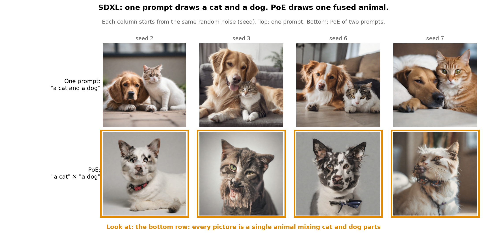</a>

SDXL can be asked for a picture in two ways.

The first way is one prompt, "a cat and a dog" (top row). SDXL draws both animals.

The second way is PoE: one prompt "a cat", one prompt "a dog", and the two combined (bottom row).
SDXL draws one animal with parts of both, such as a cat's ears over a dog's muzzle.

We ask whether part of the reason PoE fails is how the training pictures that show both animals
are captioned. A photo of a cat beside a dog is usually captioned "a cat and a dog". It is almost
never captioned just "a cat" or just "a dog". So the part of SDXL that answers "a cat" may never
have learned that a picture can contain a cat and also a dog.

SDXL is too large to retrain freely, so we built small models where we control every training
picture and every caption.

## The answer, in short

In a small model built like SDXL, yes.

1. **Without the single captions, PoE draws a purple hybrid.** When the pictures holding both
   shapes are captioned only "a red circle and a blue square", PoE of "a red circle" × "a blue
   square" draws a separate circle and square in 0 to 3 of 300 samples (15 models).
2. **With them, it starts drawing both shapes.** When 200 or more of those 2,000 pictures are also
   captioned "a red circle" and "a blue square", PoE draws a separate circle and square in up to
   252 of 300 samples. It is uneven from model to model.
3. **A corrector in the sampler completes it.** Adding Langevin corrector steps to the sampler
   raises those models to 300 of 300. The same corrector leaves the models without the single
   captions at 0 of 300.

So the captions decide whether PoE can find the pair at all, and the sampler decides how often it
does. The sections below build this up one model at a time.

## What PoE does

**An expert is a probability over pictures.** The "a cat" expert gives high probability to
pictures of cats and low probability to everything else.

**PoE multiplies two experts.** A picture scores high under PoE only if both experts give it
some probability. A picture that one expert gives zero gets zero, however much the other likes it.

$$
\underbrace{p_{\text{PoE}}(x)}_{\text{PoE's probability of picture }x}
\;\propto\;
\underbrace{p_{\text{cat}}(x)}_{\text{"a cat" expert}}
\times
\underbrace{p_{\text{dog}}(x)}_{\text{"a dog" expert}}
$$

The sign $\propto$ means "proportional to": the product is rescaled afterwards so that its
probabilities add up to 1.

**In a diffusion model, PoE is applied at every denoising step.** A diffusion model makes a picture
by starting from pure noise and removing a little noise at a time. At each step, the model
estimates which noise to remove. Under PoE, that estimate is built from three estimates of the same
model, one with each prompt and one with an empty prompt:

$$
\underbrace{\hat\epsilon_{\text{PoE}}(x_t)}_{\text{noise to remove at step }t}
=
\underbrace{\hat\epsilon(x_t,\varnothing)}_{\text{empty prompt}}
+\;
\underbrace{3}_{\text{guidance}}
\Big[
\underbrace{\hat\epsilon(x_t,\text{cat})-\hat\epsilon(x_t,\varnothing)}_{\text{push of "a cat"}}
+
\underbrace{\hat\epsilon(x_t,\text{dog})-\hat\epsilon(x_t,\varnothing)}_{\text{push of "a dog"}}
\Big]
$$

Here $x_t$ is the noisy picture at step $t$, and $\hat\epsilon(x_t, c)$ is the model's estimate of
its noise when given the prompt $c$. Each bracket is the push one prompt adds on top of the empty
prompt, and the two pushes are added. The 3 is the classifier-free guidance strength.

## The four models we built

| Model | What it is | What PoE multiplies | What it is for |
|---|---|---|---|
| 1. Formula experts | two probability distributions written by hand, no training and no captions | a distribution over red-circle pictures × a distribution over blue-square pictures | the exact PoE answer can be computed, so we can see what PoE wants apart from how a sampler finds it |
| 2. Two trained networks | two denoisers of 5.3 million parameters each, working on the pixels directly; one trained only on circle pictures, one only on square pictures | the circle network × the square network | the first step from formulas to learned experts |
| 3. One caption model | a VAE (45,707 parameters) plus one denoiser that reads a caption (2.49 million parameters), trained on circles, squares and both, the way SDXL is built | "a red circle" × "a blue square" inside the same network | the model the main result rests on |
| 4. Formula experts with a background | circle, square and empty-background distributions, written by hand | circle × square ÷ background | whether PoE can compose with no both-shapes picture at all |

All four work on the same pictures: 16 pixels high, 32 wide, in colour, on a white background
unless stated. A red circle or a blue square sits at one of three positions (left, centre, right).
The **both-shapes picture** has a red circle on the left and a blue square on the right.

Every count below is out of **300 samples**, which means 300 pictures drawn from one model with
one setting.

**A training run** is one model trained from scratch. Runs 1, 2 and 3 use the same training
pictures and differ only in their random seed, which sets the starting weights and the order the
pictures are seen in. Comparing runs shows how much a result depends on chance in training.

## Model 1: experts written as formulas

### What the two experts are

There are no captions and no training here. Each expert is a probability distribution over
pictures that we write down directly.

**The circle expert** puts its probability around three pictures: a red circle on the left, in the
centre, and on the right. "Around" means it likes those exact pictures most, and pictures very
close to them a little less. The spread is 0.1 on a 0-to-1 scale for each pixel colour.

**The square expert** does the same for the three blue-square pictures.

**Each expert also gives a small share of its probability to the both-shapes picture.** We call
that share the expert's weight on the both-shapes picture, $w$, and we vary it.

Written out, the circle expert is a mixture of four Gaussian bumps:

$$
\underbrace{p_{\text{circle}}(x)}_{\text{circle expert}}
=
\underbrace{\frac{1-w}{3}\sum_{i\in\{\text{L},\text{C},\text{R}\}}\mathcal N\big(x;\,c_i,\,\sigma^2 I\big)}_{\text{a bump on each single-circle picture}}
+
\underbrace{w\,\mathcal N\big(x;\,m,\,\sigma^2 I\big)}_{\text{a small bump on the both-shapes picture}}
$$

Here $x$ is a picture written as its 1,536 numbers (16 × 32 pixels × 3 colours), $c_i$ is the
picture of a red circle at position $i$, $m$ is the both-shapes picture, and $\sigma = 0.1$ is the
width of each bump. $\mathcal N(x; c, \sigma^2 I)$ is a Gaussian centred on picture $c$: it is
highest at $c$ and falls off with the distance from $c$. The square expert is the same with the
three single-square pictures $s_i$ in place of $c_i$.

**PoE multiplies the circle distribution by the square distribution.** Because both are formulas,
the product is a formula too, and we can compute exactly which pictures it prefers. No sampler is
involved in that answer.

### What the product prefers

Multiplying two mixtures gives a mixture over every pairing of one bump from each side. One
Gaussian identity does all the work:

$$
\mathcal N(x;\,a,\,\sigma^2 I)\;\mathcal N(x;\,b,\,\sigma^2 I)
=
\underbrace{\exp\!\Big(-\frac{\lVert a-b\rVert^2}{4\sigma^2}\Big)}_{\text{penalty for how far apart }a\text{ and }b\text{ are}}
\times
\underbrace{\mathcal N\big(x;\,\tfrac{a+b}{2},\,\tfrac{\sigma^2}{2} I\big)}_{\text{a bump halfway between them}}
\times\text{constant}
$$

So pairing a circle bump at $a$ with a square bump at $b$ produces a bump halfway between the two
pictures, weighted down by how far apart they are.

A red-circle picture and a blue-square picture are far apart: $\lVert a-b\rVert^2 \approx 104$,
so with $\sigma = 0.1$ the penalty is $\exp(-2610)$, which is zero for every practical purpose.
The square expert gives a red-circle picture almost no probability, and the circle expert gives a
blue-square picture almost none.

**With no weight on the both-shapes picture**, no picture is liked by both experts. The product
then peaks halfway between a circle picture and a square picture: a faint overlay of the two, which
is purple where they overlap. This is the hybrid.

**With some weight on the both-shapes picture**, that picture is the one place both experts give
probability. Its bump paired with itself has $a = b = m$, so it pays no penalty at all and carries
weight $w \times w$. Every other pairing carries the $\exp(-2610)$ penalty. The product puts
nearly all its probability on the both-shapes picture.

<a href="02-formula-experts-what-poe-wants.png">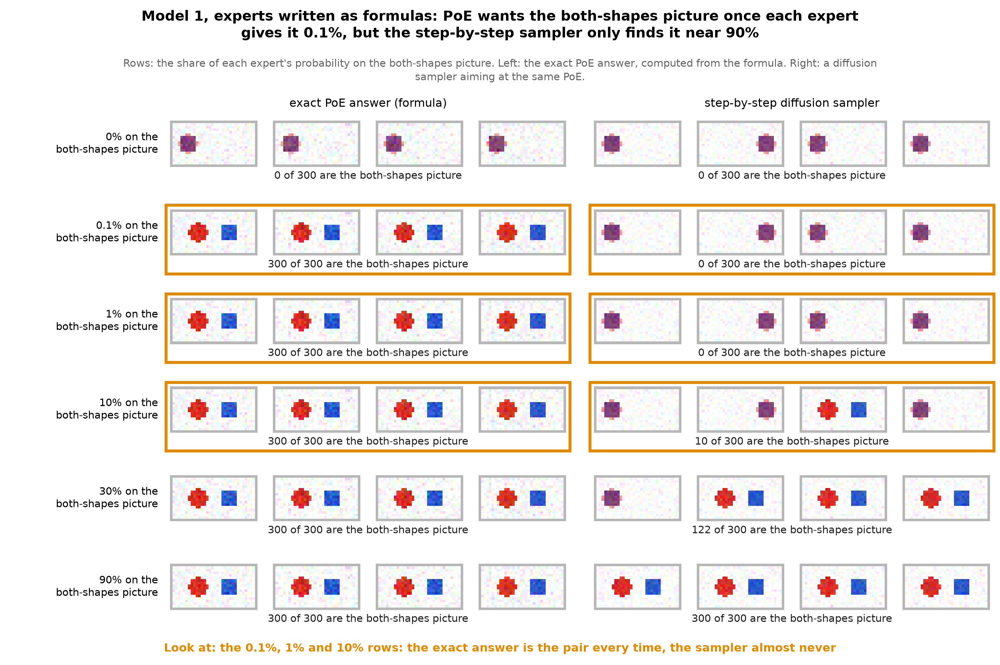</a>

Each row gives both experts a different share on the both-shapes picture. The left column is the
exact PoE answer from the formula; the right is a diffusion sampler aiming at the same PoE.

**With 0%, both columns are a purple overlay.** No picture is liked by both experts.

**From 0.1% up, the exact answer is the both-shapes picture in 300 of 300 samples.** The sampler
draws it 0 times at 0.1% and 1%, 10 times at 10%, 122 times at 30%, and 300 times only at 90%.

So PoE itself needs very little shared probability. The sampler needs a lot.

### When each expert also likes the other shape a little

<a href="03-formula-experts-that-like-the-other-shape.png">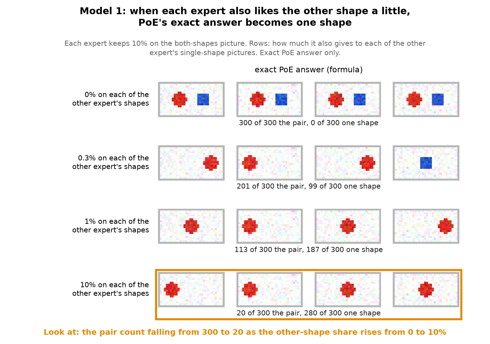</a>

A real "a cat" expert gives some probability to pictures of dogs. Here we copy that. Each expert
keeps 10% on the both-shapes picture, and each row gives a little more to each of the other
expert's single-shape pictures.

Now a lone square is liked by both experts too, and it competes with the both-shapes picture. At
0.3% on each of the other shapes, the exact answer is the pair in 201 of 300 samples; at 1%, in
113; at 10%, in 20. The rest are one shape on its own.

### Where the sampler loses the pair

<a href="04-where-the-sampler-loses-the-pair.png">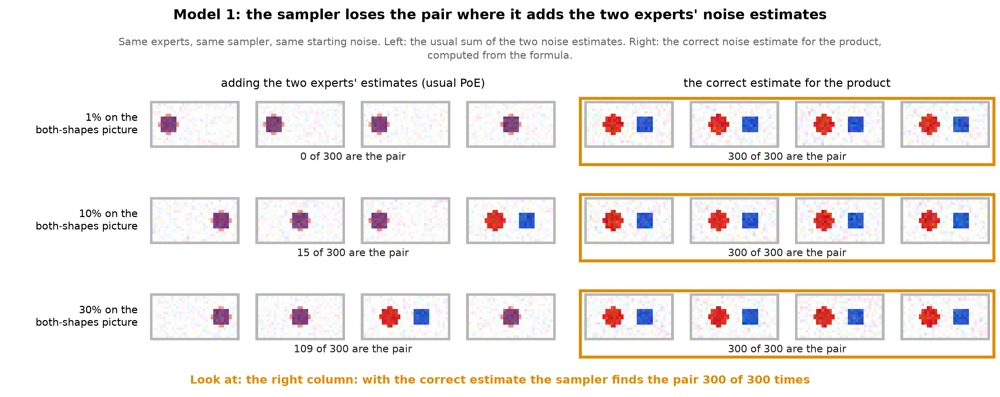</a>

Each row gives both experts a share on the both-shapes picture (1%, 10%, 30%). The exact answer
is the both-shapes picture every time. With the usual sampler (left) it comes out 0, 15 and 109
times in 300. Why?

At each step the sampler needs the noise estimate for the product. The usual way, as in SDXL, is
to add the two experts' noise estimates. That sum is the noise estimate of a different
distribution: the product of the two *noisy* experts, where the correct target is the *noisy
version of the product*. Du et al. (2023) made this point.

$$
\underbrace{\big(p_{\text{circle}}\,p_{\text{square}}\big)_t}_{\text{noisy version of the product: what we want}}
\;\neq\;
\underbrace{p_{\text{circle},t}\;p_{\text{square},t}}_{\text{product of noisy experts: what adding the estimates gives}}
$$

The difference is easy to see in the penalty above. At noise level $t$, a pairing's penalty in
the added-estimate version becomes

$$
\exp\!\Big(-\frac{\lVert a-b\rVert^2}{4}\cdot\frac{\bar\alpha_t}{\bar\alpha_t\sigma^2+1-\bar\alpha_t}\Big),
$$

where $\bar\alpha_t$ is the share of the clean picture left in the noisy one: 1 at the clean end,
near 0 at pure noise. Near pure noise the penalty disappears, so every circle-square pairing counts
as much as the both-shapes picture, and the both-shapes picture's share of the mixture falls to
about $w^2$. The sample commits to a position early, while the penalty is still missing, and it
lands on a single purple blob there.

With formulas we can compute the correct noise estimate for the product at every step. The same
sampler, using the correct estimate (right), gives 300 of 300 in every row. So the loss happens
where the two estimates are added.

## Model 2: two separately trained networks

We trained two small denoisers. One saw only circle pictures, the other only square pictures, and
each also saw the same share of both-shapes pictures. PoE added their noise estimates.

PoE drew a separate circle and square in 0 of 300 samples at every share from 0% to 50%. Before
anything changed, the two networks started to resemble each other: at 50% the circle network on its
own drew only red in 151 of 300 samples. Counts: `../toy-trained-experts.json`.

SDXL is one network that reads a caption, not two networks, so model 3 is the closer copy.

## Model 3: one caption model built like SDXL

### What the model is

**The VAE** takes a 16 × 32 colour picture and compresses it to 128 numbers. It can turn those
128 numbers back into the picture. SDXL's VAE does the same job at a larger size.

**Size.** The VAE has 45,707 parameters. The denoiser has 2.49 million: three layers of 1,024
units each. For comparison, SDXL's denoiser (its UNet) has about 2.6 billion parameters, about a
thousand times more. One training takes about 25 seconds on a laptop GPU: 4,000 steps for the VAE
and 8,000 steps of 256 pictures for the denoiser.

**The denoiser** works on those 128 numbers. It takes three inputs:

1. a noisy version of the 128 numbers,
2. how much noise is in them,
3. one of four captions: "a red circle", "a blue square", "a red circle and a blue square", or an
   empty caption.

**A caption here is a label number, not text.** There is no CLIP and no text encoder. Each of the
four captions is a number from 0 to 3, and the denoiser keeps a learned table of four vectors, 64
numbers each, one per caption. The table is trained together with the rest of the denoiser. SDXL
instead turns the words of a prompt into vectors with two CLIP text encoders. So "relabelling"
below changes which label a training picture is filed under; nothing reads the words.

Its output is its estimate of the clean 128 numbers, which gives the noise estimate.

**Making a picture** starts from pure noise in the 128 numbers. The denoiser removes noise step by
step, 200 steps, guided by a caption. The VAE then turns the result into a picture.

**PoE here** uses the formula from the top, with the two captions:

$$
\hat\epsilon_{\text{PoE}}
=
\hat\epsilon(z_t,\varnothing)
+3\Big[\big(\hat\epsilon(z_t,\text{"a red circle"})-\hat\epsilon(z_t,\varnothing)\big)
+\big(\hat\epsilon(z_t,\text{"a blue square"})-\hat\epsilon(z_t,\varnothing)\big)\Big]
$$

where $z_t$ is the noisy version of the 128 numbers at step $t$.

### What it is trained on

**The pictures.** Every picture is 16 × 32 pixels in colour on a white background. A red circle
or a blue square sits at one of three positions: left, centre or right. A both-shapes picture
has the circle on the far left and the square on the far right, or the other way round. Every
training picture also gets a little random pixel noise (standard deviation 0.1 on a 0-to-1 scale),
so no two training pictures are exactly alike.

**The captions.** Before any relabelling, the 6,000 training pictures are:

| Caption | Pictures under it | What they show |
|---|---|---|
| "a red circle" | 2,000 | one red circle, at a random one of the three positions |
| "a blue square" | 2,000 | one blue square, at a random one of the three positions |
| "a red circle and a blue square" | 2,000 | both shapes, in one of the two layouts |

During training, each picture's caption is swapped for the empty caption 10% of the time, so the
model also learns what a picture looks like with no caption. Guidance and PoE both need that.

<a href="05-the-training-pictures.png">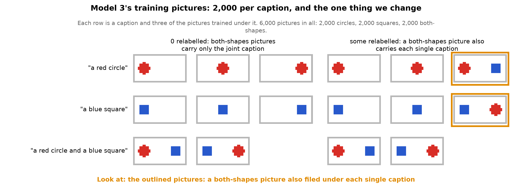</a>

**The one thing we change is relabelling.** We take some of the 2,000 both-shapes pictures and add
each of them twice more: once under "a red circle" and once under "a blue square" (outlined above).
We call this giving them the **single captions**, and a both-shapes picture treated this way is
**relabelled**. "200 relabelled" means 200 of the 2,000 both-shapes pictures are in training three
times, once under each caption. "2,000 relabelled" means all of them are.

This is the toy version of inclusive captioning: a photo of a cat beside a dog also being
captioned "a cat" and "a dog".

<a href="05b-the-training-set-with-and-without-relabelling.png">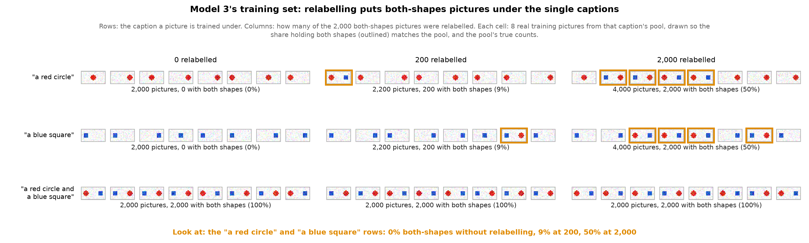</a>

What each caption's pool of training pictures looks like at three levels. Each cell shows eight
real training pictures, drawn so that the share holding both shapes (outlined) matches the pool,
and under it the pool's true counts:

| Relabelled | Pictures under "a red circle" | of which hold both shapes | Pictures under "a blue square" | of which hold both shapes | Training set size |
|---|---|---|---|---|---|
| 0 | 2,000 | 0 (0%) | 2,000 | 0 (0%) | 6,000 |
| 200 | 2,200 | 200 (9%) | 2,200 | 200 (9%) | 6,400 |
| 2,000 | 4,000 | 2,000 (50%) | 4,000 | 2,000 (50%) | 10,000 |

So relabelling changes one thing about each single caption: how often a picture filed under it
also holds the other shape. The joint caption's pool stays the same 2,000 pictures throughout.

We tried 0, 1, 5, 20, 50, 200, 600, 1,200 and all 2,000 relabelled. Each number was trained three
times with different random seeds, so 27 models in all.

### How a sample is scored

Each pixel is given the nearest of four colours: background, red, blue, or purple (red and blue
mixed). A sample counts as a **separate red circle and blue square** when it has a red patch and a
blue patch of at least 12 pixels each, apart from each other. On the VAE's own copies of the known
training pictures, this rule was right 100 times out of 100.

### What PoE draws

<a href="06-what-poe-draws-in-the-caption-model.png">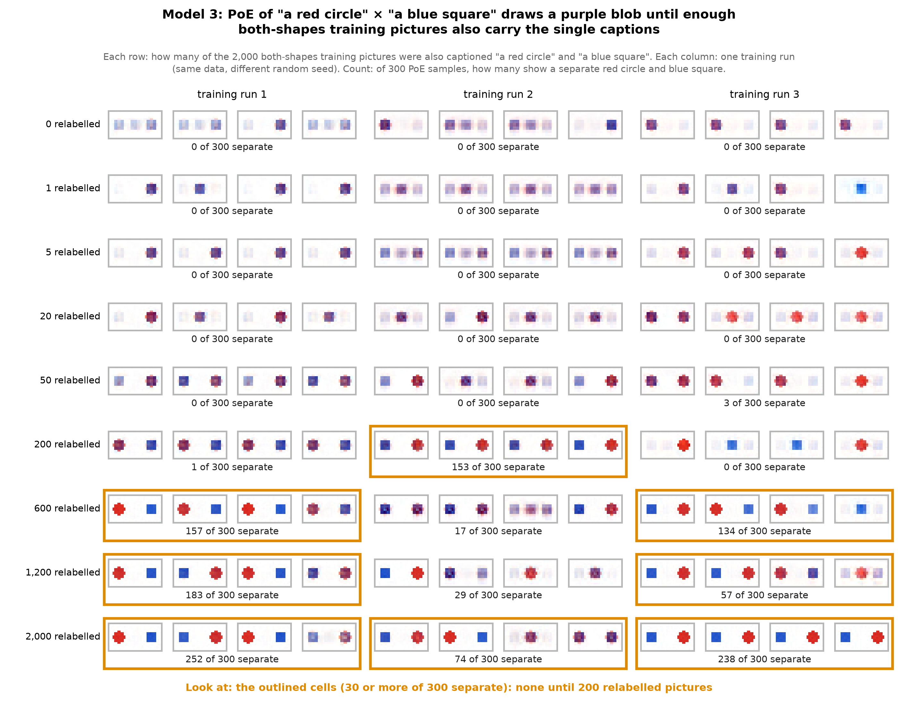</a>

Each cell is one trained model: its first four PoE samples, and how many of its 300 PoE samples
show a separate red circle and blue square. Rows are how many of the 2,000 both-shapes pictures
were relabelled. Columns are the three training runs. Outlined cells reach 30 or more of 300.

**With 0 to 50 of them, PoE draws a purple hybrid.** Across these 15 models, at most 3 of 300
samples are a separate red circle and blue square. Most samples are one purple blob. The rest are a
single shape, and one model draws a faint smear.

**With 200 or more, PoE starts drawing both shapes.** The middle of the three counts at each
number is 1 of 300 at 200, 134 at 600, 57 at 1,200, and 238 at 2,000. The three models at one number
can disagree a lot: 153, 1 and 0 at 200, and 252, 74 and 238 at 2,000.

**The model can draw both shapes. PoE is the part that fails.** In all 27 models, the one caption
"a red circle and a blue square" drew a separate red circle and blue square in at least 267 of 300
samples.

**The single captions still mean one shape.** With up to 600 relabelled pictures, "a red circle" on
its own drew only red in at least 290 of 300 samples, and "a blue square" on its own only blue in at
least 294. With all 2,000, these fall to between 223 and 264, because each single caption then
sometimes draws both shapes by itself.

### Every caption side by side

<a href="07-every-caption-side-by-side.png">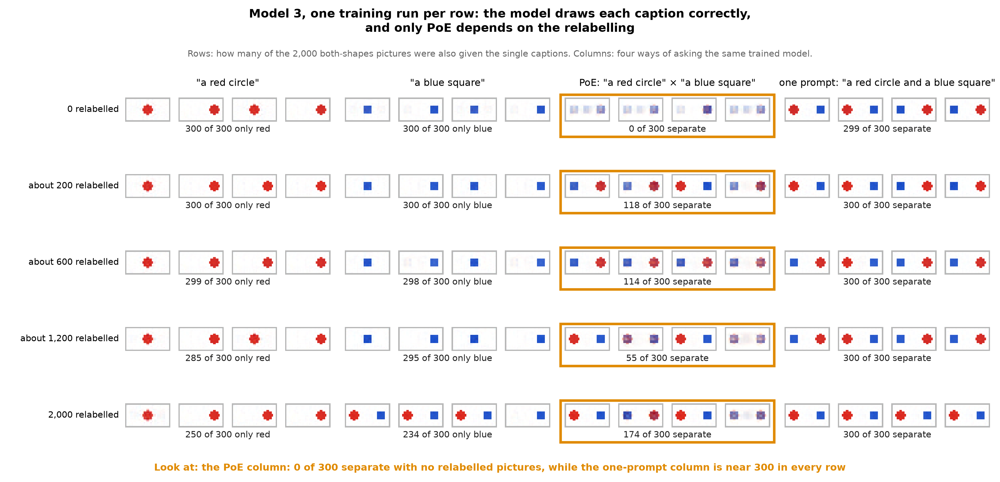</a>

This grid is from an earlier run with one model per row. Each row gave a random share of the
both-shapes pictures the single captions: 0%, 10%, 30%, 60% and 100%, which is about 0, 200, 600,
1,200 and 2,000 pictures. The four columns ask the same model in four ways. Each row's counts come
from one model only; the grid above shows how much a second or third run can differ.

**A stronger guidance does not rescue the 0% model.** Drawn at guidance strengths 1, 2, 3, 5 and 7,
it gives at most 1 of 300 separate pairs ([the 0% model across guidance](../caption-model-across-guidance.png)).

### Adding a corrector to the sampler

Model 1 showed that adding the two noise estimates loses the pair at high noise. A **Langevin
corrector** is the standard remedy (Du et al. 2023). After each normal denoising step, the sampler
stays at the same noise level and takes a few extra small steps that pull the sample toward
pictures the PoE estimate rates more likely, with a little fresh noise each time:

$$
\underbrace{z}_{\text{sample after}}
\;\leftarrow\;
\underbrace{z}_{\text{sample before}}
+\;
\underbrace{\eta\, s(z)}_{\text{move toward higher PoE probability}}
+\;
\underbrace{\sqrt{2\eta}\;\xi}_{\text{a little fresh noise}},
\qquad
s(z) = -\frac{\hat\epsilon_{\text{PoE}}(z)}{\sqrt{1-\bar\alpha_t}},
\quad
\eta = 0.05\,(1-\bar\alpha_t)
$$

Here $s(z)$ is the direction in which PoE's probability rises fastest, read off the same PoE noise
estimate as before. $\xi$ is fresh Gaussian noise, and $\eta$ is the step size, larger at high
noise. We tried 5 and 20 such steps at every noise level.

The rule for reading it was written before the run. The corrector helps if the middle count of
four models rises by at least 30 of 300, while "a red circle" and "a blue square" on their own
still draw at least 240 of 300 of their own colour. The four models were three trained with all
2,000 both-shapes pictures under the single captions, and one trained with 200.

<a href="08-the-corrector.png">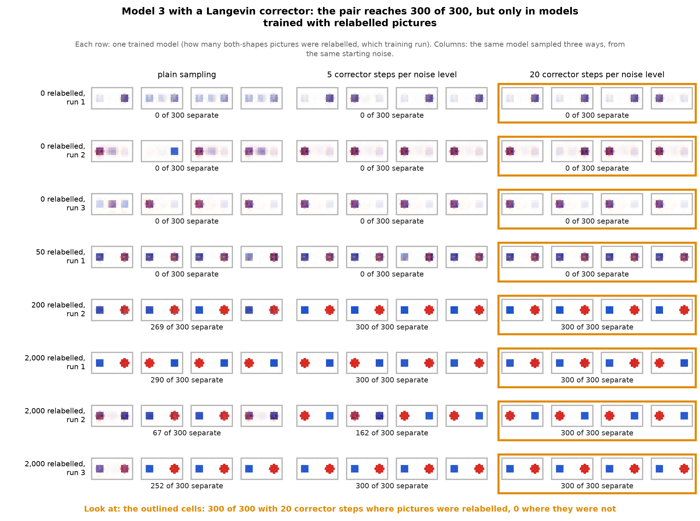</a>

Each row is one model, retrained for this test, named by how many pictures were relabelled and
which training run it repeats. Each column is one way of sampling it, from the same starting
noise.

**With the single captions in training, the corrector completes the pair.** The middle count of
the four models rose from 260.5 of 300 with plain sampling to 300 with 5 corrector steps. With 20
steps, all four models drew a separate red circle and blue square in 300 of 300 samples. The
single captions on their own stayed at 271 or more of their own colour. This meets the rule.

**Without them, the corrector does nothing for the pair.** We added this check after seeing the
result above: three models with 0 relabelled pictures and one with 50, sampled the same way. All
four stayed at 0 of 300 separate, with 5 and with 20 corrector steps. The corrector tidied their
samples into a purple hybrid, 299 or 300 of 300. The 50-picture model draws two blobs in two
places, but both are purple, so the scorer does not count them.

So the two pieces do different jobs. **The single captions make the pair something PoE can find.**
**The corrector removes the shortfall the plain sampler leaves.** Neither one alone draws the pair
every time.

The models here were retrained with the same seeds as before. Training on a GPU does not repeat
exactly, so the plain counts differ from the first trainings (269 against 153 for the 200-picture
model, for example). Each comparison is between samples from the same retrained model. Counts:
`../toy-caption-corrector.json` and `../toy-caption-corrector-no-single-captions.json`.

## Model 4: formula experts with a background

<a href="09-composing-with-no-both-shapes-pictures.png">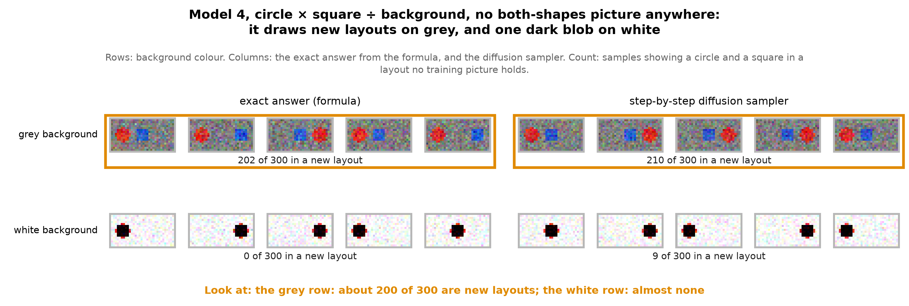</a>

This model has no both-shapes picture anywhere. There are three distributions, written by hand:
a red circle at one of three positions, a blue square at one of three positions, and the empty
background. PoE here is circle × square ÷ background:

$$
p(x)\;\propto\;\frac{p_{\text{circle}}(x)\;p_{\text{square}}(x)}{p_{\text{background}}(x)}
$$

Each expert describes a whole picture, background included. Multiplying the two counts the
background twice, and dividing by the background expert removes one copy. With Gaussian bumps of
equal width, the circle-at-$i$, square-at-$j$ pairing lands on the picture
$c_i + s_j - b$ (circle picture plus square picture minus the empty picture), with weight

$$
\exp\!\Big(\frac{\langle c_i-b,\;s_j-b\rangle}{\sigma^2}\Big),
$$

where $\langle\cdot,\cdot\rangle$ multiplies the two pictures' differences from the background
pixel by pixel and adds them up.

**On a grey background, it draws a circle and a square in layouts no training picture holds.** A
circle and a square at different positions share no pixel, so that weight is $\exp(0) = 1$ for
every apart layout, and each is as likely as any other. The exact answer lands on one of the four
layouts no training picture holds in 202 of 300 samples, and the sampler in 210.

**On a white background, it draws one near-black blob** (0 and 9 of 300). Red and blue are both
darker than white in every colour channel, so where the two shapes overlap the two differences
point the same way and the weight is far above 1. The same-position pairing takes nearly all the
mixture, and $c_i + s_i - b$ is the two shapes stacked and the white subtracted, which is near
black.

So composing without any both-shapes picture is possible for experts built this way. The answer
about captions holds for the kind of model SDXL is, where each expert comes from a caption.

## Back to SDXL

<a href="10-sdxl-inclusive-captions-pilot.png">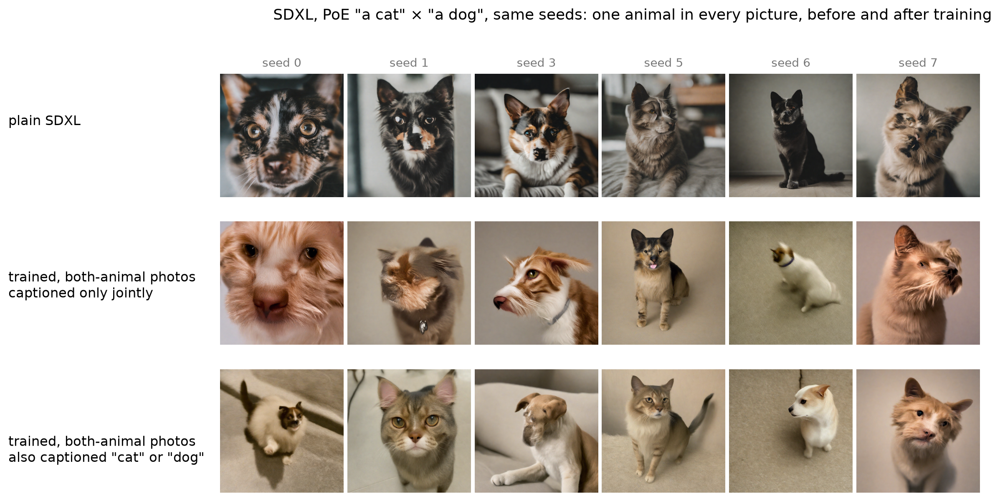</a>

The small model says to give SDXL's both-animal photos the single captions too. A pilot does this
with a LoRA fine-tune of SDXL on 550 photos: 200 of a cat, 200 of a dog, 150 of both.

- **Middle row:** the both-animal photos are captioned only "a cat and a dog".
- **Bottom row:** each time a both-animal photo is used in training, it is captioned "cat" 40% of
  the time, "dog" 40%, "a cat and a dog" 10%, and left blank 10%.
- **Top row:** plain SDXL, before any training.

On these six seeds, PoE of "a cat" × "a dog" still draws one animal in every picture, in both
trainings. What changes is the animal. With joint captions only, several are fused cat-dogs. With
the single captions added, most are a clean cat or a clean dog. That matches model 1, where an
expert that likes the other's pictures turns PoE's answer into a single shape.

Six or eight seeds cannot carry a finding. The pilot's planned test is 128 seeds per training,
which has not been run. Its record is [the inclusive-captions walk](../../../drips/inclusive-captions-pilot/EXECUTE_WALK.md).

## What this does not show

**Three models per number is few.** Models at the same number can differ by 150 of 300. So the
order between neighbouring numbers, 600 against 1,200, is not reliable. The rise from 0 to 50
pictures up to 600 to 2,000 pictures is.

**The corrector settings were not tuned.** Only 5 and 20 steps at one step size were tried. A
weaker corrector might leave a gap, and the 0-picture check covers only those two settings.

**Relabelling also makes the training set larger.** Training always runs 8,000 steps of 256
pictures, so at 2,000 relabelled (10,000 pictures) each picture is seen about 200 times, against
about 340 times at 0 (6,000 pictures). The comparison does not separate the caption change from
that small change in exposure.

**The count misses some samples with two shapes.** Many uncounted PoE samples are a reddish circle
beside a bluish square. That is two shapes in frame with their colours mixed.

**The toy has two shapes, three positions and one picture size.** It does not say how many
both-animal photos SDXL would need, or how much probability SDXL's "a cat" gives to dogs.
