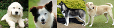

# Scenes: Shared

<!-- index: written by scripts/regroup/artifacts_index.py; edit the items, not this file -->

| Scene | What it is | Picture | Last change |
|---|---|---|---|
| [Scene: the denoising step and log-SNR, as two names for one clock](logsnr-explainer/README.md) | scene-logsnr/` in this sweep; port and exact launch command stated, not independently | — | 2026-11-13 |
| [dl-scene: the v4 pipeline's VAE, level by level](sdxl-vae-architecture-map/README.md) | collision with the other scene on the same node, at `artifacts/scenes/logsnr-explainer/README.md:16`, |  | 2026-08-24 |
| [What sampling an image means](what-sampling-an-image-means/README.md) | Three connected scenes that start from the heights of ten people, yours at 173 cm, and end with a sampler turning pure noise into a clean dog photo. |  | 2026-10-28 |
