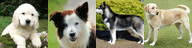

# Scenes: Shared

<!-- index: written by scripts/regroup/artifacts_index.py; edit the items, not this file -->

| Scene | What it is | Picture | Last change |
|---|---|---|---|
| [Composing by Regions](composing-by-regions/README.md) | Six frames on how region-based methods reconcile overlapping windows, worked on an invented canvas of 8 positions. | — | 2026-11-23 |
| [How CO3 corrects a step](how-co3-corrects-a-step/README.md) | One round of the CO3 corrector on SDXL, taken apart symbol by symbol on a picture you can drive. | — | 2026-11-22 |
| [Scene: the denoising step and log-SNR, as two names for one clock](logsnr-explainer/README.md) | scene-logsnr/` in this sweep; port and exact launch command stated, not independently | — | 2026-11-21 |
| [Outside Planners and Critics](outside-planners-and-critics/README.md) | Fourteen presses on what RPG's language-model planner and CountLoop's critic add to text-to-image, and what each outside model costs. | — | 2026-11-23 |
| [Sampler or Score](sampler-or-score/README.md) | Five frames that separate the two ways a composition of two Gaussian experts can miss its target: the sampler and the score. | — | 2026-11-23 |
| [dl-scene: the v4 pipeline's VAE, level by level](sdxl-vae-architecture-map/README.md) | collision with the other scene on the same node, at `artifacts/scenes/logsnr-explainer/README.md:16`, |  | 2026-08-24 |
| [The Commitment Time](the-commitment-time/README.md) | The formula T_s = ½ ln λ_max, the time scale on which a sample commits to a class, taken apart one press at a time on a 2D toy. | — | 2026-11-23 |
| [What sampling an image means](what-sampling-an-image-means/README.md) | Three connected scenes that start from the heights of ten people, yours at 173 cm, and end with a sampler turning pure noise into a clean dog photo. |  | 2026-10-28 |
