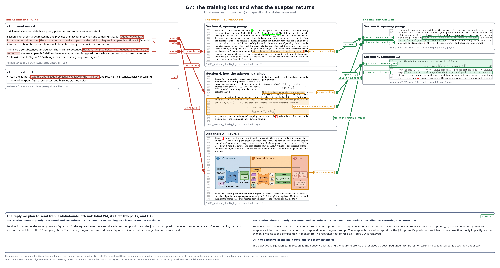

# ICLR 56173 review response, one page per claim group

Each figure takes one group of reviewer claims and puts four things on one page. On the left is the reviewer's words, then the submitted paper's weak passage, then the revised paper's answer, and below them the reply we plan to send. Red marks the reviewer's point, orange the submitted weakness and green the revised answer. Every excerpt is a crop of a page render, with its file and page printed under it. The claims and their groups come from [the claim table](../../drips/present-revision-to-supervisor/claims.md).

**How these are made**

`draw_review_figures.py` renders each source page (Reviews.pdf at 300 dpi because it is vector shapes with no text layer, both papers at 200 dpi). It finds each passage by its words, using pdftotext word boxes for the papers and tesseract OCR for Reviews.pdf, and cuts the crop halfway between text lines. Boxes are drawn around the found words. `figure_specs.py` holds one spec per group: which passages to crop, which words to box, the arrows, and the reply sections. The reply panel copies the reply file's own paragraphs under the named headings and leaves out the reviewer quotations, which the left column already shows.

Redraw one group with `python3 artifacts/scenes/iclr-review-response/draw_review_figures.py G7`, or all of them by leaving out the group name. Raw crops are written to `artifacts/drips/present-revision-to-supervisor/crops/` as `<source>-p<page>-<claim>.png`.

## The figures

**G7: The training loss and what the adapter returns**

The figure covers claims K-W4a, K-W4b and K-Q4. k4nd's weakness 4 and question 4 (Reviews.pdf page 5) point at submitted Section 4 (page 7), where no loss is written and each evaluation is said to return the correction, and at Figure 8 (page 12), where the squared error appeared only in the diagram. The revision answers on page 7 of the rebuilt PDF (`paper/iclr-56173/build/iclr2027_conference.pdf`): each evaluation returns a noise prediction, and inference is the usual product-of-experts step with the adapter switched on, which replaces the submitted equation that added the adapter's change at strength λ. On page 8, Equation 12 states the loss, and the adapter is said to learn the joint prompt's prediction and the correction only implicitly. The reply is k4nd W4's first two parts and Q4 from `replies/k4nd-and-uhz6.md`. The changes behind it are commits 8ef00a17, 88f02a45, ead813ab and 2e9af75c. Status: answered.
