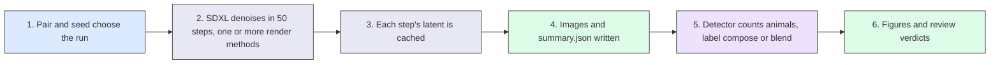
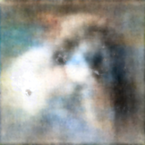
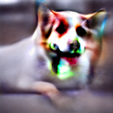
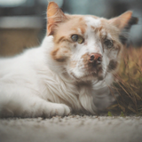

# 🌍 Where the data comes from

Every number and image in this project traces back to one SDXL sampling run, cached at every
denoising step, then scored by a fixed rule. This file walks that journey once, stage by stage,
so a reader can place any file they find on disk.

> 🖼️ **Diagram wanted**: the process-lane piece "prompt pair to cached trajectory to scorer to
> figure", per [diagram-prompts.md](../diagram-prompts.md). Not yet rendered.

## Table of contents

- [The journey](#the-journey)
- [The two filesystems](#the-two-filesystems)
- [Where this came from](#where-this-came-from)
- [🖼️ In pictures, code and further reading](#in-pictures-code-and-further-reading)

## The journey

Navigation: 📋 [TOC](#table-of-contents) | [Next](#the-two-filesystems) ➡️

**① A pair and a seed choose the run.** ✅

Two animal prompts (see [world/animal-pair.md](../world/animal-pair.md)) and a seed fix which
model call is made. `poe_repair/pairs.py` names the base pair list; the fail-rate table that
selects the current pool now lives at
`1-lora-correction/artifacts/results/does-it-reach-unseen-pairs/the-transfer/does-the-fix-reach-unseen-pairs/fail_rate.md` (the directory this file's
sources were read from, `outputs/animals_compose_transfer/`, no longer exists on disk, see
[Still open](../00-INDEX.md#still-open)). `data/pilot/seed_<n>/<slug>/` is the output layout for
one pair-and-seed run, used by this project since the pilot stage. ✅

**② SDXL runs the 50-step denoising schedule under one or more render methods.** ✅

For a given pair and seed, several render methods can be run: plain PoE, Mono (the literal joint prompt),
PoE plus the [interaction term](../world/interaction-term.md) injected over a window at a chosen strength (λ), or PoE plus the
trained LoRA's own prediction. `poe_repair/methods/_sampling.py` (per `README.md`'s repo layout)
holds the functions for each: `run_cfg`, `run_cfg_poe`, `run_teacher_residual`,
`run_lora_residual_inject`. Model: `stabilityai/stable-diffusion-xl-base-1.0`, verified directly
from `data/pilot/seed_42/a_cat__x__a_dog/summary.json`'s `model_id` field. ✅

**③ Per-step state is cached, not only the final image.** ✅

Because every step's latent state is needed to measure the interaction term and to decode
intermediate estimates, the run caches enough to recompute the model's running estimate of the
finished image at any step (the Tweedie-formula estimate `1-lora-correction/report/experiments-log.md`'s EXP-01 uses). This is
what lets several later measurements (the commitment step, and re-running the injection window
across many settings) be re-derived from the cache alone, with no further GPU sampling, per
`1-lora-correction/report/experiments-log.md`'s repeated "cache only" compute notes. ✍️

> The Tweedie formula turns a noisy latent and the model's noise prediction at that step into the
> model's best guess of the clean image it is heading toward. It is what makes an intermediate
> step viewable as a picture.

**④ The images and summary for one run are written to disk.** ✅

A pilot run (`data/pilot/seed_42/a_cat__x__a_dog/`) holds five PNGs (PoE, Mono, each concept
alone, a trajectory-manifold plot) and a `summary.json` carrying the interaction term's per-step
and final magnitude. Full-pool runs write the equivalent to `outputs/<family>/` on
`/home-mscluster` or its mirror on `/datasets` (see [The two filesystems](#the-two-filesystems)).

**⑤ The compose-rate scorer reads the final image and produces a label.** ✅

`GroundingDINO` (`IDEA-Research/grounding-dino-tiny`) is run against the rendered image, counts
distinct "animal" instances, and the rule in
[world/compose-rate.md](../world/compose-rate.md#what-a-compose-rate-is) turns that count into a
`compose` or `blend` label. Per-pair rates are aggregated across seeds
(`1-lora-correction/artifacts/results/does-it-reach-unseen-pairs/the-transfer/does-the-fix-reach-unseen-pairs/fail_rate.md`).

**⑥ Labelled runs feed figures and review-file verdicts.** ✍️

A figure (tracked in `MASTER_PLAN.md`'s paper table) reads a set of runs' labels and images
directly; a plan's review file records the verdict against a threshold fixed before the run
(`~/.claude/EXPERIMENT_CONVENTIONS.md`). Neither figures nor verdicts are restated in this folder;
see [Cross-linking](../00-INDEX.md).

## The two filesystems

Navigation: ⬅️ [The journey](#the-journey) | 📋 [TOC](#table-of-contents) | [Next](#where-this-came-from) ➡️

**Run bytes live on two filesystems that are not always in sync, and a script has to be told which
one it is writing to.** ✅

`/home-mscluster` is the git working tree; `/datasets` is a larger, non-git mount used for large
artefacts, per this project's own `CLAUDE.md`: "Large artifacts go to `/datasets` only, because
`/home-mscluster` hit 100% once and silently killed checkpointing." `RETROFIT.md`'s census recorded
several run families split across both, with some folders (e.g. `interaction_term/dose`, 6.3G)
existing as real data on one filesystem and a zero-byte placeholder on the other, as of
2026-08-23. ✍️ This context file does not restate the environment's paths, sizes, or disk-guard
rule; the file that owns them is
[environment/storage.md § Access paths](../../environment/storage.md#access-paths).

## Where this came from

Navigation: ⬅️ [The two filesystems](#the-two-filesystems) | 📋 [TOC](#table-of-contents) | [Next](#in-pictures-code-and-further-reading) ➡️

| What | How it was established | When |
|---|---|---|
| The render-method functions and their names | Read in `README.md`, repo layout section | 2026-08-24 |
| One run's on-disk shape and its model id | Read directly, `data/pilot/seed_42/a_cat__x__a_dog/summary.json` | 2026-08-24 |
| The scorer's compose/blend rule | Read in `1-lora-correction/artifacts/results/measuring-composition/the-scorers/can-we-trust-the-compose-score/compose-scorer-validation/scorer_validated.json` | 2026-08-24 |
| The two-filesystem split and its sync gaps | Read in `RETROFIT.md`, section 2 ("Moving") | 2026-08-24 |
| The "cache only" measurement principle | Read in `1-lora-correction/report/experiments-log.md`, EXP-01 and EXP-04 compute notes | 2026-08-24 |

<!-- related:start (drain) -->
<a id="in-pictures-code-and-further-reading"></a>

## 🖼️ In pictures, code and further reading

Navigation: ⬅️ [Previous](#where-this-came-from) | 📋 [TOC](#table-of-contents)

The six stages above end in a picture and a label. The diagram below lays the stages in one line, the code shows the one loop that does stages two and three, and the pictures show what a cached step looks like.

### How it fits together



Key: blue loads the inputs, grey-purple is the sampling work, violet is the judgement, green is what lands on disk. The stage names are the page's own six; the page's "diagram wanted" slot for a rendered version stays open.

### The code behind it

Stages two and three are one loop. Excerpt from `poe_repair/methods/_sampling.py` (lines 171 to 182), from plain PoE's sampler `run_cfg_poe`:

```python
        eps_p = poe_eps(eps_a, eps_b, eps_uncond)
        alpha_bar_t = scheduler.alphas_cumprod[int(timestep.item())].to(device=device, dtype=dtype)
        x0 = tweedie_mean(latents, alpha_bar_t, eps_p)
        tracker.store_step(
            step_index, latents, eps_p,
            float(step_index) / float(num_inference_steps),
            int(timestep.item()),
        )
        latents = ddim_prev_from_x0_eps(
            scheduler=scheduler, timestep=timestep, step_index=step_index,
            x0=x0, eps=eps_p,
        )
```

- `x0 = tweedie_mean(...)` is the running estimate of the finished image the page's stage three describes.
- `tracker.store_step(...)` keeps that step's latent and combined prediction in memory, in the tracker `run_cfg_poe` returns. Saving it to disk is left to the calling script.
- `ddim_prev_from_x0_eps(...)` takes the next step from that estimate.

### What comes out

<a href="../../data/pilot/seed_42/a_cat__x__a_dog/trajectory_manifold.png"></a>

One pair and seed (cat and dog, seed 42), four renders, their denoising paths projected to two axes (PC1/MDS1 across, PC2/MDS2 up), all leaving one shared start point `verified` (opened and read). No tracked script names this plot file, so its link to the stage three cache is unconfirmed.

### Further illustrations

**Evidence**

<a href="../../1-lora-correction/artifacts/scenes/where-each-condition-lands/public/frames/poe/seed_12/step_000.png"></a>
<a href="../../1-lora-correction/artifacts/scenes/where-each-condition-lands/public/frames/poe/seed_12/step_010.png"></a>
<a href="../../1-lora-correction/artifacts/scenes/where-each-condition-lands/public/frames/poe/seed_12/step_050.png"></a>

The running estimate of the finished image for plain PoE, cat and dog, held-out seed 12, at steps 0, 10 and 50: a grey blur, a dog-like face with coloured speckle, and a finished fused face `verified` (opened and read). The scene's data file describes each frame as the Tweedie mean of that step, decoded, and the scene card says the final image is saved as step 50 `stated` (`public/data.json` and the scene card).

**Scene**

[From 173 cm to a Dog](https://claude.ai/artifact/NYeZh73Sg18F2Ui4ZvNxrV): three connected scenes from the heights of ten people to a sampler turning noise into a dog photo, the idea behind the page's "best guess of the clean image" `stated` (scene card; private to its owner until shared).

### Go deeper

| What | Link |
|---|---|
| The scene's card | [what sampling an image means](../../artifacts/scenes/what-sampling-an-image-means/README.md) |
| The step-by-step scene's card | [where each condition lands](../../1-lora-correction/artifacts/scenes/where-each-condition-lands/README.md) |
| The storage facts | [environment storage](../../environment/storage.md#access-paths) |
| The fields in the files | [the dictionary](02-dictionary.md) |
| What is produced | [what we produce](../purpose/02-what-we-produce.md) |

### Still open

- The page cites `fail_rate.md` and `scorer_validated.json`. Both exist only in the cluster checkout (checked 2026-11-21), because their `results/` folders are git-ignored. No sample of either is quoted.
- No recorded run of stage ⑥ (a figure built from labels) is placed here.
<!-- related:end -->

## Cross-references

- The mention of **two filesystems** in [the environment index, under Before I...](../../environment/00-INDEX.md#before-i).
- The mention of **two separate filesystems** in [the environment overview](../../environment/overview.md).

<!-- built-to: PAGE_LOOK_FORMAT v1 -->
