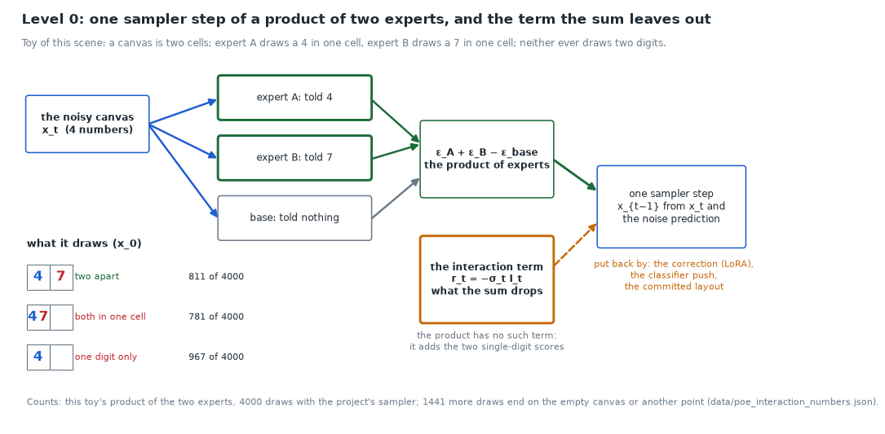
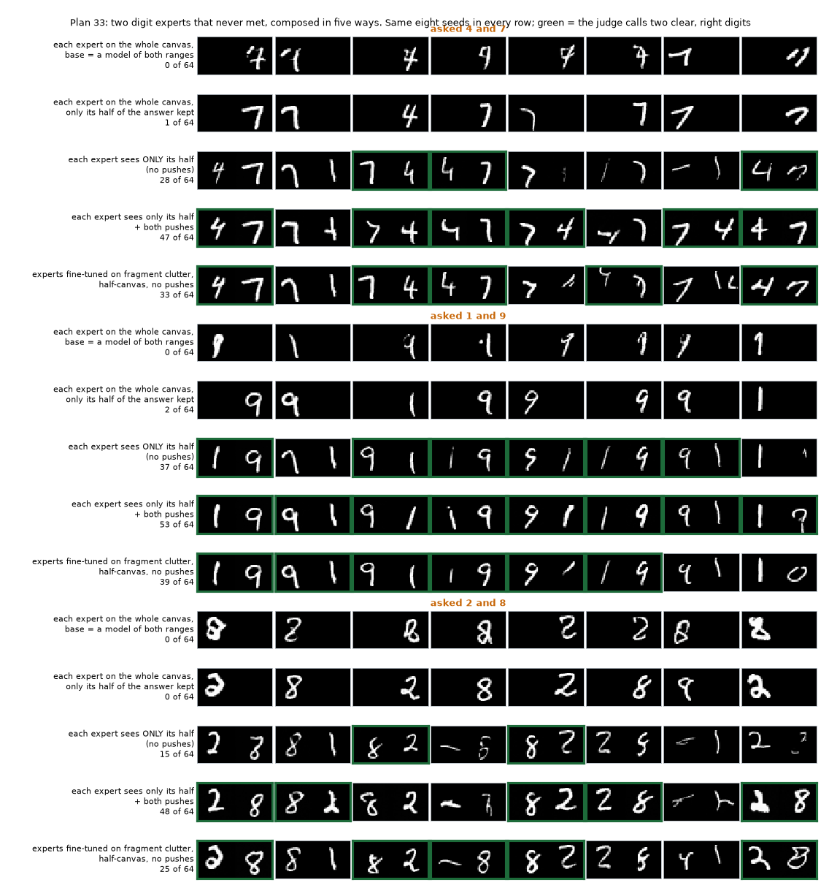
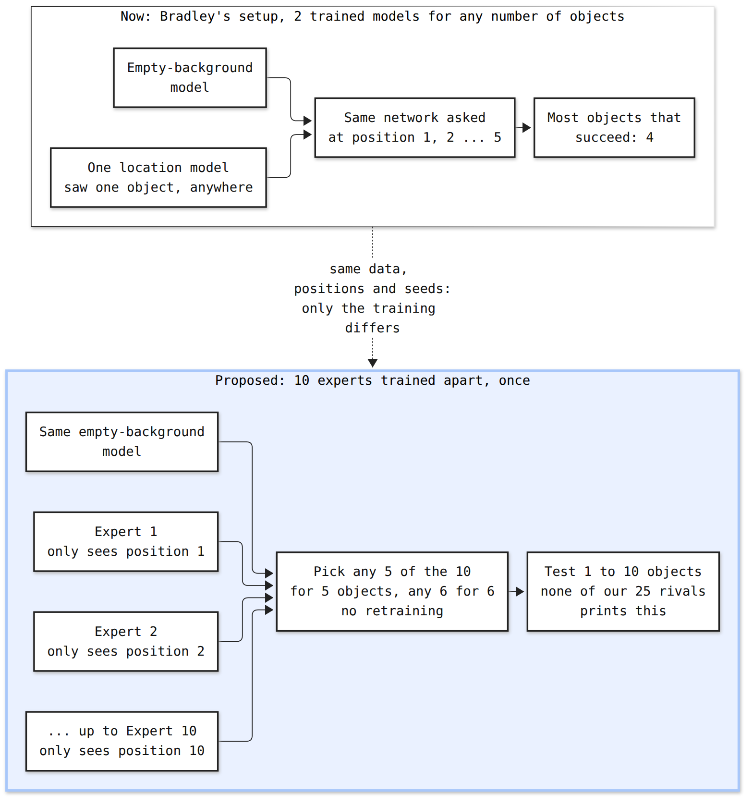

# 🌍 Context: the product of experts, one sampler step

⬅️ Previous: [the methods index](../00-INDEX.md) | 📋 [The pages of this method](#the-pages-of-this-method) | Next: [the score fields and the time profile](02-the-network-view.md) ➡️

A product of experts draws a picture by adding the noise predictions of models that each know one thing, then taking one sampler step, and the piece the sum leaves out is the interaction term. What product-of-experts composition means for this project, and what Mono is, lives in [PoE composition](../../world/poe-composition.md#what-poe-composition-is); what the interaction term `r_t` is, and how it is measured on SDXL, lives in [the interaction term](../../world/interaction-term.md#what-the-interaction-term-is). This folder adds what those two pages do not carry: the zoom ladder's pictures, a toy where every number is exact, and the code. Every picture here is one of the ladder's own, in [the product-of-experts scene](../../../2-classifier-guidance/artifacts/scenes/product-of-experts-interaction-term/README.md).

*One sampler step on the scene's toy. The blue box is the noisy canvas, four numbers in the toy. The three boxes to its right are the models: expert A told 4, expert B told 7 (green) and the base told nothing (grey). The green box adds their noise predictions as ε_A + ε_B − ε_base, and the blue box on the right takes the step. The orange box is the interaction term, which the sum never computes. The counts at the lower left are what the toy's product draws in 4000 draws: 811 with a 4 and a 7 in different cells, 781 with both in one cell, 967 with one digit only, and 1441 that end on the empty canvas or another point.* ✅

## Table of contents

- [Words this page uses](#words-this-page-uses)
- [What one step does](#what-one-step-does)
- [The names, taken apart](#the-names-taken-apart)
- [The identity, by what moves](#the-identity-by-what-moves)
- [How it fails and how you know it worked](#how-it-fails-and-how-you-know-it-worked)
- [The same step on the real digit experts](#the-same-step-on-the-real-digit-experts)
- [What is measured where](#what-is-measured-where)
- [The pages of this method](#the-pages-of-this-method)
- [Where this came from](#where-this-came-from)
- [Read more](#read-more)

## Words this page uses

Navigation: 📋 [TOC](#table-of-contents) | [Next](#what-one-step-does) ➡️

**Expert**: a model told one label (draw a 4) that has only ever seen pictures of that one thing.

**Base**: the same kind of prediction made with no label at all. The sum takes it off once, because each expert's prediction already contains it.

**Noise prediction (ε) and score (s)**: two views of one arrow. The score points toward pictures the model finds more likely; the noise prediction is the same arrow scaled and flipped, ε = −σ_t s, where σ_t is how much noise the canvas still holds at step t.

🔤 **The name:** noise prediction
- **noise**: the random speckle mixed into the canvas. **prediction**: a guess at it. On the toy, the model's guess at how much speckle sits in each of the canvas's four numbers.
- **Formula, in those words:** the guessed speckle is the score's pull, flipped and multiplied by the noise still in the canvas: ε = −σ_t s.
- **Consequence:** at step 25, where σ_t is 0.693, the product's pull of −0.932 on "how much 4 in the left cell" is a noise prediction of +0.646, and the joint's pull of −0.156 is +0.108. Move σ_t to 0.986, its value at step 5, and the same pull of −0.932 would be a noise prediction of 0.919, so one pull reads as a bigger noise guess on a noisier canvas. Toy numbers, computed this session. ✅ The score is taught with textbook pages on [the score function card](../../../../../Obsidian/Artificial%20Intelligence/Generative%20Modeling/Score%20Function.md#where-to-learn-this), and [the plan that shows noise prediction is the score](../../../../../goal-setting/learning/deep-learning/diffusion-models/02-sampler-correctors-for-composition/plans/08-noise-prediction-is-the-score.md) derives the sign and the scale.

**Sampler step**: one move of the canvas from noisier to cleaner, using the noise prediction. The project's sampler takes 50 of them, step 0 the noisiest and step 49 clean.

**The toy**: the scene's miniature, a canvas of two cells where every score is exact, worked in full on [the miniature page](03-the-miniature.md).

## What one step does

Navigation: ⬅️ [Words this page uses](#words-this-page-uses) | 📋 [TOC](#table-of-contents) | [Next](#the-names-taken-apart) ➡️

**At each step the canvas goes to every expert and to the base, the predictions are added with the base taken off once, and the sampler moves the canvas by that sum.** ✅

Each box in the picture above has a twin in the toy and in the real digit runs:

| Box | In the toy | In the real digit runs |
|---|---|---|
| the noisy canvas | four numbers: how much 4 and how much 7 in the left cell, then in the right cell ✅ | a 32 × 64 canvas of noise ✅ |
| expert A, told 4 | two narrow bumps: a 4 in the left cell or a 4 in the right cell, half each ✅ | a U-Net trained on the digits 0 to 4 ✅ |
| expert B, told 7 | the same with a 7 ✅ | a U-Net trained on the digits 5 to 9 ✅ |
| base, told nothing | the four single-digit canvases, a quarter each ✅ | chosen per run: the mean of the two experts' no-digit predictions for the full-canvas product, a model trained on both digit ranges, or a blank canvas with some spread in the earlier runs ✅ |
| the interaction term | exact, from the joint's own bumps ✅ | never available; the correction, the pushes and the held layout each stand in for it ✍️ |

A U-Net, the network each real expert is, shrinks the canvas a few times to read it whole, then grows it back to full size while passing each size's detail across, so its drawing has the shape of a U. It is taught with textbook pages on [the U-Net card](../../../../../Obsidian/Artificial%20Intelligence/Deep%20Learning/U-Net.md#where-to-learn-this).

On SDXL the base is the empty prompt's prediction, and the code that sums the two guided predictions is quoted on [PoE composition](../../world/poe-composition.md#-in-pictures-code-and-further-reading).

## The names, taken apart

Navigation: ⬅️ [What one step does](#what-one-step-does) | 📋 [TOC](#table-of-contents) | [Next](#the-identity-by-what-moves) ➡️

**Each word of the two names points at one part of the picture above.** ✅

🔤 **The name:** product of experts
- **product**: the result of multiplying. On the toy, a canvas is likely under the product only when every expert finds it likely, so in logs the three densities add: log p_A + log p_B − log p_base.
- **experts**: models that each know one thing well. On the toy, expert A has only ever drawn a single 4 and expert B a single 7; the green boxes in the picture.
- **Formula, in those words:** multiply what each expert allows and divide by the base once. On the canvas with a 4 left and a 7 right, both experts give −50.7 and the base −50.7, so the product gives −50.7 + (−50.7) − (−50.7) = −50.7, while the joint (a model told "a 4 and a 7") gives −0.7.
- **Consequence:** neither expert has seen that canvas, so the product's value there is whatever their tails leave. If expert A had seen it and gave −0.7, the product would rise by 50 to −0.7. That is a what-if on the table's own arithmetic, not a run.

The product of experts is taught with textbook pages and a plan that composes two Gaussians on [the product of experts card](../../../../../Obsidian/Artificial%20Intelligence/Generative%20Modeling/Product%20Of%20Experts.md#where-to-learn-this).

🔤 **The name:** interaction term
- **interaction**: how two things act on each other when they share a space. On the toy, whether the 4 and the 7 end up in different cells instead of on top of each other or one replacing the other.
- **term**: one piece of a sum. On the picture, the orange box: the fourth piece of the joint's score after the two experts and the base.
- **Formula, in those words:** what the joint pulls toward, minus what the sum pulls toward, is the piece the sum misses.
- **Consequence:** sample the toy with the sum alone and 811 of 4000 draws put a 4 and a 7 in different cells; add the term back at every step and all 4000 do.

## The identity, by what moves

Navigation: ⬅️ [The names, taken apart](#the-names-taken-apart) | 📋 [TOC](#table-of-contents) | [Next](#how-it-fails-and-how-you-know-it-worked) ➡️

**The joint's score is the two experts' scores, minus the base's once, plus the interaction term.** ✅ The colours are the scene's: green for an expert, grey for the base, red for the joint, orange for the term.

$$
\textcolor{#c0262d}{\underbrace{s_J}_{\text{where the joint pulls}}}
= \textcolor{#1d6b3a}{\underbrace{s_A + s_B}_{\text{where each expert pulls}}}
- \textcolor{#6b7a88}{\underbrace{s_0}_{\text{the base, taken off once}}}
+ \textcolor{#c8680a}{\underbrace{I_t}_{\text{the interaction term}}}
$$

The worked case is one point on the toy, computed this session with the scene's own `poe_toy.py` functions: the canvas with a 4 in the left cell and a 7 in the right, noised to step 25 of 50 (signal level ᾱ 0.52, noise level σ_t 0.693) with no random noise added. The numbers are each score's pull on one coordinate, "how much 4 in the left cell". ✅

| Symbol | What it is on the toy | Its pull on "4 in the left cell" | If it grew |
|---|---|---|---|
| s_A | expert A, who wants a 4 in one cell or the other | −0.379 | the sum leans harder toward a single 4 |
| s_B | expert B, who has never drawn a 4 at all | −1.486 | the sum pulls the 4 out of the left cell harder |
| s_0 | the base, taken off once | −0.932 | more is subtracted: leave the base out and the sum's pull doubles to −1.865 |
| s_A + s_B − s_0 | the product | −0.932 | it pulls the 4 out of the cell the joint wants it in |
| s_J | the joint, told a 4 and a 7 | −0.156 | the joint is nearly at rest here, because this is one of its two canvases |
| I_t | the term, s_J minus the product | +0.776 | it cancels most of the product's pull |

The signal level ᾱ and the noise level σ_t are taken apart on [the network view](02-the-network-view.md#the-three-fields): at step 25 a drawn 1 has shrunk to √0.52 ≈ 0.72 and sits under noise of size 0.693.

The same point at step 5 (ᾱ 0.03), early in the run, gives a term of only +0.045 on that coordinate, so early on the product and the joint point almost the same way. ✅

As a noise prediction the term is r_t = −σ_t I_t, which at step 25 is −0.693 × 0.776 = −0.538 on that coordinate. ✅ What `r_t` means in the SDXL pipeline is on [the interaction term](../../world/interaction-term.md#what-the-interaction-term-is).

> [!NOTE]
> The scene's `r_t` comes from unguided scores, and the digit runs use no guidance. The SDXL pipeline computes `r_t` from guided predictions, ε_cond guided = ε_empty + w (ε_cond − ε_empty). Subtracting the guided product from the guided joint leaves w times the unguided gap, so for the same model and step the SDXL `r_t` is the guidance scale (7.5 in the runs the world page quotes) times the scene's `r_t`. 🔍 This follows from the two code lines quoted on the world pages and has not been checked on a run.

🔤 **The name:** guidance scale
- **guidance**: steering toward something. **scale**: how far. On SDXL, how far each prediction is pushed from the empty prompt's toward its own prompt's: the w in ε_cond guided = ε_empty + w (ε_cond − ε_empty).
- **On a one-number toy:** an empty-prompt prediction of 0.2 and a prompted one of 0.5. At w = 0 the guided prediction is 0.2, the prompt ignored; at w = 1 it is 0.5, the prompt as the model gave it; at w = 7.5 it is 2.45, carried past the prompt in the same direction.
- **Consequence:** beside that empty 0.2, take two experts at 0.5 and 0.4 and a joint at 0.6. Unguided, the joint minus the product is 0.6 − (0.5 + 0.4 − 0.2) = −0.1. Guide each at w = 7.5 first (2.45, 1.70 and 3.20) and the gap becomes 3.20 − (2.45 + 1.70 − 0.2) = −0.75, which is 7.5 times −0.1: the arithmetic the note above rests on. Toy numbers, computed this session. ✅ Guidance is taught with textbook pages on [the classifier-free guidance card](../../../../../Obsidian/Artificial%20Intelligence/Generative%20Modeling/Diffusion%20Models/Classifier-Free%20Guidance.md#where-to-learn-this).

## How it fails and how you know it worked

Navigation: ⬅️ [The identity, by what moves](#the-identity-by-what-moves) | 📋 [TOC](#table-of-contents) | [Next](#the-same-step-on-the-real-digit-experts) ➡️

**It fails when the sampler ends on one digit, on both digits in one cell, or on an empty canvas, and the toy's product does that in 3189 of 4000 draws.** ✅

It worked when the two digits land in different cells: 811 of 4000 for the product, 4000 of 4000 when the joint's own score is used. Both counts come from the same 4000 starting noises, so the only thing that differs between them is the interaction term. ✅

## The same step on the real digit experts

Navigation: ⬅️ [How it fails and how you know it worked](#how-it-fails-and-how-you-know-it-worked) | 📋 [TOC](#table-of-contents) | [Next](#what-is-measured-where) ➡️

**On the real digit experts the plain product draws 0 clean pairs of 64 on each of the three pairs shown, and showing each expert only its own half, with the pushes added, lifts that to 47 to 53.** ✅ The scene reads the halves and the pushes as stand-ins for the missing term ✍️. These pictures come from runs; the toy's do not.

<table><tr>
<td> Five ways of composing two digit experts, on three asked pairs</td>
<td> More than two experts: a proposal</td>
</tr></table>

*Left: one row per way of composing, eight seeds per row, for the asked pairs 4 and 7, 1 and 9, and 2 and 8. A green outline means the digit-reading judge calls two clear, right digits, and the count at the end of each row label is clean pairs of 64. With each expert on the whole canvas and a model of both digit ranges as the base, the rows read 0 of 64 for all three pairs. With each expert shown only its own half and both pushes added, they read 47, 53 and 48 of 64.* ✅ *Right: Loop 4's diagram of the same product with more experts. The top box is Bradley et al.'s CLEVR setup, one location model asked at each position, whose most objects composed is 4. The bottom box is a proposal, ten experts each trained on one position, any five picked for five objects. Nothing in the bottom box has been run.* ✍️

The digit-reading judge is a 10-way digit classifier, with a hand-written rule before it that finds the digit blobs and one after it that turns the readings into a call, as [the judge scene's build record](../../../2-classifier-guidance/artifacts/scenes/mnist-judge/README.md) states. ✍️

## What is measured where

Navigation: ⬅️ [The same step on the real digit experts](#the-same-step-on-the-real-digit-experts) | 📋 [TOC](#table-of-contents) | [Next](#the-pages-of-this-method) ➡️

**The toy's numbers are exact and computed here; every real-run number is quoted from where it was measured.**

| Statement | Measured on | Mark and source |
|---|---|---|
| the toy's counts and its time profile | this toy, exact scores | ✅ the scene's numbers file |
| holding the layout chosen early raises clean digit pairs from 56 to 310 of 320 on five tuning pairs | the digit experts | ✅ [the digit-composition finding, step 7](../../../2-classifier-guidance/report/classifier-guided-poe/can-two-separately-trained-digit-models-compose-while-sampling.md#step-7-the-side-is-chosen-early-and-held) |
| that setting draws 1,200 clean pairs of 1,280 on 20 digit pairs kept out of tuning, by the judge | the digit experts | ✅ [the same finding, step 8](../../../2-classifier-guidance/report/classifier-guided-poe/can-two-separately-trained-digit-models-compose-while-sampling.md#step-8-the-final-test-on-unseen-pairs), whose verdict is still inconclusive while the by-eye count waits for the owner |
| the part of the SDXL correction shared across seeds is 19.6% of its size at steps 0 to 2 and about 0 after step 20 | SDXL cat and dog | ✍️ the scene, citing project notes; no report finding holds this number |
| the early-readout push works on steps 0 to 15 | digit and animal runs | ✍️ the scene, citing project notes |
| the step at which a product of two experts commits to a layout | not measured | open: the scene names a fork test (16 continuations from one state at step k, counting how many compose) |

## The pages of this method

Navigation: ⬅️ [What is measured where](#what-is-measured-where) | 📋 [TOC](#table-of-contents) | [Next](#where-this-came-from) ➡️

**The pages go from this one step down to the code, in the order of the scene's zoom ladder.**

1. This page: one sampler step, the two names and the identity.
2. [The score fields and the time profile](02-the-network-view.md): what a network would compute, drawn as arrows, and how big the term is at each step.
3. [The miniature](03-the-miniature.md): the two-cell toy worked in full, and what every way of composing draws out of 4000.
4. [The code](04-the-code.md): where each box lives in the digit runs' code, block by block.

The ladder's rung 1, an illustration of the idea, was not drawn; the real-run pictures stand in for it.

## Where this came from

Navigation: ⬅️ [The pages of this method](#the-pages-of-this-method) | 📋 [TOC](#table-of-contents) | [Next](#read-more) ➡️

| What | How it was established | When |
|---|---|---|
| The toy's counts (811, 781, 967, 1441, 4000) | Read in the scene's `data/poe_interaction_numbers.json` | 2026-11-24 |
| The worked case at step 25 and step 5 | Computed with the scene's `scripts/poe_toy.py` (`score`, `poe_score`, `joint_score`), unchanged, run from outside the scene folder | 2026-11-24 |
| The real runs' boxes (canvas size, the two digit ranges, the base per run) | Read in `2-classifier-guidance/scripts/mnist/two_experts.py` (`two_eps`, line 49; `--base`, line 276) and `two_experts_fullpoe.sh` line 14 | 2026-11-24 |
| What stands in for the term on the real runs | Stated by the scene's system page | 2026-11-20 |
| The guided-units relation | Inferred from `guided_eps` and `poe_eps` as quoted on the world pages | 2026-11-24 |
| The real-run grid's row counts | Read on the picture at full size | 2026-11-24 |
| The CLEVR diagram | Read on the picture and its source `one-network-against-separate-experts.mmd`; its numbers are stated by the diagram | 2026-11-24 |
| 56, 310, 1,200 of 1,280 | Read in the digit-composition finding, steps 7 and 8 | 2026-11-24 |

## Read more

Navigation: ⬅️ [Where this came from](#where-this-came-from) | 📋 [TOC](#table-of-contents)

| What | Where |
|---|---|
| Where each equation on these pages is taught by hand, in the learning tree | [the scene's companion page](../../../2-classifier-guidance/artifacts/scenes/product-of-experts-interaction-term/04-where-each-equation-is-taught.md) |
| The digit experiments step by step, with the networks and the gradient drawn | [the guidance scene for the digit canvas](../../../2-classifier-guidance/artifacts/scenes/mnist-guidance-explained/1-the-sampler-step.md) |
| The scene these pages are built from | [the product-of-experts scene](../../../2-classifier-guidance/artifacts/scenes/product-of-experts-interaction-term/README.md) |

⬅️ Previous: [the methods index](../00-INDEX.md) | 📋 [The pages of this method](#the-pages-of-this-method) | Next: [the score fields and the time profile](02-the-network-view.md) ➡️

<!-- built-to: PAGE_LOOK_FORMAT v1 -->
