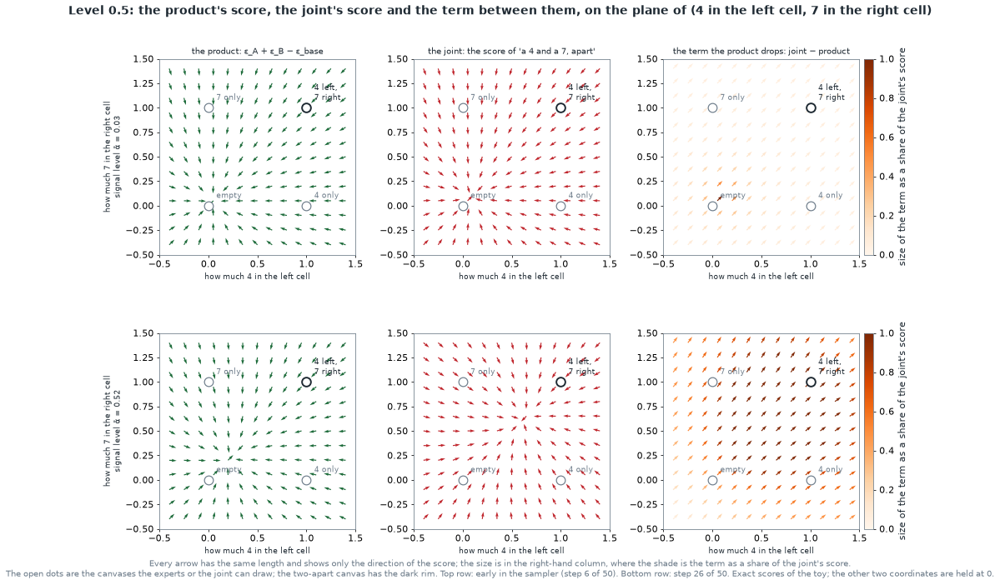
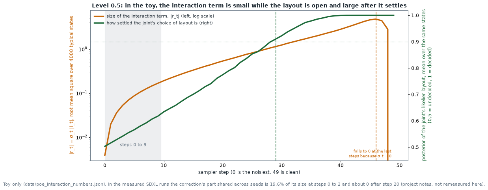

# 🌍 Context: the product of experts, the score fields and the time profile

⬅️ Previous: [one sampler step](01-overview.md) | 📋 [The pages of this method](01-overview.md#the-pages-of-this-method) | Next: [the miniature](03-the-miniature.md) ➡️

This page shows what the networks in a product of experts compute, as arrows on a plane, and how large the interaction term is at each of the 50 sampler steps. The toy has no trained network, because every score in it is exact, so the arrows stand in for what a network would output. The trained U-Nets of the real digit runs are drawn on [the digit scene's page on the networks](../../../2-classifier-guidance/artifacts/scenes/mnist-guidance-explained/2-the-networks.md). What the interaction term means for the project is on [the interaction term](../../world/interaction-term.md#what-the-interaction-term-is).

*Each panel is the plane of "how much 4 in the left cell" (across, −0.5 to 1.5) against "how much 7 in the right cell" (up, the same range), with the other two of the canvas's four numbers held at 0. Each arrow is one point's score direction, drawn at one length. Left column, green: the product. Middle, red: the joint, the model told "a 4 and a 7". Right, orange: the joint minus the product, shaded by its size as a share of the joint's score (0 pale to 1 dark). The open dots are the canvases someone can draw: empty, 4 only, 7 only, and the dark-rimmed one with a 4 left and a 7 right. Top row: signal level 0.03. Bottom row: signal level 0.52.* ✅

## Table of contents

- [Words this page uses](#words-this-page-uses)
- [The three fields](#the-three-fields)
- [Picture to equation](#picture-to-equation)
- [The term against the step](#the-term-against-the-step)
- [What this does and does not say](#what-this-does-and-does-not-say)
- [Where this came from](#where-this-came-from)
- [Read more](#read-more)

## Words this page uses

Navigation: 📋 [TOC](#table-of-contents) | [Next](#the-three-fields) ➡️

**Score field**: the score's arrow drawn at every point of a plane at once.

**Signal level ᾱ_t**: how much of the clean canvas is left at step t, from 0 (all noise) to 1 (clean). The toy uses a cosine schedule: ᾱ is about 6 × 10⁻⁵ at step 0 and 1 at step 49.

**Noise level σ_t**: the matching amount of noise, σ_t = √(1 − ᾱ_t).

**Layout**: which cell holds which digit. The joint has two layouts, 4 left and 7 right, or 7 left and 4 right.

## The three fields

Navigation: ⬅️ [Words this page uses](#words-this-page-uses) | 📋 [TOC](#table-of-contents) | [Next](#picture-to-equation) ➡️

**Early in the run the product and the joint point almost the same way; by mid-run they disagree over most of the plane.** ✅ The scene reads the mid-run disagreement as the product pulling toward the single-digit canvases and the joint toward the canvas with both ✍️.

| Row | Step on the 0 to 49 count | Signal level ᾱ | Median size of the term as a share of the joint's score, over the 169 arrows | Reading |
|---|---|---|---|---|
| top | 5 | 0.03 | 0.07 ✅ | the term is a small correction |
| bottom | 25 | 0.52 | 0.76 ✅ | the term is most of the joint's score |

The picture's own footer calls these rows "step 6 of 50" and "step 26 of 50", counting from 1; the numbers file stores them as steps 5 and 25, counting from 0 like every other step on these pages. ✅

🔤 **The name:** score field
- **score**: in everyday speech, a mark of how well something does. Here it is the direction in which a picture becomes more likely under a model, and how steeply. On the picture, one arrow.
- **field**: a quantity given at every point of a space, like wind on a weather map. On the picture, the whole grid of 13 × 13 arrows in one panel.
- **Formula, in those words:** s(x) = ∇ log p(x), the direction of steepest rise of the log density, evaluated at every x on the plane.
- **Consequence:** move from the top row to the bottom row and the right column darkens: the median share of the term rises from 0.07 to 0.76, because the green and the red fields stop agreeing.

The ∇ in the formula is the gradient, the arrow of steepest rise, taught with worked examples on [the gradient card](../../../../../Obsidian/Mathematics/Calculus/Gradient.md#where-to-learn-this); the score itself is on [the score function card](../../../../../Obsidian/Artificial%20Intelligence/Generative%20Modeling/Score%20Function.md#where-to-learn-this).

🔤 **The name:** signal level
- **signal**: the part of the canvas that carries the picture. On the toy, the 1 that marks a drawn digit.
- **level**: how much of it is present. On the toy, the noised canvas is √ᾱ_t times the clean one plus √(1 − ᾱ_t) times fresh noise.
- **Formula, in those words:** x_t = √ᾱ_t · x_clean + σ_t · noise.
- **Consequence:** at step 5 (ᾱ 0.028) a drawn digit shows as √0.028 ≈ 0.17 under noise of size 0.99; at step 25 (ᾱ 0.52) it shows as 0.72 under noise of size 0.69, so the digit is readable and the layout can start to settle. ✅

🔤 **The name:** cosine schedule
- **schedule**: a timetable. Here, the signal level ᾱ set for each of the 50 steps.
- **cosine**: the timetable is the square of a cosine, ᾱ = cos²(π/2 · u), with u running from 0.995 at step 0 down to 0 at step 49, so ᾱ climbs slowly, then steeply, then slowly again.
- **Consequence:** set beside a straight line from the same start to 1, the cosine keeps the canvas noisier early and cleans it faster late: at step 5 it leaves 0.028 of the signal where the line leaves 0.102, at step 25 the two sit together at 0.52 and 0.51, and at step 40 the cosine is at 0.92 against the line's 0.82. The straight line is a reference drawn for this comparison; no run uses it. Toy numbers, computed this session from the toy's schedule. ✅

## Picture to equation

Navigation: ⬅️ [The three fields](#the-three-fields) | 📋 [TOC](#table-of-contents) | [Next](#the-term-against-the-step) ➡️

**The right column is the middle column minus the left one, arrow by arrow: joint = product + term.** ✅

$$
\textcolor{#c0262d}{\underbrace{s_J}_{\text{middle column}}}
= \textcolor{#1d6b3a}{\underbrace{s_A + s_B - s_0}_{\text{left column}}}
+ \textcolor{#c8680a}{\underbrace{I_t}_{\text{right column}}}
$$

Take the bottom row at the point (0.72, 0.72): the two-apart canvas noised to step 25, whose 1s have shrunk to √0.52 ≈ 0.72. On the axis across, the product's pull is −0.932, the joint's −0.156, and the term +0.776; the axis up gives the same three numbers, because the toy is symmetric. So the green arrow there has size 1.32 and the red one 0.22, both pointing down and left. The panels draw every arrow at one length, which is why the size shows only in the right column's shade. Where that column is pale the product is nearly right, and where it is dark the product is pulling somewhere else. ✅ The worked case is on [the overview's identity table](01-overview.md#the-identity-by-what-moves).

## The term against the step

Navigation: ⬅️ [Picture to equation](#picture-to-equation) | 📋 [TOC](#table-of-contents) | [Next](#what-this-does-and-does-not-say) ➡️

**In the toy the interaction term is small while the layout is still open and large after it settles.** ✅

*Across: the sampler step, 0 the noisiest and 49 clean. Left axis, orange, log scale: |r_t| = σ_t |I_t|, the root mean square over 4000 canvases drawn from the joint's own noised pictures at that step. Right axis, green: the joint's belief in its likelier layout, averaged over the same canvases, from 0.5 (undecided) to 1 (decided). The grey band marks steps 0 to 9; the green dashed line is where the layout reaches 0.9; the orange dashed line is where |r_t| peaks.* ✅

🔤 **The name:** root mean square
- **square**: the name reads right to left, so this comes first: square each canvas's size of the term.
- **mean**: take the mean of the squares.
- **root**: then the square root of that mean.
- **On a three-canvas toy:** sizes 0.1, 0.2 and 0.5 give √((0.01 + 0.04 + 0.25) / 3) = 0.316, where the plain mean is 0.267.
- **Consequence:** raise the largest size from 0.5 to 1.0 and the root mean square jumps to 0.592 while the plain mean reaches 0.433, so the orange curve's height follows the canvases where the term is large. Toy numbers, computed this session. ✅

| Step | Signal level ᾱ | Size of the term, \|r_t\| | How settled the layout is |
|---|---|---|---|
| 5 | 0.03 | 0.09 | 0.57 |
| 10 | 0.10 | 0.19 | 0.63 |
| 29 | 0.65 | 1.15 | 0.91 |
| 46 | 0.99 | 4.80, the peak | 1.00 |

All from the scene's numbers file. ✅ The share of the total squared |r_t| that falls in steps 0 to 9 is 0.05%. ✅ The curve drops to 0 at step 49 because σ_t is 0 there, so the term in noise units vanishes even though the score gap does not. ✅

## What this does and does not say

Navigation: ⬅️ [The term against the step](#the-term-against-the-step) | 📋 [TOC](#table-of-contents) | [Next](#where-this-came-from) ➡️

**The toy shows that where the term acts depends on the shape of what is being composed; it neither confirms nor contradicts the early window found on SDXL.** ✍️

> [!NOTE]
> The SDXL runs found the correction works when added at steps 0 to 10, per [the interaction term's page](../../world/interaction-term.md#what-people-get-wrong), and the scene quotes project notes for the part of the correction shared across seeds being 19.6% of its size at steps 0 to 2 and about 0 after step 20 ✍️. The toy has exact scores and digits one unit apart with width 0.1, so after its layout settles the term is large and cleanly defined. The two are different systems.

The family checklist the scene keeps for this rung marks one gap: the toy draws no single sampler step with its drift and noise arrows. A real one is the opening picture of [the code page](04-the-code.md). ✍️

## Where this came from

Navigation: ⬅️ [What this does and does not say](#what-this-does-and-does-not-say) | 📋 [TOC](#table-of-contents) | [Next](#read-more) ➡️

| What | How it was established | When |
|---|---|---|
| The two median shares, 0.07 and 0.76 | Recomputed from `slice_fields` in the scene's numbers file (0.074 and 0.759) | 2026-11-24 |
| Steps 5 and 25 as the two rows | Read in `make_poe_interaction_numbers.py`, line 97, and the signal levels in the numbers file | 2026-11-24 |
| The step table and the 0.05% share | Read in the numbers file's `profile`, `commit_step_decided_90` and `r_t_share_of_total_in_steps_0_to_9` | 2026-11-24 |
| The pulls at the two-apart canvas | Computed with the scene's `poe_toy.py`, unchanged | 2026-11-24 |
| The toy against SDXL reading | Stated by the scene's network-view page | 2026-11-20 |

## Read more

Navigation: ⬅️ [Where this came from](#where-this-came-from) | 📋 [TOC](#table-of-contents)

| What | Where |
|---|---|
| The trained digit U-Nets, drawn | [the digit scene's page on the networks](../../../2-classifier-guidance/artifacts/scenes/mnist-guidance-explained/2-the-networks.md) |
| The timestep a composition is decided at, and speciation | [the scene's companion page](../../../2-classifier-guidance/artifacts/scenes/product-of-experts-interaction-term/04-where-each-equation-is-taught.md) |

⬅️ Previous: [one sampler step](01-overview.md) | 📋 [The pages of this method](01-overview.md#the-pages-of-this-method) | Next: [the miniature](03-the-miniature.md) ➡️

<!-- built-to: PAGE_LOOK_FORMAT v1 -->
