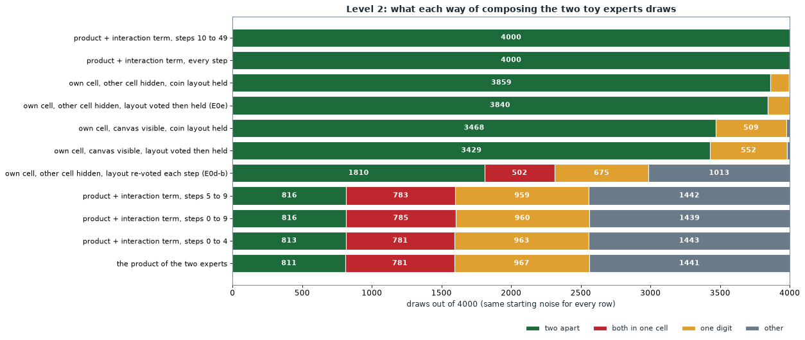
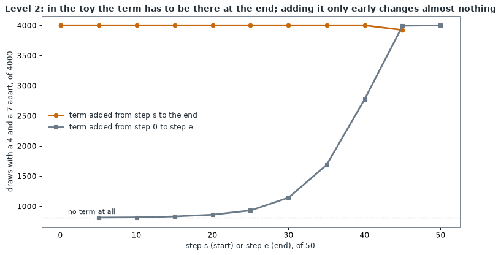

# 🌍 Context: the product of experts, worked on a two-cell toy

⬅️ Previous: [the score fields and the time profile](02-the-network-view.md) | 📋 [The pages of this method](01-overview.md#the-pages-of-this-method) | Next: [the code](04-the-code.md) ➡️

This page works the product of experts on a toy small enough that every score is exact: two experts that each draw one digit, on a canvas of two cells, sampled 4000 times with the project's sampler. Every number here comes from the scene's numbers file, and nothing here is measured on SDXL or on the digit U-Nets. What the product and the interaction term mean for the project is on [PoE composition](../../world/poe-composition.md#what-poe-composition-is) and [the interaction term](../../world/interaction-term.md#what-the-interaction-term-is).

*One bar per way of composing, 4000 draws each, all from the same starting noise. Across: draws out of 4000. Green is a 4 and a 7 in different cells, red is both in one cell, amber is one digit only, grey is anything else (mostly the empty canvas). The bottom bar is the plain product: 811 green. The three above it add the interaction term on early steps only (steps 0 to 4, 0 to 9, 5 to 9) and barely move, 813 to 816. The next five are the region recipes the digit runs use, from 1810 to 3859 green. The two top bars add the term on steps 10 to 49 or on every step, and are all green, 4000.* ✅

## Table of contents

- [Words this page uses](#words-this-page-uses)
- [The toy](#the-toy)
- [What the product puts its mass on](#what-the-product-puts-its-mass-on)
- [What each way of composing draws](#what-each-way-of-composing-draws)
- [Where the term has to act](#where-the-term-has-to-act)
- [Run it yourself](#run-it-yourself)
- [Where this came from](#where-this-came-from)

## Words this page uses

Navigation: 📋 [TOC](#table-of-contents) | [Next](#the-toy) ➡️

**Cell**: one half of the canvas, left or right. Each cell holds two numbers, how much 4 and how much 7.

**Two apart**: a finished canvas with a 4 in one cell, a 7 in the other, and nothing else. The outcome every way of composing is trying to reach.

**Region recipe**: a way of composing in which each expert supplies the prediction on one cell only. The digit runs' recipes are of this kind.

**Joint**: the density of the canvases a model told "a 4 and a 7" would draw. The toy has it exactly; no real run does.

## The toy

Navigation: ⬅️ [Words this page uses](#words-this-page-uses) | 📋 [TOC](#table-of-contents) | [Next](#what-the-product-puts-its-mass-on) ➡️

**A canvas is four numbers, x = (4 in left, 7 in left, 4 in right, 7 in right), and a drawn digit is a 1 in its place, blurred by a Gaussian of width 0.1.** ✅

| Density | What it can draw | Weights |
|---|---|---|
| expert A, told 4 | a 4 in the left cell, or a 4 in the right cell | ½, ½ |
| expert B, told 7 | a 7 in the left cell, or a 7 in the right cell | ½, ½ |
| base, told nothing | those four single-digit canvases | ¼ each |
| the joint, told 4 and 7 | a 4 in one cell and a 7 in the other | ½, ½ |

Neither expert ever draws two digits, which is the situation of the two real digit experts. ✅ The sampler is the project's: 50 steps, DDIM with eta 1, a cosine schedule. ✅

🧸 **Toy:** the four densities above, 4000 draws from one fixed starting noise. Expected before running: the product rarely puts a 4 and a 7 in different cells, because neither expert has seen that canvas; the joint always does.

## What the product puts its mass on

Navigation: ⬅️ [The toy](#the-toy) | 📋 [TOC](#table-of-contents) | [Next](#what-each-way-of-composing-draws) ➡️

**The product's mass is decided by the tails of the two experts: its highest log density is on the empty canvas, and the canvas we want ties with the fused one.** ✅

Natural log of each density at the clean canvas, up to one shared constant. The product column is log p_A + log p_B − log p_base.

| Canvas | log p_A | log p_B | log p_base | log product | log joint |
|---|---|---|---|---|---|
| 4 in the left cell only | −0.7 | −100.0 | −1.4 | −99.3 | −50.7 |
| 7 in the right cell only | −100.0 | −0.7 | −1.4 | −99.3 | −50.7 |
| 4 left and 7 right (two apart) | −50.7 | −50.7 | −50.7 | −50.7 | −0.7 |
| 4 and 7 both in the left cell | −50.7 | −50.7 | −50.7 | −50.7 | −100.0 |
| empty | −50.0 | −50.0 | −50.0 | −50.0 | −100.0 |

🔤 **The name:** tails
- **tail**: the thin end of something, far from its body. For a density, the region far from where it puts its mass.
- **On the toy:** expert A's tail is every canvas that is not a single 4. Its value at the two-apart canvas, −50.7, is the Gaussian's fall-off over one unit of distance (−1²/(2 × 0.1²) = −50) plus log ½.
- **Formula, in those words:** the product at a canvas neither expert has drawn is tail A plus tail B minus tail base, so it says nothing about what the joint wants there.
- **Consequence:** the single-digit canvases, which each expert knows best, sit at −99.3 under the product, about 49 below the empty canvas, because each one is two units of squared distance into the other expert's tail (−100) where the empty canvas is only one (−50). ✅

## What each way of composing draws

Navigation: ⬅️ [What the product puts its mass on](#what-the-product-puts-its-mass-on) | 📋 [TOC](#table-of-contents) | [Next](#where-the-term-has-to-act) ➡️

**Adding the interaction term at every step gives 4000 of 4000; the best region recipe gives 3859, and re-voting the layout at every step gives 1810.** ✅

| Way of composing | Two apart, of 4000 |
|---|---|
| the product of the two experts | 811 |
| product plus the interaction term at every step (the joint's own score) | 4000 |
| product plus the interaction term, steps 0 to 9 only | 816 |
| product plus the interaction term, steps 10 to 49 only | 4000 |
| each expert keeps its own cell, canvas visible, coin layout held | 3468 |
| the same with the layout voted over steps 0 to 9 then held | 3429 |
| each expert keeps its own cell, other cell hidden, coin layout held | 3859 |
| the same with the layout voted then held (the E0e recipe) | 3840 |
| other cell hidden, layout re-voted at every step (the E0d-b recipe) | 1810 |

E0e and E0d-b are the names the digit runs gave these two recipes; [the code page](04-the-code.md#the-layout-vote-and-the-hold) shows them on the real experts.

💥 **Broken run (without):** the plain product, no interaction term at any step.
- **Predict:** of 4000 draws, how many end with a 4 and a 7 in different cells?
- **Wrong:** 811 of 4000.
- **Right**, with the term at every step: 4000 of 4000.

🔤 **The name:** holding the layout
- **layout**: which cell each expert gets. On the toy, expert A on the left and B on the right, or the other way round.
- **holding**: keeping a choice once it is made. On the toy, the layout is chosen once (by a coin, or by summing a vote over steps 0 to 9) and kept to the end.
- **Consequence:** with the other cell hidden, re-voting at every step gives 1810 and holding the voted layout gives 3840, so holding is worth 2030 draws, about 51 percentage points. ✅

🔤 **The name:** hiding the other cell
- **hiding**: keeping something out of view. On the toy, each expert's input has the cell it does not own replaced by an empty cell at the current noise level.
- **other cell**: the half the other expert draws in.
- **Consequence:** with a coin layout held, hiding raises 3468 to 3859, and with a voted layout held it raises 3429 to 3840, about 400 draws or 10 percentage points either way. ✅

Three readings, each on this toy only:

**The order of the digit runs repeats here.** ✅ Re-voting is the worst region recipe, holding is far better, and hiding adds about 400 on top. The same order was found on the real digit experts, and the toy fills the cell the real runs did not run (held layout, canvas visible): 3468 and 3429. ✍️

**The vote adds nothing a coin does not.** ✅ Voted and held gives 3840, a coin held gives 3859. The toy experts have no preferred side, so the vote has nothing to find 🔍. The real digit experts also train with each digit on either side equally, and the matching control on them has not been run. ✍️

**The interaction term has to be there at the end.** ✅ Added over steps 0 to 9 only it moves 811 to 816; added over steps 10 to 49 it reaches 4000.

## Where the term has to act

Navigation: ⬅️ [What each way of composing draws](#what-each-way-of-composing-draws) | 📋 [TOC](#table-of-contents) | [Next](#run-it-yourself) ➡️

**In the toy, adding the term only early changes almost nothing; adding it only late repairs the product completely.** ✅

*Across: the step s where the term starts, or the step e where it stops, out of 50. Up: draws with a 4 and a 7 apart, of 4000. Orange: the term added from step s to the end. Grey: the term added from step 0 to step e. The dotted line is the plain product, 811.*

| Window | Two apart, of 4000 |
|---|---|
| from step s to the end, s = 0 to 40 | 4000 at every s |
| from step 45 to the end | 3922 |
| from step 0 to step e = 10 | 816 |
| from step 0 to step e = 30 | 1143 |
| from step 0 to step e = 40 | 2772 |
| from step 0 to step e = 45 | 3993 |
| from step 0 to step 50 | 4000 |

All read in the numbers file. ✅ The ten-step windows say the same thing: 816, 858, 1087, 2541 and 4000 for steps 0 to 9, 10 to 19, 20 to 29, 30 to 39 and 40 to 49. ✅

> [!IMPORTANT]
> The toy's joint score is exact at every noise level, so adding it late is a complete repair. A learned correction is not exact at low noise, and the SDXL runs found their correction works early ([the interaction term's page](../../world/interaction-term.md#what-people-get-wrong)). The toy cannot tell whether that early window belongs to composition or to how well a learned term can be fitted. ✍️ The scene names the test that would: take a state at step k, run 16 continuations, and count how many compose.

## Run it yourself

Navigation: ⬅️ [Where the term has to act](#where-the-term-has-to-act) | 📋 [TOC](#table-of-contents) | [Next](#where-this-came-from) ➡️

**One script makes every number on this page, and it must print 811 for the product and 4000 for the joint's own score.** ✍️

🔨 **Build:** from the scene folder, `python scripts/make_poe_interaction_numbers.py` with the sdxl-local python, as the scene gives it. It prints one line per way of composing, the product's line showing `811 two apart` and the joint's `4000 two apart`. Different counts mean the seed or the schedule changed, which would change every figure here too.

> [!WARNING]
> The script rewrites `data/poe_interaction_numbers.json` inside the scene folder. Run it on a copy of the folder, or expect a changed file in `git status`. It was not re-run for these pages; the numbers were read from the file as it stands.

To check the window table by hand, open the numbers file and find `two_apart_of_4000_by_window`: its ten-step windows reach 4000 only at steps 40 to 49. A flat table would mean the term was never applied.

## Where this came from

Navigation: ⬅️ [Run it yourself](#run-it-yourself) | 📋 [TOC](#table-of-contents)

| What | How it was established | When |
|---|---|---|
| The toy's four densities, the blur width and the sampler | Read in the scene's `scripts/poe_toy.py`, lines 16 to 23 and 49 to 61 | 2026-11-24 |
| The log density table | Read in the numbers file's `log_density_table_at_clean_canvas` | 2026-11-24 |
| Every count of 4000 and every window | Read in the numbers file's `outcomes_of_4000` and `two_apart_of_4000_by_window` | 2026-11-24 |
| The tail value −50.7 as −50 plus log ½ | Computed from the blur width 0.1 and the weight ½ | 2026-11-24 |
| That the real digit runs show the same order, and that the vote control on them is not run | Stated by the scene's miniature page | 2026-11-20 |
| The build command | Stated by the scene's miniature page; not run here | 2026-11-20 |

⬅️ Previous: [the score fields and the time profile](02-the-network-view.md) | 📋 [The pages of this method](01-overview.md#the-pages-of-this-method) | Next: [the code](04-the-code.md) ➡️

<!-- built-to: PAGE_LOOK_FORMAT v1 -->
