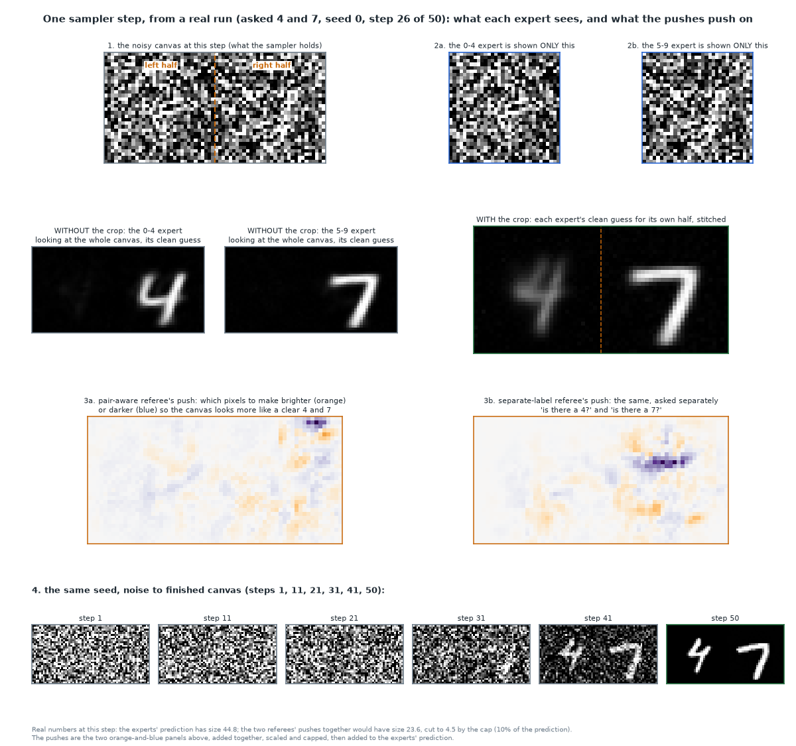
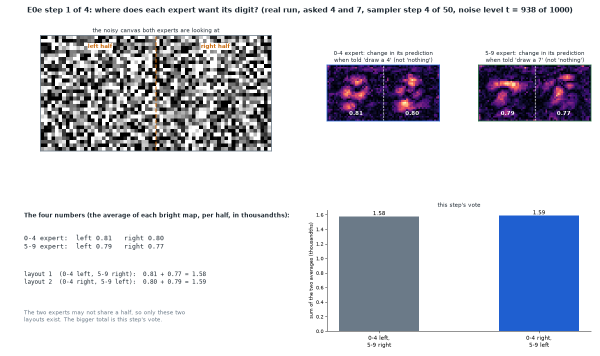
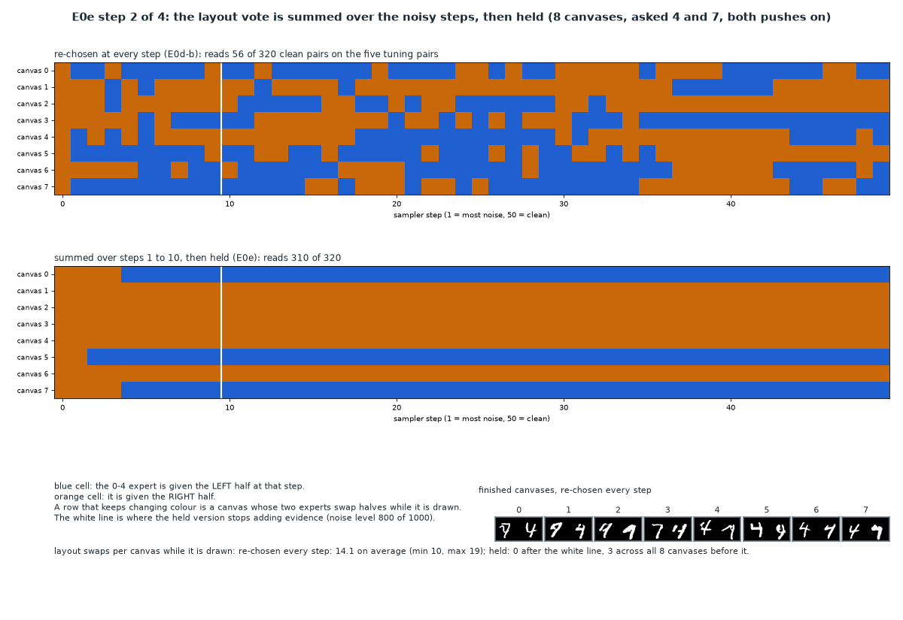
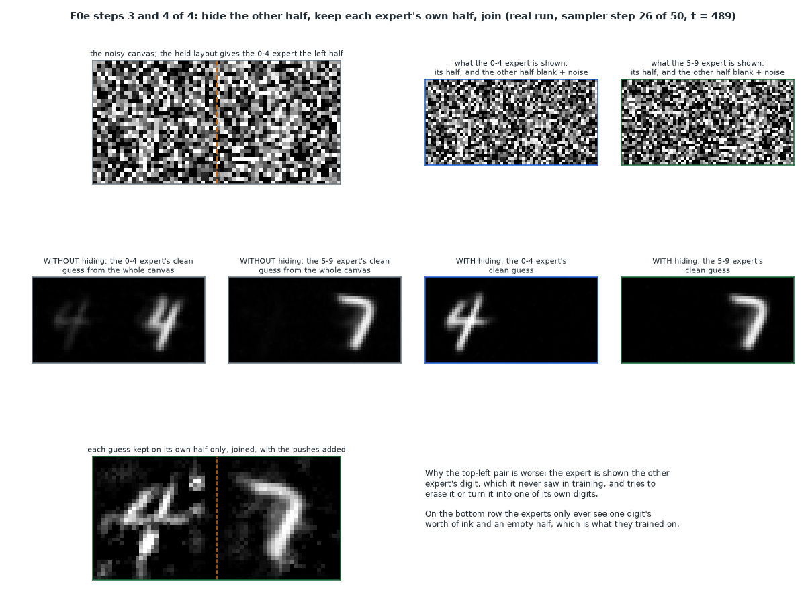

# 🌍 Context: the product of experts, the code that runs it

⬅️ Previous: [the miniature](03-the-miniature.md) | 📋 [The pages of this method](01-overview.md#the-pages-of-this-method) | Next: [the methods index](../00-INDEX.md) ➡️

This page reads the digit runs' own code block by block, where it lives, and ties each block to a box of [the overview's picture](01-overview.md) and to the toy's twin in the scene's `poe_toy.py`. The code computes four things: the product of the two experts, the layout each expert is held to, the hidden half of each expert's input, and the sampler step with its capped pushes. Line numbers are as the files stand on 2026-11-24.

<a href="../../../2-classifier-guidance/artifacts/scenes/product-of-experts-interaction-term/figures/real-run/one-sampler-step.png"></a>

*One step of a real run, asked for 4 and 7, seed 0, step 26 of 50 counting from 1, using the crop recipe, in which each expert is shown only its own half. Row 1: the 32 × 64 noisy canvas and the half each expert is shown. Row 2, left: each expert's clean guess when it sees the whole canvas, both putting their digit on the right half. Row 2, right: each expert's guess for its own half, stitched. Row 3: the two pushes, orange where they make a pixel brighter and blue where they make it darker. Row 4: the same seed at steps 1, 11, 21, 31, 41 and 50, ending on a clean 4 and 7. The footer gives the sizes at this step: the experts' prediction 44.8, the two pushes together 23.6, cut to 4.5 by the cap.* ✅

## Table of contents

- [Words this page uses](#words-this-page-uses)
- [The blocks and where they live](#the-blocks-and-where-they-live)
- [The product of two experts](#the-product-of-two-experts)
- [The layout vote and the hold](#the-layout-vote-and-the-hold)
- [Hiding the other half and joining](#hiding-the-other-half-and-joining)
- [The pushes and the cap](#the-pushes-and-the-cap)
- [The sampler step](#the-sampler-step)
- [How it fails and how you know it worked](#how-it-fails-and-how-you-know-it-worked)
- [Where this came from](#where-this-came-from)

## Words this page uses

Navigation: 📋 [TOC](#table-of-contents) | [Next](#the-blocks-and-where-they-live) ➡️

**Label-added difference**: how much an expert's prediction changes when it is told its digit instead of nothing. Large where the expert wants to draw.

**Timestep t**: the noise level the sampler is at, counted from 1000 (all noise) down to 0 (clean). The 50 sampler steps visit 50 of these.

**Push**: an extra arrow added to the noise prediction by a small classifier that reads the canvas, here asking whether it holds a clear 4 and a clear 7.

**Mask**: a canvas of 1s on one half and 0s on the other, used to pick which expert's prediction fills which half.

## The blocks and where they live

Navigation: ⬅️ [Words this page uses](#words-this-page-uses) | 📋 [TOC](#table-of-contents) | [Next](#the-product-of-two-experts) ➡️

**Every block is this project's own code, read where it lives; none of it is copied from a paper's reference implementation.** ✅

| Block | Where it lives | What it computes | The toy's twin |
|---|---|---|---|
| the product of two experts | `two_eps` in [the two-experts script](../../../2-classifier-guidance/scripts/mnist/two_experts.py), lines 49 to 60 | ε = ε_A(x, a) + ε_B(x, b) − ε_ref | `poe_score`, lines 41 to 42 |
| the layout vote and the hold | `inferred_eps`, lines 117 to 133 | D = the sum, over steps with t ≥ 800, of (A left + B right) − (A right + B left); A takes the left half if D ≥ 0 | `hide_eps` with `"vote"`, lines 88 to 97 |
| hiding the other half | `inferred_eps`, lines 135 to 142 | x̃_A = m ⊙ x + (1 − m) ⊙ blank_t, with blank_t = −√ᾱ_t + √(1 − ᾱ_t) z | `hide_eps`, lines 98 to 104 |
| each expert keeps its half | `inferred_eps`, lines 143 to 145 | ε = m ⊙ ε_A(x̃_A) + (1 − m) ⊙ ε_B(x̃_B) | `hide_eps`, lines 105 to 108 |
| the cap on the pushes | `per_sample_cap` in [the canvas U-Net script](../../../2-classifier-guidance/scripts/mnist/canvas_unet.py), lines 180 to 188 | each canvas's push cut to at most 0.1 times its prediction's size | none: the toy has no pushes |
| the sampler step | `sample`, the same script, lines 231 to 239 | x_0 = (x − √(1 − ᾱ) ε) / √ᾱ, then x' = √ᾱ' x_0 + √(1 − ᾱ' − σ²) ε + σ z | `sample`, lines 49 to 61 |

The toy's file is [the scene's toy](../../../2-classifier-guidance/artifacts/scenes/product-of-experts-interaction-term/scripts/poe_toy.py). ✅

## The product of two experts

Navigation: ⬅️ [The blocks and where they live](#the-blocks-and-where-they-live) | 📋 [TOC](#table-of-contents) | [Next](#the-layout-vote-and-the-hold) ➡️

**The product is one line: both experts told their digit, added, minus a base prediction chosen by the `--base` switch.** ✅

```python
def two_eps(A, B, a, b, base="floor", tau=0.3):
    """base: blank (point mass), floor (blank with spread tau), avgnull (mean of the two experts' no-digit predictions)."""
    def f(x, t):
        ya = torch.full((x.shape[0],), a, device=x.device)
        yb = torch.full((x.shape[0],), b, device=x.device)
        if base == "avgnull":
            n = torch.full((x.shape[0],), 10, device=x.device)
            ref = 0.5 * (A(x, t, n) + B(x, t, n))
        else:
            ref = blank_eps(x, t) if base == "blank" else floor_eps(x, t, tau)
        return A(x, t, ya) + B(x, t, yb) - ref
    return f
```

Label 10 is the no-digit label. The switch defaults to `floor`, the blank canvas with some spread (line 276), and the full-canvas product runs pass `--base avgnull`, the mean of the two experts' no-digit predictions. ✅ The toy's twin is the same sum on exact scores: `score(x, ab, A_MEANS)[0] + score(x, ab, B_MEANS)[0] - score(x, ab, BASE_MEANS)[0]`. ✅

## The layout vote and the hold

Navigation: ⬅️ [The product of two experts](#the-product-of-two-experts) | 📋 [TOC](#table-of-contents) | [Next](#hiding-the-other-half-and-joining) ➡️

**At each noisy step the code adds up where each expert wants its digit, and from timestep 800 on it stops adding and holds the layout the sum points to.** ✅

```python
        eA, eB = A(x, t, ya), B(x, t, yb)
        dA, dB = (eA - A(x, t, n)).abs(), (eB - B(x, t, n)).abs()
        sa = (dA[..., :32].mean((1, 2, 3)) + dB[..., 32:].mean((1, 2, 3)))     # A left, B right
        sb = (dA[..., 32:].mean((1, 2, 3)) + dB[..., :32].mean((1, 2, 3)))     # A right, B left
        if lock_t is not None:                              # E0e: accumulate while t >= lock_t, then hold
            ...
            if int(t[0]) >= lock_t:
                st["d"] = st["d"] + (sa - sb)
            ...
            left = (st["d"] >= 0)[:, None, None, None]
```

The dots mark lines 122 to 125 and 128, which keep the running state; the full block is lines 117 to 133. `lock_t` comes from `--lock-t`, default 800 (line 278). ✅

<table><tr>
<td><a href="../../../2-classifier-guidance/artifacts/scenes/product-of-experts-interaction-term/figures/real-run/e0e-1-where-each-expert-wants-its-digit.png"></a><br>One step's vote</td>
<td><a href="../../../2-classifier-guidance/artifacts/scenes/product-of-experts-interaction-term/figures/real-run/e0e-2-the-layout-flips-or-holds.png"></a><br>Re-chosen every step, or held</td>
</tr></table>

*Left: one real step, asked for 4 and 7, sampler step 4 of 50, timestep 938. The two bright maps are each expert's label-added difference; the four numbers are their averages per half, in thousandths: the 0 to 4 expert 0.81 left and 0.80 right, the 5 to 9 expert 0.79 left and 0.77 right. Right: 8 canvases (rows) over the 50 steps (across); blue means the 0 to 4 expert holds the left half at that step, orange the right. Top strip, re-chosen at every step: 14.1 swaps per canvas on average (10 to 19), 56 clean pairs of 320 on the five tuning pairs. Bottom strip, summed over steps 1 to 10 and held from the white line (timestep 800): 0 swaps after the line, 310 of 320.* ✅

🔤 **The name:** layout vote
- **layout**: which expert draws on which half. In the code, `left`: true when expert A takes the left half.
- **vote**: a count taken to decide between options. In the code, `sa - sb`, the evidence for "A left, B right" minus the evidence for "A right, B left".
- **Formula, in those words:** this step's vote is (A's difference on the left + B's on the right) − (A's on the right + B's on the left). On the left picture's step that is (0.81 + 0.77) − (0.80 + 0.79) = 1.58 − 1.59 = −0.01 thousandths, a vote for the 0 to 4 expert on the right.
- **Consequence:** stop summing and decide afresh at every step, and the layout flips about 14 times per canvas and the run reads 56 of 320; sum over the first 10 steps and hold, and it reads 310 of 320. ✅

## Hiding the other half and joining

Navigation: ⬅️ [The layout vote and the hold](#the-layout-vote-and-the-hold) | 📋 [TOC](#table-of-contents) | [Next](#the-pushes-and-the-cap) ➡️

**Each expert is shown its own half of the canvas and, in place of the other half, a blank canvas noised to the current level; its prediction is then kept only on its own half.** ✅

```python
        if occlude:
            ab = ABAR.to(dev)[t][:, None, None, None]
            g = torch.Generator(device=dev).manual_seed(12345 + int(t[0]))
            blank = -ab.sqrt() + (1 - ab).sqrt() * torch.randn(x.shape, generator=g, device=dev)
            mL = torch.zeros_like(x); mL[..., :32] = 1                           # 1 on the left half
            ownA = torch.where(left, mL, 1 - mL); ownB = 1 - ownA              # where each expert owns the canvas
            eA = A(ownA * x + (1 - ownA) * blank, t, ya)
            eB = B(ownB * x + (1 - ownB) * blank, t, yb)
        m = torch.zeros_like(x); m[..., :32] = 1
        pick_a = torch.where(left, m, 1 - m)
        return pick_a * eA + (1 - pick_a) * eB
```

The blank canvas is −1 everywhere (black, on the canvas's −1 to 1 scale), so its noised version at signal level ᾱ is −√ᾱ plus noise of size √(1 − ᾱ). ✅

**What each symbol of the hiding and the joining does, on a canvas of four pixels.** Orange is the mask, blue the noisy canvas, grey the noised blank and green the predictions. ✅

$$
\tilde{x}_A = \textcolor{#c8680a}{\underbrace{m}_{\text{1 on A's half}}} \odot \textcolor{#1f5fd0}{\underbrace{x}_{\text{the noisy canvas}}} + \textcolor{#c8680a}{(1-m)} \odot \textcolor{#6b7a88}{\underbrace{\text{blank}_t}_{\text{black, noised to step } t}}
\qquad
\varepsilon = \textcolor{#c8680a}{m} \odot \textcolor{#1d6b3a}{\underbrace{\varepsilon_A}_{\text{A's guess}}} + \textcolor{#c8680a}{(1-m)} \odot \textcolor{#1d6b3a}{\underbrace{\varepsilon_B}_{\text{B's guess}}}
$$

| Symbol | What it does | On the four-pixel toy |
|---|---|---|
| ⊙ | multiplies pixel by pixel, with no sum, so each pixel keeps its own place | (1, 1, 0, 0) ⊙ (0.3, −0.5, 0.9, 0.1) = (0.3, −0.5, 0, 0) |
| m | picks which pixels the expert sees as they are | with m = (1, 1, 0, 0) and a blank of (−0.7, −0.9, −0.6, −0.8), A is shown (0.3, −0.5, −0.6, −0.8); flip m to (0, 0, 1, 1), as the layout vote does when it puts A on the other side, and A is shown (−0.7, −0.9, 0.9, 0.1) |
| blank_t | fills the hidden half with what an empty canvas looks like at this step | its middle value is −0.72 at signal level 0.52 and −0.995 at 0.99, under noise of size 0.693 and 0.1, so late in the run the hidden half reads as plain black |
| the joining | keeps each guess only on its owner's half | A's guess (0.2, 0.4, 0.6, 0.8) and B's (−0.1, −0.3, −0.5, −0.7) join into (0.2, 0.4, −0.5, −0.7) |

Toy numbers, computed this session; the four pixels are invented, and the blank's values are −√ᾱ and √(1 − ᾱ) at the two signal levels.

<a href="../../../2-classifier-guidance/artifacts/scenes/product-of-experts-interaction-term/figures/real-run/e0e-3-hide-the-other-half-and-join.png"></a>

*One real step, sampler step 26 of 50, timestep 489, with the held layout giving the 0 to 4 expert the left half. Middle row, left pair: without hiding, the 0 to 4 expert's clean guess from the whole canvas shows a faint 4 on the left and a second 4 on the right, where the 7 belongs. Middle row, right pair: with hiding, a single 4 on the left and a single 7 on the right. Bottom: the two guesses kept on their own halves and joined, with the pushes added.* ✅ *The picture's own note explains the left pair: the expert is shown a digit it never saw in training and tries to erase it or turn it into one of its own.* ✍️

🔤 **The name:** occlude
- **occlude**: to block from view, as a hand over one eye. In the code, the switch `occlude` and the input `ownA * x + (1 - ownA) * blank`.
- **On the picture:** the two top-right panels, where the half an expert does not own is noise around black.
- **Consequence:** on the toy, hiding raises the held-layout counts from 3468 to 3859 (coin) and from 3429 to 3840 (vote), about 400 draws of 4000; on the real experts, re-voting at every step reads 0 of 320 without hiding and 34 with it, before any pushes. ✅

## The pushes and the cap

Navigation: ⬅️ [Hiding the other half and joining](#hiding-the-other-half-and-joining) | 📋 [TOC](#table-of-contents) | [Next](#the-sampler-step) ➡️

**Each canvas's push is cut to at most a tenth of the size of its own noise prediction, so a push can steer but never replace the experts.** ✅

```python
def per_sample_cap(push, eps, cap):
    """Scale each sample's push to at most cap times that sample's eps norm; report which fired."""
    if cap is None:
        return push, torch.zeros(push.shape[0], dtype=torch.bool, device=push.device)
    pn = push.flatten(1).norm(dim=1)
    lim = cap * eps.flatten(1).norm(dim=1)
    fired = pn > lim
    scale = torch.where(fired, lim / pn.clamp_min(1e-12), torch.ones_like(pn))
    return push * scale[:, None, None, None], fired
```

🔤 **The name:** per-sample cap
- **per sample**: computed for each canvas in the batch on its own, never pooled across the batch.
- **cap**: a ceiling. In the code, `lim = cap * ‖ε‖`, with `cap` 0.1 by default (`sample`, line 197).
- **Formula, in those words:** if the push is longer than a tenth of the prediction, shrink it to exactly that length; otherwise leave it.
- **Consequence:** at the opening picture's step the prediction has size 44.8, so the ceiling is 0.1 × 44.8 = 4.48. The two pushes together have size 23.6, which is over it, so `fired` is true and the push is scaled by 4.48 / 23.6 ≈ 0.19, to the 4.5 the footer prints. ✅

The pushes themselves are built by `make_push` (`two_experts.py`, line 178), which adds `pair_push` and `separate_push` from `pixel_checker.py` (lines 70 and 82) when both are asked for. ✅

## The sampler step

Navigation: ⬅️ [The pushes and the cap](#the-pushes-and-the-cap) | 📋 [TOC](#table-of-contents) | [Next](#how-it-fails-and-how-you-know-it-worked) ➡️

**The step first turns the noise prediction into a guess at the clean canvas, then moves to the next noise level from that guess.** ✅

```python
        a = abar[t]
        a_prev = abar[ts[i + 1]] if i + 1 < len(ts) else torch.tensor(1.0, device=device)
        x0 = (x - (1 - a).sqrt() * eps) / a.sqrt()
        if eta > 0 and i + 1 < len(ts):
            sig = eta * ((1 - a_prev) / (1 - a)).sqrt() * (1 - a / a_prev).sqrt()
            z = torch.stack([torch.randn(x.shape[1:], generator=gg) for gg in gens]).to(device)
            x = a_prev.sqrt() * x0 + (1 - a_prev - sig ** 2).clamp_min(0).sqrt() * eps + sig * z
        else:
            x = a_prev.sqrt() * x0 + (1 - a_prev).sqrt() * eps
```

$$
\textcolor{#c0262d}{\underbrace{x_0}_{\text{the clean guess}}}
= \frac{\textcolor{#1f5fd0}{\underbrace{x_t}_{\text{the noisy canvas}}} - \sqrt{1-\bar\alpha_t}\;\textcolor{#1d6b3a}{\underbrace{\varepsilon}_{\text{the summed prediction}}}}{\sqrt{\bar\alpha_t}}
$$

On the toy, at the overview's worked point (the two-apart canvas noised to step 25, signal level 0.52, so its 1s read 0.721), the clean guess for "how much 4 in the left cell" is (0.721 − 0.693 × 0.646) / 0.721 = 0.379 from the product, and (0.721 − 0.693 × 0.108) / 0.721 = 0.896 from the joint. ✅ The product's guess has already lost most of the 4 it is standing on; the joint's has kept it. Computed with the scene's `poe_toy.py`, unchanged.

**The move to the next step, by what moves.** The colours carry on from the equation above, with grey for the fresh noise. ✅

$$
x_{t'} = \textcolor{#c0262d}{\underbrace{\sqrt{\bar\alpha_{t'}}\;x_0}_{\text{the clean guess, at the next level}}}
+ \textcolor{#1d6b3a}{\underbrace{\sqrt{1-\bar\alpha_{t'}-\sigma^2}\;\varepsilon}_{\text{the predicted noise, kept}}}
+ \textcolor{#6b7a88}{\underbrace{\sigma\,z}_{\text{fresh noise}}}
$$

On the toy's step from 25 to 26 (signal level 0.52 to 0.55), on "how much 4 in the left cell":

| Symbol | Moved | Product | Joint |
|---|---|---|---|
| √ᾱ_t′ x_0 | the clean guess, times 0.743 | 0.379 becomes 0.282 | 0.896 becomes 0.666 |
| √(1 − ᾱ_t′ − σ²) ε | the predicted noise, times 0.670 at eta 0 or 0.628 at eta 1 | 0.646 becomes 0.433 or 0.406 | 0.108 becomes 0.072 or 0.068 |
| σ z | eta 0 sets σ to 0; eta 1 sets it to 0.232 | fresh noise of size 0 or 0.232 | the same |
| all three added, z at its middle value 0 | the next canvas | 0.714 at eta 0, 0.687 at eta 1 | 0.738 at eta 0, 0.733 at eta 1 |

The product's next value is close to the joint's on this one coordinate only because its smaller clean guess is made up by its larger noise guess; its clean guess, 0.379 against 0.896, is where the two part. Toy numbers, computed this session from the toy's schedule. ✅ What DDIM and eta mean is taken apart on [the miniature](03-the-miniature.md#the-toy).

## How it fails and how you know it worked

Navigation: ⬅️ [The sampler step](#the-sampler-step) | 📋 [TOC](#table-of-contents) | [Next](#where-this-came-from) ➡️

**The layout flips when `lock_t` is left unset, and the run prints 0.0 for the fraction of canvases whose layout never changes after the first fifth of the run.** ✅

With `--compose inferred-occ` (no hold) that fraction is 0.0 and the five tuning pairs read 56 of 320 with both pushes; with `--compose inferred-lock` it is 1.0 and they read 310 of 320. The toy shows the same break: re-voting at every step draws two apart in 1810 of 4000 against 3840 when the layout is held. ✅

> [!NOTE]
> This page does not re-run the real code. The counts 56, 310 and 1,200 of 1,280 are read from [the digit-composition finding](../../../2-classifier-guidance/report/classifier-guided-poe/can-two-separately-trained-digit-models-compose-while-sampling.md#step-7-the-side-is-chosen-early-and-held), whose verdict stays inconclusive while the by-eye count of the 1,200 waits for the owner.

## Where this came from

Navigation: ⬅️ [How it fails and how you know it worked](#how-it-fails-and-how-you-know-it-worked) | 📋 [TOC](#table-of-contents)

| What | How it was established | When |
|---|---|---|
| Every excerpt and line number | Read in `2-classifier-guidance/scripts/mnist/two_experts.py` and `canvas_unet.py`, working tree at commit `f8fbe08c`, both files clean | 2026-11-24 |
| `--compose inferred-lock` turns on the hold, `inferred-occ` hides without holding | Read in `build_eps`, `two_experts.py` lines 163 to 164 | 2026-11-24 |
| The toy's twin lines | Read in the scene's `scripts/poe_toy.py` | 2026-11-24 |
| The picture numbers (44.8, 23.6, 4.5; 0.81, 0.80, 0.79, 0.77; 14.1 swaps) | Read on each picture at full size; the cap arithmetic checked by hand | 2026-11-24 |
| 0 and 34 of 320 for re-voting without and with hiding, no pushes | Read in the digit-composition finding, step 6's table | 2026-11-24 |
| The expert's reason for the doubled 4 | Stated by the picture's own note | 2026-11-20 |
| The clean guesses 0.379 and 0.896 | Computed with the scene's `poe_toy.py`, unchanged | 2026-11-24 |

⬅️ Previous: [the miniature](03-the-miniature.md) | 📋 [The pages of this method](01-overview.md#the-pages-of-this-method) | Next: [the methods index](../00-INDEX.md) ➡️

<!-- built-to: PAGE_LOOK_FORMAT v1 -->
