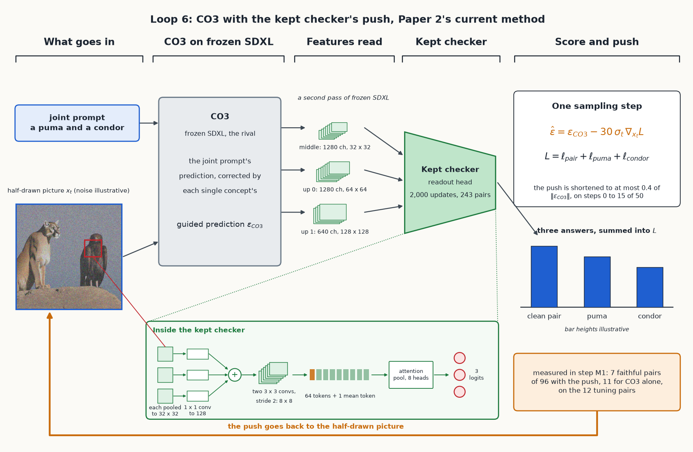
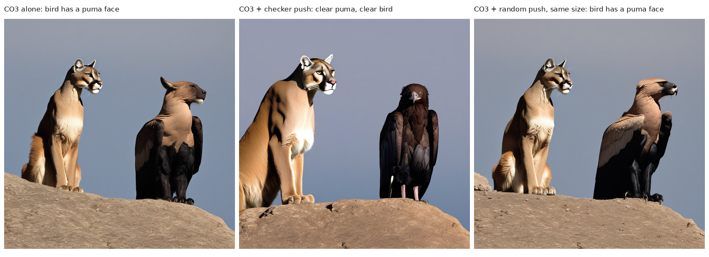
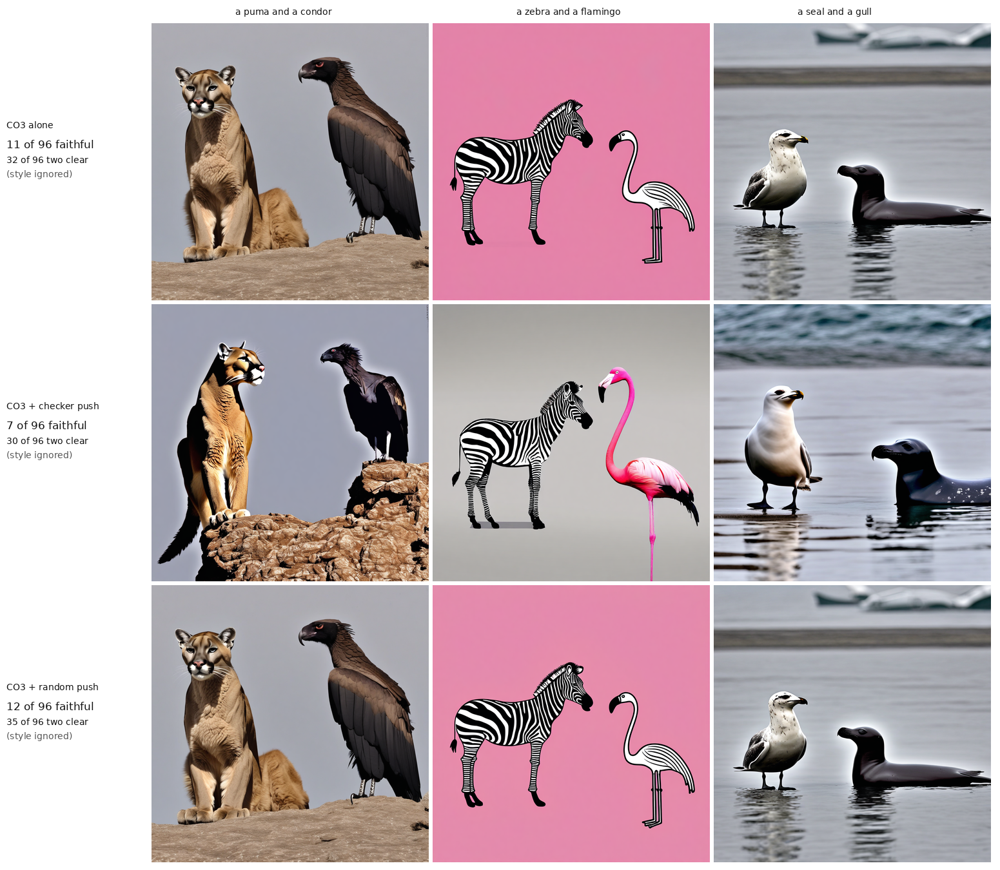

# 🌍 Context: the readout checker, one pushed sampling step

⬅️ Previous: [the methods index](../00-INDEX.md) | 📋 [The pages of this method](#the-pages-of-this-method) | Next: [inside the kept checker](02-inside-the-kept-checker.md) ➡️

The readout checker is a small trained network that reads frozen SDXL's own inner features on a half-drawn picture and scores whether it is heading for two separate, right subjects; the gradient of that score is added to the sampler's noise prediction on the first 16 of 50 steps. It is the method Loop 6 tests as Paper 2's current one, added to CO3. What the product of experts is and why it fuses two subjects lives in [PoE composition](../../world/poe-composition.md#what-poe-composition-is), what a fused creature is lives in [the chimera page](../../world/chimera.md#what-a-chimera-is), and the piece of the score the product leaves out lives in [the interaction term](../../world/interaction-term.md#what-the-interaction-term-is). This folder adds the loops' pictures of the checker, its parts with their real sizes, a worked case for the push, and the code. Every picture here comes from [the annotated overviews](../../../2-classifier-guidance/artifacts/scenes/annotated-overviews/README.md) or from the method search's own notes.

*One pushed sampling step, read left to right. What goes in: the joint prompt "a puma and a condor" and the half-drawn picture x_t; the noise drawn over the picture is illustrative. CO3 on frozen SDXL gives its guided prediction ε_CO3. A second pass of frozen SDXL hands three feature maps to the checker: the middle block (1,280 channels on a 32 × 32 grid), up block 0 (1,280 channels, 64 × 64) and up block 1 (640 channels, 128 × 128). The kept checker was trained for 2,000 updates on pictures of 243 subject pairs. Its three answers (clean pair, puma, condor) are summed into L; the bar heights are illustrative. The formula box gives the step: ε̂ = ε_CO3 − 30 σ_t ∇_{x_t} L, with the push shortened to at most 0.4 of the size of ε_CO3, on steps 0 to 15 of 50. The orange box gives a measured result: 7 faithful pairs of 96 pictures with the push against 11 for CO3 alone, on the 12 tuning pairs. The inset opens the checker, drawn in full on [the next page](02-inside-the-kept-checker.md).* ✅ read on the picture at full size; the layer sizes match the code (see [the code page](04-the-code.md)).

## Table of contents

- [Words this page uses](#words-this-page-uses)
- [What one pushed step does](#what-one-pushed-step-does)
- [The names, taken apart](#the-names-taken-apart)
- [The step, by what moves](#the-step-by-what-moves)
- [How it fails and how you know it worked](#how-it-fails-and-how-you-know-it-worked)
- [What is measured where](#what-is-measured-where)
- [The pages of this method](#the-pages-of-this-method)
- [Where this came from](#where-this-came-from)
- [Read more](#read-more)

## Words this page uses

Navigation: 📋 [TOC](#table-of-contents) | [Next](#what-one-pushed-step-does) ➡️

**Loop 6, Paper 2 and step M1**: Loop 6 is the project's search for each paper's method. Paper 2 asks whether a checker trained on what a separate pair looks like can raise how often one model draws two distinct subjects, added to the product of experts and to CO3. Step M1 is the progress board's test of whether each paper's method beats its simplest baseline.

**CO3**: a published sampler correction for composing two prompts. It combines one model's predictions for each subject as a product and corrects each step with the joint prompt's and the single subjects' predictions. Here it runs at its released settings: CFG++ at guidance 0.8, 50 steps, 6 corrected steps.

🔤 **The name:** CFG++ at guidance 0.8
- **conditional and unconditional**: a prediction is *conditional* when the model is told the prompt (ε_c) and *unconditional* when it is told nothing, the empty prompt (ε_u). The `un-` removes the prompt.
- **CFG**: classifier-free guidance. *Guidance* is steering; *classifier-free* says the steering comes from the model's own two predictions, ε_c and ε_u, with no separate checker network. The [classifier-free guidance card](../../../../../Obsidian/Artificial%20Intelligence/Generative%20Modeling/Diffusion%20Models/Classifier-Free%20Guidance.md#where-to-learn-this) teaches it with worked examples.
- **Formula, in those words:** start at the unconditional prediction and lean toward the prompt's by the guidance: ε_u + 0.8 (ε_c − ε_u).
- **++**: the published variant (Chung et al. 2024, arXiv 2406.08070) that keeps the guidance between 0 and 1 and, when it adds noise back for the next step, adds it with ε_u in place of the guided prediction. That is the √(1 − ᾱ_{t−1}) ε_u term of CO3's step on [the push page](03-the-push-and-its-cap.md#where-the-push-enters-the-sampler). ✍️ stated by [the review of the three inference-time fixes](../../../1-lora-correction/plans/01-showcase-the-trained-lora/review/23-three-inference-time-fixes-for-the-soft-corrected-render.md), line 92.
- **Consequence:** on one number with ε_u = 1.0 and ε_c = 2.0 (illustrative), a guidance of 0 gives 1.0, the prompt ignored; 0.8 gives 1.8; 1 gives 2.0, the prompt's own prediction; and 7.5, the plain product's scale on [the push page](03-the-push-and-its-cap.md#where-the-push-enters-the-sampler), gives 8.5, far past it. So CFG++'s 0.8 and plain guidance's 7.5 sit on different scales and are not compared as numbers. ✅ arithmetic on the toy.

**Half-drawn picture x_t**: the latent at sampler step t, a block of 4 × 128 × 128 numbers that SDXL's decoder turns into a 1,024 × 1,024 picture once sampling ends. Step 0 is the noisiest and step 49 the last.

🔤 **The name:** latent
- **latent**: present but hidden, the way a talent nobody has seen yet is latent. On the opening picture, x_t is a latent: a block of numbers that holds the picture without being one anyone can look at.
- **Where it sits:** the 4 × 128 × 128 block on the left of the opening picture. SDXL's decoder, the decoding half of a [variational autoencoder](../../../../../Obsidian/Artificial%20Intelligence/Generative%20Modeling/Variational%20Autoencoders/Variational%20Autoencoders.md#where-to-learn-this), turns the finished block into the 1,024 × 1,024 picture.
- **Consequence:** the block holds 65,536 numbers where the finished picture holds 3,145,728 (1,024 × 1,024 × 3 colours), 48 times fewer, and the gradient on these pages has one entry per latent number, 65,536 of them. ✅ arithmetic.

**Noise prediction ε**: what the U-Net outputs at each step, its guess at the noise in x_t. The sampler steps x_t toward a cleaner picture using it.

**Feature map**: a stack of numbers SDXL's U-Net computes inside itself on the way to ε, one value per channel per grid cell.

**Logit**: a network's raw output number before any squashing into a probability. Positive leans yes, negative leans no.

**Faithful pair**: a picture with one clear first subject and one clear second subject as separate bodies, nothing borrowed from the other, and an intact photograph, as called by eye under [the blind count rubric](../../../artifacts/notes/progress/method-search/01-beat-the-baseline/blind-count-rubric.md).

## What one pushed step does

Navigation: ⬅️ [Words this page uses](#words-this-page-uses) | 📋 [TOC](#table-of-contents) | [Next](#the-names-taken-apart) ➡️

**On each of steps 0 to 15, SDXL runs once more on the half-drawn picture, the checker reads three of its inner feature maps and scores the picture, and the gradient of that score is subtracted from CO3's noise prediction before the step is taken.** ✅ read in `co3_push.py`, lines 30 to 36 and 62 to 76.

Each box in the picture has a twin in the code:

| Box | What it is | Where its numbers come from |
|---|---|---|
| joint prompt | "a puma and a condor", one of the 12 tuning pairs; the checker reads SDXL under this same prompt | ✅ `paper2_rows.py`, lines 45 and 63 to 64 |
| half-drawn picture | the latent x_t, 4 × 128 × 128 | ✅ the deep-dive picture and `load_latent` in `train_readout_pair.py` |
| CO3 on frozen SDXL | CO3's guided prediction, its only two-entry U-Net call on that step | ✅ `co3_push.py`, lines 3 to 10 and 32 |
| features read | three outputs of a second, separate U-Net pass, caught by hooks | ✅ `train_count_head.py`, lines 58 to 69 |
| kept checker | a trained head of 780,675 weights; SDXL's own weights never change | ✅ counted from its layers on [the next page](02-inside-the-kept-checker.md#the-weights-counted) |
| three answers summed into L | the sum of three logits: clean pair, first subject present, second subject present | ✅ `train_readout_pair.py`, lines 79 and 91 |
| the push | 30 × σ_t × the gradient of L with respect to x_t, cut to at most 0.4 of the size of ε_CO3 | ✅ `co3_push.py`, lines 66 to 73; `paper2_rows.py`, lines 30 to 32 |

The same push was first tuned on SDXL's plain product of "a cat" and "a dog", where it is subtracted from the product's prediction; that path is on [the push page](03-the-push-and-its-cap.md#where-the-push-enters-the-sampler).

## The names, taken apart

Navigation: ⬅️ [What one pushed step does](#what-one-pushed-step-does) | 📋 [TOC](#table-of-contents) | [Next](#the-step-by-what-moves) ➡️

**Each word of the method's three names points at one box of the picture above.** ✅

🔤 **The name:** readout checker
- **readout**: a reading taken off an instrument without changing what it measures, like the dial on a meter. On the picture, the three green stacks under "Features read": SDXL's own inner maps, copied out by hooks while SDXL's weights stay frozen. The word comes from Readout Guidance (Luo et al., CVPR 2024), whose small heads read a frozen diffusion model's decoder features the same way. ✍️ `train_readout_pair.py`, lines 2 to 7.
- **checker**: something that inspects work and says pass or fail. On the picture, the green trapezoid and its three outputs: is this a clean pair, is the first subject present, is the second subject present.
- **Formula, in those words:** L = ℓ_pair + ℓ_first + ℓ_second, the three logits the head reads off SDXL's features, added.
- **Consequence:** take the "readout" away and the checker would have to see the finished picture, which does not exist yet at step 0. A checker trained on finished pictures read the first 10 steps' guesses at about chance (balanced accuracy 0.50 to 0.51 at steps 0 to 10), while a readout checker read noised finished pictures at 0.63 at step 0 and 0.78 at step 10. ✍️ [the checker finding](../../../2-classifier-guidance/report/classifier-guided-poe/can-a-checker-read-a-clean-cat-and-dog.md#finished-pictures-and-half-drawn-guesses).

🔤 **The name:** balanced accuracy, the reading quoted just above
- **accuracy**: the share of calls that are right.
- **balanced**: each side weighs the same however many pictures it holds. The checker's hit rate on clean pairs and its hit rate on rejects are averaged half and half.
- **Where it sits, on a toy of 20 pictures** (illustrative counts, computed): 8 clean pairs and 12 rejects by eye, with the checker's call across the top and the by-eye call down the side.

| | checker says clean | checker says reject | hit rate on this row |
|---|---|---|---|
| by eye: clean, 8 | 6 | 2 | 6 / 8 = 0.75 |
| by eye: reject, 12 | 3 | 9 | 9 / 12 = 0.75 |

- **Formula, in those words:** (hit rate on the clean row + hit rate on the reject row) / 2 = (0.75 + 0.75) / 2 = 0.75, the pass mark [the deep dive](02-inside-the-kept-checker.md#how-it-fails-and-how-you-know-it-worked) quotes.
- **Consequence:** on a lopsided set of 2 clean pairs and 18 rejects, a lazy checker that calls every picture a reject is right on 18 of 20, a plain accuracy of 0.90, and its balanced accuracy is (0 / 2 + 18 / 18) / 2 = 0.50, the coin flip. ✅ arithmetic on the toy.

> 🖼️ **Diagram wanted**: two overlapping circles over the 20-picture toy above: the by-eye clean circle (8 pictures) in blue, the checker's clean circle (9 pictures) in green, their overlap of 6 in a darker shade, and the 9 pictures outside both in grey. Beside it the same toy's table, the clean row's hit rate drawn as overlap over blue (6 / 8) and the reject row's as grey over everything outside blue (9 / 12), with the two averaged to 0.75. A second panel shows the lazy checker on 2 clean and 18 rejects: an empty green circle, plain accuracy 0.90, balanced accuracy 0.50.

🔤 **The name:** kept checker
- **kept**: chosen and held onto after the others were dropped. On the picture, the label "2,000 updates, 243 pairs" under the trapezoid: the multi-pair checkpoint that survived the cat and dog improvement rounds.
- **Consequence:** a run that trained the same checker for 4,000 updates in place of 2,000 dropped the faithful pairs on 128 cat and dog seeds from 29 to 13, so 2,000 stayed. ✍️ [the kept push finding](../../../2-classifier-guidance/report/classifier-guided-poe/how-close-the-kept-push-comes-to-the-joint-prompt.md#every-improvement-round).

🔤 **The name:** push
- **push**: a shove in one direction. On the picture, the orange arrow from the score back to the half-drawn picture, and the orange term in the formula box.
- **Formula, in those words:** shove the noise prediction against the direction that raises L, scaled by a strength of 30 and by how noisy the picture still is, σ_t.
- **Consequence:** subtract a random shove of exactly the same length at every step and the picture does not separate: on 128 cat and dog seeds the random push drew 0 faithful pairs where the kept push drew 35. ✍️ [the kept push finding](../../../2-classifier-guidance/report/classifier-guided-poe/how-close-the-kept-push-comes-to-the-joint-prompt.md#every-improvement-round).

## The step, by what moves

Navigation: ⬅️ [The names, taken apart](#the-names-taken-apart) | 📋 [TOC](#table-of-contents) | [Next](#how-it-fails-and-how-you-know-it-worked) ➡️

**The prediction the sampler uses is CO3's, minus the push; the push is the strength times the noise level times the checker's gradient, cut to a ceiling.** ✅ The colours are the picture's: grey for frozen SDXL, orange for the push, green for the checker.

$$
\underbrace{\hat\varepsilon}_{\text{what the sampler uses}}
= \textcolor{#6b7a88}{\underbrace{\varepsilon_{CO3}}_{\text{CO3's guided prediction}}}
- \textcolor{#c86a0a}{\underbrace{30\,\sigma_t}_{\text{strength times noise level}}}\;
\textcolor{#1d6b3a}{\underbrace{\nabla_{x_t} L}_{\text{where the checker's score rises}}}
$$

| Symbol | What it is | Its value in the kept recipe | If it grew |
|---|---|---|---|
| ε_CO3 | CO3's guided prediction at step t | a 4 × 128 × 128 block from frozen SDXL | the ceiling on the push grows with it, 0.4 × its size |
| 30 | the strength | 30, fixed | the push grows in step until the ceiling stops it |
| σ_t | the noise level, √(1 − ᾱ_t), with ᾱ_t the share of clean signal left | 0.9971 at step 0, 0.9515 at step 15 | over the 16 pushed steps it barely moves, so the push stays near full strength through the window |
| ∇_{x_t} L | the direction in which the 65,536 numbers of x_t raise the checker's summed logits | computed fresh at every pushed step through the head and the frozen U-Net | a steeper score means a longer push, until the ceiling |
| window | which steps are pushed | steps 0 to 15 of 50; steps 16 to 49 are CO3 alone | pushing on steps 0 to 24 dropped faithful pairs from 25 to 24 of 128 on cat and dog ✍️ |

The σ_t values are computed from SDXL's shipped scheduler (scaled linear betas from 0.00085 to 0.012, 1,000 training steps, leading spacing with offset 1), whose 50 timesteps put steps 0 and 15 at timesteps 981 and 681. ✅ computed this session from `sdxl-scheduler.json` in [the word-map checker scene's sources](../../../2-classifier-guidance/artifacts/scenes/word-map-checker/numbers/sources/configs/sdxl-scheduler.json). That CO3 steps through the same 50 timesteps is 🔍 inferred: CO3 loads a DDIM scheduler from SDXL's own scheduler folder (`Co3.py`, line 85 of the CO3 clone).

**The scheduler sentence above, one term at a time.** ✅ computed this session from the same config.
- **Training steps and timestep**: SDXL was trained on a clock of 1,000 noise levels, numbered 0, almost clean, to 999, almost pure noise. A *timestep* is a position on that clock. A *step* on these pages is one of the sampler's 50 moves, so step 0 sits at timestep 981.
- **Betas**: β is the share of variance swapped for fresh noise at one tick of that clock, 0.00085 at the first tick and 0.012 at the last. ᾱ_t is what survives every tick up to t, the product of (1 − β) over them: 0.00578 at timestep 981.
- **Scaled linear**: the square roots of the betas rise in a straight line between those two ends, so the betas themselves curve upward.
- **Leading spacing**: the 50 timesteps are taken every 1,000 / 50 = 20 ticks counting from the start, 0, 20 and so on to 980, then run in reverse.
- **Offset 1**: one tick is added to each, giving 981, 961, 941 and so on to 681 at step 15 and 1 at step 49. Without the offset, step 0 would sit at timestep 980, where ᾱ is 0.00584 in place of 0.00578.
- **DDIM**: the scheduler CO3 loads; its step is written out on [the push page](03-the-push-and-its-cap.md#where-the-push-enters-the-sampler), and the [DDIM card](../../../../../Obsidian/Artificial%20Intelligence/Generative%20Modeling/Diffusion%20Models/DDIM.md#where-to-learn-this) teaches it.

The worked case with numbers, the ceiling and where the push enters CO3 are on [the push page](03-the-push-and-its-cap.md).

## How it fails and how you know it worked

Navigation: ⬅️ [The step, by what moves](#the-step-by-what-moves) | 📋 [TOC](#table-of-contents) | [Next](#what-is-measured-where) ➡️

**It worked when the picture holds one clear puma beside one clear condor; it fails when one body borrows the other's face, feathers or snout, and CO3 alone already separates the bodies on every one of its 96 pictures.** ✍️ [the CO3 finding](../../../2-classifier-guidance/report/the-method-search/does-adding-the-kept-push-to-co3-beat-co3-alone.md#3-what-the-blind-count-shows-beyond-the-verdict). These pictures come from real runs.

<table><tr>
<td> One pair, one seed, three rows</td>
<td> Three pairs at the next seed</td>
</tr></table>

*Left: the trial run of one pair at one seed made before the full comparison, the prompt "a puma and a condor" at seed 6001. From the left, CO3 alone, CO3 with the checker push, CO3 with a random push of the same size. The sheet's labels read "bird has a puma face", "clear puma, clear bird" and "bird has a puma face".* ✅ seen at full size. *It shows the code runs and the rows differ, and is no evidence for either side.* ✍️ *Right: rows CO3 alone, with the checker push, with a random push; columns a puma and a condor, a zebra and a flamingo, a seal and a gull, all at seed 6002. The row labels read 11, 7 and 12 faithful of 96, and 32, 30 and 35 of 96 with two clear subjects when drawn style is ignored. Every tile holds two separate animals, and the zebra and flamingo column is flat graphic art in all three rows.* ✅ seen at full size; the counts match the finding.

💥 **Broken run (without the checker's direction):** CO3 plus a random push whose length matches the real push at every step.
- **Predict:** does the random push draw fewer faithful pairs than the checker push?
- **Measured:** no. On the 12 tuning pairs at 8 seeds, the random push drew 12 faithful pairs of 96, the checker push 7 and CO3 alone 11. The lead of the push over CO3 alone is −4, inside the bar of 10.08, so the verdict is null. ✍️ [the CO3 finding](../../../2-classifier-guidance/report/the-method-search/does-adding-the-kept-push-to-co3-beat-co3-alone.md#1-the-three-rows-on-the-same-seeds).
- **On the plain product of "a cat" and "a dog"**, where the recipe was tuned, the random push drew 0 faithful pairs of 128 and the kept push 35. ✍️ [the kept push finding](../../../2-classifier-guidance/report/classifier-guided-poe/how-close-the-kept-push-comes-to-the-joint-prompt.md#every-improvement-round).

> [!NOTE]
> On CO3 the two presence outputs ask about subjects they never trained on: they learned "a cat is present" and "a dog is present" on cat and dog pictures only, and none of the 12 tuning pairs is cat and dog. The picture's "puma" and "condor" bars name what the outputs are asked about here, which is what they were never taught. ✅ `presence_catdog.json` holds labels for the 1,603 cat and dog pictures alone, and the loss masks the rest (`train_readout_pair.py`, lines 457 to 464).

## What is measured where

Navigation: ⬅️ [How it fails and how you know it worked](#how-it-fails-and-how-you-know-it-worked) | 📋 [TOC](#table-of-contents) | [Next](#the-pages-of-this-method) ➡️

**The layer sizes, the weight count and the noise levels are read from code or computed here; every count of pictures is quoted from the finding that measured it.**

| Statement | Measured on | Mark and source |
|---|---|---|
| the tap sizes, the head's layers and its 780,675 trained weights | the code | ✅ [inside the kept checker](02-inside-the-kept-checker.md) |
| σ_t from 0.9971 to 0.9515 over the pushed steps | SDXL's scheduler config | ✅ computed here |
| the kept push draws 35 faithful pairs of 128 on cat and dog by the automatic scorer, against 57 for the joint prompt and 89 for CO3 | SDXL, plain product, seeds 6001 to 6128 | ✍️ [how close the kept push comes to the joint prompt](../../../2-classifier-guidance/report/classifier-guided-poe/how-close-the-kept-push-comes-to-the-joint-prompt.md#the-four-methods-on-128-seeds), with no overall verdict recorded |
| an early push separates the cat and dog on 28 of 32 new seeds against 1 for the plain product | SDXL, plain product, cap 0.3 | ✍️ [the early push finding](../../../2-classifier-guidance/report/classifier-guided-poe/does-an-early-push-separate-the-cat-and-dog.md#the-result-on-32-new-seeds), verdict support |
| CO3 with the push draws 7 faithful pairs of 96, CO3 alone 11 | SDXL, CO3, 12 tuning pairs | ✍️ [the CO3 finding](../../../2-classifier-guidance/report/the-method-search/does-adding-the-kept-push-to-co3-beat-co3-alone.md), verdict null |
| whether the kept push helps on pairs and seeds no round has used | not measured | open in both findings |

## The pages of this method

Navigation: ⬅️ [What is measured where](#what-is-measured-where) | 📋 [TOC](#table-of-contents) | [Next](#where-this-came-from) ➡️

**The pages run from this one step down to the code, in the order the loops' figures zoom: the overview, then the inside of the checker, then the push, then the code.**

1. This page: one pushed step, the three names and the step's equation.
2. [Inside the kept checker](02-inside-the-kept-checker.md): the three taps on the frozen U-Net, the head layer by layer with its weight count, and what it was trained on.
3. [The push and its cap](03-the-push-and-its-cap.md): what the push follows, the ceiling worked with numbers, and where the push enters CO3 and the plain product.
4. [The code](04-the-code.md): where each block lives, read line by line.

No page carries a toy miniature of the kind [the product-of-experts folder](../01-the-product-of-experts/03-the-miniature.md) has: no source folder computes one for this checker, so the worked cases use the real sizes, and any number that is not from a run says it is illustrative.

## Where this came from

Navigation: ⬅️ [The pages of this method](#the-pages-of-this-method) | 📋 [TOC](#table-of-contents) | [Next](#read-more) ➡️

| What | How it was established | When |
|---|---|---|
| Every label and number on the opening picture | Read on `loop-6.png` at full size; the sizes match `loop_6` in `make_overviews.py`, lines 158 to 233 | 2026-11-24 |
| The step's boxes and their code | Read in `co3_push.py`, `paper2_rows.py`, `train_readout_pair.py` and `train_count_head.py` at commit `e7787922`, all four files clean | 2026-11-24 |
| σ_t at steps 0 and 15 | Computed from SDXL's scheduler config: ᾱ 0.00578 and 0.09464 at timesteps 981 and 681 | 2026-11-24 |
| What CO3 is, and Paper 2's question | Stated by [the problem statements](../../../artifacts/notes/progress/problem-statements.md#paper-2-restoring-plurality-in-one-model), lines 80 to 88 | 2026-11-24 |
| CO3's released settings | Read in `RELEASED_SETTINGS`, `co3_common.py` line 29, in the replications hub | 2026-11-24 |
| The two sheets' labels and what they show | Seen at full size; every path and visible label passed `is_showable` and is absent from [the held-pictures list](../../../artifacts/notes/progress/held-pictures.md) | 2026-11-24 |
| Every count of pictures | Quoted from the findings linked beside each, not recomputed | 2026-11-24 |

## Read more

Navigation: ⬅️ [Where this came from](#where-this-came-from) | 📋 [TOC](#table-of-contents)

| What | Where |
|---|---|
| Classifier guidance on a product of experts, derived step by step from its assumptions | [the derivation page of the digit guidance scene](../../../2-classifier-guidance/artifacts/scenes/mnist-guidance-explained/4-the-derivation.md) |
| Readout Guidance's own head, taught on one small network | [chapter 6 of the classifier-guidance-by-hand textbook](../../../../../goal-setting/learning/deep-learning/diffusion-models/13-classifier-guidance-by-hand/textbook/06-readout-guidance-on-one-small-network.md) |
| The older interactive ladder for the cat and dog checker, one output and cap 0.1 | [the cat and dog guidance ladder](../../../2-classifier-guidance/artifacts/scenes/classifier-guidance-on-poe/guidance-ladder.html) |
| The figures these pages are built from | [the annotated overviews](../../../2-classifier-guidance/artifacts/scenes/annotated-overviews/README.md) |
| The gradient, taught with worked examples | [the gradient card](../../../../../Obsidian/Mathematics/Calculus/Gradient.md#where-to-learn-this) |

⬅️ Previous: [the methods index](../00-INDEX.md) | 📋 [The pages of this method](#the-pages-of-this-method) | Next: [inside the kept checker](02-inside-the-kept-checker.md) ➡️

## Cross-references

- The mention of **readout checker** in [the finding "Does adding the kept push to CO3 beat CO3 alone?", section "2. What the push follows"](../../../2-classifier-guidance/report/the-method-search/does-adding-the-kept-push-to-co3-beat-co3-alone.md#2-what-the-push-follows).
- The mention of **readout checker** in [the finding "Does a linear probe on frozen image vectors read unseen pairs?", section "2. The probe finds something, and the random-number control does not"](../../../2-classifier-guidance/report/the-sentence-score/does-a-linear-probe-on-frozen-image-vectors-read-unseen-pairs.md#2-the-probe-finds-something-and-the-random-number-control-does-not).
- The mention of **readout checker** in [the finding "Is the sentence-score test fair, and can anything read the half-drawn picture at all?", section "Words this page uses"](../../../2-classifier-guidance/report/the-sentence-score/is-the-sentence-score-test-fair.md#words-this-page-uses).

<!-- built-to: PAGE_LOOK_FORMAT v1 -->
