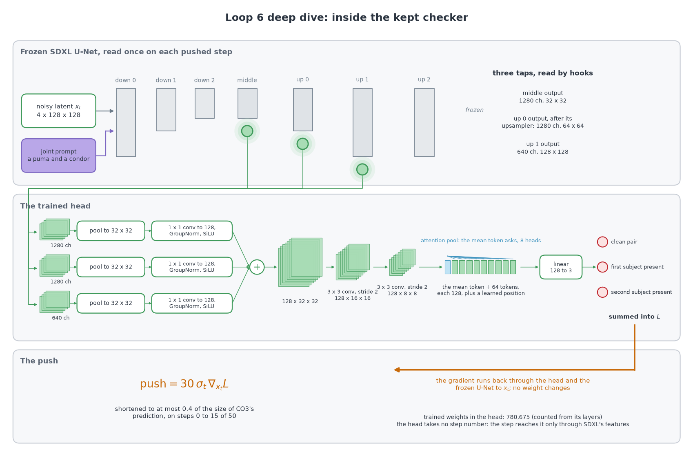
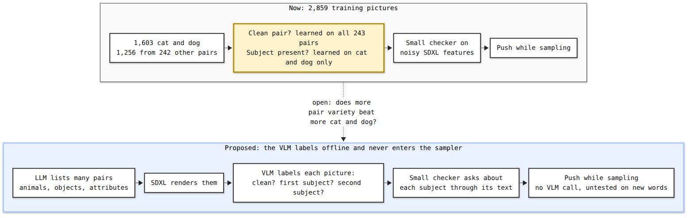

# 🌍 Context: the readout checker, inside the kept checker

⬅️ Previous: [one pushed sampling step](01-overview.md) | 📋 [The pages of this method](01-overview.md#the-pages-of-this-method) | Next: [the push and its cap](03-the-push-and-its-cap.md) ➡️

This page opens the green trapezoid of [the overview's picture](01-overview.md): where on the frozen SDXL U-Net the checker reads, how the trained head shrinks three feature maps down to three numbers, how many weights it trains, and what pictures it learned from. Every size here is read from the code and every count is either counted from a file or quoted with its source.

*Top band: frozen SDXL's U-Net, read once on each pushed step, with [the noisy latent](../../../2-classifier-guidance/artifacts/scenes/noisyclip-sentence-score/rebuild-from-fundamentals.md#1-the-noisy-latent) x_t (4 × 128 × 128) and the joint prompt "a puma and a condor" going in. Of its seven blocks (down 0 to 2, middle, up 0 to 2) three are tapped, marked by green dots: the middle output (1,280 channels, 32 × 32), up 0's output after its upsampler (1,280 channels, 64 × 64) and up 1's output (640 channels, 128 × 128). Middle band: the trained head. Each tap is pooled to 32 × 32, then a 1 × 1 convolution to 128 channels with GroupNorm and SiLU; the three are added into one 128 × 32 × 32 stack; two 3 × 3 convolutions of stride 2 shrink it to 128 × 16 × 16 and then 128 × 8 × 8; the 64 cells become 64 tokens of 128 numbers, a mean token (pale blue) is put in front, and each gets a learned position; an attention pool with 8 heads, asked by the mean token, gives one vector; a linear layer turns its 128 numbers into 3: clean pair, first subject present, second subject present, summed into L. Bottom band: the push, 30 σ_t ∇_{x_t} L, shortened to at most 0.4 of the size of CO3's prediction on steps 0 to 15 of 50; the gradient runs back through the head and the frozen U-Net to x_t and no weight changes. The footer: 780,675 trained weights, and the head takes no step number.* ✅ read on the picture at full size; every size matches the code.

## Table of contents

- [Words this page uses](#words-this-page-uses)
- [The three taps](#the-three-taps)
- [The head, layer by layer](#the-head-layer-by-layer)
- [The attention pool, by what moves](#the-attention-pool-by-what-moves)
- [The weights, counted](#the-weights-counted)
- [What the head learned from](#what-the-head-learned-from)
- [How it fails and how you know it worked](#how-it-fails-and-how-you-know-it-worked)
- [Where this came from](#where-this-came-from)
- [Read more](#read-more)

## Words this page uses

Navigation: 📋 [TOC](#table-of-contents) | [Next](#the-three-taps) ➡️

**Channel**: one of the stacked layers of a feature map. A map of 1,280 channels on a 32 × 32 grid holds 1,280 numbers at each of its 1,024 cells.

**Hook**: a small function attached to a block of a network that copies the block's output as it passes, without changing it.

**Pooling**: averaging neighbouring cells of a grid into one, so the grid shrinks.

**Convolution**: a small window of weights slid over a grid; a 1 × 1 convolution mixes the channels at each cell on its own, and a 3 × 3 one also mixes each cell's eight neighbours. Stride 2 means the window jumps two cells at a time, halving the grid.

**GroupNorm and SiLU**: GroupNorm rescales each group of 8 channels (16 groups of the 128) to a common spread; SiLU is a smooth bend that lets small negative numbers through and passes large positive ones almost unchanged.

🔤 **The name:** GroupNorm and SiLU
- **group**: a set of channels handled together, here 8 of the head's 128 at a time.
- **norm**, short for normalise: shift and rescale a set of numbers to mean 0 and spread 1. On a toy group holding 1, 3, 5 and 7 (mean 4, variance 5), GroupNorm gives −1.342, −0.447, 0.447 and 1.342. Then the learned scale and shift, the 2 × 128 numbers counted below, set the size the head wants.
- **SiLU**: sigmoid linear unit, x × sigmoid(x). *Sigmoid* is the S-curve 1 / (1 + e^−x) that squashes any number into 0 to 1; *linear* is the x it multiplies; *unit* is one neuron's output. On toy inputs −3, −1, 0, 1 and 3 it gives −0.142, −0.269, 0, 0.731 and 2.858: large positives pass nearly unchanged, small negatives come through small, large negatives are squashed toward 0.
- **Consequence:** feed GroupNorm the toy group ten times louder, 10, 30, 50 and 70, and it gives the same −1.342, −0.447, 0.447 and 1.342. So a tap whose numbers run ten times larger reaches the add at the same size as the others; without the norm it would enter ten times larger. ✅ computed on the toy; 🔍 what that would do to the head is inferred, no run removed the norm.

**Token**: one cell's vector of numbers, treated as one item in a list.

**The M1 design**: the file that fixed, before any run, the settings and pass marks of the progress board's step M1, which tests CO3 with this checker's push against CO3 alone.

## The three taps

Navigation: ⬅️ [Words this page uses](#words-this-page-uses) | 📋 [TOC](#table-of-contents) | [Next](#the-head-layer-by-layer) ➡️

**The head reads the U-Net's middle and the first two blocks that grow the picture back, at three grid sizes, and SDXL is never trained.** ✅ `Readout`, `train_count_head.py` lines 50 to 69.

| Block of the frozen U-Net | Output read | What it holds, in the head's terms |
|---|---|---|
| middle | 1,280 channels, 32 × 32 | the coarsest map: one cell per 32 × 32 pixels of the finished picture |
| up 0, after its upsampler | 1,280 channels, 64 × 64 | the first map grown back, one cell per 16 × 16 pixels |
| up 1 | 640 channels, 128 × 128 | one cell per latent cell, 8 × 8 pixels |
| down 0 to 2 and up 2 | not read | |

The pixels per cell are 🔍 inferred from the finished picture's 1,024 pixels across divided by each grid's side.

🔤 **The name:** tap
- **tap**: a valve fitted onto a pipe so some of what flows can be drawn off. On the picture, the three green dots on the frozen blocks.
- **On the code:** `register_forward_hook` on `unet.mid_block`, `unet.up_blocks[0]` and `unet.up_blocks[1]`, each storing its block's output in a dictionary.
- **Consequence:** SDXL still runs to its end on each read and its own noise prediction is thrown away; only the three copied maps go on to the head. ✅ `Readout.forward` calls the U-Net and returns only the three stored maps (line 68 to 69).

**The step number reaches the head only through SDXL's features.** ✅ `PairHead.forward` takes the three maps and nothing else (`train_readout_pair.py`, line 73), while `Readout` hands the timestep to the U-Net (line 68 of `train_count_head.py`). Readout Guidance's released heads add a time vector inside the head; this head does not. ✍️ caveat R2 on [the readout guidance code walks](../../../2-classifier-guidance/artifacts/results/what-each-line-of-readout-guidance-computes/README.md#our-count-head-codewalkhtml).

**The prompt SDXL reads under is the pair's joint prompt.** ✅ The kept checkpoint was saved with `pair_prompt` on, and the CO3 run refuses any checkpoint without it (`paper2_rows.py`, lines 45 to 46); before each pair the reader's stored prompt is replaced by that pair's joint prompt (lines 63 to 64). So for the puma and condor picture the head reads SDXL's features under "a puma and a condor".

## The head, layer by layer

Navigation: ⬅️ [The three taps](#the-three-taps) | 📋 [TOC](#table-of-contents) | [Next](#the-attention-pool-by-what-moves) ➡️

**Three maps of different sizes become one 128 × 32 × 32 stack, then 64 tokens, then one vector, then three numbers.** ✅ `PairHead`, `train_readout_pair.py` lines 61 to 79.

| Layer | Shape in | Shape out | What it does |
|---|---|---|---|
| pool each tap to 32 × 32 | 1,280 × 32 × 32; 1,280 × 64 × 64; 640 × 128 × 128 | 1,280 × 32 × 32; 1,280 × 32 × 32; 640 × 32 × 32 | averages each 1 × 1, 2 × 2 and 4 × 4 block of cells |
| 1 × 1 convolution, GroupNorm, SiLU, one per tap | the three pooled maps | three of 128 × 32 × 32 | brings every tap to the same 128 channels |
| add | three of 128 × 32 × 32 | 128 × 32 × 32 | one map holding all three scales |
| 3 × 3 convolution, stride 2, SiLU | 128 × 32 × 32 | 128 × 16 × 16 | mixes neighbours and halves the grid |
| 3 × 3 convolution, stride 2, SiLU | 128 × 16 × 16 | 128 × 8 × 8 | again |
| flatten to tokens, add a mean token and positions | 128 × 8 × 8 | 65 tokens of 128 | the mean of the 64 tokens goes first; a learned vector is added to each of the 65 |
| attention pool, 8 heads | 65 tokens | 1 vector of 128 | the mean token asks every token how much it matters, and takes their weighted average |
| linear | 128 | 3 | the three logits: clean pair, first subject present, second subject present |

A worked case for the pooling, with illustrative numbers: one 4 × 4 block of up 1's map holding the values 0 to 15 in one channel becomes a single cell of 7.5, their average. Up 1's 16,384 cells per channel become 1,024, so the head sees the finest map at the middle block's resolution. ✅ the shrink factor follows from 128 / 32 = 4; the block values are illustrative.

🔤 **The name:** stride 2
- **stride**: a long step in walking. On the picture, the two 3 × 3 boxes between the 128 × 32 × 32 stack and the 128 × 8 × 8 one.
- **2**: the window moves two cells per step, so it lands on 16 of each row's 32 cells.
- **Consequence:** with stride 1 the grid would stay 32 × 32 and the attention pool would face 1,025 tokens in place of 65. ✅ arithmetic on the layer shapes.

## The attention pool, by what moves

Navigation: ⬅️ [The head, layer by layer](#the-head-layer-by-layer) | 📋 [TOC](#table-of-contents) | [Next](#the-weights-counted) ➡️

**One question vector, built from the mean token, scores each of the 65 tokens; the scores become weights summing to 1, and the answer is the weighted average of the tokens' values.** ✅ `nn.MultiheadAttention(128, 8)` called as `self.attn(x[:, :1], x, x)`, line 77. The colours are the picture's: pale blue for the mean token, green for the cell tokens.

$$
\underbrace{o}_{\text{one vector of 128}}
= \sum_{k=0}^{64}
\underbrace{\frac{e^{\,\textcolor{#3d93bf}{q}\cdot \textcolor{#3e9a5a}{K_k}/\sqrt{16}}}{\sum_j e^{\,\textcolor{#3d93bf}{q}\cdot \textcolor{#3e9a5a}{K_j}/\sqrt{16}}}}_{\text{weight on token } k}\;
\textcolor{#3e9a5a}{\underbrace{V_k}_{\text{token } k\text{'s value}}}
$$

This is one head; the 128 numbers are split into 8 heads of 16 each, each head does the above with its own learned question, key and value maps, and the 8 results are joined and mixed by one more 128 × 128 map. ✅ the head width 128 / 8 = 16 is from the layer's settings.

| Symbol | What it is | If it grew |
|---|---|---|
| q | the question: the mean token (with its position) times a learned matrix | a larger match with one token's key gives that token more of the weight |
| K_k | token k's key: what it offers to be matched on | the token pulls more of the average toward its value |
| V_k | token k's value: what it contributes if chosen | the output moves toward it in proportion to its weight |
| √16 | the scale for a head of 16 numbers | without it, scores of 16 summed products would be large and the weights would collapse onto one token |

A worked case with illustrative numbers and three tokens in place of 65: match scores q·K / 4 of 2, 0 and 0 give weights e² / (e² + 1 + 1) = 7.39 / 9.39 = 0.79, then 0.11 and 0.11. If the three values are 1, 0 and 0 on one number, the output on that number is 0.79. Raise the first score from 2 to 3 and its weight rises to 20.09 / 22.09 = 0.91.

🔤 **The name:** attention pool
- **attention**: where one looks, given that one cannot look everywhere equally. On the picture, the pale blue lines from the mean token fanning out to the green tokens, drawn thicker where the weight is larger (illustrative).
- **pool**: putting many things into one shared pool. On the picture, the 65 tokens going in and one vector coming out to the linear layer.
- **Formula, in those words:** a weighted average of the tokens, with the weights chosen by how well each token answers the mean token's question.
- **Consequence:** replace the attention with a plain average and every one of the 64 cells counts 1/64, so a small region holding a borrowed face would count no more than a patch of sky. 🔍 inferred from the formula; no run compared the two.

## The weights, counted

Navigation: ⬅️ [The attention pool, by what moves](#the-attention-pool-by-what-moves) | 📋 [TOC](#table-of-contents) | [Next](#what-the-head-learned-from) ➡️

**The head trains 780,675 numbers, and just over half of them sit in the three 1 × 1 convolutions that bring the taps to 128 channels.** ✅ counted by hand from the layer shapes; matches `trained_weights_kept_checker` in `make_deep_dives.py`.

| Layer | How the count is made | Weights |
|---|---|---|
| middle tap: 1 × 1 convolution, GroupNorm | 1,280 × 128 + 128 biases + 2 × 128 for GroupNorm's scale and shift | 164,224 |
| up 0 tap: the same | 1,280 × 128 + 128 + 256 | 164,224 |
| up 1 tap: the same | 640 × 128 + 128 + 256 | 82,304 |
| two 3 × 3 convolutions | 2 × (128 × 128 × 9 + 128) | 295,168 |
| learned positions | 65 × 128 | 8,320 |
| attention | in: 3 × 128 × 128 + 384; out: 128 × 128 + 128 | 66,048 |
| linear | 128 × 3 + 3 | 387 |
| total | | 780,675 |

The three projections hold 410,752 of the 780,675, or 52.6%. ✅ The older ladder page rounds the same head to "about 0.78 M weights". ✅

## What the head learned from

Navigation: ⬅️ [The weights, counted](#the-weights-counted) | 📋 [TOC](#table-of-contents) | [Next](#how-it-fails-and-how-you-know-it-worked) ➡️

**The head trained on 2,859 finished pictures of 243 subject pairs, each noised to a random sampler step; the clean-pair output learned from all of them, the two presence outputs from the 1,603 cat and dog pictures alone.** ✅ counted from `training_set_multipair.json` and `presence_catdog.json` in `2-classifier-guidance/scripts/rung2/`.

*Top row, the checker as it is: 2,859 training pictures, 1,603 of cat and dog and 1,256 from 242 other pairs; the yellow box reads "Clean pair? learned on all 243 pairs" and "Subject present? learned on cat and dog only"; then the small checker on noisy SDXL features and the push while sampling. Bottom row, a proposed design: a language model lists many pairs, SDXL renders them, a vision-language model labels each picture offline (clean, first subject, second subject), and a checker asks about each subject through its text, with no labelling model in the sampler. The dotted arrow asks whether more pair variety beats more cat and dog.* ✅ read on the picture at full size. The bottom row is ✍️ a proposal stated by the diagram.

| Count | Value | Mark |
|---|---|---|
| training pictures | 2,859: 1,187 labelled clean pair, 1,672 labelled reject | ✅ counted from the list |
| cat and dog pictures | 1,603 | ✅ |
| pictures from other pairs | 1,256 over 242 pairs | ✅ |
| pairs with at least one clean picture | 201 of 243 | ✅ |
| presence labels | 1,823 in the file, covering all 1,603 cat and dog training pictures; the other 1,256 training pictures carry none and the loss skips them | ✅ |
| pairs held out of training | 2, named in the list's `held_out_pairs` | ✅ |
| updates | 2,000 | ✅ the checkpoint's name, `head_step_002000.pt` |

Each training picture's finished latent is noised to one of the 50 sampler steps, the U-Net reads it under that pair's joint prompt, and the head's three outputs are scored with binary cross-entropy: the clean-pair output against 1 or 0, and the two presence outputs against the presence labels, counted twice as heavily and skipped where no label exists. Each pass draws 4 clean and 4 reject pictures, every source equally likely on each side. ✅ lines 143 to 152 and 448 to 466.

**Noising a finished latent, by what moves.** The blue term is what is left of the finished latent x_0, the grey term is fresh noise ε; the colours are this block's own. ✍️ the formula of the scheduler's `add_noise`, not reread this session.

$$
\underbrace{x_t}_{\text{the noised latent}}
= \textcolor{#1f5fd0}{\underbrace{\sqrt{\bar\alpha_t}\,x_0}_{\text{what is left of the finished latent}}}
+ \textcolor{#6b7a88}{\underbrace{\sqrt{1-\bar\alpha_t}\,\varepsilon}_{\text{fresh noise}}}
$$

On one number of the latent, with a finished value x_0 = 1.0 and a noise draw ε = 0.5 (illustrative), at the schedule's real ᾱ_t:

| Step of 50 | ᾱ_t | Finished part | Noise part | x_t |
|---|---|---|---|---|
| 0 | 0.00578 | 0.076 | 0.499 | 0.575 |
| 15 | 0.09464 | 0.308 | 0.476 | 0.783 |
| 49 | 0.99830 | 0.999 | 0.021 | 1.020 |

✅ computed this session from SDXL's scheduler config. Move ᾱ_t up and the blue part grows while the grey part shrinks; the head trains on all 50 steps, while the push uses it on steps 0 to 15, where at most 0.308 of the finished value is left.

> [!WARNING]
> The trainer has four switches that change the batch: the share of noise levels drawn from the 20 noisiest steps, the share of rejects drawn from wrong pairs such as two cats, augmented copies of each latent, and passes per update. Which of them the kept run set is not recorded in any source read for this page, so the step choice above is the trainer's default (uniform over 50) and the run may have differed. 🔍

A worked case for the loss, with illustrative logits: a clean picture given a clean-pair logit of +2 costs log(1 + e^−2) = 0.127; a reject given the same +2 costs log(1 + e^2) = 2.127. Training lowers the second far more than the first.

🔤 **The name:** binary cross-entropy
- **binary**: two answers, yes or no. Each of the head's three outputs is its own yes or no.
- **cross-entropy**: the cost of a belief measured against the true answer, −log of the probability the belief gave the true answer. The [cross-entropy card](../../../../../Obsidian/Mathematics/Statistics/Information%20Theory/Cross-Entropy.md#where-to-learn-this) works it with numbers.
- **Formula, in those words:** turn the logit into a probability p with the sigmoid, 1 / (1 + e^−logit); a yes costs −log p and a no costs −log(1 − p). That is the log(1 + e^−2) and log(1 + e^2) of the worked case above.
- **Consequence:** move a clean picture's clean-pair logit from +2 to 0 to −2 and its cost goes 0.127, 0.693, 2.127; a reject's cost runs the same numbers in reverse. ✅ computed this session.

> [!NOTE]
> The pair list behind those 243 pairs holds 54 pictures over 27 pairs naming a subject on the subject guard's decision list, so this checkpoint can answer the CO3 test and cannot be frozen as a recipe. A retrained checker on a cleaned list is a later step. ✍️ [the M1 design](../../../artifacts/notes/progress/method-search/01-beat-the-baseline/design.md#paper-2-co3-with-the-push-against-co3-alone), lines 106 to 109.

## How it fails and how you know it worked

Navigation: ⬅️ [What the head learned from](#what-the-head-learned-from) | 📋 [TOC](#table-of-contents) | [Next](#where-this-came-from) ➡️

**The head's clean-pair output is read against held-out pictures as balanced accuracy, the mean of its hit rate on clean pairs and on rejects, where 0.5 is a coin flip; the readings on record for this checker sit below the 0.75 pass mark.** ✍️

The kept multi-pair checker read held-out half-drawn runs at 0.686, 0.691 and 0.702 after 500, 1,000 and 1,500 updates; no reading at 2,000 is recorded in the sources read here. ✍️ [the checker loop](../../../2-classifier-guidance/artifacts/drips/rung2-pair-aware-discriminator/checker-loop.md#loop-closed-on-2026-11-19), line 273. The best reading of the sampler's own early states on record, by a cat and dog checker trained on those states, is 0.730 against the 0.75 mark. ✍️ [the checker finding](../../../2-classifier-guidance/report/classifier-guided-poe/can-a-checker-read-a-clean-cat-and-dog.md#training-on-the-samplers-own-states).

💥 **Broken run (trained twice as long):** the same list and settings for 4,000 updates in place of 2,000.
- **Predict:** more training, more faithful pairs?
- **Measured:** fewer. On cat and dog seeds 6001 to 6128 at cap 0.3, faithful pairs fell from 29 to 13 and damaged pictures rose from 10 to 23. ✍️ [the checker loop](../../../2-classifier-guidance/artifacts/drips/rung2-pair-aware-discriminator/checker-loop.md#loop-closed-on-2026-11-19), line 287.

A higher reading does not promise a better push: two cat and dog checkers reading 0.755 and 0.756 gave two bodies on about 7 and 3 of 8 seeds. ✍️ [the checker finding](../../../2-classifier-guidance/report/classifier-guided-poe/can-a-checker-read-a-clean-cat-and-dog.md#what-this-cannot-tell-you).

## Where this came from

Navigation: ⬅️ [How it fails and how you know it worked](#how-it-fails-and-how-you-know-it-worked) | 📋 [TOC](#table-of-contents) | [Next](#read-more) ➡️

| What | How it was established | When |
|---|---|---|
| The taps, the head's layers and their shapes | Read in `train_count_head.py` lines 50 to 69 and `train_readout_pair.py` lines 61 to 94, commit `e7787922`, both clean | 2026-11-24 |
| The 780,675 weights | Counted by hand from the layer shapes; equal to `trained_weights_kept_checker` in `make_deep_dives.py` | 2026-11-24 |
| The training counts | Counted from `training_set_multipair.json` and `presence_catdog.json` with a short read-only script | 2026-11-24 |
| The training batch and loss | Read in `train_readout_pair.py`, lines 143 to 152 and 448 to 466 | 2026-11-24 |
| The joint prompt as the reading prompt | Read in `paper2_rows.py`, lines 43 to 64 | 2026-11-24 |
| Both pictures' labels | Read at full size; paths and labels passed `is_showable` and are absent from the held-pictures list | 2026-11-24 |
| The readings and the 4,000-update round | Stated by the checker loop and the checker finding, not recomputed | 2026-11-24 |
| Pixels per cell, and what a plain average would lose | Inferred from the grid sizes and the attention formula | 2026-11-24 |

## Read more

Navigation: ⬅️ [Where this came from](#where-this-came-from) | 📋 [TOC](#table-of-contents)

| What | Where |
|---|---|
| A tap, a frozen feature and a readout head, taught on one small network | [chapter 6, section 6.1, of the classifier-guidance-by-hand textbook](../../../../../goal-setting/learning/deep-learning/diffusion-models/13-classifier-guidance-by-hand/textbook/06-readout-guidance-on-one-small-network.md#61-the-frozen-models-two-taps) |
| Line by line, where this project's head copies Readout Guidance's and where it departs | [the readout guidance code walks](../../../2-classifier-guidance/artifacts/results/what-each-line-of-readout-guidance-computes/README.md) |

⬅️ Previous: [one pushed sampling step](01-overview.md) | 📋 [The pages of this method](01-overview.md#the-pages-of-this-method) | Next: [the push and its cap](03-the-push-and-its-cap.md) ➡️

<!-- built-to: PAGE_LOOK_FORMAT v1 -->
