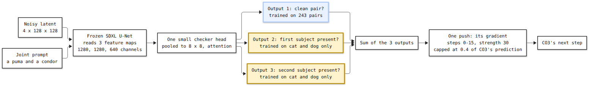

# 🌍 Context: the readout checker, the push and its cap

⬅️ Previous: [inside the kept checker](02-inside-the-kept-checker.md) | 📋 [The pages of this method](01-overview.md#the-pages-of-this-method) | Next: [the code](04-the-code.md) ➡️

This page follows the checker's three outputs to the sampler: what the push is the gradient of, how its length is set and capped, which steps it acts on, and how it enters CO3 and the plain product. The worked cases use the recipe's real strength, cap and noise levels; where a size was never recorded, the number is illustrative and says so.

*Left to right: [the noisy latent](../../../2-classifier-guidance/artifacts/scenes/noisyclip-sentence-score/rebuild-from-fundamentals.md#1-the-noisy-latent) (4 × 128 × 128) and the joint prompt "a puma and a condor" go into the frozen SDXL U-Net, which hands three feature maps (1,280, 1,280 and 640 channels) to one small checker head. The head has three outputs: clean pair, trained on 243 pairs (blue box), and first and second subject present, each trained on cat and dog only (yellow boxes). Their sum gives one push: its gradient, on steps 0 to 15, at strength 30, capped at 0.4 of CO3's prediction. The push enters CO3's next step.* ✅ read on the picture at full size; matches [the M1 design](../../../artifacts/notes/progress/method-search/01-beat-the-baseline/design.md#paper-2-co3-with-the-push-against-co3-alone), lines 97 and 111 to 113.

## Table of contents

- [Words this page uses](#words-this-page-uses)
- [What the push follows](#what-the-push-follows)
- [The push, by what moves](#the-push-by-what-moves)
- [The cap, worked](#the-cap-worked)
- [Where the push enters the sampler](#where-the-push-enters-the-sampler)
- [How the kept settings were chosen](#how-the-kept-settings-were-chosen)
- [Where this came from](#where-this-came-from)
- [Read more](#read-more)

## Words this page uses

Navigation: 📋 [TOC](#table-of-contents) | [Next](#what-the-push-follows) ➡️

**Gradient**: for a score that depends on many numbers, the list of how much the score rises when each number is nudged up a little. Here it has one entry for each of the 65,536 numbers of the latent x_t.

🔤 **The name:** gradient
- **gradient**: a slope, as in a road's gradient, taken in every direction at once. On the push's formula below, the green ∇_{x_t} L.
- **On a toy score of two numbers**, L = 2 x₁ − x₂: nudge x₁ up by 0.1 and L rises by 0.2; nudge x₂ up by 0.1 and L falls by 0.1. So the gradient is (2, −1), one entry per number, the way the real one has 65,536.
- **Consequence:** move the toy's two numbers by 0.1 × (2, −1) and L rises by 0.5; move them the opposite way and L falls by 0.5. No other move of the same length raises L more, which is why the push follows this direction. ✅ computed this session; the [gradient card](../../../../../Obsidian/Mathematics/Calculus/Gradient.md#where-to-learn-this) teaches it with worked examples.

**Signal level ᾱ_t and noise level σ_t**: ᾱ_t is the share of the clean latent's variance still present at step t, from near 0 at step 0 to near 1 at the end; σ_t = √(1 − ᾱ_t) is the matching noise size.

**Norm**: the length of a block of numbers taken as one arrow, the square root of the sum of their squares.

**Size-matched random push**: a random direction scaled at each step to exactly the length the real push had at that step, so only the direction differs.

**The M1 design and review**: the two files of the progress board's step M1, which tests whether each paper's method beats its simplest baseline. The design fixed the CO3 run's settings and pass marks before any run, and the review records what the runs gave, including a trial on one pair at one seed.

## What the push follows

Navigation: ⬅️ [Words this page uses](#words-this-page-uses) | 📋 [TOC](#table-of-contents) | [Next](#the-push-by-what-moves) ➡️

**The push follows the gradient of the sum of the head's three raw logits, taken through the head and the frozen U-Net back to the latent.** ✅ `ReadoutPairClassifier.forward` returns `o.sum(-1)` and `log_prob_both` sums that over the batch (`train_readout_pair.py`, lines 89 to 94); `Pusher` differentiates it with respect to x_t (`co3_push.py`, lines 62 to 65).

$$
L = \textcolor{#1f5fd0}{\underbrace{\ell_{\text{pair}}}_{\text{clean pair?}}}
+ \textcolor{#b58900}{\underbrace{\ell_{\text{first}}}_{\text{first subject present?}}}
+ \textcolor{#b58900}{\underbrace{\ell_{\text{second}}}_{\text{second subject present?}}}
$$

The colours are the picture's: blue for the output trained on every pair, yellow for the two trained on cat and dog only.

**Each term is a logit, the raw output before any sigmoid.** For a yes-or-no output, the logit is the log of the odds: a logit of 0 is even odds, +2 is odds of e² ≈ 7.4 to 1. So raising L raises the log-odds of all three answers at once, each with slope 1. [The digit derivation's step 7](../../../2-classifier-guidance/artifacts/scenes/mnist-guidance-explained/4-the-derivation.md#step-7-the-checkers-outputs-are-logits) works the same reading for the pair-aware digit checker. ✍️

A worked case with illustrative logits: a picture with logits +1, −1 and +0.5 has L = 0.5. A nudge that raises only the clean-pair logit by 0.2 raises L by 0.2 whatever the other two are; with a sigmoid in front (log σ(ℓ)) the same nudge would raise the score by only (1 − σ(1)) × 0.2 = 0.27 × 0.2 = 0.054, because a confident output's push fades. Summing raw logits means no output's pull fades as the checker grows sure. ✅ arithmetic; 🔍 the reading of what this does to a render is inferred and untested.

🔤 **The name:** sigmoid
- **sigmoid**: S-shaped, after the Greek letter sigma. The sigmoid squashes any logit into a probability between 0 and 1: σ(ℓ) = 1 / (1 + e^−ℓ).
- **On the worked case:** logits −2, 0, 1 and 2 become 0.119, 0.5, 0.731 and 0.881, so 1 − σ(1) = 0.269, the 0.27 above.
- **Consequence:** the slope of log σ(ℓ) is 1 − σ(ℓ), which is 0.5 at a logit of 0 and 0.119 at a logit of 2. With a sigmoid in front, a confident output's pull shrinks to about a quarter of an unsure one's; the summed raw logits keep a slope of 1 at every logit. ✅ computed this session.
- **One letter, two meanings:** σ(ℓ) in this block is the sigmoid; σ_t everywhere else on this page is the noise level. They share only the letter. The [logit card](../../../../../Obsidian/Artificial%20Intelligence/Deep%20Learning/Logit.md#where-to-learn-this) teaches logits and the sigmoid together.

> [!NOTE]
> The code calls the summed logits `log_prob_both`, and the sampler's docstring describes the head as giving "log p(cat) + log p(dog)" (`poe_repair/methods/_classifier_guided.py`, line 14). For the kept checker the quantity differentiated is the sum of three raw logits, which is a sum of log-odds, as above. The names fit an older presence head whose outputs were log-probabilities. 🔍

**On CO3's tuning pairs the two yellow outputs answer about subjects they never trained on.** ✅ Their labels exist only for the 1,603 cat and dog pictures and the loss masks every other picture (`train_readout_pair.py`, lines 457 to 464); none of the 12 tuning pairs is cat and dog. ✍️ the design draws the consequence: the CO3 run tests the kept push as it stands, and which outputs should drive it is a later step (lines 111 to 115).

## The push, by what moves

Navigation: ⬅️ [What the push follows](#what-the-push-follows) | 📋 [TOC](#table-of-contents) | [Next](#the-cap-worked) ➡️

**The push before the cap is the strength, times the noise level, times the gradient; over the 16 pushed steps the noise level stays between 0.95 and 1, so the push's length is set almost entirely by the gradient and the cap.** ✅

$$
\textcolor{#c86a0a}{\underbrace{\text{raw push}}_{\text{before the cap}}}
= \underbrace{30}_{\text{strength}}\;\times\;\underbrace{\sigma_t}_{\text{noise level}}\;\times\;\textcolor{#1d6b3a}{\underbrace{\nabla_{x_t} L}_{\text{where the score rises}}}
$$

| Step of 50 | Timestep | Signal level ᾱ_t | Noise level σ_t | Raw push per unit of gradient length |
|---|---|---|---|---|
| 0 | 981 | 0.00578 | 0.9971 | 29.91 |
| 5 | 881 | 0.01719 | 0.9914 | 29.74 |
| 10 | 781 | 0.04346 | 0.9780 | 29.34 |
| 15 | 681 | 0.09464 | 0.9515 | 28.55 |
| 16 onward | 661 and below | | | 0: no push |

✅ computed from SDXL's scheduler config (scaled linear betas 0.00085 to 0.012 over 1,000 steps, 50 steps with leading spacing and offset 1).

🔤 **The name:** noise level, as the push's scale
- **noise**: the random part of the latent. On the table, σ_t, near 1 at step 0.
- **level**: how much of it there is at this step.
- **Formula, in those words:** the push is scaled by how much noise the latent still holds, because a [noise prediction is the score](../../../../../goal-setting/learning/deep-learning/diffusion-models/02-sampler-correctors-for-composition/plans/08-noise-prediction-is-the-score.md) scaled by −σ_t. ✍️ derived in [step 1 of the digit derivation](../../../2-classifier-guidance/artifacts/scenes/mnist-guidance-explained/4-the-derivation.md).
- **Consequence:** the same gradient pushed at step 40 (timestep 181, σ_t 0.4662) would give a raw push less than half as long as at step 0 (0.9971). The window keeps the push where σ_t is near 1. ✅ computed from the same schedule.

🔤 **The name:** window
- **window**: an opening that lets through only part of a view. On the picture, "steps 0-15" in the push box.
- **Formula, in those words:** push when 0 ≤ step < 16, else push nothing. ✅ `WINDOW = (0, 16)` in `paper2_rows.py`, line 32, and `co3_push.py`, line 52.
- **Consequence:** the same push on every step of 50, with a cap of 0.3, separated the cat and dog on most seeds and damaged the colour; on steps 0 to 15 only, the colour came closer to a photograph. ✍️ [the early push finding](../../../2-classifier-guidance/report/classifier-guided-poe/does-an-early-push-separate-the-cat-and-dog.md#how-hard-and-for-how-long), draft calls on 8 seeds.

## The cap, worked

Navigation: ⬅️ [The push, by what moves](#the-push-by-what-moves) | 📋 [TOC](#table-of-contents) | [Next](#where-the-push-enters-the-sampler) ➡️

**If the raw push is longer than 0.4 times the length of the prediction it is added to, it is shrunk along its own direction to exactly that length; otherwise it passes unchanged.** ✅ `co3_push.py`, lines 69 to 73; `capped_push` in `poe_repair/methods/_classifier_guided.py`, lines 49 to 61.

$$
\textcolor{#c86a0a}{\text{push}} = \textcolor{#c86a0a}{\text{raw}} \times \min\!\left(1,\; \frac{0.4\,\lVert \textcolor{#6b7a88}{\varepsilon} \rVert}{\lVert \textcolor{#c86a0a}{\text{raw}} \rVert}\right)
$$

On CO3, ε here is CO3's guided prediction ε_u + 0.8 (ε_c − ε_u), with ε_u its unconditional prediction and ε_c the joint prompt's. ✅ line 70.

The guidance 0.8, with the words "unconditional" and "CFG++" taken apart and the guidance moved from 0 to 7.5 on one number, is on [the overview's words](01-overview.md#words-this-page-uses).

🔤 **The name:** cap
- **cap**: a ceiling on how high something may go. On the picture, "capped at 0.4 of CO3's prediction".
- **Formula, in those words:** the push may be at most four tenths as long as the prediction it changes.
- **Consequence:** the push can steer the sampler and can never outweigh it. On cat and dog with the plain product, raising the cap from 0.3 to 0.4 raised faithful pairs from 29 to 35 of 128 and the scorer's damaged count from 10 to 11. ✍️ [the kept push finding](../../../2-classifier-guidance/report/classifier-guided-poe/how-close-the-kept-push-comes-to-the-joint-prompt.md#every-improvement-round).

A worked case. The strength 30, the cap 0.4 and the noise levels are the recipe's; the prediction length 100 and the gradient lengths 1 and 2 are illustrative, because no run recorded them for CO3.

| Case | Raw push length | Ceiling, 0.4 × 100 | Push applied | Shrink factor |
|---|---|---|---|---|
| step 0, gradient length 1 | 30 × 0.9971 × 1 = 29.91 | 40 | 29.91 | 1, the cap does not fire |
| step 0, gradient length 2 | 30 × 0.9971 × 2 = 59.83 | 40 | 40 | 40 / 59.83 = 0.669 |
| step 15, gradient length 2 | 30 × 0.9515 × 2 = 57.09 | 40 | 40 | 40 / 57.09 = 0.701 |
| step 0, gradient length 2, the older cap of 0.3 | 59.83 | 30 | 30 | 0.501 |

How often it fires on real runs: on the CO3 trial at one pair and one seed the cap fired on 2 of the 16 pushed steps ✍️ ([the M1 review](../../../artifacts/notes/progress/method-search/01-beat-the-baseline/review.md), lines 42 to 43); on the plain product of "a cat" and "a dog" at cap 0.4 it fired on 18.9% of steps 0 to 15, averaged over 128 seeds ✍️ ([the kept push finding](../../../2-classifier-guidance/report/classifier-guided-poe/how-close-the-kept-push-comes-to-the-joint-prompt.md#where-the-sources-disagree)).

## Where the push enters the sampler

Navigation: ⬅️ [The cap, worked](#the-cap-worked) | 📋 [TOC](#table-of-contents) | [Next](#how-the-kept-settings-were-chosen) ➡️

**On CO3 the push is subtracted from both entries of CO3's main U-Net call, so its guided and unconditional predictions each drop by the same push; on the plain product it is subtracted from the product's one prediction.** ✅ `PushingUNet.forward`, `co3_push.py` lines 30 to 36; `run_poe_classifier_guided`, `_classifier_guided.py` lines 201 to 232.

$$
\underbrace{(\varepsilon_u - p) + g\big((\varepsilon_c - p) - (\varepsilon_u - p)\big)}_{\text{CO3's guidance on the pushed entries}}
= \underbrace{\varepsilon_u + g(\varepsilon_c - \varepsilon_u)}_{\text{CO3's own guided prediction}} - \textcolor{#c86a0a}{p}
$$

✅ the identity is written in `co3_push.py`'s docstring, lines 7 to 10. On one number, with illustrative values ε_u = 1.0, ε_c = 2.0, the guidance g = 0.8 and a push p = 0.3: unpushed, 1.0 + 0.8 × 1.0 = 1.8; pushed, 0.7 + 0.8 × (1.7 − 0.7) = 1.5, which is 1.8 − 0.3.

**Why both entries.** CO3's step is x_{t−1} = √ᾱ_{t−1} x̂_0(ε_g) + √(1 − ᾱ_{t−1}) ε_u, where x̂_0(ε_g) = (x_t − σ_t ε_g) / √ᾱ_t is the clean guess from the guided prediction. ✍️ the design, lines 99 to 104. Lowering both predictions by p moves the latent by √ᾱ_{t−1} σ_t / √ᾱ_t × p − √(1 − ᾱ_{t−1}) × p; lowering ε_g alone drops the second term.

| Step | Latent moves per unit of push, both lowered | The same, guided prediction alone | How much further |
|---|---|---|---|
| 0 (timestep 981 to 961) | 0.0853 × 13.12 − 0.9964 = 0.123 | 1.120 | 9.1 times |
| 15 (timestep 681 to 661) | 0.3298 × 3.093 − 0.9441 = 0.076 | 1.020 | 13.4 times |

✅ computed from SDXL's schedule on the step formula the design states; CO3's corrector, which runs before the push on corrected steps, is left out. The design's reason for subtracting from both, that it moves the latent the way the kept recipe's own DDIM step does, is ✍️ stated there.

**On the plain product**, the push is subtracted from ε_PoE = ε_cat + ε_dog − ε_empty, each expert's prediction first guided against the empty prompt at the run's guidance scale, and the ordinary DDIM step with one prediction follows. The cap is 0.4 of ε_PoE's length. ✅ `_classifier_guided.py`, lines 149 to 158 and 228 to 232. The project's default guidance scale is 7.5 (`DEFAULT_GUIDANCE`, `poe_repair/config.py` line 15), and the older ladder page gives 7.5 for these runs. ✍️ What the product is and why it fuses the two animals is on [PoE composition](../../world/poe-composition.md#what-poe-composition-is).

**A zero push is the canary.** At strength 0 the push code still runs its path and multiplies by 0, and the final latent must match CO3's own loop to within 1e-5; it matched with a largest absolute difference of 0.0. ✍️ the M1 review, line 39.

🔤 **The name:** canary
- **canary**: the bird miners carried underground, which reacted to bad air before they did, so a live canary meant the air was safe. Here, a run whose answer is known before it starts, so any difference is a fault.
- **Where it sits:** the whole push path run at strength 0, compared with CO3's own loop from the same starting noise.
- **Consequence:** at strength 0 the largest difference in the final latent was 0.0 against a mark of 1e-5; at strength 30 it was 3.79. ✍️ the M1 review, lines 39 to 43, as tabled on [the code page](04-the-code.md#how-it-fails-and-how-you-know-it-worked). A strength-0 run that moved the latent would mean the wrapper changes the render with no push at all.

## How the kept settings were chosen

Navigation: ⬅️ [Where the push enters the sampler](#where-the-push-enters-the-sampler) | 📋 [TOC](#table-of-contents) | [Next](#where-this-came-from) ➡️

**The strength, window and cap were kept one change at a time on the plain product of "a cat" and "a dog", then carried unchanged to CO3.** ✍️ The table quotes the rounds that set each value; every count is from [the kept push finding](../../../2-classifier-guidance/report/classifier-guided-poe/how-close-the-kept-push-comes-to-the-joint-prompt.md#every-improvement-round) or [the early push finding](../../../2-classifier-guidance/report/classifier-guided-poe/does-an-early-push-separate-the-cat-and-dog.md#how-hard-and-for-how-long), not recomputed.

| Setting | What was tried | What was recorded | Kept |
|---|---|---|---|
| window | steps 0 to 15 against steps 0 to 24, 128 seeds | 25 against 24 faithful pairs | 0 to 15 |
| cap, all 50 steps | 0.1, 0.3, 0.5, draft calls on 8 seeds | 0.3 separated most seeds with colour damage; 0.5 broke at strength 100 | 0.3, then 0.3 on steps 0 to 15 |
| cap, early window | 0.2 against 0.3 on 32 new seeds, by eye | 22 and 28 of 32 separate | 0.3 |
| checker | cat and dog only against the 243-pair list, cap 0.3, 128 seeds | 25 against 29 faithful pairs | the 243-pair list |
| cap | 0.3 against 0.4 with the 243-pair checker, 128 seeds | 29 against 35 faithful pairs | 0.4 |

> [!IMPORTANT]
> Every round was judged on the same 128 seeds, so the final 35 is the best of several tries on one set and may flatter the recipe. No fresh set of seeds has tested the final setting, and drawing the same seeds twice moved which seeds were faithful while the total held. ✍️ [the kept push finding](../../../2-classifier-guidance/report/classifier-guided-poe/how-close-the-kept-push-comes-to-the-joint-prompt.md#what-this-cannot-tell-you).

💥 **Broken run (direction removed):** the size-matched random push, same lengths at every step, random direction.
- **Predict:** does any disturbance of that size separate the animals?
- **On the plain product of cat and dog:** the random push gave 0 or 1 two-body pictures and 0 faithful pairs on every 128-seed sheet that scored it; the kept push gave 121 and 35. ✍️ [the kept push finding](../../../2-classifier-guidance/report/classifier-guided-poe/how-close-the-kept-push-comes-to-the-joint-prompt.md#every-improvement-round).
- **On CO3:** the random push gave 12 faithful pairs of 96 and the checker push 7, with CO3 alone at 11. ✍️ [the CO3 finding](../../../2-classifier-guidance/report/the-method-search/does-adding-the-kept-push-to-co3-beat-co3-alone.md#1-the-three-rows-on-the-same-seeds).

## Where this came from

Navigation: ⬅️ [How the kept settings were chosen](#how-the-kept-settings-were-chosen) | 📋 [TOC](#table-of-contents) | [Next](#read-more) ➡️

| What | How it was established | When |
|---|---|---|
| The opening picture's labels | Read at full size and against its source `what-the-push-follows.mmd`; path and labels passed `is_showable` and are absent from the held-pictures list | 2026-11-24 |
| L as the sum of three raw logits | Read in `train_readout_pair.py`, lines 73 to 94 | 2026-11-24 |
| The push, the cap, the window and the CO3 entry | Read in `co3_push.py` lines 16 to 76 and `paper2_rows.py` lines 30 to 32, commit `e7787922`, both clean | 2026-11-24 |
| The plain-product path | Read in `poe_repair/methods/_classifier_guided.py`, lines 49 to 61, 149 to 158 and 201 to 232 | 2026-11-24 |
| The noise levels and the latent moves per unit of push | Computed from SDXL's scheduler config and the CO3 step as the design states it | 2026-11-24 |
| CO3's step formula and the reason to subtract from both | Stated by the M1 design, lines 99 to 104 | 2026-11-24 |
| Every count of pictures and how often the cap fired | Quoted from the findings and the M1 review linked beside each | 2026-11-24 |

## Read more

Navigation: ⬅️ [Where this came from](#where-this-came-from) | 📋 [TOC](#table-of-contents)

| What | Where |
|---|---|
| Why a guidance term carries √(1 − ᾱ_t), and why a checker's outputs are logits | [the digit guidance derivation](../../../2-classifier-guidance/artifacts/scenes/mnist-guidance-explained/4-the-derivation.md) |
| The gradient, taught with worked examples | [the gradient card](../../../../../Obsidian/Mathematics/Calculus/Gradient.md#where-to-learn-this) |
| The DDIM step and classifier-free guidance, with textbook pages | [the DDIM card](../../../../../Obsidian/Artificial%20Intelligence/Generative%20Modeling/Diffusion%20Models/DDIM.md#where-to-learn-this) and [the classifier-free guidance card](../../../../../Obsidian/Artificial%20Intelligence/Generative%20Modeling/Diffusion%20Models/Classifier-Free%20Guidance.md#where-to-learn-this) |
| Readout Guidance's own push, one fresh Adam step on the latent | [chapter 6, section 6.5, of the classifier-guidance-by-hand textbook](../../../../../goal-setting/learning/deep-learning/diffusion-models/13-classifier-guidance-by-hand/textbook/06-readout-guidance-on-one-small-network.md#65-the-push-back-to-the-latent-one-fresh-adam-step) |

⬅️ Previous: [inside the kept checker](02-inside-the-kept-checker.md) | 📋 [The pages of this method](01-overview.md#the-pages-of-this-method) | Next: [the code](04-the-code.md) ➡️

<!-- built-to: PAGE_LOOK_FORMAT v1 -->
