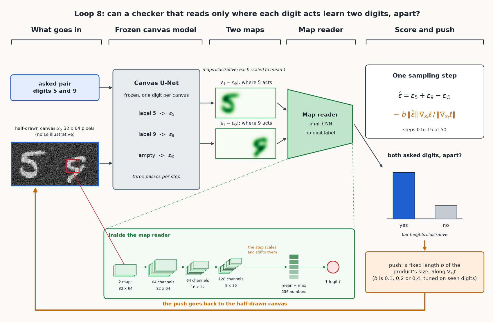
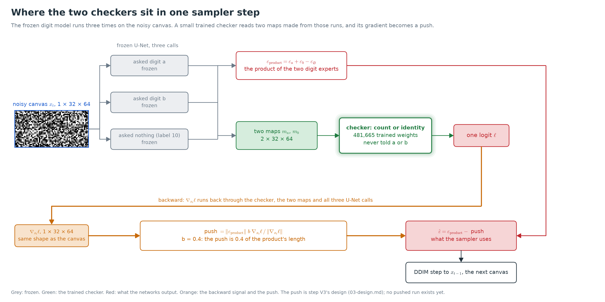
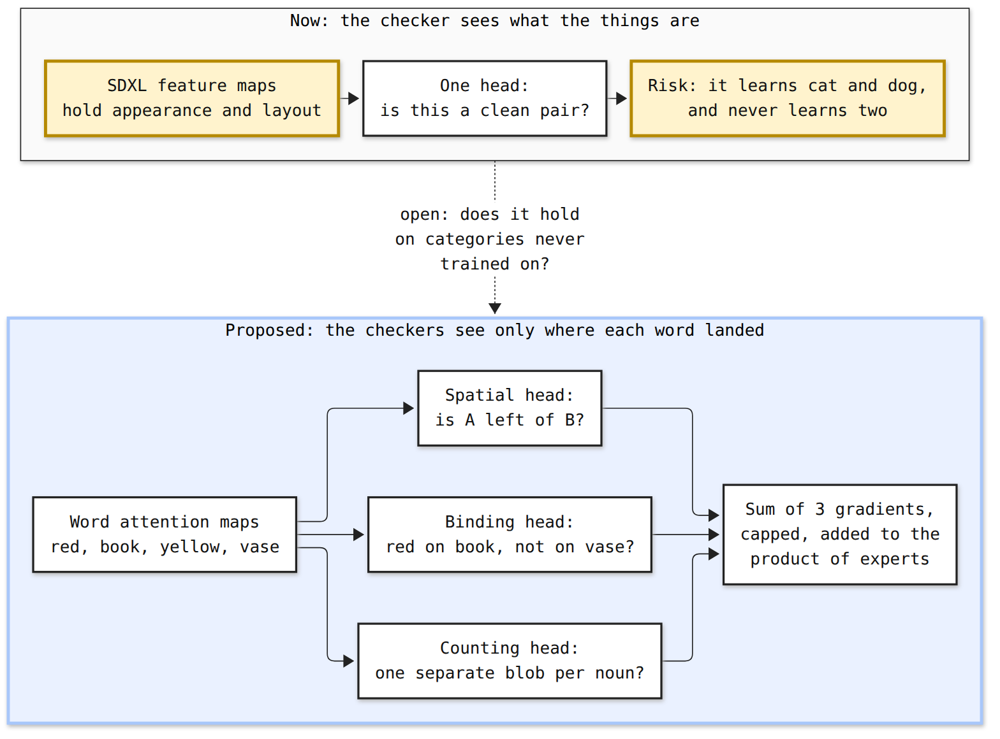
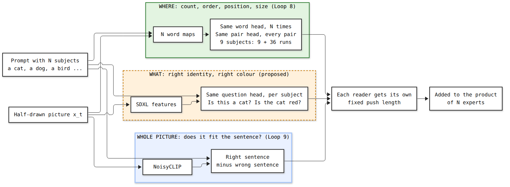
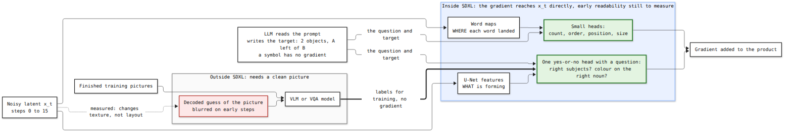
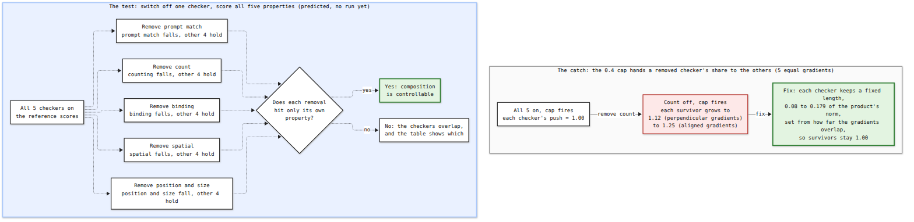

# 🌍 Context: the digit-map checkers, one sampler step

⬅️ Previous: [the methods index](../00-INDEX.md) | 📋 [The pages of this method](#the-pages-of-this-method) | Next: [the network view](02-the-network-view.md) ➡️

The digit-map checkers are two small classifiers Loop 8 trains on noisy digit canvases. The count checker answers "two digits, one in each half?" and the identity checker answers "the two asked digits?". Both read the same thing: two maps of where each asked digit acts, made by asking a frozen digit U-Net for each digit and for no digit. Neither is ever told which digits were asked. While a picture is drawn, the gradient of a checker's one output number is subtracted from the digit product's noise prediction at a fixed length, and that push is what this method adds to the sampler. What the product of experts is, and the piece it leaves out, are on [the product-of-experts overview](../01-the-product-of-experts/01-overview.md) and [PoE composition](../../world/poe-composition.md#what-poe-composition-is). This folder adds the zoom ladder's pictures, a four-pixel miniature where every number can be followed by hand, and the code. Every picture here comes from [the digit-map checkers ladder](../../../2-classifier-guidance/artifacts/scenes/digit-map-checkers/README.md) unless its caption names another source.

*One sampling step of Loop 8's method, left to right. The blue tile is a half-drawn canvas x_t of 32 × 64 pixels, asked for the digits 5 and 9. The grey box is the frozen canvas U-Net, called three times per step: with label 5, with label 9, and empty. The two green tiles are the maps, where asking for 5 (top) and for 9 (bottom) changes the noise guess, each scaled to a mean of 1 over the pixels. The green trapezoid is the map reader, a small CNN that gets no digit label. The bars ask "both asked digits, apart?". The orange box and arrow are the push, a fixed length b of the product's size along the gradient, sent back to the canvas. The inset opens the reader: 2 maps of 32 × 64, then 64, 64 and 128 channels down to 8 × 16, mean and max pooling to 256 numbers, then 1 logit.* ✅ *The noise on the canvas, the two maps and the bar heights are drawn to show the shape of each step, and no run produced them.* ✍️ *(the overview's card). The figure's labels "steps 0 to 15 of 50" and "b is 0.1, 0.2 or 0.4" are the design as first written; the run pushed at steps 15 to 25 with b frozen at 0.4, see [where the sources disagree](#where-the-sources-disagree).*

## Table of contents

- [Words this page uses](#words-this-page-uses)
- [What one step does](#what-one-step-does)
- [The names, taken apart](#the-names-taken-apart)
- [The push, by what moves](#the-push-by-what-moves)
- [How it fails and how you know it worked](#how-it-fails-and-how-you-know-it-worked)
- [Why the checker reads maps](#why-the-checker-reads-maps)
- [What is measured where](#what-is-measured-where)
- [Where the sources disagree](#where-the-sources-disagree)
- [The pages of this method](#the-pages-of-this-method)
- [Where this came from](#where-this-came-from)
- [Read more](#read-more)

## Words this page uses

Navigation: 📋 [TOC](#table-of-contents) | [Next](#what-one-step-does) ➡️

**Canvas**: a black picture 32 pixels tall and 64 wide, room for one handwritten MNIST digit in each half. Pixels run from −1 (background) to +1 (ink).

**Asked pair**: the two digits a canvas is drawn for or judged against, written a and b with a < b.

**Frozen digit U-Net**: one trained digit model, the share-0.0 canvas U-Net, which takes a noisy canvas, a timestep and a label (a digit 0 to 9, or 10 for no digit) and returns a noise guess ε of the canvas's shape. It drew one digit per canvas in training and never saw two together. "Frozen" means no weight of it changes here.

**Product**: the digit product of experts, ε_product = ε_a + ε_b − ε_∅, where ε_∅ is the guess with label 10. The same U-Net is asked twice, once per digit, and each answer acts as one expert.

**Logit ℓ**: the checker's one output number. σ(ℓ) = 1 / (1 + e^(−ℓ)) is its chance that the answer is yes, so ℓ = 0 is a coin toss.

**Push**: the extra arrow subtracted from the product's noise prediction at a step, built from the checker's gradient.

**The miniature**: the ladder's four-pixel toy, worked in full on [the miniature page](03-the-miniature.md). Its weights are set by hand; its noise level is the real one at timestep 480.

## What one step does

Navigation: ⬅️ [Words this page uses](#words-this-page-uses) | 📋 [TOC](#table-of-contents) | [Next](#the-names-taken-apart) ➡️

**At each pushed step the frozen U-Net runs three times, the product and the two maps are both made from those three runs, the checker turns the maps into one logit, and the logit's gradient is subtracted from the product at 0.4 of the product's length.** ✅ Read in `make_push` in the V3 script and `sample` in the canvas U-Net script (see [the code page](04-the-code.md#the-push-in-the-sampler)).

*The ladder's level-0 picture. Grey is frozen, green is the trained checker, red is what a network outputs, orange is the backward signal and the push. The top row makes the product, the middle row runs the checker from the two maps (2 × 32 × 64) to one logit, and the bottom row carries ∇_{x_t}ℓ back to a canvas-shaped gradient, scales it to b = 0.4 of the product's length, and subtracts it before the DDIM step.* ✅ *The figure's footer says no pushed run exists; that was true when the ladder was drawn, and step V3 has since run (job 94134).* ✍️ *([the push finding](../../../2-classifier-guidance/report/abstract-checkers-on-digits/does-the-count-checkers-push-compose-unseen-digits.md#1-the-push-separates-the-fused-digit))*

Each box has a twin in the miniature and in the real runs:

| Box | In the miniature | In the real runs |
|---|---|---|
| the noisy canvas | four pixels, left half p₁ p₂ and right half p₃ p₄ ✅ | 1 × 32 × 64 ✅ |
| the three frozen calls | a hand-set expert: ε_∅ = 0.9 x, and asking for digit y subtracts 0.5 T_y σ(3x), where T_y says where y has ink ✅ | the share-0.0 canvas U-Net with labels a, b and 10 ✅ |
| the two maps | each adds to 4 over the 4 pixels ✅ | each adds to 2,048 over the 2,048 pixels ✅ |
| the checker | one convolution of 2 channels, a scale and shift from the timestep, mean and max, one readout ✅ | `PixelHead` with its first layer taking 2 channels, 481,665 weights ✅ |
| the logit on the apart canvas, asked 1 and 3, at t = 480 | 0.772, from untrained hand-set weights ✅ | 6.308, from the saved count checker ✅ |
| the push | b = 0.4 at one step ✅ | b = 0.4 at sampler steps 15 to 25 of 50, timesteps 693 to 489 ✅ |

## The names, taken apart

Navigation: ⬅️ [What one step does](#what-one-step-does) | 📋 [TOC](#table-of-contents) | [Next](#the-push-by-what-moves) ➡️

**Each name points at one part of the picture above.** The miniature and the real numbers below are marked with where they come from.

🔤 **The name:** digit map
- **digit**: one of the ten handwritten numerals. Here, one of the two asked digits, a or b.
- **map**: a picture of where something is. On the opening picture, the two green tiles: bright where asking the U-Net for that digit changes its noise guess, pale where it changes nothing.
- **Formula, in those words:** m_a = 2048 · |ε_a − ε_∅| / Σ_pixels |ε_a − ε_∅|. The difference is what asking for a adds; the absolute value keeps its size and drops its sign; dividing by the total and multiplying by 2,048 makes the map's mean 1, so only its shape is kept.
- **Consequence:** on the saved count checker's run for the apart canvas asked 1 and 3 at t = 480, the map for 3 puts 93% of its mass in the right half, where the 3 is, and the map for 1 puts only 32% in the left half, where the 1 is, because it also lights up the 3. ✅ Computed from the ladder's `count-stages.npz`. A map shows where the model reacts to a digit, which is not always where that digit sits.

🔤 **The name:** count checker
- **count**: how many. Here, whether there are two digits, one per half.
- **checker**: something that answers yes or no about what it is shown. On the picture, the green trapezoid and its one logit.
- **Formula, in those words:** label 1 for a canvas with two digits one per half (the kinds `apart` and `wrong`), label 0 for `overlaid`, `same_half` and `single`. Which digits they are never changes the label.
- **Consequence:** the `wrong` canvas showing 3 and 2 for the asked pair 1 and 3 is a yes to the count checker. On the miniature, one training step with that label raises the wrong canvas's logit from 0.352 to 0.997 and the apart canvas's from 0.772 to 1.459. ✅ The miniature's answer key.

🔤 **The name:** identity checker
- **identity**: which one a thing is. Here, whether the two digits are the asked ones.
- **Formula, in those words:** the same network trained only on `apart` (label 1) against `wrong` (label 0). Both kinds have two digits apart, so layout cannot tell them apart and only what each blob is can.
- **Consequence:** flip the `wrong` canvas's label from 1 (count) to 0 (identity) and the same miniature step lowers both logits, the apart canvas from 0.772 to 0.565 and the wrong one from 0.352 to 0.146, so the gap between them barely moves (0.4205 to 0.4192). ✅ The miniature's answer key. The real identity checker read little above chance on the pairs holding digit 4, per [the learning finding, section 3](../../../2-classifier-guidance/report/abstract-checkers-on-digits/does-a-checker-learn-plurality-on-unseen-digits.md#3-split-in-two-the-count-checker-passes-and-the-identity-checker-misses). ✍️

🔤 **The name:** push
- **push**: a shove in one direction. On the picture, the orange box and the orange arrow back to the canvas.
- **Formula, in those words:** take the direction in which the logit rises fastest at the noisy canvas, g = ∇_{x_t}ℓ, set its length to b times the product's length, and subtract it from the product's noise prediction.
- **Consequence:** with no push the plain product drew 0 clean pairs of 320 on the ten pairs among digits 5 to 9; with the count checker's push it drew 43. ✍️ [The push finding, section 1](../../../2-classifier-guidance/report/abstract-checkers-on-digits/does-the-count-checkers-push-compose-unseen-digits.md#1-the-push-separates-the-fused-digit).

## The push, by what moves

Navigation: ⬅️ [The names, taken apart](#the-names-taken-apart) | 📋 [TOC](#table-of-contents) | [Next](#how-it-fails-and-how-you-know-it-worked) ➡️

**The sampler uses the product minus the checker's gradient direction, at a length fixed to 0.4 of the product's own length.** ✅ The colours are the ladder's: red for what a network outputs, orange for the backward signal and the push.

$$
\textcolor{#c0262d}{\underbrace{\hat\varepsilon}_{\text{what the sampler uses}}}
= \textcolor{#c0262d}{\underbrace{\varepsilon_{\text{product}}}_{\varepsilon_a + \varepsilon_b - \varepsilon_\varnothing}}
- \underbrace{\lVert\varepsilon_{\text{product}}\rVert}_{\text{the product's length}}\;
\underbrace{b}_{0.4}\;
\textcolor{#c86a0a}{\underbrace{\frac{g}{\lVert g\rVert}}_{\text{the checker's direction, length 1}}}
$$

The worked case is the miniature's apart canvas (it shows 1 | 3, asked 1 and 3) at t = 480, with the hand-set, untrained head. The values are per pixel, p₁ p₂ | p₃ p₄. ✅ The miniature's answer key, and the arithmetic redone this session.

| Symbol | On the miniature's apart canvas | If it grew |
|---|---|---|
| ε_product | (−0.223, −0.290, −0.042, −0.831), length 0.909 | the push grows with it, so the push is always the same share of the prediction |
| g | (−1.258, 0.480, 0.470, −0.208), length 1.441 | nothing changes: multiply g by 10 and the push is still (−0.317, 0.121, 0.119, −0.052) |
| b | 0.4 | doubled to 0.8, the push doubles to length 0.727 and p₁ of ε̂ moves from 0.094 to 0.412 |
| push = ‖ε_product‖ b g / ‖g‖ | 0.909 × 0.4 / 1.441 = 0.252 times g: (−0.317, 0.121, 0.119, −0.052), length 0.364 = 0.4 × 0.909 | |
| ε̂ = ε_product − push | (0.094, −0.411, −0.160, −0.779) | |

**What the push does to the clean-canvas guess.** The sampler's guess of the clean canvas is x̂₀ = (x_t − √(1 − ᾱ_t) ε̂) / √ᾱ_t. Subtracting the push from ε̂ adds √(1 − ᾱ_t) / √ᾱ_t = 0.951 / 0.308 = 3.09 times the push to x̂₀, so at t = 480 the guess moves by (−0.98, +0.37, +0.37, −0.16): along g, the way the logit rises. ✅ On the real canvas at the same timestep the product's length is 45.79, so a push of b = 0.4 has length 18.3. ✅ Computed from the saved stages of the apart canvas asked 1 and 3, `count-stages.npz`.

> [!NOTE]
> Only g's direction is used. The checker's gradient can be large where it is sure and small where it is not, and dividing by ‖g‖ throws that size away. The reason is Loop 7's: a fixed length per checker means removing one checker leaves the others' pushes unchanged, and it makes the log-probability and log-odds forms of the push identical (see [why the checker reads maps](#why-the-checker-reads-maps)). 🔍 A fixed length also means a checker reading near chance still pushes at full length.

## How it fails and how you know it worked

Navigation: ⬅️ [The push, by what moves](#the-push-by-what-moves) | 📋 [TOC](#table-of-contents) | [Next](#why-the-checker-reads-maps) ➡️

**The push fails silently when the maps are built with gradients off, as training builds them: the backward pass then stops at the maps and g is zero.** ✍️ The miniature page's broken-run control, described in [its spec](../../../2-classifier-guidance/artifacts/scenes/digit-map-checkers/miniature-page/SPEC.md#what-each-control-does), shows g = (0, 0, 0, 0) with the maps detached.

💥 **Broken run (without):** the maps built under `torch.no_grad`, so the logit has no path back to the pixels.
- **Predict:** on the miniature's apart canvas, what is g?
- **Wrong:** (0, 0, 0, 0), and the push adds nothing.
- **Right**, with the maps built with gradients on: (−1.258, 0.480, 0.470, −0.208).

**The sign check.** A step of 0.01 along g raises the miniature's logit from 0.7721 to 0.7866, so subtracting the push moves the canvas the way the checker says yes. ✅ The miniature's answer key.

**It worked on the real runs** when the plain product's 0 clean pairs of 320 on the ten unseen pairs became 43 with the push, while a random push of the same length gave 1 and the best of four plain seeds picked by the checker gave 0. About half the pushed canvases (161 of 320) held two separate digits of any identity. ✍️ [The push finding](../../../2-classifier-guidance/report/abstract-checkers-on-digits/does-the-count-checkers-push-compose-unseen-digits.md#1-the-push-separates-the-fused-digit). The push moves layout, which is what the count checker reads; which digits appear is left to the product's two labels.

## Why the checker reads maps

Navigation: ⬅️ [How it fails and how you know it worked](#how-it-fails-and-how-you-know-it-worked) | 📋 [TOC](#table-of-contents) | [Next](#what-is-measured-where) ➡️

**Loop 7's reading chose maps because a checker that sees only where each word or digit acts cannot learn which things are there, so whatever it learns about two-ness has a chance to carry over to things it never trained on.** ✍️ These pictures were drawn for the SDXL version, where the maps are word attention maps; on the digit canvas each word map becomes a digit map. They were planned before any run, and the digit runs above are what tested them.

<table><tr>
<td> The risk the maps answer</td>
<td> Where this checker sits among three readers</td>
</tr></table>

*Left: the top box is the checker Loop 6 kept, one head on SDXL's features asking "is this a clean pair?", with the risk written beside it: it learns cat and dog and never learns two. The bottom box is the proposal, heads that see only where each word landed (spatial, binding, counting) whose gradients are added to the product.* ✅ *Right: three readers of a half-drawn picture. The green box, "where" (count, order, position, size), reads word maps and is labelled Loop 8; the orange dashed box, "what" (right identity, right colour), is a proposal; the blue box, "whole picture", is Loop 9's sentence score. Each reader gets its own fixed push length.* ✅

**Why the gradient can reach the canvas.** The maps are computed by the frozen model from the noisy canvas itself, so the chain rule runs from the logit through the maps and the model to x_t. A judge outside the model, reading a decoded picture, gives labels for training and no gradient. ✍️ [Where each model can reach the latent](../../../artifacts/notes/progress/abstract-checkers/01-reading/where-each-model-can-reach-the-latent.png), drawn for SDXL.

<table><tr>
<td> Inside the model the gradient reaches x_t</td>
<td> Why each push has its own fixed length</td>
</tr></table>

*Left: inside SDXL, word maps and U-Net features feed small heads whose gradient is added to the product; outside SDXL, a decoded guess blurred on early steps goes to a VLM or VQA model that only labels training pictures.* ✅ *Right: under one shared cap of 0.4, switching the count checker off makes each surviving push grow from 1.00 to 1.12 (perpendicular gradients) or 1.25 (aligned gradients); giving each checker its own fixed length keeps the survivors at 1.00. Labelled "predicted, no run yet".* ✅ *The digit removal test has since run, with three checkers: see [the removal finding](../../../2-classifier-guidance/report/abstract-checkers-on-digits/does-removing-one-checker-remove-its-property.md#2-the-removal-table-960-canvases-per-row).* ✍️

**Why the count checker comes first.** Adding two checkers' log-probabilities is exact only when their labels are independent given the noisy picture, and "right order" cannot hold without "two subjects". On Loop 7's small worked example the summed gradient is 2.619 where the true one is 2.048, 27.9% too large; training the later checker only on pictures the count checker passes recovers 2.048 by the chain rule. ✍️ [The score view, steps 6 and 7](../../../artifacts/notes/progress/abstract-checkers/02-score-view.md#step-7-the-chain-rule-removes-the-assumption), with the chain drawn in [five checkers as a chain](../../../artifacts/notes/progress/abstract-checkers/01-reading/five-checkers-as-a-chain.png).

## What is measured where

Navigation: ⬅️ [Why the checker reads maps](#why-the-checker-reads-maps) | 📋 [TOC](#table-of-contents) | [Next](#where-the-sources-disagree) ➡️

**Every miniature number is illustrative except its noise level and time features; every real-run number is quoted from where it was measured, and the verdicts belong to the findings.**

| Statement | Measured on | Mark and source |
|---|---|---|
| the miniature's logits, losses, gradients and push | the hand-set four-pixel toy at the real t = 480 | ✅ the miniature's answer key |
| the checker has 481,665 trained weights | counted from the code | ✅ the ladder's numbers file, layer by layer, re-added this session |
| the saved count checker's logits on four example canvases at four timesteps (apart 1 \| 3 rises from 0.543 at t = 712 to 6.308 at t = 480; wrong 3 \| 2 is negative at three of the four) | the real count checker, job 94116 | ✅ read in `count-stages.npz` and `count-explained.npz`, which agree |
| the count checker reads two digits apart at 0.791 balanced accuracy on digits 5 to 9 and 0.782 on digits 0 to 4 | the real count checker, job 94108, W&B `tyhrpyov` | ✍️ [the learning finding, section 4](../../../2-classifier-guidance/report/abstract-checkers-on-digits/does-a-checker-learn-plurality-on-unseen-digits.md#4-the-count-checker-on-digits-5-to-9); the ladder's `count-final.json` holds 0.7908 and 0.7818 ✅ |
| the identity checker reads little above chance on the pairs holding digit 4 | job 94085 | ✍️ [the learning finding, section 3](../../../2-classifier-guidance/report/abstract-checkers-on-digits/does-a-checker-learn-plurality-on-unseen-digits.md#3-split-in-two-the-count-checker-passes-and-the-identity-checker-misses) |
| the count checker's push draws 43 clean pairs of 320 on unseen digits against 0 plain | job 94134, W&B `qhusod91` | ✍️ [the push finding](../../../2-classifier-guidance/report/abstract-checkers-on-digits/does-the-count-checkers-push-compose-unseen-digits.md#1-the-push-separates-the-fused-digit) |
| removing one of three checkers removes its property and only its property | job 94186, W&B `j4anxfgy` | ✍️ null by the written rule, [the removal finding](../../../2-classifier-guidance/report/abstract-checkers-on-digits/does-removing-one-checker-remove-its-property.md#3-which-removal-meets-the-rule) |
| the canvases rebuild to the same data hash, and a zero push changes no pixel | job V1, W&B `xv6mbklb` | ✍️ [the environment finding](../../../2-classifier-guidance/report/abstract-checkers-on-digits/is-the-small-environment-repeatable.md#2-a-zero-push-changes-no-pixel) |

**Balanced accuracy**, the score every bar here uses, is the mean of the share of yes-canvases called yes and the share of no-canvases called no. On the identity test's 400 `apart` and 100 `wrong` canvases, a checker that says yes to everything is right on 400 of 500 (0.8) and has a balanced accuracy of (1 + 0) / 2 = 0.5, which is chance. ✅ Counts from the ladder's numbers file; the example is the ladder's [rebuild companion, rung 17](../../../2-classifier-guidance/artifacts/scenes/digit-map-checkers/rebuild-from-fundamentals.md#rung-17-balanced-accuracy-averages-the-two-classes-hit-rates).

## Where the sources disagree

Navigation: ⬅️ [What is measured where](#what-is-measured-where) | 📋 [TOC](#table-of-contents) | [Next](#the-pages-of-this-method) ➡️

**Three places where two records say different things about this method. These pages report both and resolve none.**

| What | One source | The other source |
|---|---|---|
| Which steps the push acts on | [Loop 7's checker design](../../../artifacts/notes/progress/abstract-checkers/03-design.md), line 163 ("Checker push, steps 0 to 15"), and the opening picture's "steps 0 to 15 of 50" | `WINDOW` in the V3 script (line 33: the timesteps from 480 to 712, which are sampler steps 15 to 25) and the trace's `push_steps` (693 to 489) |
| What each map adds to | the design, line 69: each map "adds to 1"; the learning finding's word list: "scaled to add to 1" | `maps` in `v2_learn.py`, lines 85 to 98, and the ladder: each map is multiplied by 2,048 and adds to 2,048, mean 1 |
| Whether a pushed run exists | the ladder's level-0 and push figures: "no pushed run exists yet" | the push finding: job 94134 ran it, and job 94161 traced every step |

## The pages of this method

Navigation: ⬅️ [Where the sources disagree](#where-the-sources-disagree) | 📋 [TOC](#table-of-contents) | [Next](#where-this-came-from) ➡️

**The pages go from this one step down to the code, in the order of the ladder's rungs.**

1. This page: one sampler step, the names, the push equation, and the background (ladder level 0).
2. [The network view](02-the-network-view.md): the canvas and its noise, the two maps, the network layer by layer, the two label sets, and the two backward passes (level 0.5).
3. [The miniature](03-the-miniature.md): the four-pixel toy with every number, one training step per branch, the push on four pixels, and the interactive page that plays it on real runs (levels 2 and "2, to play", merged).
4. [The code](04-the-code.md): where each box lives, block by block (level 3).

The ladder's level 1, three illustrations of the idea, is written as prompts and not rendered, so it has no page. The ladder's closing page and its rebuild companion are linked under [read more](#read-more).

## Where this came from

Navigation: ⬅️ [The pages of this method](#the-pages-of-this-method) | 📋 [TOC](#table-of-contents) | [Next](#read-more) ➡️

| What | How it was established | When |
|---|---|---|
| The step: three calls, product, maps, checker, push of fixed length | Read in `v3_compose.py` lines 50 to 66 and `canvas_unet.py` lines 172 to 177 and 214 to 220 | 2026-11-24 |
| The push window, sampler steps 15 to 25 | Read in `v3_compose.py` line 33 and the ladder's `trace.json` | 2026-11-24 |
| The share-0.0 U-Net never saw two digits together | Stated by the push finding's "What a canvas is" and the canvas U-Net's docstring | 2026-11-24 |
| The miniature's values, the worked push and the b = 0.8 and 10 g cases | Read in `miniature_answer_key.json`; the variants computed from its values | 2026-11-24 |
| The real logits, the map shares 93% and 32%, the product length 45.79 | Computed from the ladder's `count-stages.npz` (job 94116) with numpy | 2026-11-24 |
| What the opening picture draws as illustrative | Stated by the annotated overviews' card | 2026-11-24 |
| Loop 7's reasons and numbers (2.619, 2.048, 27.9%, 1.12, 1.25) | Read on the four pictures at full size and in the score view | 2026-11-24 |
| Every real-run count and verdict | Read in the four findings under `2-classifier-guidance/report/abstract-checkers-on-digits/` | 2026-11-24 |

## Read more

Navigation: ⬅️ [Where this came from](#where-this-came-from) | 📋 [TOC](#table-of-contents)

| What | Where |
|---|---|
| Each equation down to the rungs the learning tree teaches, with links to the textbook pages | [the ladder's rebuild companion](../../../2-classifier-guidance/artifacts/scenes/digit-map-checkers/rebuild-from-fundamentals.md) |
| One canvas walked through both checkers, as the ladder closes | [the ladder's closing page](../../../2-classifier-guidance/artifacts/scenes/digit-map-checkers/read-through-a-small-network.md) |
| The mathematics of adding checker gradients | [Loop 7's score view](../../../artifacts/notes/progress/abstract-checkers/02-score-view.md) |
| The full design, every bar written before the runs | [Loop 7's checker design](../../../artifacts/notes/progress/abstract-checkers/03-design.md) |
| The product this push is added to | [the product-of-experts overview](../01-the-product-of-experts/01-overview.md) |

⬅️ Previous: [the methods index](../00-INDEX.md) | 📋 [The pages of this method](#the-pages-of-this-method) | Next: [the network view](02-the-network-view.md) ➡️

<!-- built-to: PAGE_LOOK_FORMAT v1 -->
